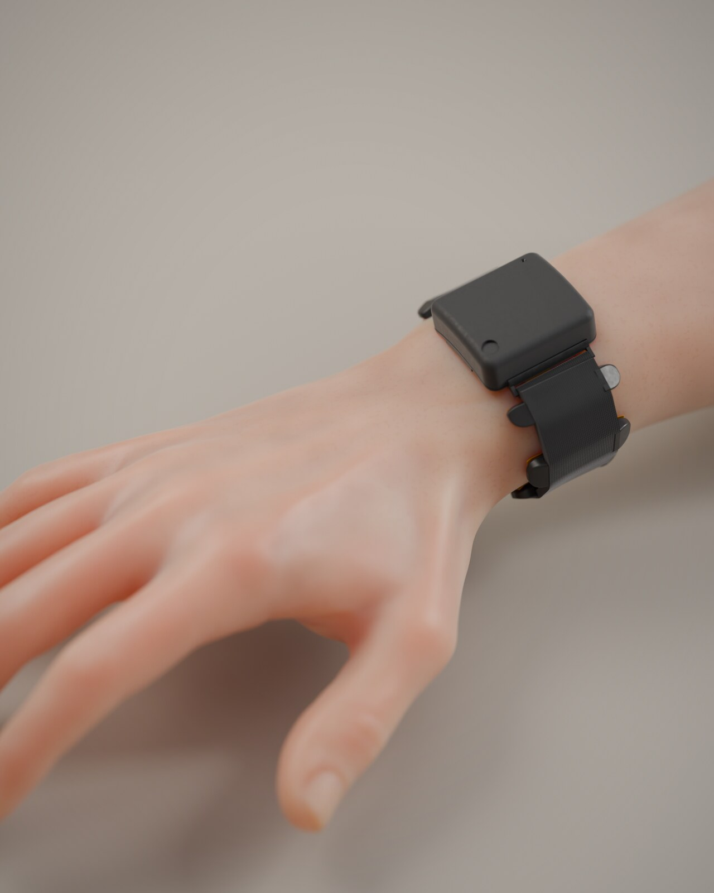
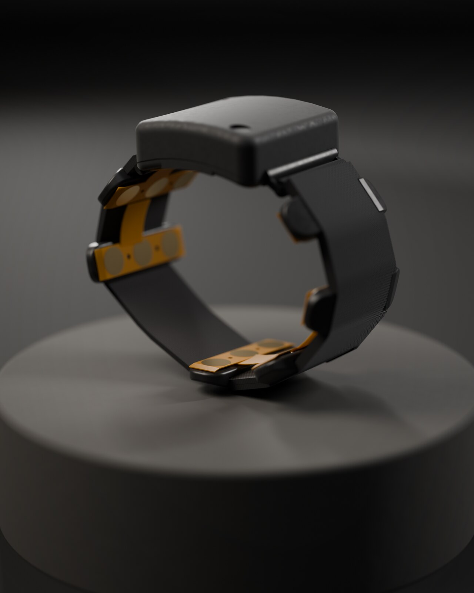
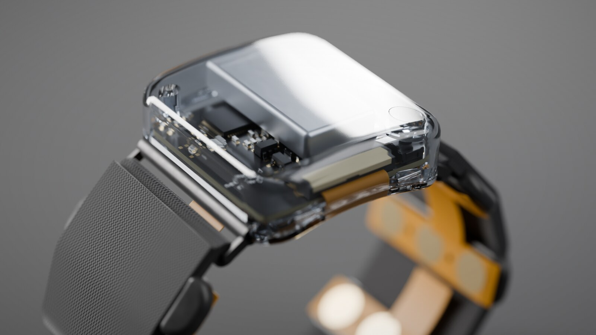
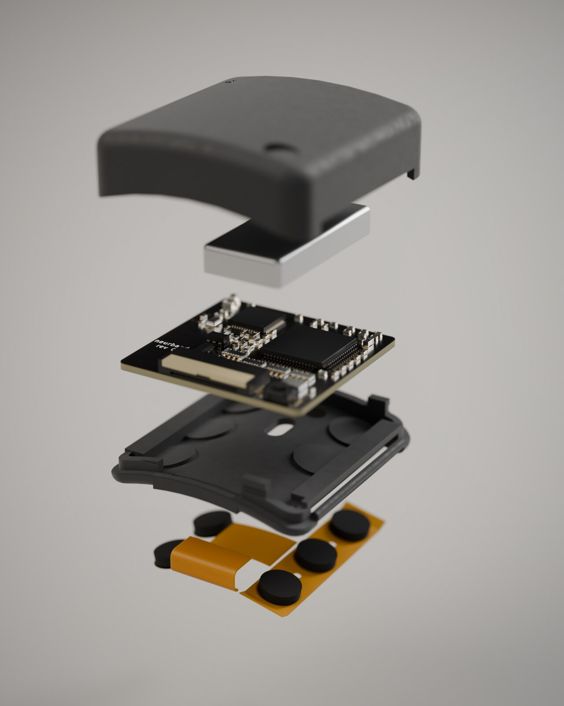
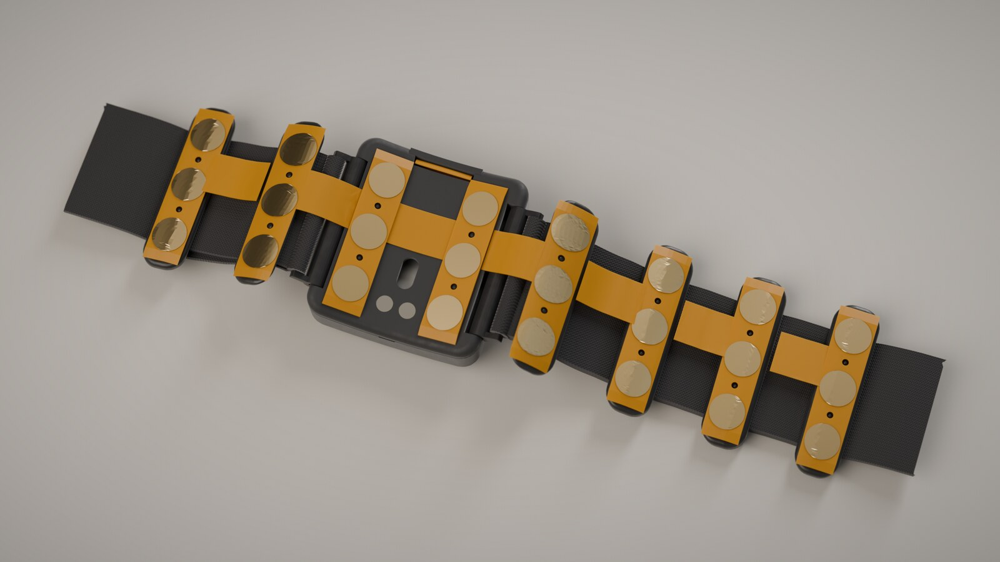
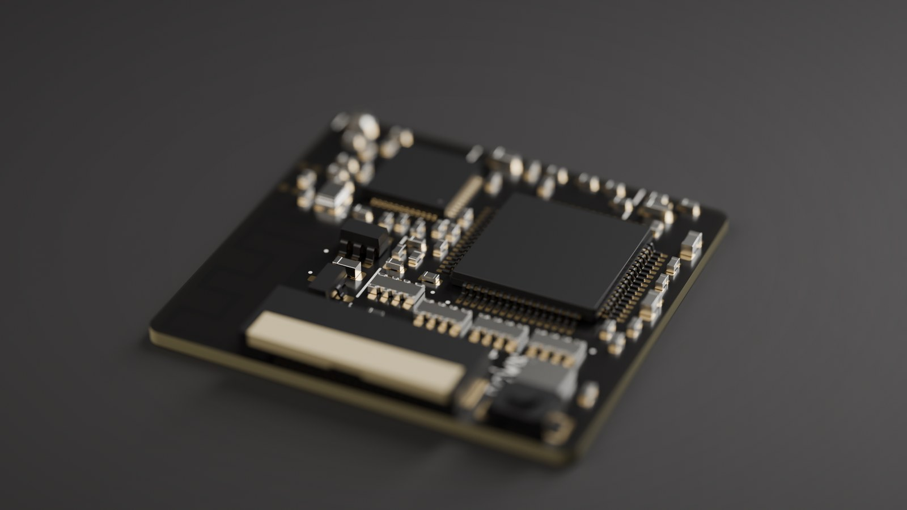
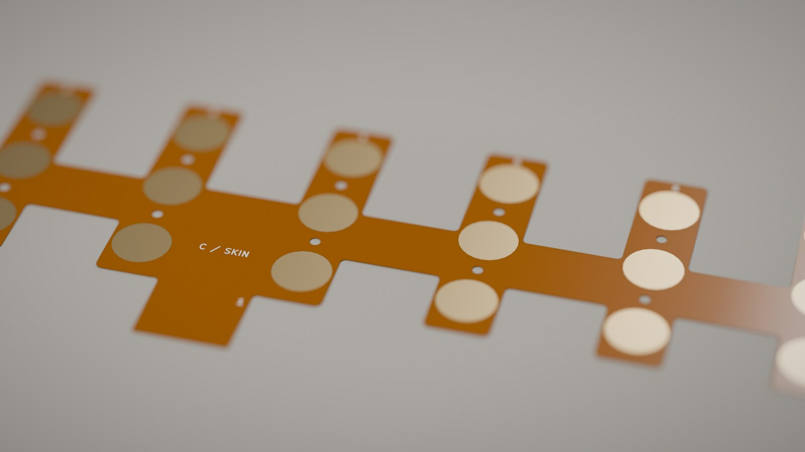
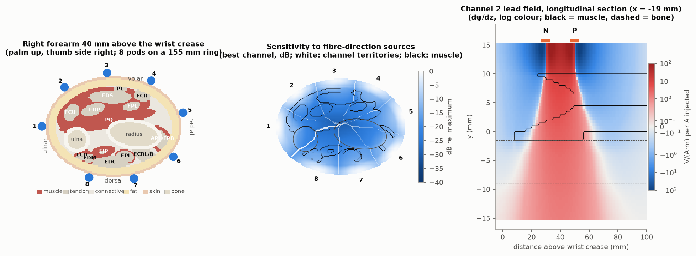
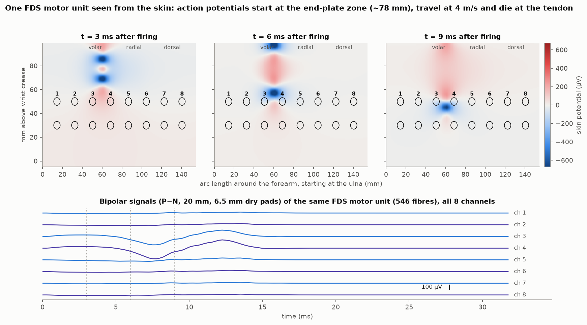

# neurband

**An open, minimal, ~$200 copy of Meta's sEMG wristband.** Eight bipolar surface-EMG channels around the
wrist, a 24-bit biopotential front end, Bluetooth LE, and a module the size of a small watch face — designed
from first principles to record data good enough to train gesture models, and cheap enough to just build.



> **Status: design complete, not yet built.** Schematics, both PCBs (DRC-clean), mechanics, firmware
> (compiles, untested on hardware), recorder and analysis code are done; everything below that says
> "simulated" or "estimated" has not been measured on a real board yet. See [what's next](#status-and-next-steps).

| | |
|---|---|
| Channels | 8 bipolar (P–N 20 mm along the forearm) + a driven bias pad in every pod |
| Front end | TI ADS1298, 24 bit, gain 6, 4 kSPS acquisition, ~1.2 µVrms (20–850 Hz) |
| Electrodes | 24 dry 6.5 mm ENIG gold pads on a 2-layer polyimide flex, foam-backed, 1 mm proud |
| Radio | nRF52832, BLE 5 2M PHY, printed antenna; 2 kSPS × 8 ch, 16-bit stream |
| IMU | LSM6DSL accel + gyro, 208 Hz |
| Power | 100 mAh LiPo, ~10 h streaming; magnetic charger that only fits when the band is off the wrist |
| Module | 31.9 × 34.3 × 9.9 mm, ~15 g total, one size for 145–180 mm wrists |
| Cost | ≈ $195–240 for a first build incl. flex, prints and off-the-shelf parts ([breakdown](docs/rev_c/cost.md)) |

## Gallery

| | |
|---|---|
|  |  |
|  |  |
|  |  |

More in [docs/renders.md](docs/renders.md).

## How it works

```
 skin ─ 8 pods × (P, bias, N) gold pads ─ polyimide flex (GND-shielded) ─ 20-pin FPC
   └─ main board 28.7 × 27 mm, 4 layers, one-sided assembly
        ADS1298 ─ 16 × 4.7 kΩ inputs, bias amp (1 MΩ‖4.7 nF → all middle pads), filtered AVDD/2 reference
          │ SPI
        nRF52832 ─ printed 2.4 GHz antenna ─ BLE ─► nRF52840 USB dongle ─► host/neurband_ble.py ─► .npz
          ├ LSM6DSL IMU, button (wake/marker), LED
        LiPo ─ XC6206 3.3 V ─ RC filter ─ AVDD          charge pads (recessed) ─ TP4054
```

The design copies what matters in Meta's research band (*A generic non-invasive neuromotor interface for
human-computer interaction*, Nature 2025): bipolar gold contacts 20 mm apart along the forearm, µV-level noise,
2 kHz data. It drops what only costs money: per-pod amplifiers, 16 channels, custom electrodes.
The reasoning, decision by decision, is in [docs/rev_c/README.md](docs/rev_c/README.md).

## The science, checked before building

Four independent reviews and simulations went into this design:

- **Signal chain** ([docs/science/signal_chain.md](docs/science/signal_chain.md)): noise budget, dry-contact
  impedance, mains pickup, sampling and BLE throughput, with pass/fail bench gates.
- **Circuit simulation** ([docs/science/simulations.md](docs/science/simulations.md), ngspice): bias-loop
  stability (57° worst-case phase margin), mains residual (≤ 1.5 µV on battery), RF filtering, radio-burst
  coupling — which is why the bias reference is filtered.
- **Forearm volume-conductor model** ([docs/science/emg_forward_model.md](docs/science/emg_forward_model.md)):
  a 3-D finite-difference model of the distal forearm (bones, muscles, fat, skin, anisotropic muscle), lead
  fields of all 8 channels, travelling motor-unit action potentials. 8 channels separate single muscles at
  98–100 %; pad size, spacing and band rotation are quantified.
- **Data & models** ([docs/science/data_and_models.md](docs/science/data_and_models.md)): what 8-channel wrist
  EMG can decode, how to use Meta's open datasets, a first-week recording protocol, and a working pipeline.

| | |
|---|---|
|  |  |

**Honest expectations** (per user, with calibration): 6–8 hand/wrist postures at ~90–98 %, pinches and thumb
swipes at ~75–90 %, 2-axis wrist control. Not expected: models that work across people without calibration,
typing, fluent handwriting.

## Build one

1. **Order** the main board (assembled) and the electrode flex through the fab files in
   `boards/neurband_c/` and `boards/neurband_c_flex/` (`*.fab.json`). Print `mech/rev_c/` parts
   (MJF PA12 / TPU, or PETG/TPU on your own printer). Buy the off-the-shelf bits in
   [docs/rev_c/cost.md](docs/rev_c/cost.md) (LiPo 401225, magnetic charge pins, nRF52840 dongle, Pico as SWD probe,
   25 mm elastic webbing, foam discs).
2. **Assemble**: foam discs under each pad, pods onto the flex, flex tail into J1 (contacts toward the board),
   cell onto the battery pads, close the module. Details: [docs/mech/mechanical_c.md](docs/mech/mechanical_c.md).
3. **Flash** `firmware_c/` (Zephyr) over SWD with any CMSIS-DAP probe; follow the bring-up checklist in
   [docs/firmware_c.md](docs/firmware_c.md) (ADC ID, test signal, shorted-input noise, then skin).
4. **Record**: `python3 host/neurband_ble.py -o rec.npz`, and in a second terminal
   `python3 -m analysis collect basic --out data/s1`.
5. **Check and train**: `python3 -m analysis report data/*.npz`, `python3 -m analysis train data/*.npz`.
   Try the whole pipeline without hardware: `python3 -m analysis synth /tmp/nb`.

**Safety.** Wear it only while it runs on its own battery. Never connect a charger, USB cable, debugger or
grounded instrument while the pads touch skin. This is a research prototype, not a medical device.

## Repository

| Path | What |
|---|---|
| `boards/neurband_c/` | main board: schematic generator (`gen_c_sch.py`), KiCad project, layout scripts |
| `boards/neurband_c_flex/` | electrode flex: schematic + parametric PCB generator |
| `mech/rev_c/` | FreeCAD scripts and STEP for module, pods, strap, charger, fit checks |
| `firmware_c/` | nRF52832 Zephyr firmware |
| `host/` | BLE recorder and packet tests |
| `analysis/` | quality gates, features, baseline models, collection prompts, Meta dataset reader |
| `sim/` | ngspice AFE simulations and the forearm EMG forward model |
| `render/` | Blender pipeline for the images (`python3 render/make_renders.py`) |
| `docs/` | design notes, reviews, science, layout and mechanical docs |
| `archive/` | rev A (16 ch, ESP32, 54 × 34 mm) and rev B (compact 16 ch, unfinished) |
| `tools/` | the small Python KiCad schematic generator used for every schematic |

## Status and next steps

- [x] Rev C schematic, main board (DRC 0), flex (DRC 0), mechanics, fit checks on 145/160/180 mm wrists
- [x] Firmware compiles; host recorder and analysis pipeline tested on synthetic data
- [ ] Build two boards; bench gates: shorted-input noise, mains residual, radio-on noise, bias-loop stability
- [ ] Antenna tuning (π network on the board), BLE throughput on a real link
- [ ] First week of recordings with the protocol in `docs/science/data_and_models.md`

## Credits

Research summary of Meta's work in [docs/research/meta_semg_research.md](docs/research/meta_semg_research.md).
Human model: Blender Studio "Human Base Meshes" (CC0). KiCad stock libraries. Meta's datasets referenced here are
CC BY-NC 4.0.
