# neurband rev C: assembly manual

This manual is for a first build. You need basic soldering skills: two wires onto two pads, and four
onto a probe. You don't need a sewing machine, a hole punch, or glue other than one drop of CA per
pogo pin. Each figure answers one question: which part, where it goes, which way round, and what the
interface looks like up close.

- **Colours.** Every part has one colour throughout (legend in 0.1).
- **What each step adds.** The parts being added have an **orange outline**. Parts already in place
  are drawn normally or see-through, and parts not needed yet are left out.
- **Motion.** Dashed orange arrows show where a part travels.

The numbered actions under each figure refer to its labels. There is also a 24 s
[assembly animation](../media/assembly.mp4) ([GIF](../media/assembly.gif)), and a printable copy of
this manual: [neurband_build_manual.pdf](neurband_build_manual.pdf).

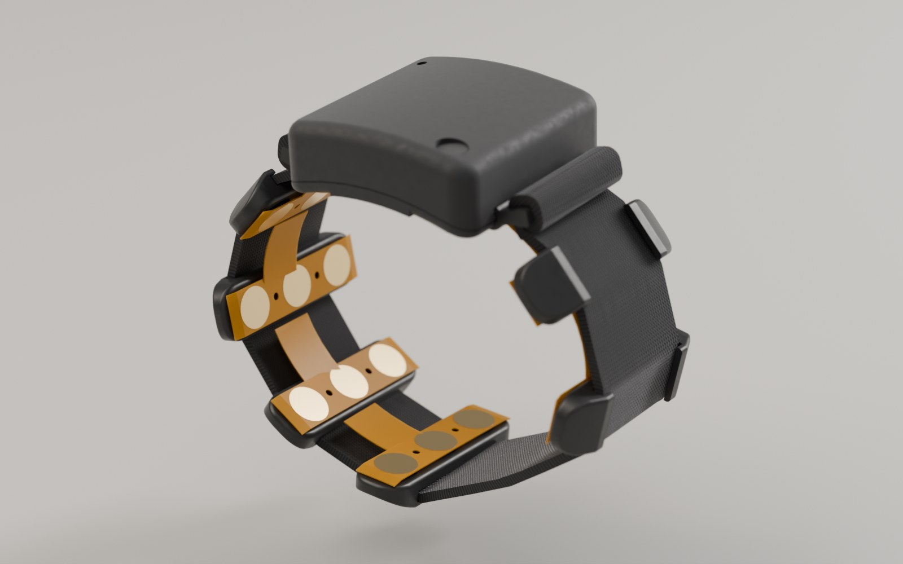

## Figure index

| Figure | Shows |
|---|---|
| [0.1](#01-kit-of-parts) Kit of parts | Every part and tool, with quantities and the colour legend |
| [0.2](#02-names-and-directions) Names and directions | The words used later: J1 end, button side, antenna side, pods 1-8, slides A/B, the gap; how it sits on the arm |
| [0.3](#03-exploded-overview) Exploded overview | How all parts stack, module and ring |
| [0.4](#04-one-pod-on-the-skin) One pod on the skin | Section: skin, pad, flex, foam dot, pod, webbing |
| [1.1](#11-pogo-pins-into-the-swd-jig) Pins into the SWD jig | Five pins from below, their lean and height, where the CA goes |
| [1.2](#12-wiring-the-jig-to-a-pico-2) Wiring | Jig pins to Pico 2 pins; TP1-TP5 on the board |
| [1.3](#13-board-into-the-jig) Board into the jig | Which way the board sits; the pins on the test pads |
| [2.1](#21-cell-leads-onto-j2) Cell leads | J2 + and -, where the cell lies, the flat joint under Kapton |
| [3.1](#31-the-bonding-jig) The bonding jig | Nests 1, 2, 5-8, the saddle, pins, fences, ledges |
| [3.2](#32-flex-onto-the-jig) Flex onto the jig | Pads down, holes on the pins, which end is which |
| [3.3](#33-foam-dots-into-a-pod) Dots into a pod | Three dots into the pockets; one seated |
| [3.4](#34-foam-dots-into-the-base) Dots into the base | Seven dots, including the root dot |
| [3.5](#35-pods-into-their-fences) Pods into their fences | Pod turned over and pressed home; order |
| [3.6](#36-base-onto-the-saddle) Base onto the saddle | The tail through the floor slot, the base pressed home |
| [3.7](#37-the-bonded-strip) The bonded strip | The result, lifted off the jig |
| [4.1](#41-tail-into-j1) Tail into J1 | Latch up, fingers toward the board, latch down |
| [4.2](#42-book-fold-the-board-down) Book-fold | Board upright, folding, seated with the tail's U |
| [4.3](#43-lead-route-round-the-board) Lead route | The cell leads from J2 round the corner through the lead gate |
| [5.1](#51-cell-into-place) Cell into place | Lead end toward J1; the spacer for the short cell |
| [5.2](#52-button-cap-and-lid) Cap and lid | The cap on SW1, the LED hole, the four snap catches |
| [6.1](#61-slides-onto-the-hidden-bars) Slides onto the bars | Clip opening toward the bar; slide A and B |
| [6.2](#62-locking-a-webbing-end) Locking a webbing end | Under, up, over, round and back under; why it holds |
| [6.3](#63-through-the-pods) Through the pods | The webbing path 2, 1, 8, 7, 6, 5; no twist |
| [6.4](#64-setting-the-length) Setting the length | Untuck, pull, trim, seal, tuck; lengths per wrist |
| [7.1](#71-on-the-wrist) On the wrist | Where and which way round |
| [8.1](#81-building-the-charge-clip) Building the charge clip | Which pin is + and how to tell |
| [8.2](#82-clip-onto-the-module) Clip onto the module | Key into the pry notch; pins on the pads |
| [9.1](#91-opening-and-re-flashing) Opening and re-flashing | The pry notch; the board back in the SWD jig |

## Part 0: Before you start

### 0.1 Kit of parts

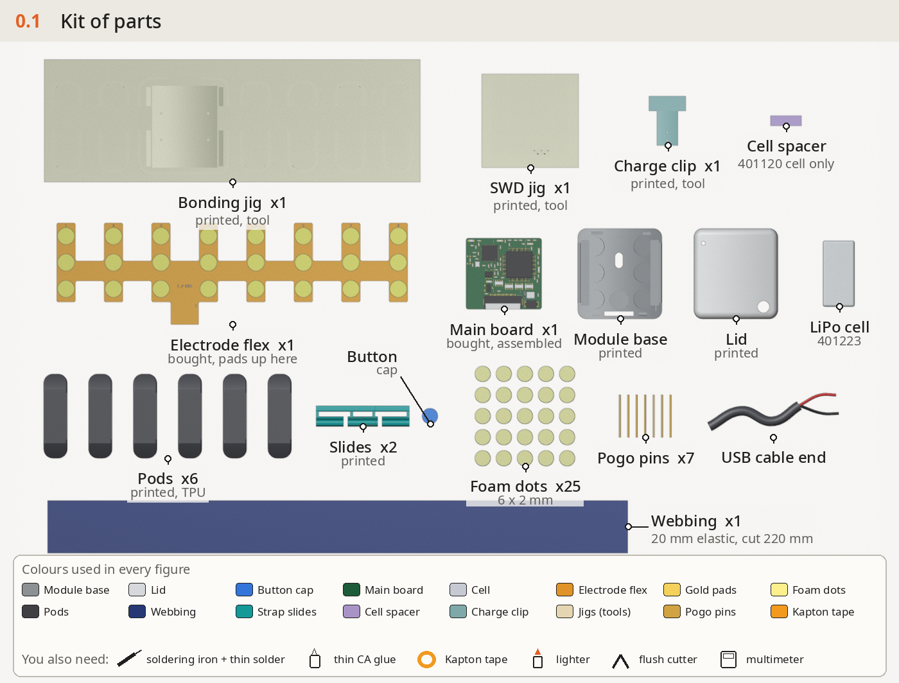

1. Check the kit against the figure. Printed parts come from Backplane (Printing, below), and the
   bought parts from the shopping list.
2. **Measure the cell** before you start: at most 12.0 x 25.0 x 4.0 mm including its little board. A
   shorter 401120-class cell also works with the **cell spacer**.
3. You need **25 foam dots**: 3 per pod (18) and 7 for the base.

### 0.2 Names and directions

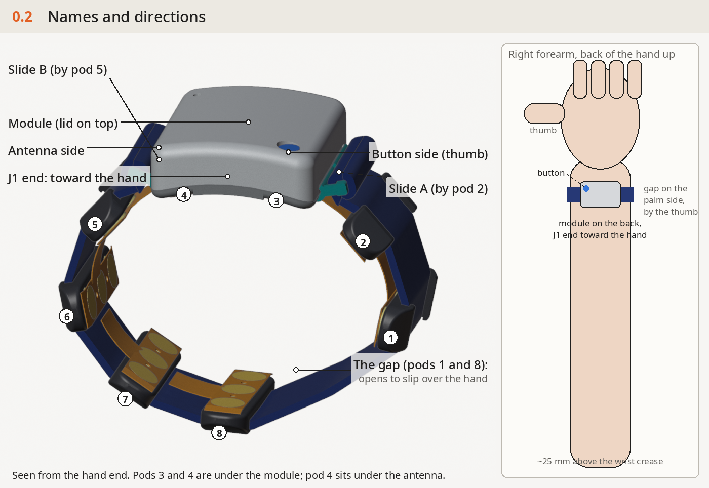

- The **J1 end** of the module points toward the hand. The **button side** goes toward the thumb, and
  the **antenna side** toward the little finger.
- **Pods 1-8** are numbered as on the flex. Pods 3 and 4 sit under the module, and pod 4 is under the
  antenna. Pods 1 and 2 are on the button side; 5, 6, 7 and 8 on the other.
- **Slide A** is next to pod 2, and **slide B** next to pod 5. **The gap** is between pods 1 and 8, on
  the palm side near the thumb. It opens when you slip the band over your hand.

### 0.3 Exploded overview

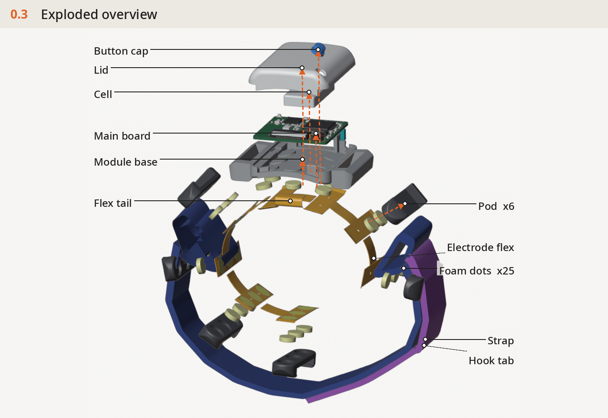

From the skin out: the **electrode flex** with its 24 gold pads, then a **foam dot** behind each pad,
then the **pods** (and the **module base** for pods 3 and 4). The **webbing** runs through all six
pods, and its ends lock round the two **strap slides** on the module. The module stacks **base**,
**main board** (the flex tail plugs into J1), **cell**, **lid** and **button cap**.

### 0.4 One pod on the skin

- **Foam dot.** It is the spring that keeps the **gold pad** on the skin, at about 3-15 kPa
  depending on how tight the loop is.
- **Flex.** It sets the 18 mm spacing between pods, so the pods always land on the same muscles.
- **Webbing.** It only slides through the pod's sleeve. When the loop stretches over your hand, the
  elastic stretches and the flex does not.

## Shopping list

Everything you buy yourself is from [sourcing.md](sourcing.md) (checked 2026-10-29, from Greece;
prices move).

| Part | Per band | Buy (pack) | ~EUR |
|---|---|---|---|
| Plain woven elastic, **20 mm x 1.5 mm**, black (1.2-1.8 mm thick works) | 220 mm | [AliExpress 1005004884068548](https://www.aliexpress.com/item/1005004884068548.html) (1 m), or [Amazon.de B0CHNPF575](https://www.amazon.de/dp/B0CHNPF575) (5 m) | 4.80 |
| Foam dots, **round 6 x 2 mm EVA, adhesive on both faces** | 25 | [Amazon.de B0GTVY9GP9](https://www.amazon.de/dp/B0GTVY9GP9) (1160) | 6.20 |
| LiPo cell with protection board, **401223 (130 mAh)**, at most 12.0 x 25.0 x 4.0 mm including its board | 1 | [AliExpress 1005013473853786](https://www.aliexpress.com/item/1005013473853786.html) | 11.10 |
| Fallback cell **401120** (about 11 x 22 x 4 mm, 50-60 mAh); it uses the printed spacer | (1) | [AliExpress 1005005450826923](https://www.aliexpress.com/item/1005005450826923.html) | 1.80 |
| Pogo pins **P50-J1** (0.68 mm, 16 mm, round tip): 5 for the SWD jig, 2 for the charge clip | 7 | [Amazon.de B0988ZMG29](https://www.amazon.de/dp/B0988ZMG29) (100), or the spear-tip [AliExpress 1005010399046797](https://www.aliexpress.com/item/1005010399046797.html) | 12.60 |
| SWD probe: **Raspberry Pi Pico 2** running [debugprobe](https://github.com/raspberrypi/debugprobe) (it can also power the bare board) | 1 | [nettop.gr](https://nettop.gr/index.php/en/raspberry-pi-en/pico/raspberry-pi-pico-kits/raspberry-pi-pico-2.html) | 5.60 |
| BLE receiver for the PC: **nRF52840 Dongle** (PCA10059) | 1 | [DigiKey](https://www.digikey.ie/en/products/detail/nordic-semiconductor-asa/NRF52840-DONGLE/9491124) | 12 |
| Kapton tape, 10 mm | 2 cm | [Amazon.de B094X62PSM](https://www.amazon.de/dp/B094X62PSM) | 6 |

That comes to about EUR 60. Buy both cells, measure them, and keep the one that fits (step 2). A
[Raspberry Pi Debug Probe](https://nettop.gr/index.php/en/raspberry-pi-en/pico/raspberry-pi-pico-kits/raspberry-pi-debug-probe.html)
(EUR 14.50) also works, but it has no 3.3 V output, so the bare board then needs power from somewhere else.

What you probably already have:

| Tool | For |
|---|---|
| Soldering iron with a fine tip, thin flux-core solder (0.5 mm) | Cell leads, probe wires, clip wires |
| Flush cutter, tweezers | Trimming leads, handling the dots |
| Thin CA glue (superglue) | One drop per pogo pin |
| An old USB cable, and a USB charger | The charge clip's lead (only the red and black wires are used) |
| Lighter | Heat-sealing the cut webbing ends |
| Multimeter | Polarity and short checks |

**What to order through Backplane.** Press **Buy it** in Backplane for:
- the assembled main board ([boards/neurband_c/ORDERING.md](../../boards/neurband_c/ORDERING.md));
- the printed parts, which are the `mech/rev_c/*.fab.json` files listed under Printing below.

**What to order from a flex service.** The electrode flex is a separate order from a flex-PCB service.
Follow [boards/neurband_c_flex/ORDERING.md](../../boards/neurband_c_flex/ORDERING.md) (0.11 mm
polyimide, ENIG, no stiffener in the tail bend).

## Printing

Every printed part is in `mech/rev_c/`. The fab chooses the orientation for MJF parts. Walls are at
least 1.0 mm everywhere (`mech/rev_c/wall_check.json`). **Tools** are only used to build or charge
the band; they are not part of it.

| Part (`.fab.json`) | Process | Ordered (per band) | Orientation | Notes |
|---|---|---|---|---|
| `module_base` | MJF PA12, grey | 3 (1) | fab's choice | Has the hidden strap bars (with a centre rib), the lead gate and the tail slot |
| `module_lid` | MJF PA12, grey | 3 (1) | fab's choice | Four snap catches; two ribs inside cage the cell |
| `button_cap` | MJF PA12, grey | 4 (1) | fab's choice | Small: easy to lose |
| `strap_slide` | MJF PA12, black | 5 (2) | fab's choice | Two-bar slide with a split C-clip |
| `cell_spacer` | MJF PA12, grey | 2 (0 or 1) | fab's choice | Only for the shorter 401120 cell |
| `pod` | FDM TPU 95A, black | 14 (6) | on its side, no supports | 0.4 mm nozzle; walls 1.0 mm (2.5 perimeters) |
| `bond_jig` (**tool**) | FDM PLA or PETG, white | 1 | flat, plate down, no supports | 0.2 mm layers. Check that all 16 small pins printed |
| `swd_jig` (**tool**) | MJF PA12, white | 1 | fab's choice | Takes five pogo pins |
| `charge_clip` (**tool**) | MJF PA12, black | 2 (1) | fab's choice | Takes two pogo pins |

## Step 1: Flash and test the bare board

### 1.1 Pogo pins into the SWD jig

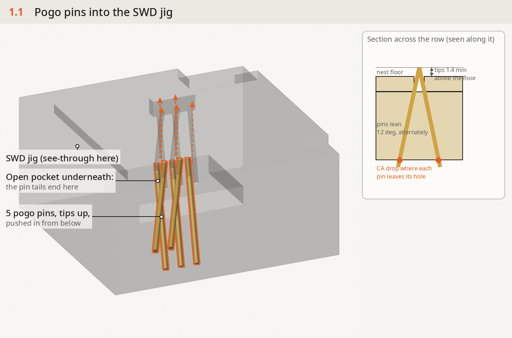

1. Push a pogo pin into each of the five holes **from below**, tip first, until the tip stands
   **1.4 mm above the nest floor** (inset). Neighbouring pins lean opposite ways; that is on purpose.
2. With all five tips level, put a **drop of thin CA** where each pin leaves its hole underneath. Let
   it set for 10 minutes.

### 1.2 Wiring the jig to a Pico 2

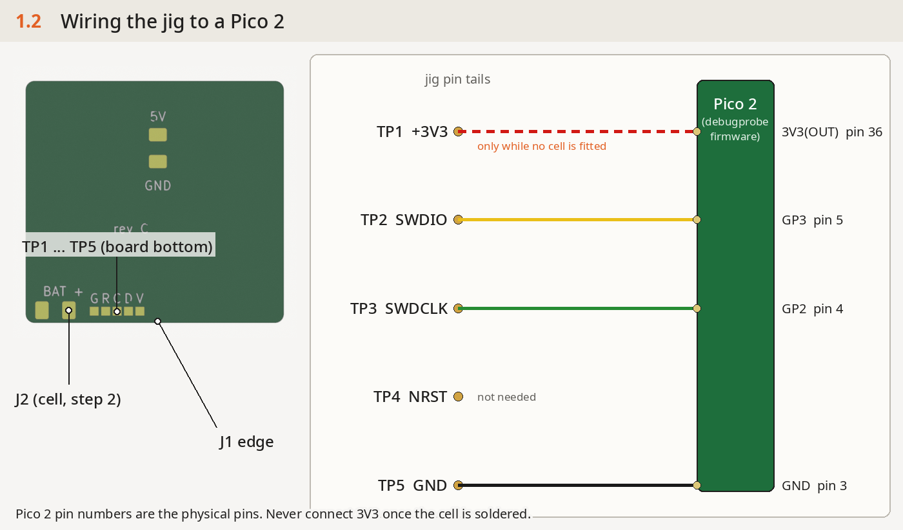

1. Solder the wires to the pin tails in the open pocket:
   - **TP2 SWDIO** to **GP3** (pin 5);
   - **TP3 SWDCLK** to **GP2** (pin 4);
   - **TP5 GND** to **GND** (pin 3);
   - **TP1 +3V3** to **3V3(OUT)** (pin 36), **only while no cell is fitted**.

   TP4 (NRST) is not needed.
2. Flash the Pico 2 with [debugprobe](https://github.com/raspberrypi/debugprobe).
3. With a meter, check that TP1 and TP5 on the board are not shorted.

### 1.3 Board into the jig

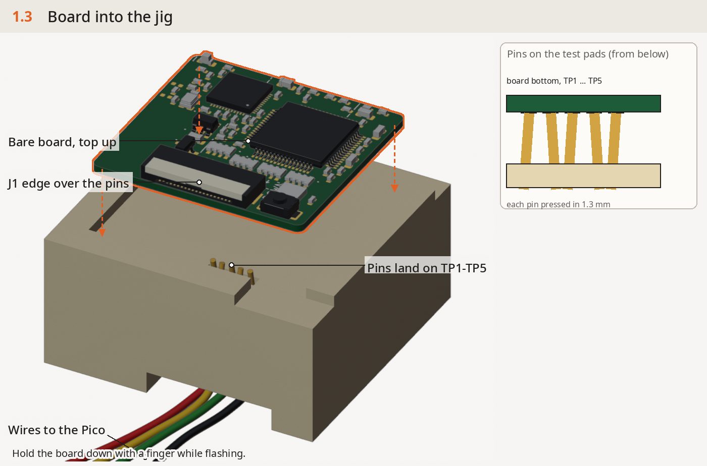

1. Lower the bare board into the nest **top up**, with its **J1 edge over the pins**. Hold it down
   with a finger while you work (inset: the pins land on TP1-TP5 on the underside).
2. Flash and test following [docs/firmware_c.md](../firmware_c.md), "Build and flash", then bring-up
   checklist items 2-7:
   - `pyocd flash -t nrf52832 build/zephyr/zephyr.hex`;
   - the RTT log shows `neurband c0.1 up`;
   - the LED flashes once a second;
   - a phone sees `neurband`;
   - the ADS ID is 0x92;
   - `--fmt 24 --mode test` shows the same square wave on all 8 channels.

   Fix any failure now, while the board is easy to reach.

## Step 2: Solder the cell leads

### 2.1 Cell leads onto J2

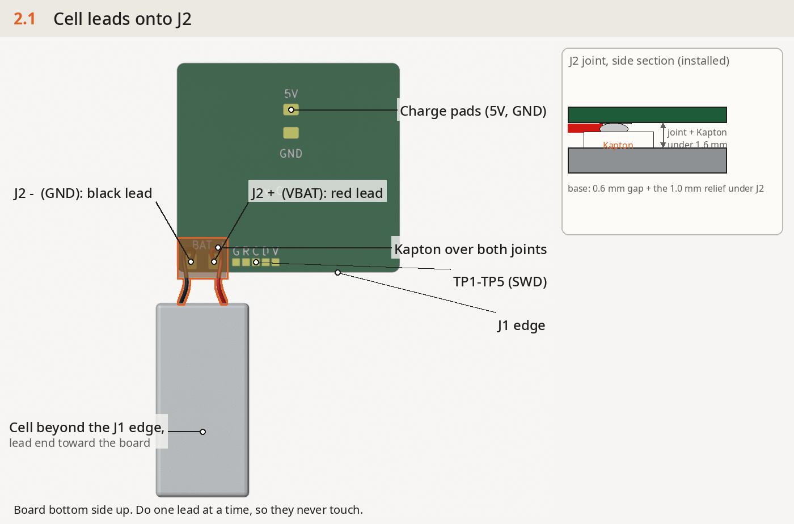

1. Lay the board **bottom side up**. Put the cell flat **beyond the J1 edge**, with its lead end
   toward the board.
2. Cut off any plug, **one lead at a time** so the leads never touch. Strip 1.5 mm and tin it. Keep
   the leads long: about 30 mm is normal, and the route needs 16-22 mm.
3. Solder **red to J2 +** (VBAT, the pad nearer the test pads) and **black to J2 -** (GND). Keep the
   joints flat: joint plus Kapton must stay under 1.6 mm (inset).
4. Put a strip of **Kapton** over both joints. The board now runs from the cell, so from here on
   **never connect TP1 (3V3)**.

## Step 3: Bond the flex in the jig

### 3.1 The bonding jig

- The jig has a **nest** for each free pod: 1 and 2 on the short side, 5-8 on the long side.
- The **saddle** in the middle takes the base, which carries pods 3 and 4.
- **16 pins** locate the flex by its holes. Each nest has a **fence** and two **ledges** that stop the
  pod at the right height. The **fence gap** lets the tail through, and **stop pads** set the base's
  height.

### 3.2 Flex onto the jig

1. Lay the flex with its **gold pads DOWN** (the tail's contact fingers face UP), pods 1-2 on the
   short side.
2. Lower it so **each hole goes over its pin** (inset). It lies flat on the plate, and on the saddle
   in the middle.

### 3.3 Foam dots into a pod

1. Hold a pod **pocket side up** and press a dot into each of its three pockets. Each dot stands
   1.0 mm proud of the pod's face.
2. **Peel each dot's top liner** after pressing it in. Do all six pods.

### 3.4 Foam dots into the base

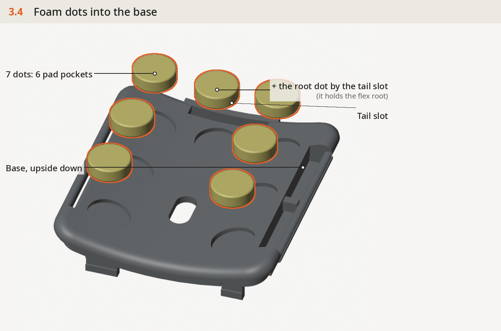

1. Turn the base upside down. Press a dot into each of the **six pad pockets**.
2. Press the **seventh, root dot** into the small pocket by the tail slot. It holds the flex root.
   Peel the liners.

### 3.5 Pods into their fences

1. Turn a pod **pocket side DOWN** and lower it straight into its fence. Its **sleeve runs along the
   strip** (around the wrist).
2. Press until it **stops on the ledges** (inset), and hold for 10 s.
3. Order: **1, 2, 5, 6, 7, 8**.

### 3.6 Base onto the saddle

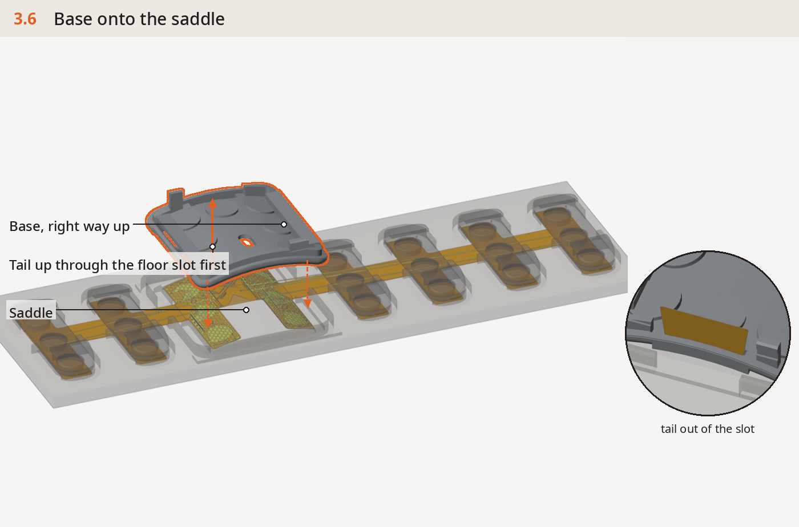

1. Thread the flex **tail up through the base's floor slot** from underneath (inset).
2. Lower the base, **right way up**, onto the saddle into its fence. Press until it stops on its
   stop pads, and hold for 10 s.

### 3.7 The bonded strip

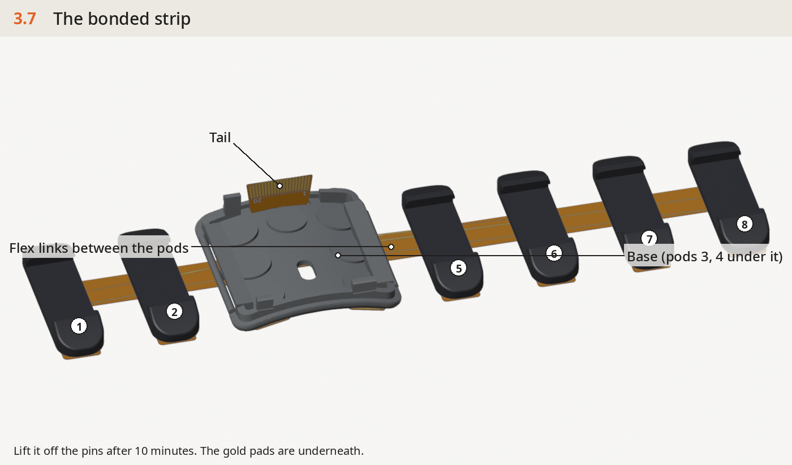

1. Wait 10 minutes, then lift the strip off the pins, pulling each pod straight up.
2. Check that every gold pad sits centred on its dot, and that the tail stands up out of the slot.

## Step 4: Board onto the flex

### 4.1 Tail into J1

1. Put the strip down, base the right way up. Hold the board **upright above the base's J1 end**,
   with J1 at the bottom and its mouth down. Let the cell hang beside the module on its leads.
2. **Flip J1's latch up** (a). Push the tail in square until it stops, with its **gold fingers
   toward the board**, on the side of the **DOWN** mark. J1's contacts are on the board side (section).
3. **Press the latch down** (b).

### 4.2 Book-fold the board down

1. Fold the board down onto the base like closing a book (a to c). The tail forms a smooth **U along
   the end wall**. Don't crease it.

### 4.3 Lead route round the board

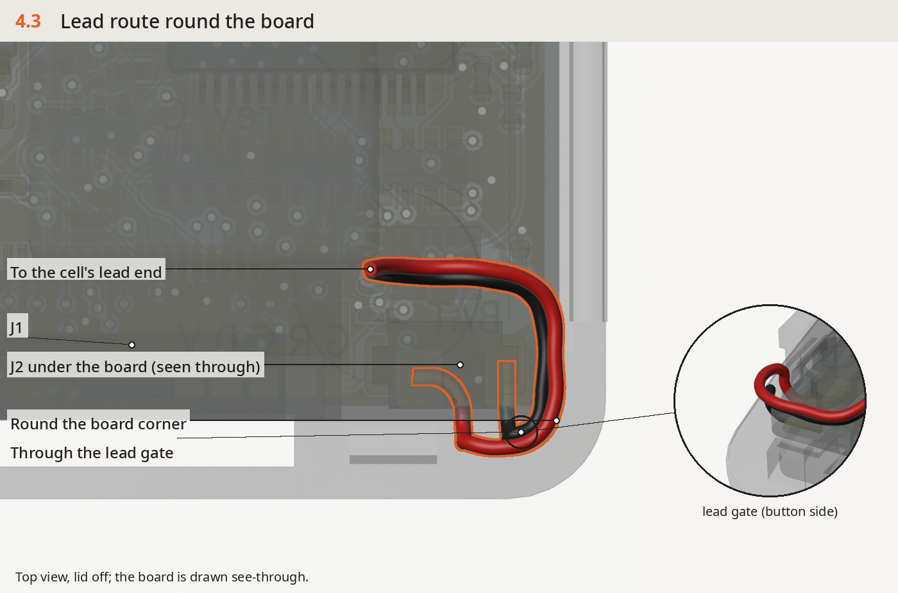

1. Run the two leads from **J2** (under the board) round the board's corner on the **button side**.
2. Take them **through the lead gate**, the notch in the base wall, toward the cell's lead end
   (inset).

## Step 5: Close the module

### 5.1 Cell into place

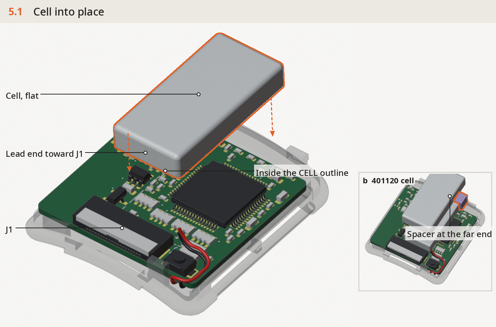

1. Lay the cell flat on the board **inside the CELL outline**, with its **lead end toward J1**.
2. For a 401120 cell (b), put the **spacer at its far end**.

### 5.2 Button cap and lid

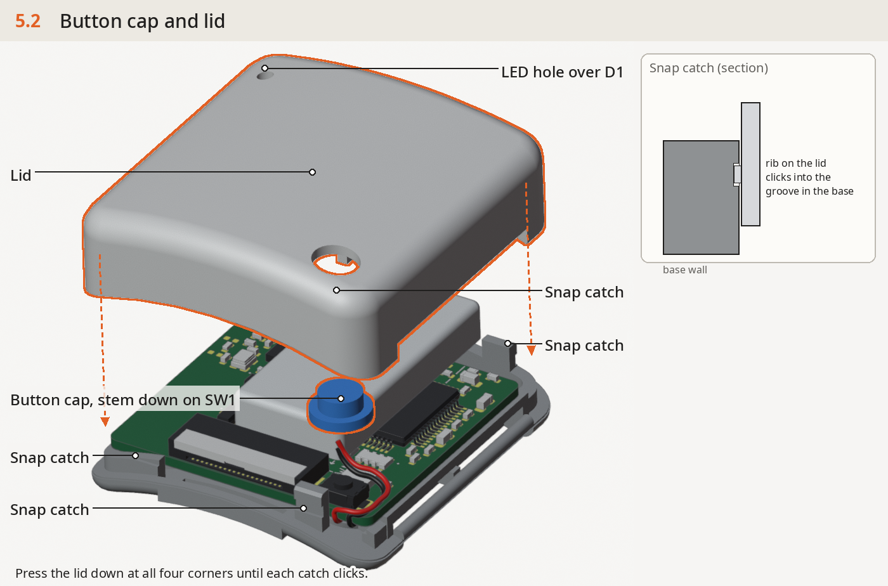

1. Stand the **button cap** stem-down on SW1.
2. Lower the lid so the cap comes up through its hole and the **LED hole** sits over D1.
3. Press the lid down at all four corners until all four **snap catches** click (inset). The button
   should click, and the LED should still flash.

## Step 6: Strap

### 6.1 Slides onto the hidden bars

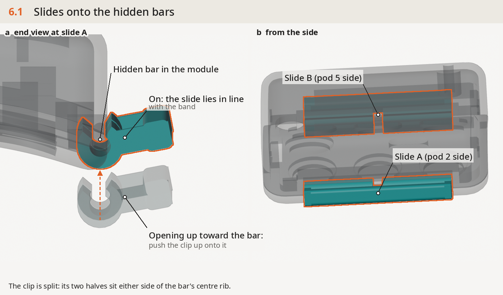

1. Hold a slide under its hidden bar with the **clip opening up toward the bar** (a). Push it up until
   it snaps on. The clip's two halves sit either side of the bar's centre rib.
2. **Slide A** goes on the pod 2 side and **slide B** on the pod 5 side (b). They are the same part.

### 6.2 Locking a webbing end

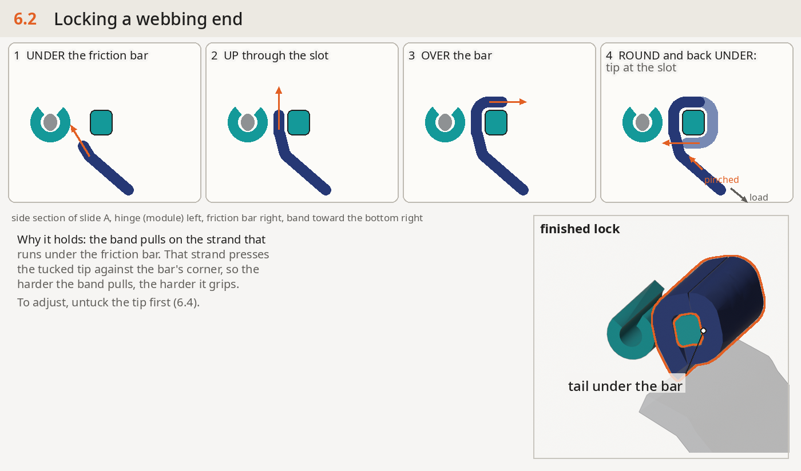

1. Cut **220 mm** of webbing and heat-seal both ends with a quick pass of the lighter flame.
2. At **slide A**, lock one end:
   1. **under** the friction bar from the pod side;
   2. **up** through the slot;
   3. **over** the bar;
   4. **round** its far end and **back under** it, until the tip reaches the slot.

   The friction bar is the slide's outer bar, not the clip.
3. **Why it holds:** the band pulls on the strand under the bar. That strand pinches the tucked tip
   against the bar's corner, so a harder pull grips harder. Only untucking the tip releases it.

### 6.3 Through the pods

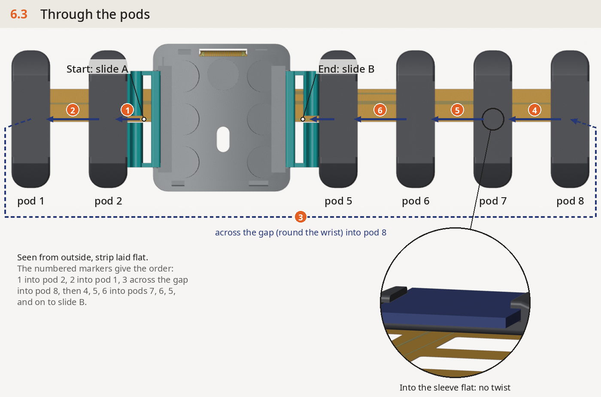

1. From slide A, thread the long end through the sleeves of **pods 2, 1, 8, 7, 6 and 5**, in that
   order. The numbers on the arrows give the order: after pod 1 (2) it crosses the gap into pod 8 (3).
2. Keep it flat; it must enter each sleeve flat, with no twist (close-up).
3. Lock the other end at **slide B** the same way as in 6.2.

### 6.4 Setting the length

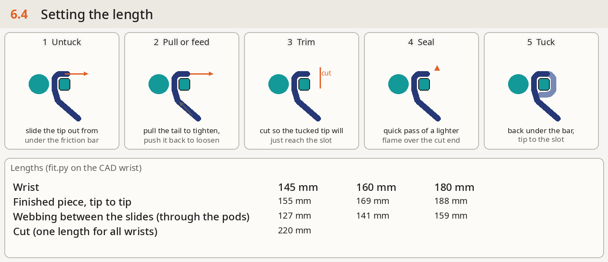

1. **Untuck** one tip. **Pull** the tail to tighten, or feed it back to loosen, until the band sits
   snug.
2. Do the **slip-on test** below *before you trim*.
3. **Trim** so the tucked tip will just reach the slot (about 14 mm of webbing goes round each slide).
4. **Seal** the cut end and **tuck** it back under the bar.

> **Test the slip-on before anything else.** The closed loop has to stretch over your hand: about
> +25-40 % for most hands. This has not yet been tried on a real band. Put it on and take it off five
> times (7.1). If it is snug on the wrist but **too tight to get over the hand**:
> 1. Let out up to 10 mm at each slide and try again. A slightly looser loop still reads well if the
>    pods touch all round.
> 2. If it is still too tight, wear it as an **open strap** with the same parts. Cut a 250 mm piece
>    and lock one end at slide B. Thread it through the pods, but leave the slide A end free. To put
>    it on, wrap it round the wrist and lock the free end at slide A (6.2), pulling it snug before
>    you tuck. To take it off, untuck the tip and pull the end out.
> 3. A stretchier elastic (thinner latex-polyester, still 20 mm wide) is the other way out.

## Step 7: First wear

### 7.1 On the wrist

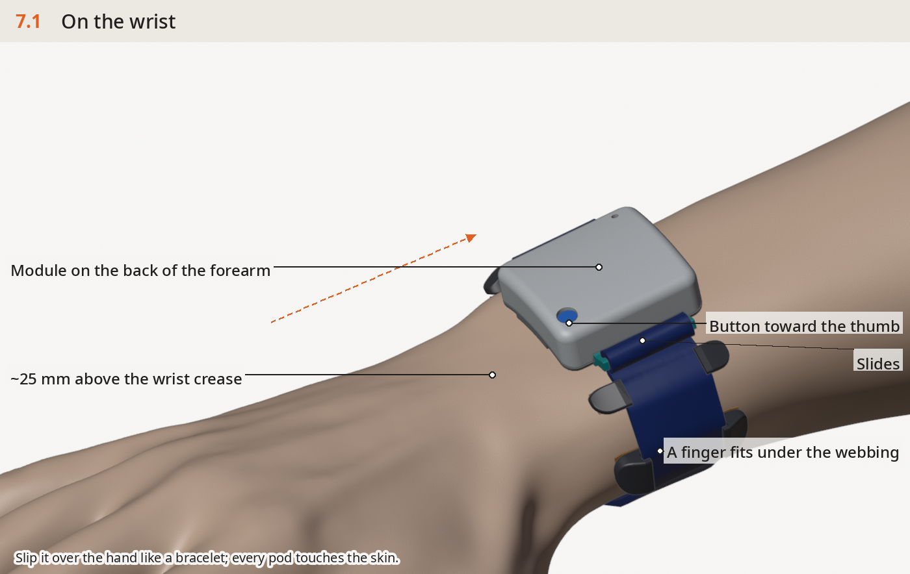

1. **Put it on.** Fold your thumb into your palm and slip the loop over your hand. Wear it with:
   - the module on the back of the forearm, **about 25 mm above the wrist crease**;
   - the J1 end toward the hand and the **button toward the thumb**.

   It should be snug, not tight: every pod touches the skin, and **a finger fits under the
   webbing**.
2. **Battery only.** No charger, no SWD wires and no cable on any pad while it touches the skin.
3. **Record.** Connect with `python3 host/neurband_ble.py --duration 60 -o first.npz` and follow
   [docs/firmware_c.md](../firmware_c.md), bring-up checklist item 12 ("On skin"). You should see:
   - **relaxed forearm:** a few µVrms per channel, and no mains hum in the live RMS;
   - **fist:** tens to hundreds of µV;
   - `diag_dc` well inside ±400 mV, and `rail=0x00`.

   A channel much noisier than the others usually means its pod is not on the skin: tighten 6.4 by a
   few mm, or move the band 1 cm.
4. **Report.** `python3 -m analysis report first.npz` makes a per-channel report.

## Step 8: Charging

### 8.1 Building the charge clip

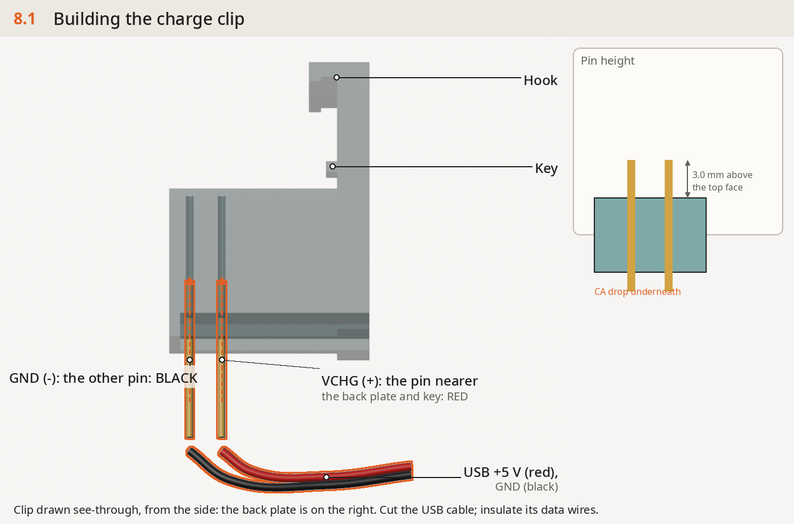

1. Push the two pogo pins into the clip's holes from below until each tip stands **3.0 mm above the
   top face** (inset). Add a drop of CA underneath.
2. Find which pin is which:
   - the **VCHG (+)** pin is the one **nearer the back plate**, which carries the key and the hook;
   - the other one is **GND (-)**.
3. Cut a USB cable and keep its red and black wires; insulate the others. Solder **red to the VCHG
   pin** and **black to the GND pin**. The joints sit in the open pocket under the clip, and the cable
   leaves at the back.

### 8.2 Clip onto the module

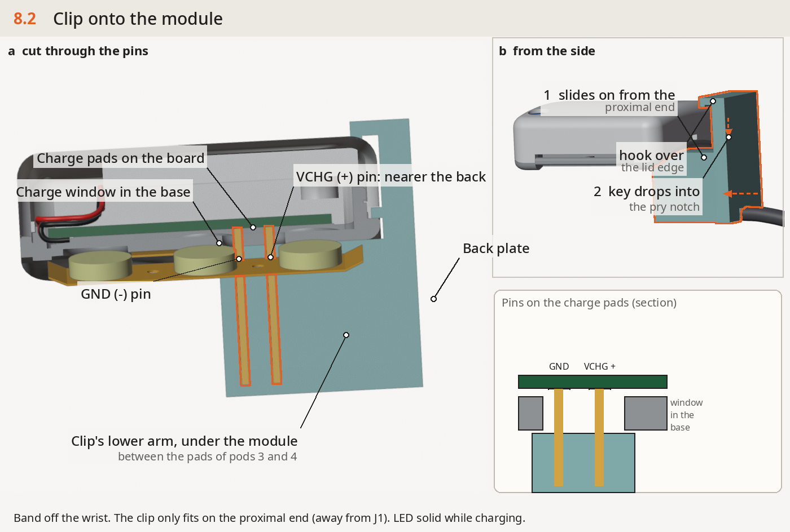

1. Take the band **off the wrist**.
2. Slide the clip onto the module's proximal end (away from J1), as in (b):
   1. slide it on from the proximal end; its **lower arm** goes under the module, between the pads of
      pods 3 and 4;
   2. its **key** drops into the **pry notch** and its **hook** goes over the lid edge.

   It only fits that way round. In the cut (a), both pins go up through the charge window onto the
   charge pads. **VCHG (+)** is the pin nearer the back plate.
3. Plug into a USB charger. The LED stays **solid** while it charges and goes back to flashing when
   the cell is full.

## Step 9: Opening and re-flashing

### 9.1 Opening and re-flashing

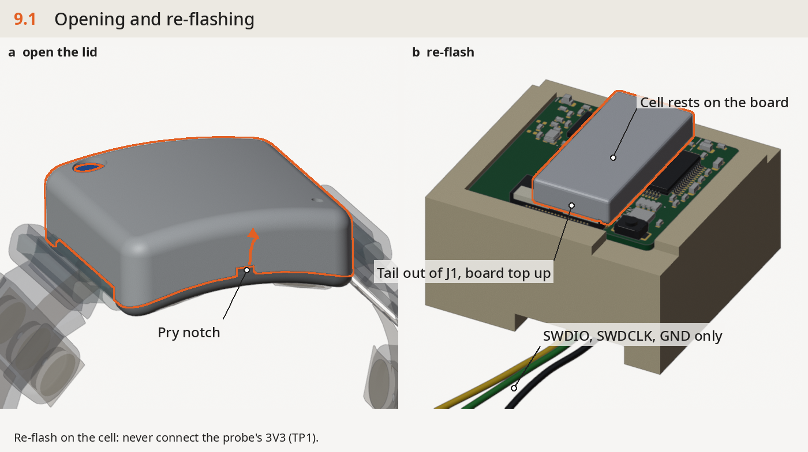

1. **Open.** Put a fingernail or a plastic pry tool in the **pry notch** at the proximal end and lever
   the lid up (a). The four catches let go.
2. **Re-flash** (b):
   - lift out the button cap and the cell;
   - unfold the board (reverse 4.2), lift J1's latch and slide the tail out;
   - set the board top up in the SWD jig with the cell resting on it;
   - flash with **SWDIO, SWDCLK and GND only**: the cell powers the board, so **never connect TP1**.
3. Re-insert the tail (4.1), fold the board back (4.2) and close (5.2).
4. **Webbing.** To take it off, untuck each tip and unthread the slides. The slides pull off their
   bars with a thumbnail, and the pods slide off the webbing.

## Troubleshooting

| Symptom | Likely cause | Fix |
|---|---|---|
| Probe found, but no target | Pins not touching the pads, or a swapped wire | Press the board into the nest; check TP2 to GP3 and TP3 to GP2. If APPROTECT blocks access, erase the chip (firmware_c.md bring-up item 2) |
| Board warm, or tens of mA drawn | Solder bridge or a part fitted backwards | Power off; inspect under a loupe |
| No LED flash, no `neurband` advert | Not flashed, or the crystal is not starting | Bring-up items 3-4 |
| ADS ID reads 0x00 or 0xFF | SPI or PWDN | Bring-up item 5 |
| All 8 channels flat or railed after assembly, but fine in step 1 | Tail in J1 the wrong way round, or not fully in | Re-insert it with the fingers toward the board (DOWN marker); press the latch down |
| One channel noisy | That pod is not on the skin, a dot lost its grip, or the pad is lifted | Tighten a few mm; re-press the pod; replace the dot |
| Lid won't click shut | Cell not flat, leads not in the lead gate, or the cap off SW1 | Re-seat the cell and leads; stand the cap on SW1 |
| Too tight to get over the hand | Loop too short, or the elastic too stiff | See the box in Step 6 |
| Band loosens during use | Tail tip not tucked back under the friction bar (it holds only by friction then), tip too short to reach the slot, or the webbing thinner than 1.2 mm | Re-lock it as in step 6 with the tip reaching the slot; use 1.5 mm webbing |
| No charge LED | Pins not touching, or red and black swapped | Check pin height and polarity (red to the pin nearer the cable) |

## Physical tests to do on the first build

These numbers come from CAD and hand calculations. Check them on the first band, and write the results
into [docs/mech/mechanical_c.md](../mech/mechanical_c.md), section 10.

1. **Slip-on.** Put it on and take it off 20 times. Check that it gets over the hand, that no dot lets
   go and that the flex root stays put.
2. **Slide grip.** Hang about 2 kg (20 N) from the loop for one minute. The tucked tips should not move
   (mark them). Repeat with one tip untucked: that end should slip, which shows the tuck is what locks
   it.
3. **Hidden bars and slide clips.** In the same pull, neither slide comes off its bar, and the bar does
   not crack (it is rated about 20 N). Under the load each slide
   should swing out in line with the band without rubbing the slot roof. If it can't swing, the
   doubled webbing under its friction bar presses on the flex edge link.
4. **Lid catches.** Open and close it 10 times with no whitening or cracks. Twist the band: the lid stays
   on.
5. **Foam dots.** After one day, every pad still stands about 1 mm proud. Flexing a pod doesn't peel
   its dot.
6. **Tail fold.** With the band closed, run the test signal (bring-up item 7). All 8 channels should
   show it.
7. **Cell fit.** The lid sits flush, with no bulge over the cell. A 401120 cell with the spacer doesn't
   rattle.
8. **Charge clip.** It stays on while you move the band. The LED is solid, and 20 clip-ons leave no
   marks on the pads.
9. **SWD jig.** Five flashes in a row without re-seating any pin.
10. **Comfort.** Wear it for 30 minutes and check for pressure marks. Loosen it if they last more than a
    few minutes.
11. **Webbing ends.** No fraying after the 20 slip-ons.
