# Build a neurband (rev C)

This guide is for a first build. You need basic soldering skills: two wires onto two pads, and five onto a
probe. You don't need a sewing machine, a hole punch or glue other than one drop of CA per pogo pin.
Watch the 24 s [assembly animation](../media/assembly.mp4) first ([GIF](../media/assembly.gif)). It shows
steps 3-6 and 8 in order.

## What you'll end up with

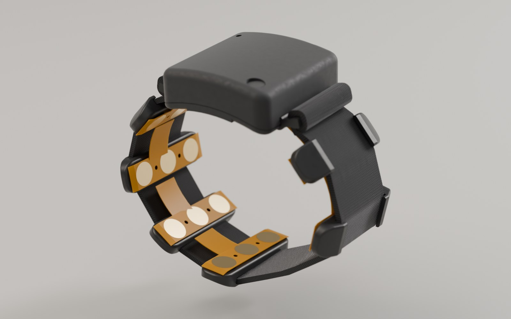

- An 8-channel surface-EMG band for the forearm. It has 24 gold pads on soft foam, and a module the size
  of a watch face that streams to your PC over Bluetooth.
- One closed elastic loop that you slip over your hand. You set it to your wrist once, at the two strap
  slides.
- It runs on its own 130 mAh cell. It charges from any USB charger through a small printed clip.

## How it works

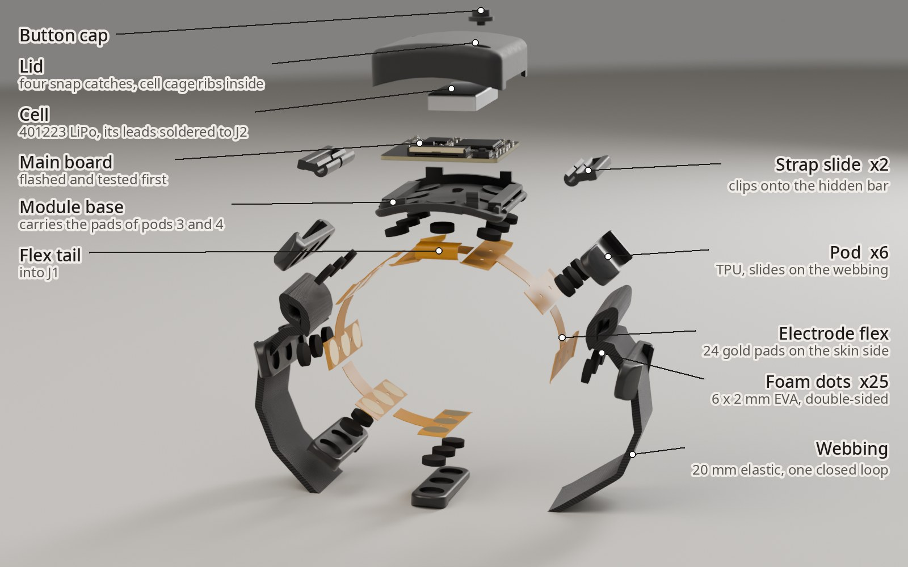

The **electrode flex** carries the 24 gold pads, and its tail plugs into the **main board** (J1). Each
pad sits on a **foam dot** inside a **TPU pod**, so the pad is pushed onto the skin. The six free pods
hold the pads of pods 1-2 and 5-8. The **module base** holds those of pods 3 and 4. The **cell**, the **lid** and the
**button cap** close the module. One **webbing** loop runs through all six pods. Its ends are held by two
**strap slides** that clip onto bars hidden in the module's sides.

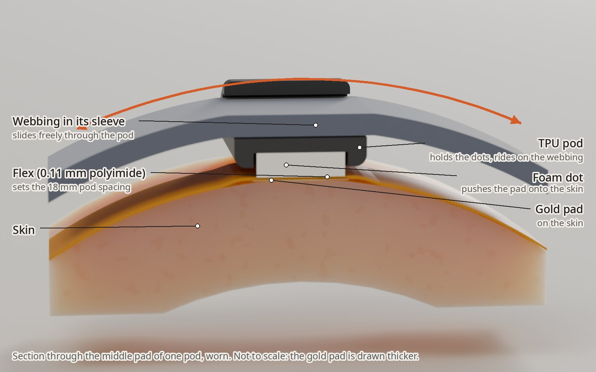

From the skin outward, in one pod:

- **Skin.** The pad is pressed onto it at about 3-15 kPa, depending on how tight the loop is.
- **Gold pad.** One of the 24 electrodes, on the skin side of the flex.
- **Flex.** 0.11 mm polyimide that carries the signals. It also fixes the spacing between pods
  (18 mm), so the pods always land on the same muscles.
- **Foam dot.** 6 x 2 mm, sticky on both faces. It holds the flex in the pod and acts as the spring
  that keeps the pad on the skin.
- **TPU pod.** Holds three dots and has a sleeve through it.
- **Webbing in its sleeve.** The webbing is not fixed to the pods: it slides through every sleeve.
  When the loop stretches (over your hand, or when a muscle bulges), only the elastic stretches. The
  flex never does, because it, not the webbing, sets where the pods are.

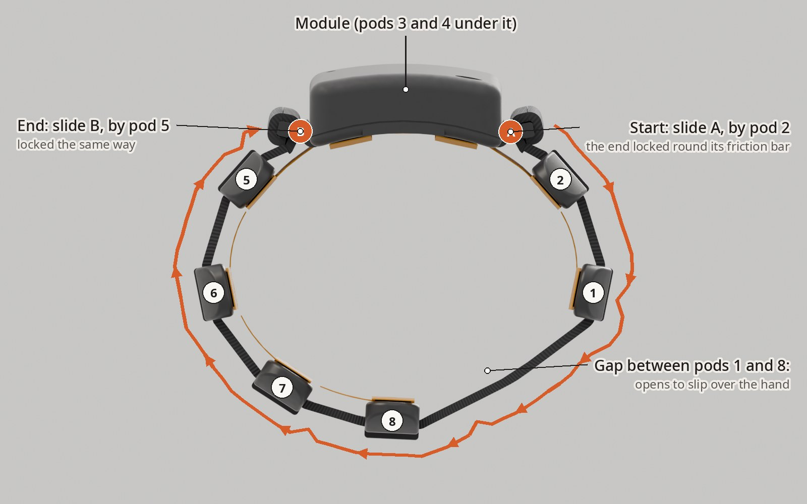

The webbing starts at **slide A** (on the button side, next to pod 2). It goes through pods 2, 1, 8, 7,
6 and 5 and ends at **slide B**. Each end is locked round its slide's friction bar (step 6). Moving
webbing through a slide sets the size. The view is from the hand end.

- **Putting it on.** Fold your thumb into the palm. With the module on the back of the hand and its
  J1 end toward the fingers, push the loop over the knuckles and slide it about 25 mm up the forearm
  past the wrist crease. The gap between pods 1 and 8 opens as it passes the hand.
- **Adjusting.** Untuck a tail tip from under its friction bar. Pull the tail to tighten, or push
  webbing back through the slot to loosen. Then tuck the tip back under the bar. You only do this to
  set the size.
- **Taking it off.** Roll it down over the hand the same way. You don't need to touch the slides.

## Shopping list

Everything you buy yourself is from [sourcing.md](sourcing.md) (checked 2026-10-29, from Greece;
prices move).

| Part | Per band | Buy (pack) | ~EUR |
|---|---|---|---|
| Plain woven elastic, **20 mm x 1.5 mm**, black (1.2-1.8 mm thick works) | 220 mm | [AliExpress 1005004884068548](https://www.aliexpress.com/item/1005004884068548.html) (1 m), or [Amazon.de B0CHNPF575](https://www.amazon.de/dp/B0CHNPF575) (5 m) | 4.80 |
| Foam dots, **round 6 x 2 mm EVA, adhesive on both faces** | 25 | [Amazon.de B0GTVY9GP9](https://www.amazon.de/dp/B0GTVY9GP9) (1160) | 6.20 |
| LiPo cell with protection board, **401223 (130 mAh)**, at most 12.0 x 25.0 x 4.0 mm including its board | 1 | [AliExpress 1005013473853786](https://www.aliexpress.com/item/1005013473853786.html) | 11.10 |
| Fallback cell **401120** (about 11 x 22 x 4 mm, 50-60 mAh); it uses the printed spacer | (1) | [AliExpress 1005005450826923](https://www.aliexpress.com/item/1005005450826923.html) | 1.80 |
| Pogo pins **P50-J1** (0.68 mm, 16 mm, round tip): 5 for the SWD jig, 2 for the charge clip | 7 | [Amazon.de B0988ZMG29](https://www.amazon.de/dp/B0988ZMG29) (100), or the spear-tip [AliExpress 1005010399046797](https://www.aliexpress.com/item/1005010399046797.html) | 12.60 |
| SWD probe: **Raspberry Pi Pico 2** running [debugprobe](https://github.com/raspberrypi/debugprobe) (it can also power the bare board) | 1 | [nettop.gr](https://nettop.gr/index.php/en/raspberry-pi-en/pico/raspberry-pi-pico-kits/raspberry-pi-pico-2.html) | 5.60 |
| BLE receiver for the PC: **nRF52840 Dongle** (PCA10059) | 1 | [DigiKey](https://www.digikey.ie/en/products/detail/nordic-semiconductor-asa/NRF52840-DONGLE/9491124) | 12 |
| Kapton tape, 10 mm | 2 cm | [Amazon.de B094X62PSM](https://www.amazon.de/dp/B094X62PSM) | 6 |

That comes to about EUR 60. Buy both cells, measure them, and keep the one that fits (step 2). A
[Raspberry Pi Debug Probe](https://nettop.gr/index.php/en/raspberry-pi-en/pico/raspberry-pi-pico-kits/raspberry-pi-debug-probe.html)
(EUR 14.50) also works, but it has no 3.3 V output, so the bare board then needs power from somewhere else.

What you probably already have:

| Tool | For |
|---|---|
| Soldering iron with a fine tip, thin flux-core solder (0.5 mm) | Cell leads, probe wires, clip wires |
| Flush cutter, tweezers | Trimming leads, handling the dots |
| Thin CA glue (superglue) | One drop per pogo pin |
| An old USB cable, and a USB charger | The charge clip's lead (only the red and black wires are used) |
| Lighter | Heat-sealing the cut webbing ends |
| Multimeter | Polarity and short checks |

**What to order through Backplane.** Press **Buy it** in Backplane for:
- the assembled main board ([boards/neurband_c/ORDERING.md](../../boards/neurband_c/ORDERING.md));
- the printed parts, which are the `mech/rev_c/*.fab.json` files listed under Printing below.

**What to order from a flex service.** The electrode flex is a separate order from a flex-PCB service.
Follow [boards/neurband_c_flex/ORDERING.md](../../boards/neurband_c_flex/ORDERING.md) (0.11 mm
polyimide, ENIG, no stiffener in the tail bend).

## Printing

Every printed part is in `mech/rev_c/`. The fab chooses the orientation for MJF parts. Walls are at
least 1.0 mm everywhere (`mech/rev_c/wall_check.json`). **Tools** are only used to build or charge
the band; they are not part of it.

| Part (`.fab.json`) | Process | Ordered (per band) | Orientation | Notes |
|---|---|---|---|---|
| `module_base` | MJF PA12, grey | 3 (1) | fab's choice | Has the hidden strap bars (with a centre rib), the lead gate and the tail slot |
| `module_lid` | MJF PA12, grey | 3 (1) | fab's choice | Four snap catches; two ribs inside cage the cell |
| `button_cap` | MJF PA12, grey | 4 (1) | fab's choice | Small: easy to lose |
| `strap_slide` | MJF PA12, black | 5 (2) | fab's choice | Two-bar slide with a split C-clip |
| `cell_spacer` | MJF PA12, grey | 2 (0 or 1) | fab's choice | Only for the shorter 401120 cell |
| `pod` | FDM TPU 95A, black | 14 (6) | on its side, no supports | 0.4 mm nozzle; walls 1.0 mm (2.5 perimeters) |
| `bond_jig` (**tool**) | FDM PLA or PETG, white | 1 | flat, plate down, no supports | 0.2 mm layers. Check that all 16 small pins printed |
| `swd_jig` (**tool**) | MJF PA12, white | 1 | fab's choice | Takes five pogo pins |
| `charge_clip` (**tool**) | MJF PA12, black | 2 (1) | fab's choice | Takes two pogo pins |

## Steps

### 1. Flash and test the bare board in the SWD jig

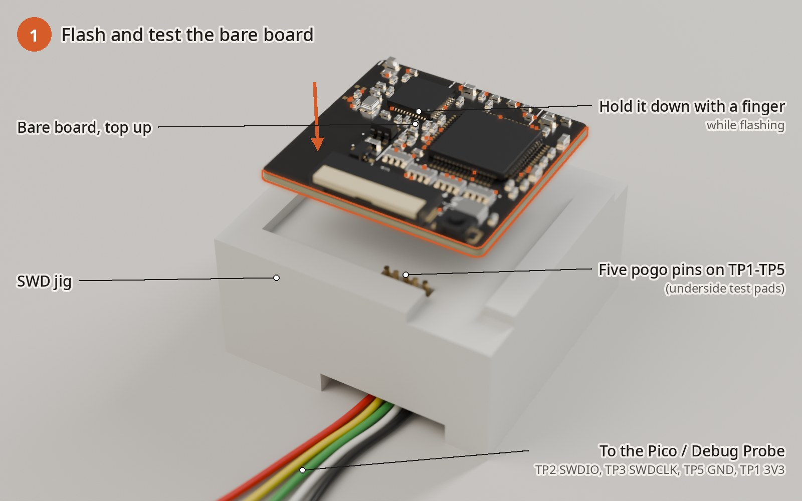

1. **Pins.** Push a pogo pin into each of the jig's five holes from below, tip first, until its tip
   stands about 1.4 mm above the nest floor. Its tail then ends in the open pocket underneath, about
   2 mm up from the jig's bottom face. When all five tips stand level, put a drop of thin CA where each
   pin leaves its hole underneath, and let it set for 10 minutes. The pins lean
   alternately: that is on purpose.
2. **Wires.** Solder four wires to the pin tails and run them out of the pocket. The pin order matches
   the pads TP1 to TP5:

   | Jig pin (pad) | Signal | Pico 2 pin |
   |---|---|---|
   | TP1 | +3V3 | 3V3(OUT), pin 36 (**only while no cell is fitted**) |
   | TP2 | SWDIO | GP3, pin 5 |
   | TP3 | SWDCLK | GP2, pin 4 |
   | TP4 | NRST | not needed |
   | TP5 | GND | GND, pin 3 |

3. **Before power,** check with the meter that TP1 and TP5 on the board are not shorted.
4. **Seat the board** in the nest, top (components) up, J1 edge over the pins. Hold it down with a
   finger while you work.
5. **Flash and test** following [docs/firmware_c.md](../firmware_c.md): "Build and flash", then
   bring-up checklist items 2-7. In short:
   - `pyocd flash -t nrf52832 build/zephyr/zephyr.hex`;
   - the RTT log shows `neurband c0.1 up`;
   - the LED flashes once a second;
   - a phone sees `neurband`;
   - the ADS ID is 0x92;
   - `--fmt 24 --mode test` shows the same square wave on all 8 channels.

   Fix any failure now, while the board is easy to reach.

### 2. Solder the cell leads

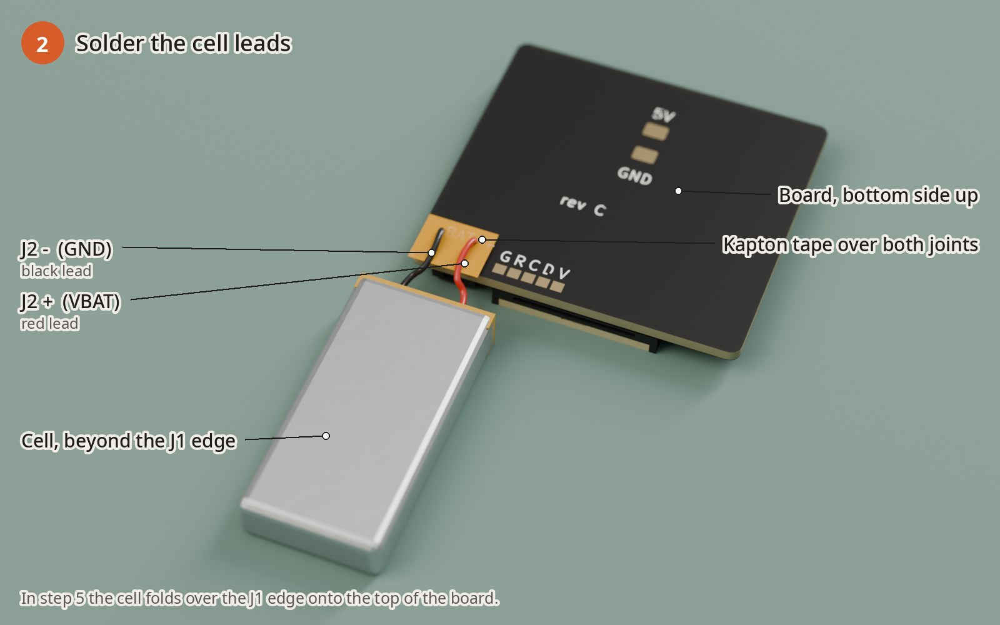

1. **Measure the cell,** including its little board and taped tabs: at most 12.0 x 25.0 x 4.0 mm. If it
   is 401120-sized (about 22 mm long), you will add the `cell_spacer` in step 5.
2. **Cut off any plug.** Do one lead at a time, so they never touch. Strip 1.5 mm and tin it. Keep the
   leads long: the route needs 16-22 mm, and about 30 mm is normal.
3. **Lay out the parts.** Lay the board bottom side up. Put the cell flat on the bench beyond the
   board's J1 edge, with its lead end toward the board.
4. **Solder.** The red lead goes to J2 **+** (VBAT, the pad nearer the five test pads), and the black
   lead to J2 **-** (GND). Solder them flat and low. The base has only a 1.0 mm relief under these
   joints.
5. **Insulate.** Put a strip of Kapton over both joints.
6. The board now runs from the cell. **From here on, never connect the probe's 3V3 (TP1).**

### 3. Bond the flex in the bonding jig

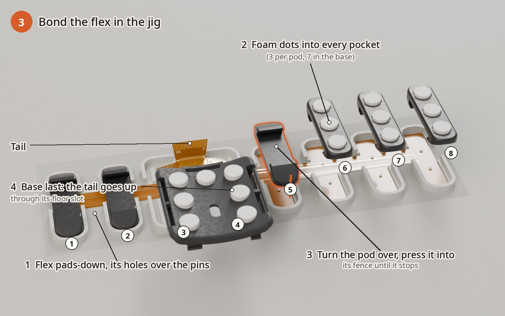

1. **Flex.** Lay the flex on the jig pads-down: the gold pads face the jig, and the tail's contact
   fingers face up. Each of its 16 small holes goes over a pin. The module section (pods 3 and 4) lies
   on the curved saddle, with the tail through the gap in the base fence. Pods 1 and 2 are on the short
   side.
2. **Dots.** Press a foam dot into every pocket: three in each pod and seven in the base. The seventh
   is the round pocket by the tail slot, and it holds the flex root. Peel the dots' top liners.
3. **Pods.** Turn each pod over, pocket side down. Lower it straight into its fence and press until it
   stops on the ledges. Hold for 10 s. Order: 1, 2, 5, 6, 7, 8.
4. **Base.** Thread the flex tail up through the base's floor slot from underneath. Lower the base into
   its fence on the saddle and press until it stops. Hold for 10 s.
5. **Lift off.** Wait 10 minutes, then lift the strip off the pins, pulling each pod straight up.
   Check that every pad sits centred on its dot.

### 4. Book-fold the tail into J1

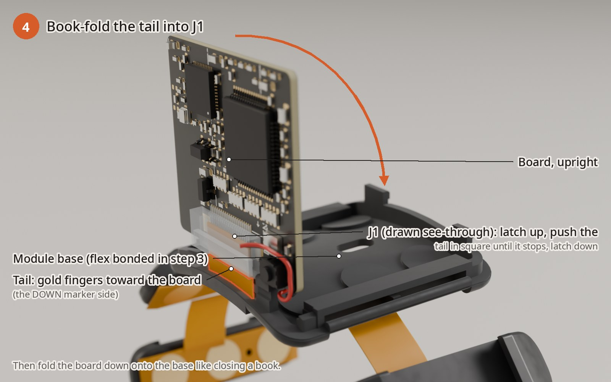

1. **Set up.** Put the band down with the base the right way up (floor down) and the tail standing up
   out of the slot at the base's J1 end. Hold the board upright above that end, with its components
   facing away from the base and J1 at the bottom, mouth down toward the tail. Let the cell hang beside
   the module on its leads.
2. **Open J1.** Lift J1's latch (the flip bar).
3. **Insert.** Push the tail in square until it stops. Its gold fingers must face the board, on the
   side of the **DOWN** marker printed next to J1.
4. **Close J1.** Press the latch down.
5. **Fold.** Fold the board down onto the base like closing a book. The tail forms a smooth U along the
   base's end wall. Don't crease it.

### 5. Seat the board, cell and lid

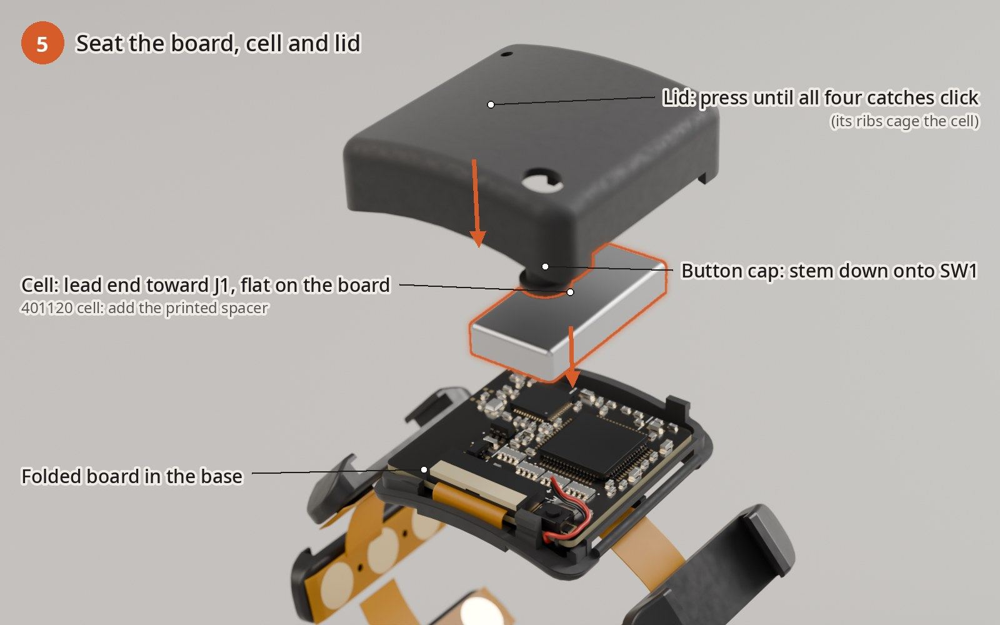

1. **Leads.** Run the cell leads round the board corner on the button side, through the notch in the
   base wall (the lead gate).
2. **Cell.** Lay it flat on the board inside the printed CELL outline, with its lead end toward J1.
   For the 401120 cell, put the `cell_spacer` at its far end.
3. **Button cap.** Stand it stem-down on the button (SW1).
4. **Lid.** Lower the lid so the cap comes up through its hole. Press the lid down at all four corners
   until all four catches click. The LED shows through the small open hole.
5. **Check.** The button clicks, and the LED still flashes.

### 6. Webbing and slides: set the length

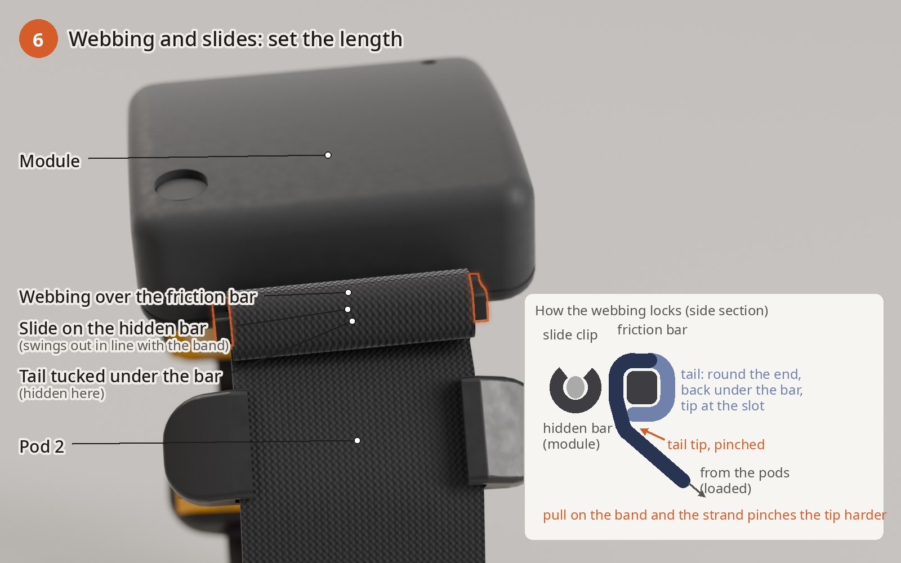

1. **Cut and seal.** Cut **220 mm** of webbing. Heat-seal both cut ends with a quick pass of the lighter
   flame.
2. **Fit the slides.** Clip a slide onto each hidden bar in the module's sides. Press the split C-clip
   over the bar until it snaps on, either side of the centre rib. It swings freely on the bar.
3. **Lock one end at slide A** (next to pod 2), as in the inset:
   - **Under:** push the end under the slide's friction bar from the pod side. The friction bar is the
     slide's outer bar, not the clip.
   - **Up:** bring it up through the slot between the friction bar and the clip.
   - **Over:** lay it over the friction bar, heading back toward the pods.
   - **Round and back under:** take it round the bar's far end and tuck it back under the bar. It now
     lies between the bar and the webbing you started with. Push the tip in until it reaches the slot.
4. **Pods.** Thread the long end through the sleeves of pods 2, 1, 8, 7, 6 and 5, in that order. Keep
   it flat; it must not twist.
5. **Slide B.** Lock the other end the same way.
6. **Set the length.** With one tip untucked, pull the tail or feed it back until the band sits snug.
   Then trim that tail so its tucked tip just reaches the slot (about 14 mm of webbing goes round each
   slide), and tuck it. As a guide, the finished piece is about 155 / 169 / 188 mm tip to tip for a
   145 / 160 / 180 mm wrist. Do the slip-on test below before you trim.

**Why it doesn't slip.** The band's pull runs along the strand that goes under the friction bar. That
strand presses the tucked tip against the bar's corner, so the harder the band pulls, the harder it
grips. That is on top of the friction of a full turn round the bar. The slide swings on its clip until
it lines up with the band; that is expected. Only the tucked tip can release the webbing: untuck it to
adjust.

> **Test the slip-on before anything else.** The closed loop has to stretch over your hand: about
> +25-40 % for most hands. This has not yet been tried on a real band. Put it on and take it off five
> times (step 7, "putting it on"). If it is snug on the wrist but **too tight to get over the hand**:
> 1. Let out up to 10 mm at each slide and try again. A slightly looser loop still reads well if the
>    pods touch all round.
> 2. If it is still too tight, wear it as an **open strap** with the same parts. Cut a 250 mm piece
>    and lock one end at slide B as above. Thread it through the pods, but leave the slide A end free.
>    To put it on, wrap it round the wrist and lock the free end at slide A: under the friction bar, up
>    through the slot, over the bar, round its end and tucked back under. Pull it snug before you
>    tuck. To take it off, untuck the tip and pull the end out.
> 3. A stretchier elastic (thinner latex-polyester, still 20 mm wide) is the other way out.

### 7. First wear and signal check

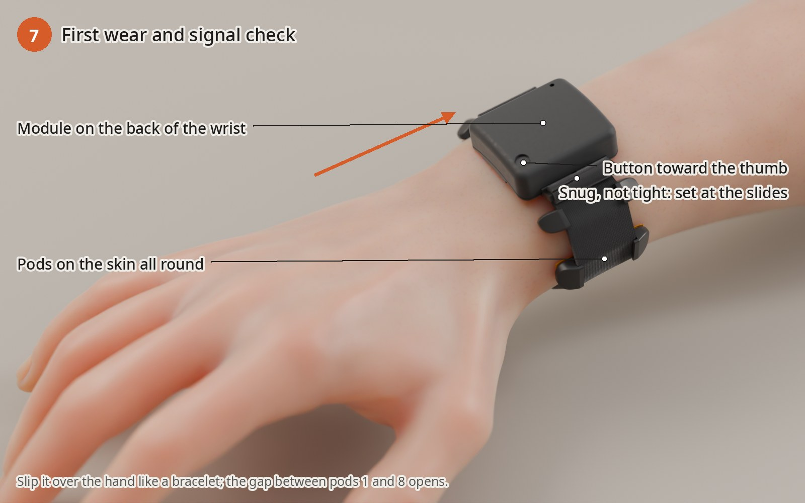

1. **Put it on.** Slip it on as above, with the module on the back of the forearm about 25 mm above
   the wrist crease and the button toward the thumb. It should be snug, not tight: every pod touches
   the skin, and you can slide a finger under the webbing.
2. **Battery only.** No charger, no SWD wires and no cable on any pad while it touches the skin.
3. **Record.** Connect with `python3 host/neurband_ble.py --duration 60 -o first.npz` and follow
   [docs/firmware_c.md](../firmware_c.md), bring-up checklist item 12 ("On skin"). You should see:
   - **relaxed forearm:** a few µVrms per channel, and no mains hum in the live RMS;
   - **fist:** tens to hundreds of µV;
   - `diag_dc` well inside ±400 mV, and `rail=0x00`.

   A channel that is much noisier than the others usually means its pod is not on the skin. Tighten a
   tail by a few mm, or move the band 1 cm.
4. **Report.** `python3 -m analysis report first.npz` makes a per-channel report.

### 8. Charging with the clip

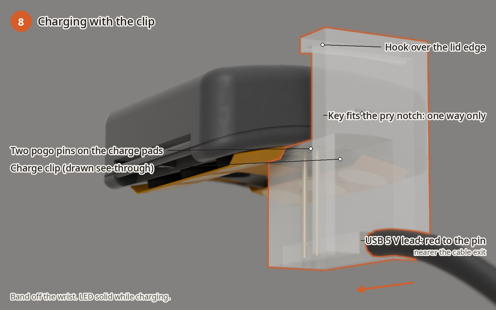

1. **Pins.** Push the two pogo pins into the clip's holes from below until each tip stands 3.0 mm
   above the clip's top (contact) face. Add a drop of CA underneath.
2. **Wires.** Cut the USB cable and keep the red (+5 V) and black (GND) wires; insulate the others.
   Solder **red to the pin nearer the cable exit** (VCHG) and black to the other pin (GND). The joints
   sit in the open pocket under the clip.
3. **Clip on.** Take the band off the wrist. Slide the clip onto the module's proximal end (the end
   away from J1). Its block goes under the module, its key into the pry notch, and its hook over the
   lid edge. It only fits that way round.
4. **Charge.** Plug into a USB charger. The LED stays solid while it charges, and the band won't
   stream. When the LED goes back to its normal flashing, the cell is full.

## Taking it apart / re-flashing

- **Opening.** Put a fingernail or a plastic pry tool in the pry notch at the proximal end and lift. The
  four catches let go. Lift the button cap and the cell out; nothing holds them but the cage.
- **Re-flashing.** Unfold the board (the reverse of step 4). Lift the J1 latch and slide the tail out.
  Set the board top up in the SWD jig, with the cell resting on it; its leads leave by the jig's corner
  notch. Flash with **SWDIO, SWDCLK and GND only.** The cell powers the board, so leave TP1 unconnected.
  Re-insert the tail (DOWN marker), fold the board back and close.
- **Webbing.** Untuck each tail tip from under its friction bar and unthread the slide. The slides
  pull off their bars with a thumbnail. The pods slide off the webbing.

## Troubleshooting

| Symptom | Likely cause | Fix |
|---|---|---|
| Probe found, but no target | Pins not touching the pads, or a swapped wire | Press the board into the nest; check TP2 to GP3 and TP3 to GP2. If APPROTECT blocks access, erase the chip (firmware_c.md bring-up item 2) |
| Board warm, or tens of mA drawn | Solder bridge or a part fitted backwards | Power off; inspect under a loupe |
| No LED flash, no `neurband` advert | Not flashed, or the crystal is not starting | Bring-up items 3-4 |
| ADS ID reads 0x00 or 0xFF | SPI or PWDN | Bring-up item 5 |
| All 8 channels flat or railed after assembly, but fine in step 1 | Tail in J1 the wrong way round, or not fully in | Re-insert it with the fingers toward the board (DOWN marker); press the latch down |
| One channel noisy | That pod is not on the skin, a dot lost its grip, or the pad is lifted | Tighten a few mm; re-press the pod; replace the dot |
| Lid won't click shut | Cell not flat, leads not in the lead gate, or the cap off SW1 | Re-seat the cell and leads; stand the cap on SW1 |
| Too tight to get over the hand | Loop too short, or the elastic too stiff | See the box in step 6 |
| Band loosens during use | Tail tip not tucked back under the friction bar (it holds only by friction then), tip too short to reach the slot, or the webbing thinner than 1.2 mm | Re-lock it as in step 6 with the tip reaching the slot; use 1.5 mm webbing |
| No charge LED | Pins not touching, or red and black swapped | Check pin height and polarity (red to the pin nearer the cable) |

## Physical tests to do on the first build

These numbers come from CAD and hand calculations. Check them on the first band, and write the results
into [docs/mech/mechanical_c.md](../mech/mechanical_c.md), section 10.

1. **Slip-on.** Put it on and take it off 20 times. Check that it gets over the hand, that no dot lets
   go and that the flex root stays put.
2. **Slide grip.** Hang about 2 kg (20 N) from the loop for one minute. The tucked tips should not move
   (mark them). Repeat with one tip untucked: that end should slip, which shows the tuck is what locks
   it.
3. **Hidden bars and slide clips.** In the same pull, neither slide comes off its bar, and the bar does
   not crack (it is rated about 20 N). Under the load each slide
   should swing out in line with the band without rubbing the slot roof. If it can't swing, the
   doubled webbing under its friction bar presses on the flex edge link.
4. **Lid catches.** Open and close it 10 times with no whitening or cracks. Twist the band: the lid stays
   on.
5. **Foam dots.** After one day, every pad still stands about 1 mm proud. Flexing a pod doesn't peel
   its dot.
6. **Tail fold.** With the band closed, run the test signal (bring-up item 7). All 8 channels should
   show it.
7. **Cell fit.** The lid sits flush, with no bulge over the cell. A 401120 cell with the spacer doesn't
   rattle.
8. **Charge clip.** It stays on while you move the band. The LED is solid, and 20 clip-ons leave no
   marks on the pads.
9. **SWD jig.** Five flashes in a row without re-seating any pin.
10. **Comfort.** Wear it for 30 minutes and check for pressure marks. Loosen it if they last more than a
    few minutes.
11. **Webbing ends.** No fraying after the 20 slip-ons.
