# Build guide: neurband rev C

This guide takes you from a pile of parts to a band on your wrist. It is written for a first-time
builder working at a kitchen table: no microscope or reflow oven, one pair of hands. The boards come
assembled from the fab, so the only soldering is two battery wires, a splice and (for flashing) five
test pads.

The 24 s animation ([MP4](../media/assembly.mp4)) shows the order. Budget about **one evening** for
the assembly, plus **24 h** for the adhesives to reach full strength, plus the fab's lead time.

> **Safety.** The cell is a lithium-polymer pouch: do not puncture, bend or short it. Solder its
> leads one at a time and insulate each joint before you bare the next. Wear the band **only** when it
> runs on its own battery. Never wear it while it charges, while the SWD probe is attached, or while
> any cable or grounded instrument touches it ([firmware_c.md](../firmware_c.md), top). This is a
> research prototype, not a medical device.

## The order matters

| # | Step | Why here |
|---|---|---|
| 1 | Order and buy ([sec. 1](#1-what-to-order)) | |
| 2 | Print, clean up, test-fit ([sec. 3](#3-printing)) | Fix tight holes and snaps before anything is glued |
| 3 | Bench bring-up of the bare board ([sec. 5](#5-bench-bring-up-of-the-bare-board)) | The SWD pads are on the board's underside. Once the board is in the base you cannot reach them |
| 4 | Pre-wire the battery pads | J2 is also on the underside |
| 5 | Magnets into the base, then build the charger puck | The base sets the puck's magnet polarity |
| 6 | Foam discs, then bond the flex to the base and the six pods | 24 h rest is ideal before the strap goes on |
| 7 | Tail up through the base, into J1, fold the board in | The tail has no slack once the board sits flat: insert it first |
| 8 | Cell on, leads spliced | The cell is connected last, after the fiddly steps |
| 9 | Test in the open module | Last chance to fix J1 or the splice without opening the lid |
| 10 | Light pipe, button cap, lid | |
| 11 | Strap: loops, webbing, closure | |
| 12 | Charge, wear | |

## 1. What to order

### Through the fab

Order the main board and the prints with Backplane's **Buy it** button. The fab files sit next to the
design files: `boards/neurband_c/neurband_c.fab.json` (order settings in
[ORDERING.md](../../boards/neurband_c/ORDERING.md)) and `mech/rev_c/*.fab.json`.

The **electrode flex is a separate order.** Buy it's board flow only knows rigid boards, so the flex's
fab file is marked not-to-order. Take `boards/neurband_c_flex/` (its Gerbers, including the stiffener
layer) to a flex-PCB service with the settings in
[boards/neurband_c_flex/ORDERING.md](../../boards/neurband_c_flex/ORDERING.md): 2-layer polyimide,
coverlay both sides, ENIG, a polyimide stiffener to 0.30 mm at the tail fingers.

| Part | Source | Process / material | Per band | Default qty (fab.json) |
|---|---|---|---|---|
| Main board, assembled | `boards/neurband_c/` | 4-layer 1.0 mm, ENIG, black mask, parts on top only | 1 | 5 |
| Electrode flex (separate flex order, see above) | `boards/neurband_c_flex/` | 2-layer polyimide flex, ENIG, 0.3 mm stiffened tail | 1 | 5 |
| Module base | `mech/rev_c/module_base.step` | MJF PA12, grey or black | 1 | 3 |
| Module lid | `mech/rev_c/module_lid.step` | MJF PA12 | 1 | 3 |
| Button cap | `mech/rev_c/button_cap.step` | MJF PA12 | 1 | 4 |
| Strap loop | `mech/rev_c/strap_loop.step` | MJF PA12, black | 2 | 5 |
| Pod shell | `mech/rev_c/pod.step` | TPU 95A: your own FDM printer, or FDM TPU from the fab | 6 | 16 |
| Charger puck | `mech/rev_c/charge_puck.step` | MJF PA12, or PETG on your own printer | 1 | 2 |

The quantities include spares: the small PA12 parts cost little more in threes, and a lid or loop
is easy to lose.

### Buy elsewhere

Everything here is generic. The specs matter more than the brand.

| Item | Spec | Per band |
|---|---|---|
| LiPo cell | **Protected** (with a protection board) single cell, 3.7 V, 80-120 mAh, 401225 class. **Overall size including the protection board and taped tabs at most 4.0 x 12.0 x 25.0 mm**, with two wire leads from one short end. Many cells sold as "401225" are 26-28 mm long once the protection board is counted. Ask for the drawing; a 401020-class cell also fits, with less capacity | 1 |
| Double-sided foam tape | **Adhesive on both faces** (acrylic), closed-cell PE or PU foam, **1.5-1.6 mm thick**, soft: a fingertip should visibly squash it. For example a 1/16 in (1.6 mm) double-coated urethane foam tape such as 3M 4026, or a generic "1.5 mm double-sided foam mounting tape". Single-sided foam will not work: one face bonds the shell, the other the flex | 24 discs (25 mm x 0.3 m is plenty) |
| Thin double-sided tape | 0.05-0.2 mm, for example adhesive transfer tape or thin double-sided tissue / polyimide tape | 10 cm |
| Elastic webbing | **22 mm (7/8 in) wide, 1.2-1.4 mm thick** woven elastic with a **loop-fabric outer face** (sold as elastic hook-and-loop strap). Plain 22 mm elastic plus 110 mm of sew-on loop tape also works. It must stay at or under 1.4 mm thick and 22.4 mm wide | 0.25 m |
| Hook tape | 20-22 mm sew-on hook tape (or the hook tab of a ready-made elastic hook-and-loop strap) | 40 mm |
| Magnets | N52 (N42 also works) axially magnetised discs, **3 x 1 mm** | 4 (2 base, 2 puck) |
| Pogo pins | Spring-loaded pogo pins, **2.0 mm barrel**, about 6 mm long, at least 1 mm travel, round or flat tip, solder cup or tail | 2 |
| Light pipe | **1.5 mm** PMMA optical fibre (end-glow) or clear acrylic rod | 2 cm |
| USB lead | Any USB-A (or USB-C) cable you can cut up: you need only 5 V and GND | 1 |
| Hook-up wire | **30 AWG** PTFE or Kynar (wire-wrap) wire, at most 0.55 mm over the insulation, red and black | 20 cm each |
| Heat-shrink | 1.0-1.5 mm, or more Kapton tape | 3 cm |
| Kapton (polyimide) tape | 5-10 mm wide | a few cm |
| Glue | CA (cyanoacrylate) gel, or 5-minute two-part epoxy | |
| Textile glue | Flexible fabric adhesive, only for the no-sew strap option | |
| Solder and flux | 0.3-0.5 mm solder wire, no-clean flux pen | |
| Thread | Polyester sewing thread and a needle | |
| Soft foam pad | 1 mm soft foam (or a piece of the foam tape with its top liner left on), 10 x 15 mm, keeps the cell and board from rattling | 1 |
| SWD probe | Raspberry Pi Pico (or Pico 2 / Debug Probe) running debugprobe, plus 5 jumper wires; optional: a 1.27 mm pitch, 5-pin pogo test clip | 1 per builder |
| PC radio | nRF52840 USB dongle (recommended for full-rate streaming, [firmware_c.md](../firmware_c.md)) | 1 per builder |
| Cleaning | Isopropyl alcohol (IPA), lint-free wipes | |

Prices are in [docs/rev_c/cost.md](../rev_c/cost.md).

## 2. Tools

- Soldering iron with a fine tip (0.5-1 mm), fine tweezers, flush cutter, hobby knife.
- A **6 mm hole punch** (leather or wad punch) for the foam discs.
- Two sewing needles (0.6-0.8 mm) to align the flex.
- Pin vice (hand drill) with 1.5, 1.6, 2.0, 3.2 and 4.6 mm bits, a needle file and 400-600 grit paper,
  to ease printed holes.
- Calipers, multimeter.
- A guitar pick or plastic spudger to open the lid.
- Blu-Tack, and a tube or jar about 50 mm across (a wrist-sized mandrel for the strap).
- Optional: a current-limited bench supply, a heat gun or lighter for heat-shrink.

## 3. Printing

### Which process for which part

| Part | Recommended | Orientation and supports | Notes |
|---|---|---|---|
| Module base | MJF PA12 from the fab | The fab picks it; MJF needs no supports | FDM PETG works for a fit test; see below |
| Module lid | MJF PA12 | | |
| Button cap | MJF PA12 | | FDM: flat top on the bed |
| Strap loops | **MJF PA12 only** | | The 1.0 mm C-clip and 1.3 mm bar are too fine for FDM |
| Pods | **FDM TPU 95A** (your own printer, or FDM TPU from the fab) | Lying on a long side face, so the strap sleeve runs vertically. No supports | |
| Charger puck | MJF PA12 or FDM PETG | FDM: base on the bed, no supports (the wiring pocket bridges 8 mm) | |

**FDM settings.** Use a 0.4 mm nozzle and variable-width walls (Arachne): the parts are 1.0-1.1 mm thick
everywhere, so they print as two or three perimeters with no infill gaps.

- **TPU 95A pods:** 0.16-0.2 mm layers, 100 % infill (or four walls), 225-235 °C, 20-25 mm/s, little
  or no retraction, 50 % fan. Check that the two 1.0 mm pins on the face printed and that a strip of the
  webbing slides through the sleeve. Trim any strings.
- **PETG base and lid (fit test):** 0.12 mm layers, 235-245 °C, 80 °C bed.
  - Lid: stand it on its proximal end face (the end with the pry notch). The crown then prints as a
    clean vertical wall. Add a small support under the light-pipe tube only.
  - Base: stand it on its proximal end face too. The R42 underside, the foam pockets and the slot roofs
    then need no supports. The integral strap bars print as vertical columns, which are weaker in
    bending, so an FDM base is fine for fitting and careful use. Use MJF for a band you wear daily.

### Tolerances, and what to check when the parts arrive

MJF PA12 holds about ±0.2 mm, but small holes come out undersize. FDM is similar, with more
variation. The CAD already allows for this. Check each feature below, by hand, **before** you glue
anything:

| Feature | Design | Check / fix |
|---|---|---|
| Lid snap | Four square catches; 0.1 mm side clearance between the base tongue and the lid, 0.25 mm catch, a 45° lead-in on each catch | Press the lid on the empty base: it should click at the four catches and sit flush along the seam. Too tight: blow MJF powder out of the grooves, then sand the lead-in. Too loose: one layer of Kapton on the tongue at the catches |
| Button cap | 4.3 mm disc in a 4.6 mm hole (0.15 mm gap), 6 mm flange inside | The cap must slide freely. If not, twist a 4.6 mm bit through the lid hole by hand or sand the cap's rim |
| Light-pipe hole | 1.6 mm for a 1.5 mm rod | Twist a 1.6 mm bit through it until the rod slides in |
| Magnet holes | 3.1 mm through holes in the base, 3.2 mm pockets in the puck | Ease with a 3.2 mm bit if a magnet will not drop in |
| Pogo-pin holes | 2.05 mm through the puck | Ease with a 2.0-2.1 mm bit |
| Strap loop on its bar | The bar is integral to the base; the loop's C-clip snaps over it with 0.14 mm interference | Push a loop onto a bar (sec. 6.10): it should click on and hinge freely. If it binds in the slot, sand its two short ends |
| Pod pins | 1.0 mm pins for the flex's 1.2 mm holes | Pins present and not bent |
| Pod sleeve | 22.4 x 1.4 mm for the 22 x 1.2 webbing | A strip of webbing slides through |

## 4. What gets glued to what

| Joint | Adhesive | How | Cure |
|---|---|---|---|
| Foam disc to pod / base pocket | The foam tape's own adhesive | Clean the pocket with IPA, peel one liner, press the disc in | Handle at once; full strength after 24 h |
| Flex (back of each pad) to foam disc | The foam's second adhesive face | Peel the top liner and press the flex on (sec. 6.4) for 30 s | 24 h before strap tension, 72 h for full strength |
| Flex root (between the two module pods) to the base underside | Thin double-sided tape | One strip from the spine to the tail slot. It holds the root flat and relieves the tail | At once |
| Magnets in the base | CA gel or 5-min epoxy | Flush with the underside, polarity as in sec. 6.2 | CA 5 min, epoxy 1 h; 24 h full |
| Magnets in the puck | CA gel or 5-min epoxy | Let the base set their polarity (sec. 6.2) | As above |
| Pogo pins in the puck | CA gel or epoxy, from below | Never let glue reach the plunger | As above |
| Cell to the board (on the big square chip) | Thin double-sided tape | | At once |
| Light pipe in the lid | Friction, plus a tiny drop of CA at the **inner** end | CA fumes fog acrylic: keep glue away from the visible top and leave the lid open while it cures | 5 min |
| Webbing ends and hook tab | Sewn (default) or flexible textile glue | Sec. 6.10 | Glue: 24 h |

Nothing else is glued. The lid, button cap, strap loops, board and J1 all come apart again. Do not
use CA on the webbing or near the PMMA rod's visible end.

## 5. Bench bring-up of the bare board

The SWD test pads TP1-TP5 are on the board's **underside**, near the J1 edge, so flash and test the
board **before** it goes into the base. [firmware_c.md](../firmware_c.md) explains each step in detail.

1. **Look first.** Check under a lamp for solder bridges at J1 and the small chips, and that J1's
   latch (the flap along its mouth) moves.
2. **Wire the Pico.** The five 1 mm pads in a row on the underside, 1.3 mm in from the J1 edge, are
   labelled **V D C R G** on the silkscreen:

   | Label | Pad | Net | Pico |
   |---|---|---|---|
   | V | TP1 (16.00, 25.7) | +3V3 | 3V3, for now: no cell yet, and never both |
   | D | TP2 (17.27, 25.7) | SWDIO | GP3 |
   | C | TP3 (18.54, 25.7) | SWDCLK | GP2 |
   | R | TP4 (19.81, 25.7) | NRST | optional |
   | G | TP5 (21.08, 25.7) | GND | GND |

   Either tack thin wires onto the pads or hold a 1.27 mm pogo clip on them.
3. **Flash.** `pyocd erase -t nrf52832 --chip` (a fresh chip may be locked), then
   `pyocd flash -t nrf52832 build/zephyr/zephyr.hex` and `pyocd rtt -t nrf52832`. The log should show
   `neurband c0.1 up`.
4. **BLE.** The LED flashes once a second and a phone (nRF Connect) or `bleak` sees `neurband`.
5. **ADC.** Connect with `python3 host/neurband_ble.py`; the status shows `ads=0x92 verr=0`. Run the test
   signal (`--fmt 24 --mode test`): all 8 channels show the same ~1 mV square wave.
6. **Flex, flat on the table.** Plug the flex in (sec. 6.5 explains J1). Lay a scrap of kitchen foil over
   the three pads of one pod, run `--leadoff on`, and check that this channel's lead-off flags clear.
   Repeat for each pod. Do not touch the pads yourself while the Pico is connected. Unplug the flex.
7. **Charger (optional).** With a cell connected (after sec. 6.1) and 5 V on the J3 pads, the LED goes
   solid and the status shows `chg=1`.

Then remove the SWD wires and clean off any flux. To re-flash later, see [sec. 9](#9-opening-it-again-and-re-flashing).

## 6. Assembly

Directions: **distal** is toward the hand, **proximal** toward the elbow. The **J1 end** of the module is
distal. The **button side** faces the thumb (radial) on a right wrist; the other side is ulnar.

### 6.1 Pre-wire the battery pads (J2, board underside)

J2 is two 1.5 x 2 mm pads on the underside, under the button: **VBAT** at (23.9, 25.6), marked
**BAT +** on the silkscreen and nearer the middle of the board, and **GND** at (26.9, 25.6), nearer the
edge. A multimeter confirms GND: it beeps to the **G** pad. (The two pads marked **5V** and **GND** near
the middle of the underside are the charge contacts, J3; leave them bare.)

There is only 0.6 mm under most of the board, so the joints must stay flat. The base has a 1.0 mm deep
relief under J2 and a **lead gate** in front of the button corner, where the base's inner tongue is
cut away so the wires can wrap round the board edge.

1. Cut a red and a black 30 AWG wire, 40 mm each. Strip 1.5 mm and tin them.
2. Tin each pad thinly. Lay the wire **flat** along the pad and reflow it: a lap joint, not a blob. Keep
   the joint under 0.5 mm high.
   - The **black (GND)** wire leaves its pad toward the nearby board edge (distal).
   - The **red (VBAT)** wire leaves toward the gap between the two pads, then to the edge.
3. Wrap both wires round the board's distal edge **in front of the button**, between the button and
   the corner. Bring them up past the button's outer end, then along the button-side edge of the board
   toward the middle. Hold them with a dot of Kapton.

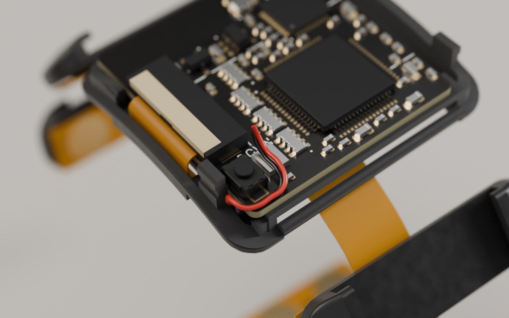

*The leads in place, seen from the button corner with the board in the base: under the board in
the J2 relief, round the edge through the lead gate, past the button, toward the cell.*

### 6.2 Magnets: base first, then the puck

The base and the puck each hold two 3 x 1 mm magnets of opposite polarity. That keys the charger: the
band only sits on the puck one way round, so the pins can never meet the wrong pads.

1. **Mark the poles.** Stack all four magnets in a column. Mark the top face of the top magnet, slide
   it off, mark the next top face, and so on. All marks are now the same pole.
2. **Base.** The two holes sit near the proximal end of the underside, either side of the centre line.
   Put a magnet in the hole on the **button side with its mark facing out** (toward the skin) and one in
   the other hole with its **mark facing in**. Glue them flush with the underside and let the glue cure.
3. **Puck pins and lead.**
   1. Cut the USB cable 1 m from its plug. Keep red (+5 V) and black (GND); cut white and green short
      and insulate them.
   2. Solder red to the pin that goes in the hole **nearer the magnets and the cable exit**: that is
      VCHG. Solder black to the other pin. Insulate both joints.
   3. Push the pins up through the puck from below until each tip stands **2.0 mm** above the plateau
      (use the calipers' depth rod; 1.9-2.4 mm is fine). Glue them from below, without letting glue reach
      the plungers. Run the cable out through the slot and fill the pocket with hot glue or epoxy as
      strain relief.
4. **Puck magnets: let the base set them.**
   1. Cover the base's underside with cling film.
   2. Let each loose magnet snap onto a base magnet through the film; it flips itself the right way.
   3. Put a drop of glue in each puck pocket and lower the base, underside down, onto the puck. The
      window goes over the pins and the loose magnets drop into the pockets.
   4. Leave it until the glue has cured, then lift the base off.
5. **Check the polarity.** Plug the USB in: with a multimeter, the pin nearer the magnets reads +5 V
   against the other.

*The charger puck: the two pogo pins in the middle and the two magnet pockets toward the cable end.*

### 6.3 Foam discs

Punch 24 discs (plus spares) from the double-sided foam tape with the 6 mm punch: 18 for the six pods
and 6 for the two pods under the module. Wipe every pocket with IPA. Peel one liner and press a disc
into each 6.2 mm pocket, **leaving the top liner on** for now. Each disc stands 1.0 mm proud of the
face.

### 6.4 Bond the flex to the base and to the six pods

The flex sticks only to the foam discs, so line it up before it touches them. Each flex pod has two
1.2 mm holes between its pads, and each shell has two 1.0 mm pins in the same places. The foam stands
higher than the pins, so the pins do not catch until the foam is pressed, and you have one try.
The needles make that try a sure one.

1. Clean the back of the flex (the side without the gold pads) with IPA.
2. **Base first.** Put the base on Blu-Tack, underside up. Peel the top liners of its six discs.
   Push the tip of a needle through each of the two holes of the flex pod that belongs there, and rest
   the needle tips in the dimples of the two pins. Slide the flex down the needles onto the foam and
   press for 30 s. Then do the second pod position under the module.
   - The tail must point to the **distal** end, beside the floor slot.
   - The gold pads face out, away from the base.
3. Run a strip of thin double-sided tape along the flex root between the two pods: from the spine to the
   edge of the tail slot. It keeps the root flat and protects the tail.
4. **The six pods.** Do them one at a time, face up on Blu-Tack, the same way: peel the liners, needles
   through the holes onto the pins, slide the flex down, press for 30 s. The flex sets the pod spacing,
   so do not stretch it.
5. Let the band rest, ideally for 24 h, before you put strap tension on it.

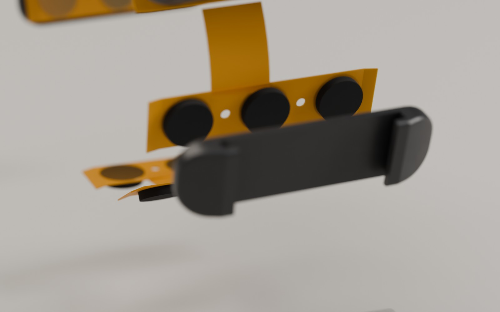

*Foam discs on the backs of the pads; a pod coming onto the flex with its pins through the holes.*

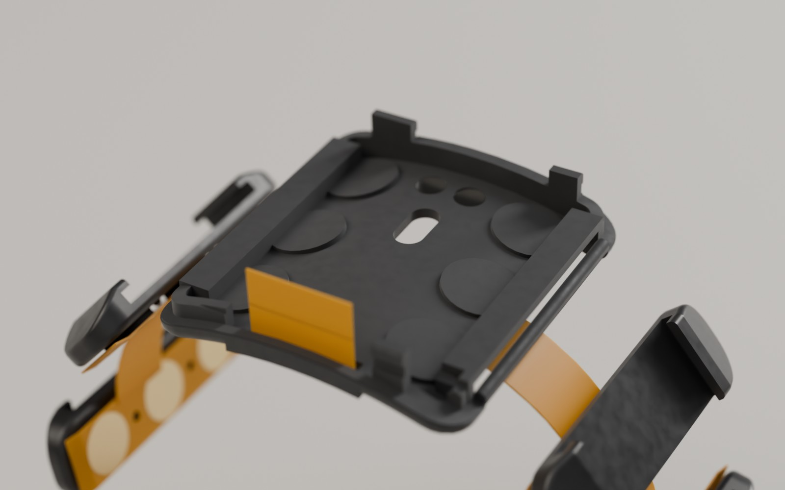

*The base on the two module pods. The tail stands up at the distal end, beside the floor slot.*

Pod numbering: use the flex's own numbering (its silkscreen, [flex_c_layout.md](../layout/flex_c_layout.md)).
The module pod under the board's antenna, on the side away from the button, is **pod 4** (channel 4).
`docs/mech/` numbers the pods in mirrored order and calls that one pod 3. The pods are identical, so this
changes only the channel names, not the assembly.

### 6.5 Tail into J1: fold the board in like a book

J1 is a front-flip connector: the latch is the flap along its mouth, on the board's distal edge. The
flex tail is 8.5 mm long and has almost no slack once the board lies in the base. So **plug the tail in
with the board standing upright above the distal end, then fold the board down**. Do not try to plug
it in with the board already lying flat.

1. Stand the base on Blu-Tack, underside down. Unplugged, the charger puck makes a good stand too: its
   magnets hold the base.
2. Feed the tail **up through the floor slot** from below. It should stand straight up next to the
   distal wall, with its gold fingers facing **proximal** (toward the middle of the base). Do not twist it.
   The vertical **DOWN** mark on the board's top silkscreen, between J1 and the button, is the reminder:
   with the board lying flat, the flex's contacts face down onto J1's contacts.
3. Open J1's latch: lift the flap up about 90° with a fingernail.
4. Hold the board **upright** above the distal end, top side facing you (distal), J1 at the bottom with
   its mouth facing down. The red and black leads hang at the button corner.
5. Lower the board onto the tail so that the stiffened end slides squarely into J1's mouth, all the way
   in: about 3.5 mm, until only a hair of the stiffener shows. Keep the board's lower edge just inside
   the base's distal wall.
6. Close the latch: press the flap down flat toward the board.
7. Fold the board down toward the proximal end, like closing a book. The tail rolls into its U-turn
   by itself. The board drops onto the two strap-slot roofs.
8. Dress the leads: they lie under the board at J2, wrap the edge through the lead gate in front of the
   button, and run up past the button's outer end.

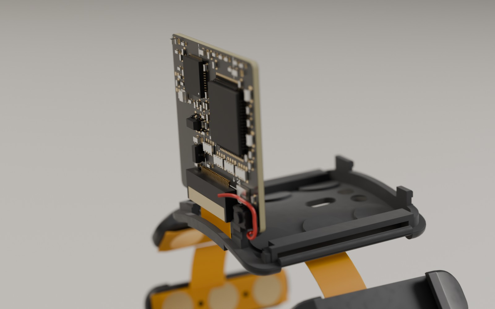

*The board upright, J1 pushed down onto the tail. The leads hang at the button corner.*

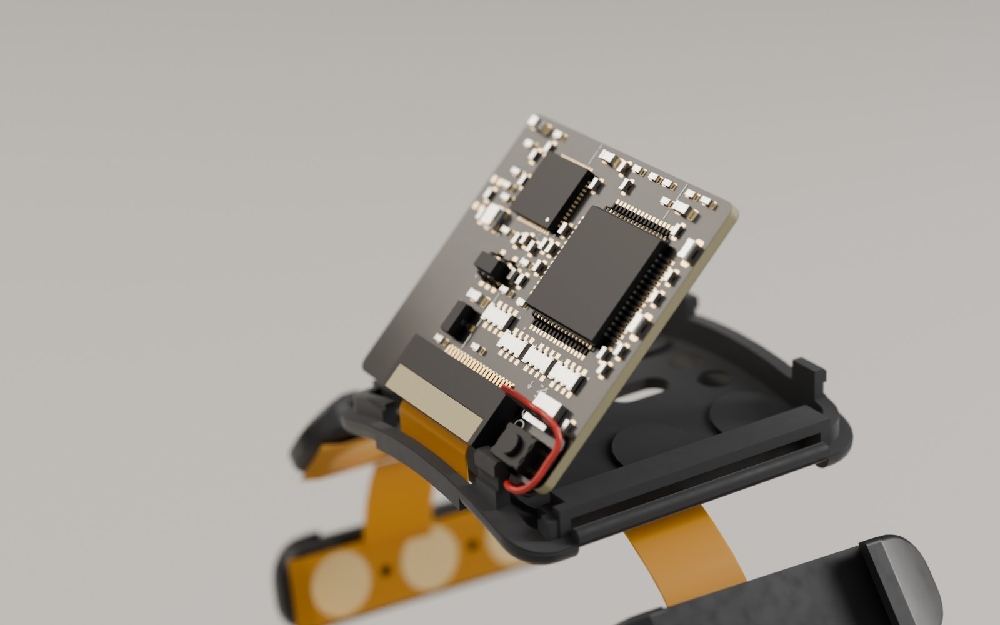

*Folding the board in: the tail bends at the top into its R1 U-turn.*

**Pin 1 check.** With the board lying flat, the flex's gold fingers face down onto J1's contacts (the
**DOWN** mark) and the plain stiffener faces up. J1's pin-1 mark on the silkscreen is at the end away
from the button. The flex's pin 1 lands at that same end by itself as long as the tail is not twisted.

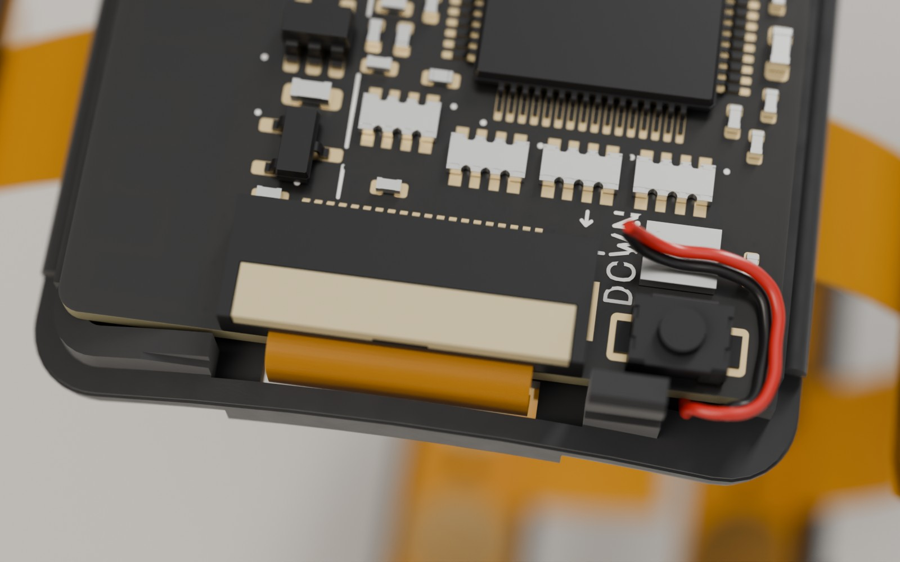

*The J1 end of the seated board, before the cell goes on. Between J1 and the button are the vertical
**DOWN** mark and its arrow. J1's pin-1 dot sits behind the left end of its pad row, away from the
button. The short white line above it belongs to the CELL outline.* If you twisted the tail or plugged it in upside down, no channel will work
([sec. 10](#10-troubleshooting)).

### 6.6 Cell

1. Put a 10 x 10 mm piece of thin double-sided tape on the big square chip (the ADS1298) and wrap a
   turn of Kapton round the cell's protection-board end.
2. Place the cell on the **CELL** outline on the board's top silkscreen (KiCad x 10.5-22.5), **lead end
   distal** against the back of J1. It overhangs the board's proximal edge by about 3 mm, past the end of
   the outline.
   - Most of the outline runs under the big chips, so use the short lines you can see: one behind J1,
     a few along the antenna side next to the two small black chips, and the ends at the proximal edge.
     The "CELL" label itself sits under the ADS1298 and is hidden.
   - Its long edge on the button side also lines up with the button's inner edge (±0.3 mm).
   - On the other side it must stay clear of the two small black chips (the charger and the regulator).
   - Do not let it go more than 0.5 mm past the outline toward the button. There the cell touches the
     base's proximal snap catch and has only 0.05 mm to the lid's corner.
3. **Splice one lead at a time.** Cut the cell's red lead to about 15 mm, strip, tin, slide on
   heat-shrink, and solder it to the red board lead with a 3 mm overlap. Insulate it. Only then do the
   black lead the same way. The splices lie flat beside the cell, on the button side, where there is
   4 mm of height above the small parts.
4. The LED blinks three times: the board has woken up.
5. Stick the soft foam pad on top of the cell (liner up). It stops the cell and board rattling.

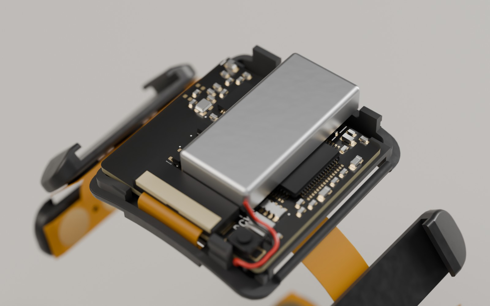

*The cell over the ADS1298, lead end against J1.*

If your cell's own leads are already thin (0.55 mm or less over the insulation) and at least 35 mm long,
you can solder them straight to J2 in sec. 6.1 instead. Tape the cell to the board before the fold.

### 6.7 Test in the open module

The band now runs on its own battery. Leave the SWD probe and charger off; it is still off-body.

- Check the LED blinks once a second, the band connects, `ads=0x92`, and `imu=1`.
- Run the foil lead-off test of sec. 5 for each pod.
- If a channel is dead, check the tail first: is it fully in, latched and not twisted? Fix it now.

### 6.8 Light pipe, button cap, lid

1. **Light pipe.** Push the 1.5 mm rod into the lid's small hole from outside until it shows inside.
   Cut it flush with the inner end of the guide tube, so it stops 0.3 mm above the LED. Add a tiny drop of
   CA at that inner end. Cut the outside flush with a fresh blade and polish it with 2000 grit.
2. **Button cap.** Drop it into the round hole from inside: the disc goes through, the flange stays
   inside. Hold it there with a scrap of tape on the outside while you close the lid.
3. **Lid.** The pry notch goes at the proximal end and the button over the switch. Press the lid down
   evenly until all four catches click and the seam is even all round. Remove the tape and press the
   button: it should click and spring back.

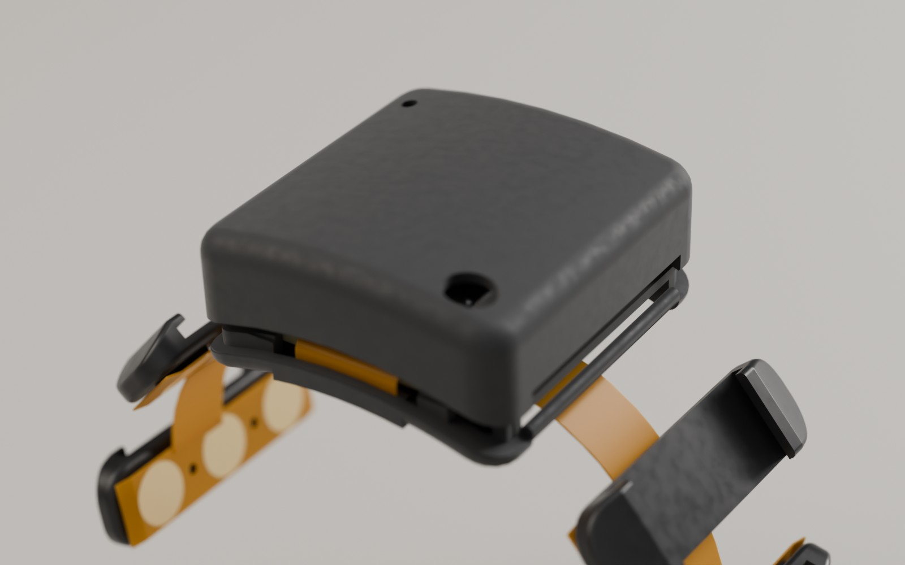

*Light pipe and button cap in place, the lid coming down. The pry notch is at the proximal end.*

### 6.9 Strap: cut and prepare the webbing

- Cut **226 mm** of webbing. That includes the 12 mm sewn loop round the ulnar loop's far bar and a
  45 mm fold-back on a 180 mm wrist; smaller wrists simply fold back more. Seal both cut ends: a quick
  pass of a flame for nylon or polyester, a smear of textile glue for rubber-cored elastic.
- **Hook tab.** Sew (or glue) the 40 mm hook tab onto the **outer, loop-fabric face** of the free end.
  That face ends up underneath when the end folds back, and the hook lands on the loop face below it.

### 6.10 Strap loops and webbing

The two printed loops are identical. Each clips onto a bar moulded into the hidden slot in an end of
the module. The webbing never wraps the bars themselves, so the flex links underneath stay free.

1. **Ulnar end (fixed).** Pass the webbing's plain end through one loop (between its clip and its far
   bar), round the far bar, and back 12 mm over itself. Sew the overlap with a box stitch of
   polyester thread.
   - **No-sew option:** glue the 12 mm overlap with flexible textile glue, clamp it and let it cure
     for 24 h. You can also buy an elastic hook-and-loop strap whose hook tab is already sewn on, and
     glue only this end.
2. **Snap the loop on.** The ulnar slot is in the module end opposite the button. Hold the loop with
   its clip's gap facing up toward the lid and the far bar pointing away from the module. Push it up into
   the slot from below until it clicks over the bar; the flex link from the module to the next pod
   passes underneath it. Tension pulls the clip onto the bar, away from its gap. To remove a loop,
   pull it straight down out of the slot; it unclips the way it went on.
3. **Thread the pods.** Wrap the electrode chain, pads inward, round the 50 mm tube with the module on
   top. From the ulnar loop, thread the webbing through the sleeve of each pod in turn: the two on the
   ulnar side, across the gap, then the four round to the button side. It always runs outside the flex.
   You can also taco-fold the webbing and press it into a sleeve through its open top. The pods slide
   along the webbing; that is intended, so the elastic never stretches the flex.
4. **Radial end.** Snap the second loop onto the bar on the button side, the same way. Pass the free
   end through it, fold it back and press the hook tab down.

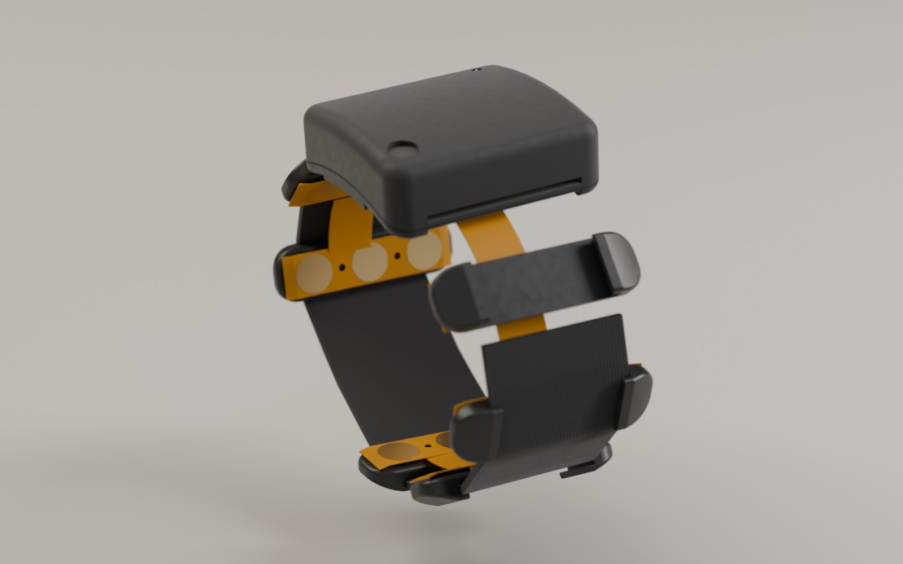

*The webbing threads through the six pod sleeves from the ulnar loop.*

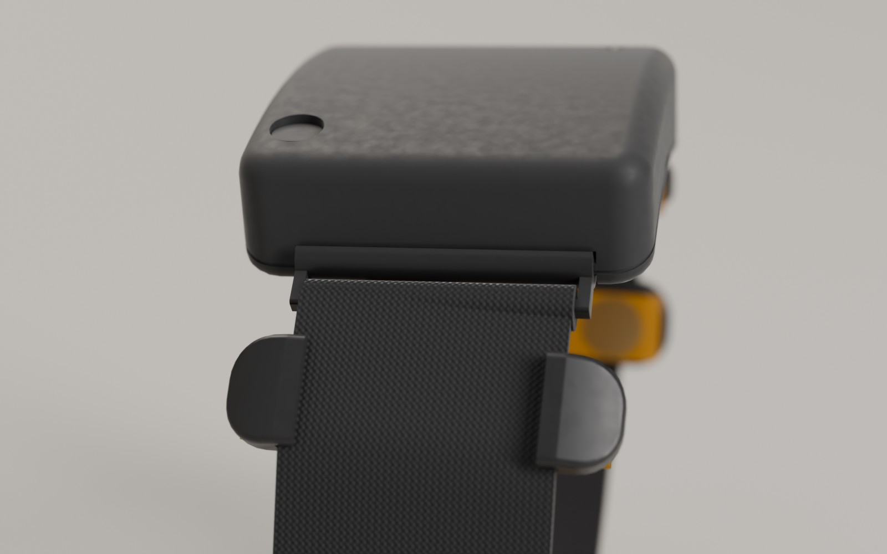

*The radial loop on its hidden bar, the end through it and folded back.*

## 7. Wearing it

- Open the tab and slip the band over your hand, or pull the end out of the radial loop and wrap it on.
- Put the module on the back of the wrist, about **25 mm above the wrist crease** (a finger's width),
  with the button toward the thumb.
- Pull the end just snug: the pads should press evenly, and a fingertip should still slide under the
  band at the gap on the inside of the wrist. Press the tab down. The elastic and the sliding pods even
  out the pressure.
- The band is one size, for 145-180 mm wrists. On a left arm it works mirrored, with the closure on
  the other side.
- Press the button for a marker; hold it 3 s to switch off; press it to wake up
  ([firmware_c.md](../firmware_c.md), LED and button).

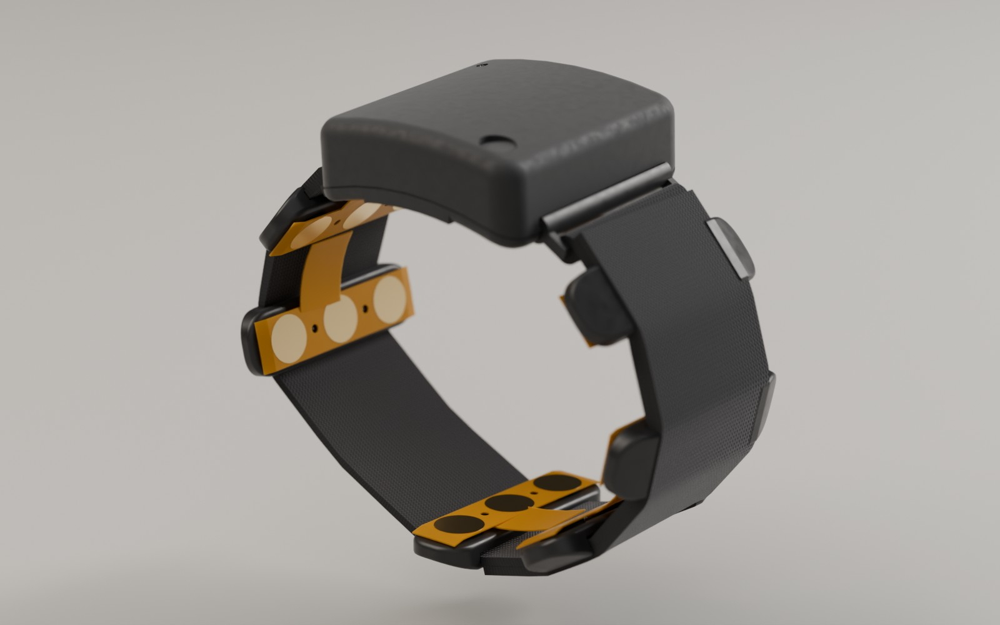

## 8. Charging

- **Take the band off first.** The charge pads sit in a 1.7 mm deep window and cannot reach skin, so
  the band cannot charge on a wrist by design. While it charges, the firmware also keeps the ADC off.
- Lay the band module-down on the puck. The magnets pull it into the one position where the pins meet
  the pads. If it is pushed away, turn it round.
- The LED stays lit while charging (100 mA, so about 1-1.5 h from flat). Wipe sweat out of the charge
  window now and then.

## 9. Opening it again (and re-flashing)

1. Put a guitar pick into the **pry notch** at the proximal seam and twist. The two proximal catches
   let go; lift the proximal end and slide the lid off toward the hand. Catch the button cap: it falls
   out when you turn the lid over.
2. Lift off the foam pad. To get the board out, flip J1's latch up and slide the tail out of the mouth;
   it bows upward.
3. Swing the board out over the distal end like opening a book. The cell is taped to the board and
   comes with it; the battery leads at the button corner act as the hinge. The SWD pads TP1-TP5 now
   face you, by the J1 edge.
4. **Re-flash** with the Pico as in sec. 5. Connect only SWDIO, SWDCLK and GND, **not 3V3**: the cell
   powers the board.
5. Put it back with sec. 6.5: board upright, tail into J1, latch closed, fold it in, then the lid.

## 10. Troubleshooting

| Symptom | Likely cause | Fix |
|---|---|---|
| No LED at all after the splice | Cell reversed or its protection tripped; a J2 joint open | Check about 3.7-4.2 V across the splice, red to VBAT. Put the band on the puck once to reset a tripped protection board |
| LED fine but no channels, or all lead-off | Tail not fully in J1, latch open, or the tail twisted or upside down | Re-seat it (sec. 6.5): fingers face the board, no twist, all the way in, latch flat |
| One channel noisy or always lead-off | That pod's flex lifted off its foam, a disc missing, or a pad not pressing | Re-press the pod, or use a thicker or denser foam disc for that pod ([mechanical_c.md](../mech/mechanical_c.md) sec. 4) |
| Band switches itself off | The button is held down: the cap binds or its stem is too long | Free the cap in its hole; sand 0.1 mm off the stem tip |
| Button does nothing | Cap jammed, or the board shifted | Free the cap. Check the board lies flat on the slot roofs |
| LED hard to see | Rod too short, not polished, or fogged by CA | Replace the rod; polish it; keep CA at the inner end |
| Lid will not click on | Leads or the splice under the lid edge; powder in the grooves; FDM swelling | Dress the leads into the gate and beside the cell; clean the grooves; ease the lead-in chamfers |
| Lid pops off | Weak catch (tolerance) | One layer of Kapton on the tongue at the catches |
| Rattle inside | No foam pad on the cell | Add the soft foam pad (sec. 6.6) |
| Will not charge | Pins too short or too long, wrong polarity, or dirty pads | Pins 1.9-2.4 mm proud; +5 V on the pin nearer the magnets; clean the window with IPA |
| The band repels the puck | The magnet keying working as intended | Turn the band round |
| A strap loop comes off | Fitted with its gap facing down | Refit it with the gap facing up, toward the lid |
| A strap bar breaks | An overloaded FDM base, or a crack | Print a new base (MJF). On the radial side only, a 1.5 mm steel spring bar in a 1.6 mm hole is a stopgap ([mechanical_c.md](../mech/mechanical_c.md) sec. 10). Keep metal out of the ulnar end, which is next to the antenna |
| Strap slowly loosens | Hook tab too short or the loop face worn | A longer hook tab or new webbing |
| Cell swells | Aged or damaged cell | Stop using it and replace it |

More background: mechanics in [docs/mech/mechanical_c.md](../mech/mechanical_c.md), the board in
[docs/layout/main_c_layout.md](../layout/main_c_layout.md), the flex in
[docs/layout/flex_c_layout.md](../layout/flex_c_layout.md), and firmware and bring-up in
[docs/firmware_c.md](../firmware_c.md). The images and the animation are rendered from the CAD with
`render/assembly_anim.py` ([docs/renders.md](../renders.md)).
