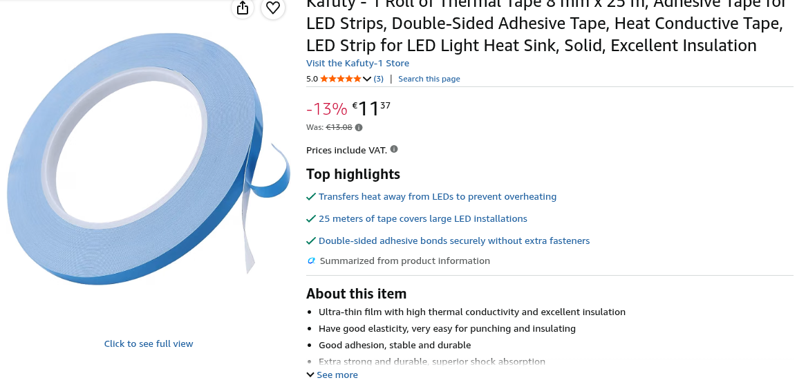
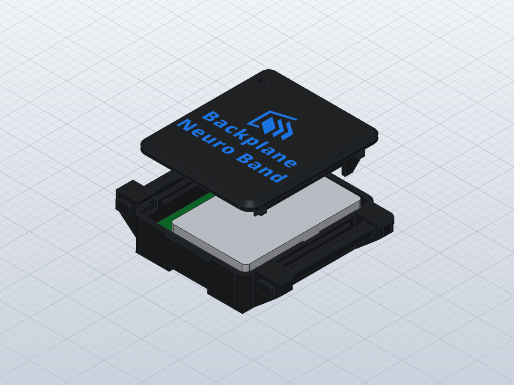
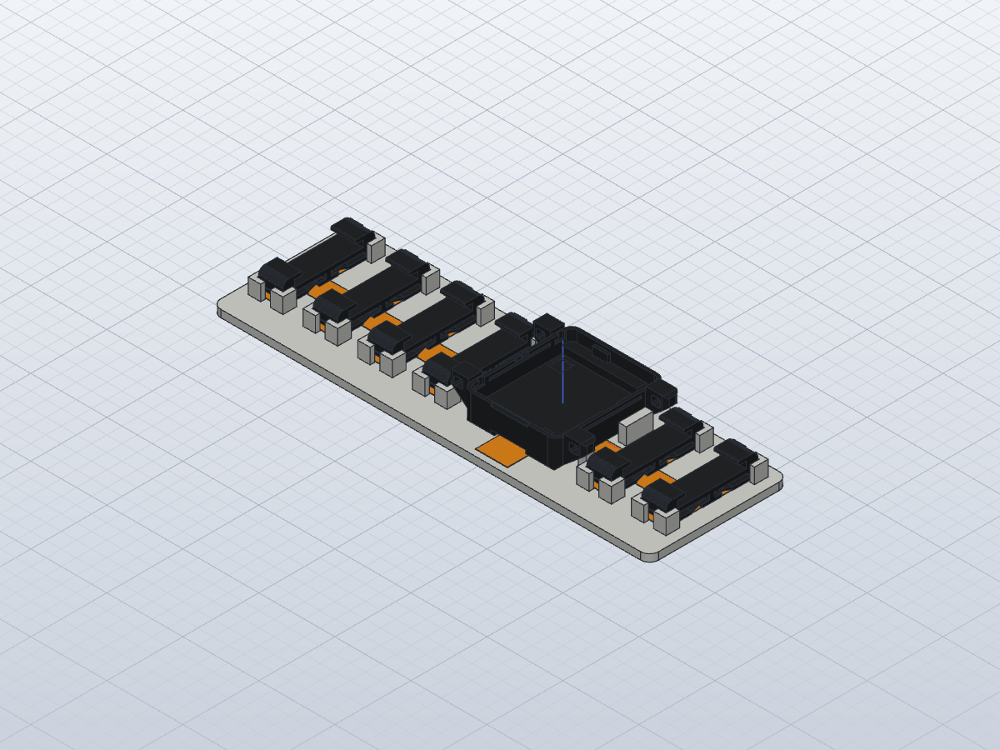
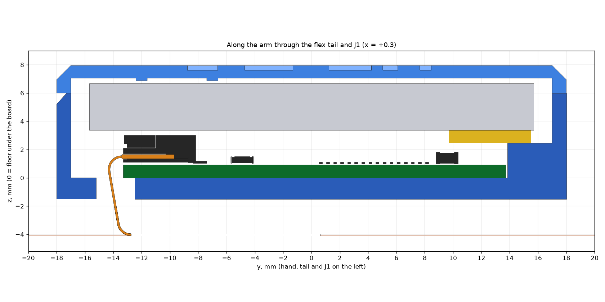
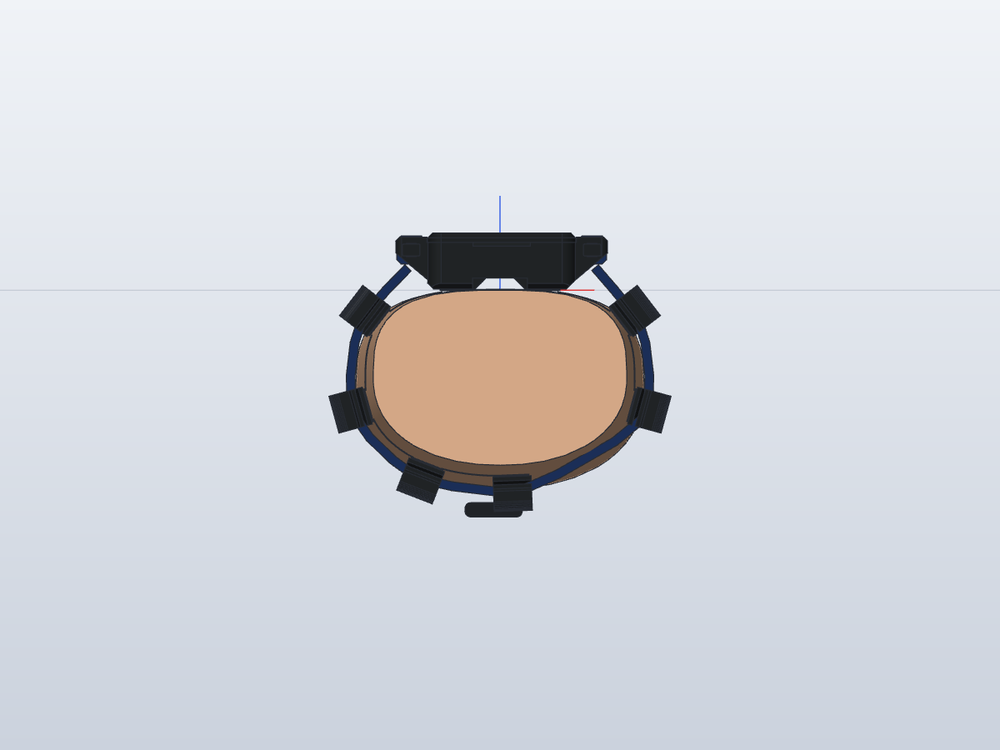

# Neurband Rev C assembly guide

This guide is for the second mechanical revision of the rev C housing (`mech/rev_c2`, 2026-11-28): a tub, a
slide-on lid, two printed strap bars and six pods with spring wings. It fits the 28.7 × 27.0 mm rev C board,
the eight-paddle electrode flex, a 302030 cell and a 22 mm two-piece nylon strap (the Tech-Protect Nylon
Classic, QuickFit 22). Paddles 3 and 4 sit under the case; the other six each get a pod. The first set was
printed on 2026-11-28 and is being worn; the [housing notes](../../mech/rev_c2/README.md#not-verified) list
what is still only checked in CAD.

"Hand end" below means the end of the case with the flex tail and J1. It is the end with the thumb notch
under the lid edge. The other end is the elbow end; the LED slit is there.

| Gather | Quantity per band |
|---|---|
| Tub and lid | One of each |
| Printed strap bars | Two (the rev C1 bars are too short) |
| Pods | Six |
| Bonding tray | One, reusable |
| Protected 302030 cell, leads soldered to J2 | One |
| Strap: Tech-Protect Nylon Classic, QuickFit 22 (22 mm two-piece nylon, buckle) | One, in two halves, with its QuickFit clips popped off so the sewn end loops are free. With this strap the band fits wrists up to about **160 mm** round; a bigger wrist needs a longer 22 mm two-piece strap |
| Thin double-sided tape, 8 mm wide (see below) | About 250 mm. Not foam tape: the flex tail has no length to spare for it |

**The tape used on the built band** is a thin double-sided thermal tape sold for LED strips: *Kafuty
thermal tape, 8 mm x 25 m, double-sided, heat conductive* (Amazon, about EUR 11). Any thin, non-foam
double-sided tape of about the same thickness should work; the CAD allows 0.1 to 0.25 mm under the flex.
Its 8 mm width matches the width of the pods' pads.

## Print and check

Open one of the two Bambu Studio projects, both oriented and set up for the X2D with a 0.4 mm nozzle,
PLA Matte, 0.12 mm layers, no supports and no brim:

- [one filament](../../mech/rev_c2/to_print/neurband_c2_x2d_plain.3mf): tub, plain lid, two bars, six pods
  and the bonding tray, all on the main nozzle;
- [two colours](../../mech/rev_c2/to_print/neurband_c2_x2d.3mf): the same parts without the tray, the lid
  with the blue logo and text as filament 2. Print `bond_tray.step` separately for this one.

The [housing notes](../../mech/rev_c2/README.md#print) have the settings per part.

1. **Pods.** Each pod has two wings and a rigid middle pad. Look along the pod: there must be an open gap
   of about 0.5 mm under each wing where it runs under the middle pad's cap, and above it.
   Press each wing flat down until it is level with the middle pad and let go; it must come back. A wing
   that does not move has a fused gap: open it with a blade.
2. **Tub.** Both long walls have a 20 mm slit under their top strip; check that it is open. Push a bar,
   split end first, through one pair of lugs until both barbs spring out, then pinch the barbs and pull it
   back out.
3. **Lid.** Set the lid on the tub about 1.3 mm toward the elbow end, so that its four pegs drop into the
   notches in the wall tops, press it down, and slide it toward the hand end until it clicks and the ends
   are flush. To open, put a thumbnail in the notch under the lid edge at the hand end, push the lid
   toward the elbow end until it stops and lift it. Pull the closed lid straight up: it may rise a
   quarter of a millimetre and must then hold. If it will not slide, shave the sloped tops of the four
   pegs on the lid with a blade.
4. **Strap.** Pop the QuickFit clips off both halves of the Tech-Protect strap so the sewn loops are free, and check that a bar
   passes through each loop and that a strap edge slides under the ears of a pod.

## Tape the flex on

The tray's top stands in for the skin. The flex lies on it electrodes down, and the tub and the pods are
pressed onto its back. The pods pick the flex up by their rigid middle pads first; the two spring wings are
taped afterwards, off the tray. That order matters: see step 6.

1. Lay the tray flat, pins up. Lay the flex on it **electrodes down**, each paddle over its pair of pins;
   the numbers 1 to 8 are engraved beside the stations. The tail lies flat on the wide margin of the tray.
2. **Tape the pods, liners on.** Cut the tape into pieces about 6.5 mm long, one per pad, and stick one on
   each of the **three** pads of every pod: the middle pad and both wing pads, with the tape running across
   the pod so its 8 mm width covers the pad. Leave every outer liner on.
3. **Tape the tub.** Stick one strip along each runner, over its three pads. At the hand end stop at the
   edge of the last pad: nothing in the pocket beside the slot, and nothing on the small foot beyond it.
   Peel both liners. Lower the tub onto paddles 3 and 4, between the four posts that stand in its strap
   bays, with the tail still flat on the tray under the tunnel. Before it touches the flex, slide it
   toward the elbow end until the posts stop it: that gives the tail its full length. Press for ten
   seconds.
4. **Pods, middle pad only.** On each pod peel the liner of the **middle** pad only. The two wing pads keep
   their liners. Press the pod straight down between its four corner posts until the middle pad is on the
   flex, and hold it for ten seconds. Pods 1 and 2 go on one side of the tub, 5 to 8 on the other.
5. Lift the tub and the pods off together, supporting the links between them. Each paddle now hangs from
   its pod's middle pad, with the two wing pads still covered.
6. **Wings, off the tray.** For one pod at a time, peel the liners of the two wing pads, lay the pod
   electrodes down on a flat table and press it down until both wings are level with the middle pad, so
   the paddle sticks to the wing pads too. Hold for ten seconds.

   Why not peel all three liners at once: the wings stand 0.9 mm proud of the middle pad. Pressed down
   with all three exposed, the wing pads touch the flex first and grab it, and the paddle can then no
   longer slide or stretch the last bit to reach the middle pad, which stays unstuck. Fixing the middle
   pad first, and the wings second, avoids that.
7. Turn the tub over. Bend the tail up at the edge of the pocket and feed its tip through the slot in the
   floor, into the tub. The two paddle ends beside it lift with it; that is what the pocket is for.

## Board, cell and lid

1. Flash and bench-test the bare board first. The [firmware guide](../firmware_c.md#build-and-flash) covers
   SWD wiring, power and bring-up. Check the polarity of the cell leads at J2 and insulate the joints.
2. Hold the board in the tub with its J1 edge down at the hand end, the component side toward the hand-end
   wall, leaning back toward the elbow at about 45°. Open the J1 latch, push the tail in squarely with its
   gold fingers **toward the board**, and close the latch. The tail has slack in this position; it takes
   it up as the board comes down.
3. Lay the two cell leads in the trough in the floor, toward the elbow end, and fold the board down. Push
   its J1 edge back under the two small wedges at the hand end as it goes flat; the far edge then drops
   between the stops. The tail should stand in the slot in a smooth curve, without a crease.
4. Bring the leads up in the corner bay behind the board. Lay the cell on the two shelves with its lead end
   toward the elbow, either face up. It must lie between the two end stops and clear of the button.
5. Put the lid on as in the dry fit: down at its offset toward the elbow end, slide toward the hand,
   click. If it will not go down, look for a lead under the lid's feet or a cell standing on a stop.

## Strap and first wear

1. Put the buckle half's loop between the lugs on the **four-pod side** and push a bar through lug, loop
   and lug until its barbs spring out. Do the same with the hole half on the **two-pod side**.
2. Tuck each strap half under the ears of its pods. The pods must slide on the strap when the band bends.
3. Pull on each strap half with the band off the wrist and look at the lugs for whitening or cracks. The
   lug dimensions are from CAD; their strength has not been tested.
4. For first wear, use battery and Bluetooth only: no charger, debugger or other cable. The built band is
   worn with the **case on the underside of the wrist** (the palm side), hand end toward the hand; the
   pods then sit around the back and the sides of the wrist. Tighten until the case sits flat and the
   middle pad of each pod touches the skin. The wings of a pod that is not pressed down still reach
   0.9 mm further than its middle pad. Then follow the [on-skin bring-up checks](../firmware_c.md#bring-up-checklist).

   The fit model and the renders show the case on the back of the wrist, where it was first designed to
   sit. The band is the same either way round; wearing the case underneath moves which forearm muscles
   sit under which channel, so record a new calibration set after changing sides.

