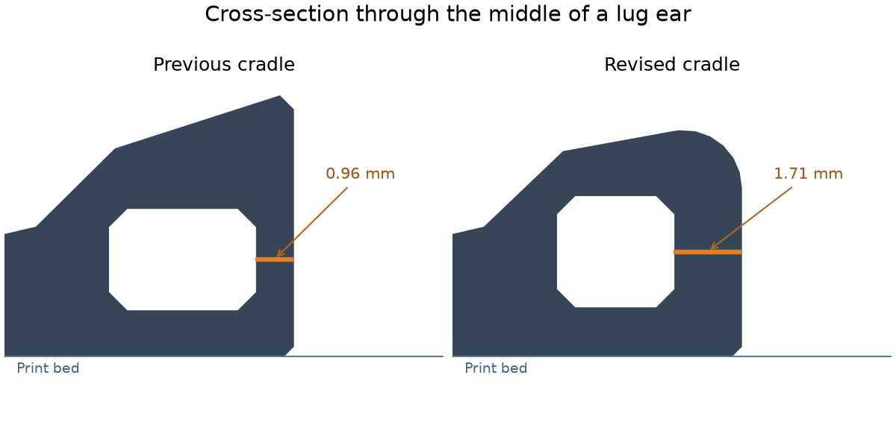
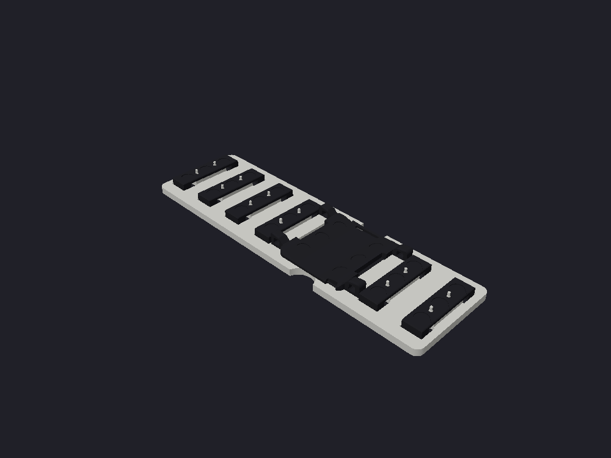
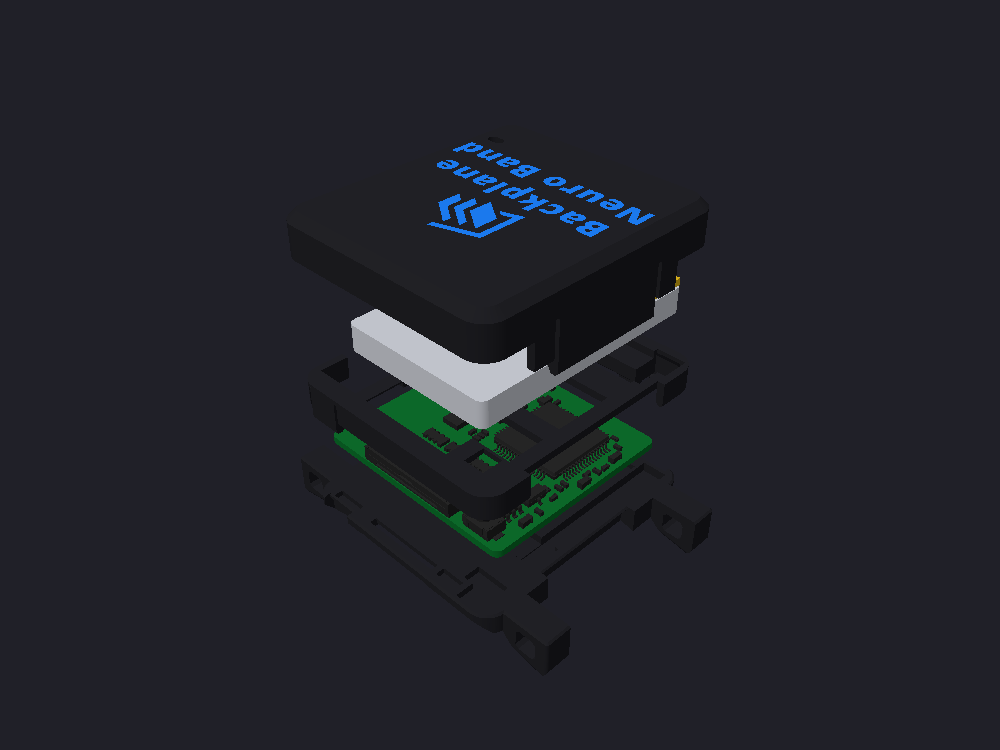

# Neurband Rev C assembly guide

This guide fits the rectangular 28.7 × 27.0 mm Rev C board, eight-paddle electrode flex, three-piece printed case and 22 mm two-piece nylon buckle strap. Pads 3 and 4 sit under the case. The other six paddles each have their own clip-on pod.

| Gather | Quantity per band |
|---|---|
| Cradle, board holder and marked lid | One of each |
| Matched printed lug bars and pod clips | Two bars, six clips |
| Protected 302030 cell and 22 mm nylon strap with accessible sewn end loops | One of each |
| Double-sided 1.27 mm foam tape, punched into 5 mm dots | 24 dots |
| Bonding jig | One reusable tool. Check the guide widths if using a previously printed jig. |

## Print and dry-fit

Open the [complete Bambu Studio project](../../mech/rev_c/to_print/neurband_22mm_complete_x2d.3mf) for the X2D with a 0.4 mm nozzle. Assign black PLA Matte to filament 1 and blue PLA Matte to filament 2. The plate includes the wearable parts and one shim for the older jig. The lid prints face down with a two-layer blue inlay. For separate parts, jig files and other plate combinations, see the [print guide](../../mech/rev_c/to_print/README.md).

1. Remove the pod brims and break away the black supports under the middle holder. Clear its key faces and the gaps around both spring tabs.
2. Try a bar in each empty lug pair. The split end should pass through both holes, spring back, and retain the bar against its broad head. The revised bar is **31.95 mm overall**, with a **2.65 × 2.50 mm shaft**. Pair it with the cradle in this project. Pinch both barbs together to withdraw it.
3. Dry-fit the two case joints before installing electronics. The holder's four keys register in the cradle and its two diagonal tabs engage. Press the lid over both side catches and check that it sits evenly. Use the pry notch at the wire-chute end to reopen it.
4. Remove the strap's QuickFit hardware and check that both sewn loops stay intact and accept a bar. Check that a strap edge can slide lengthwise under the pod hooks.

## Bond the flex

1. Set the jig flat, pins up. If it is the earlier 18:11 print, measure its cradle guides and pod platforms and fit the [corresponding shim or adapter set](../../mech/rev_c/to_print/README.md#using-an-earlier-bonding-jig).
2. Seat the cradle **flat board face down**, with its wire bay over the jig key. Put the six pods over their pin pairs, clip ears in the side pockets. All 24 round foam pockets should face up.
3. Lay the flex on the pins with **gold electrodes up**. Paddles 1 and 2 go on the two-pod side, 3 and 4 on the cradle, and 5 through 8 on the four-pod side. Feed the central tail through the cradle slot into the jig channel. Check that both short links beside the cradle lie relaxed.
4. Lift the flex, keeping its orientation. Put one foam dot in each pocket, remove the upper liners and lower the flex onto the same pins. Press each paddle over its three dots. Lift the cradle and pods off together while supporting the links.

## Install the board, holder and cell

1. Flash and bench-test the bare board before closing the case. The [firmware guide](../firmware_c.md#build-and-flash) covers SWD wiring, power and bring-up. Verify the cell lead polarity against J2, insulate the joints, and keep them low enough to sit inside the cradle relief.
2. Turn the bonded cradle board-side up. Hold the PCB beside the tail, open the J1 latch and insert the tail squarely with its gold fingers **toward the board**. Close the latch and fold the PCB onto the cradle. The tail should curve through the slot without a sharp crease.
3. Route the battery leads in the cradle trough and up through the holder's corner chute. Align the four keys, then press over the two diagonally opposite end tabs until both catch. Check that the holder sits flat and stays seated when released.
4. Lay the protected 302030 cell flat on the holder deck with its lead end toward the wire chute. Align the lid's LED slit over D1, tuck the leads below the seam and press over the two side catches. If one corner stands proud, reopen it and check the holder keys, wire route and cell position before pressing again.

## Attach the strap and check the fit

1. Put the buckle half's sewn loop between the ears on the **four-pod side**. Slide a matched bar, split end first, through the first ear, loop and second ear. The broad head rests against one outside face and both tips spring out past the other. Repeat with the hole half on the **two-pod side**.
2. Tuck the buckle half under the hooks on pods 5–8, and the hole half under pods 2 and 1. Slide each half gently in its clips and wrap the band. The strap should take up the change in length without pulling the flex links taut.
3. Gently pull each strap half while holding the empty band off-wrist and inspect the narrow wall beyond each pin for cracking or whitening. Check both bars remain latched. The published lug dimensions are CAD measurements. Load capacity and repeated flexing need a physical test.
4. For first wear, use battery and Bluetooth only. Disconnect the charger, debugger and any other cable first. Place the module on the back of the wrist, J1 toward the hand. Choose the buckle hole that brings the electrodes into contact comfortably. If a lug presses into the wrist before the pads touch, take the band off and check how the pods and strap sit. Follow the [on-skin bring-up checks](../firmware_c.md#bring-up-checklist) when the mechanical fit is comfortable.
