# neurband rev C: assembly manual (r2 mechanics)

This manual is for a first build. You need basic soldering skills: thin wires onto small pads. You
don't need a sewing machine, a hole punch, pogo pins, or glue other than a little CA or epoxy for the
charging connector. Each step says which part, where it goes, which way round, and what to check.

**r2 (November 2026).** The mechanics were redone for printing and for the re-placed main board:

- an **open hook-and-loop strap** on two thick bars that are part of the module base. It replaces the
  closed elastic loop and its printed slides;
- a **slimmer, tapered case** with a crowned lid;
- a **magnetic charging connector** in place of the printed charge clip;
- flashing **once, through five soldered wires**, in place of the SWD jig;
- a second bonding jig, the pedestal, for the base.

Figures marked *(r1 figure)* still show the earlier parts. The text is current; see "Figures to
redraw" at the end.

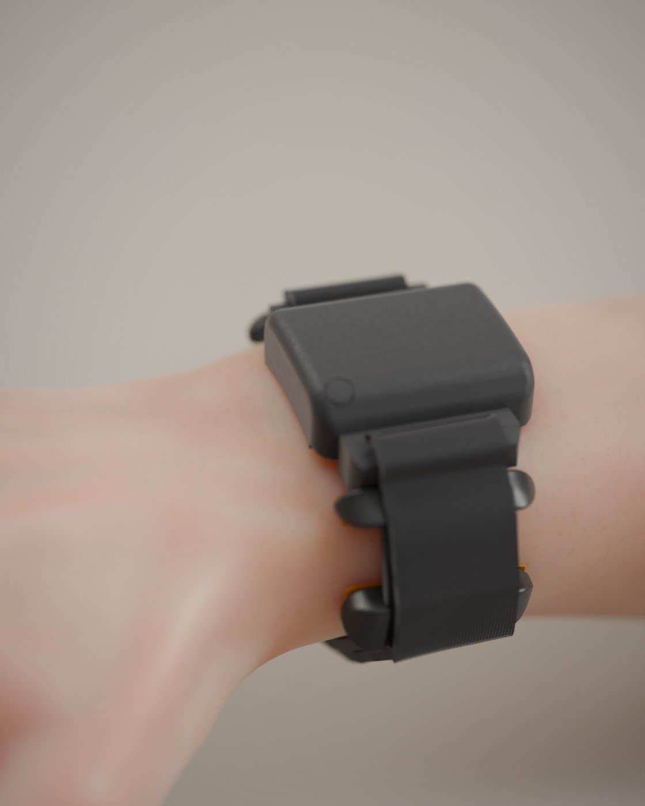

## Part 0: Before you start

### 0.1 Kit of parts

| Part | Qty per band | Notes |
|---|---|---|
| Main board (assembled by the fab) | 1 | `boards/neurband_c` |
| Electrode flex | 1 | `boards/neurband_c_flex` |
| `module_base` (MJF PA12) | 1 | With the two strap bars A and B, the connector bay and the lead channels |
| `module_lid` (MJF PA12) | 1 | Tapered, crowned shell; four snap catches |
| `button_cap` (MJF PA12) | 1 | Small: easy to lose |
| `pod` (TPU) | 6 | Snap-in strap channel |
| `cell_spacer` (MJF PA12) | 0 or 1 | Only for the shorter 401120 cell |
| Hook-and-loop strap, 20 mm, one-piece "single pass" | 1 | [sourcing.md](sourcing.md) §1 |
| LiPo 401223 (130 mAh, protected) | 1 | At most 12.0 x 25.0 x 4.0 mm including its board |
| Magnetic 2-pin connector pair | 1 | Female glued into the base; male on the charging cable |
| Foam dots, 6 x 2 mm, adhesive both faces | 25 | 3 per pod (18) and 7 for the base |
| 30 AWG wire, Kapton tape | a little | |
| Tools: `bond_jig` and `base_jig` (FDM), Pico 2 as SWD probe, soldering iron, calipers, lighter, multimeter | | |

### 0.2 Names and directions

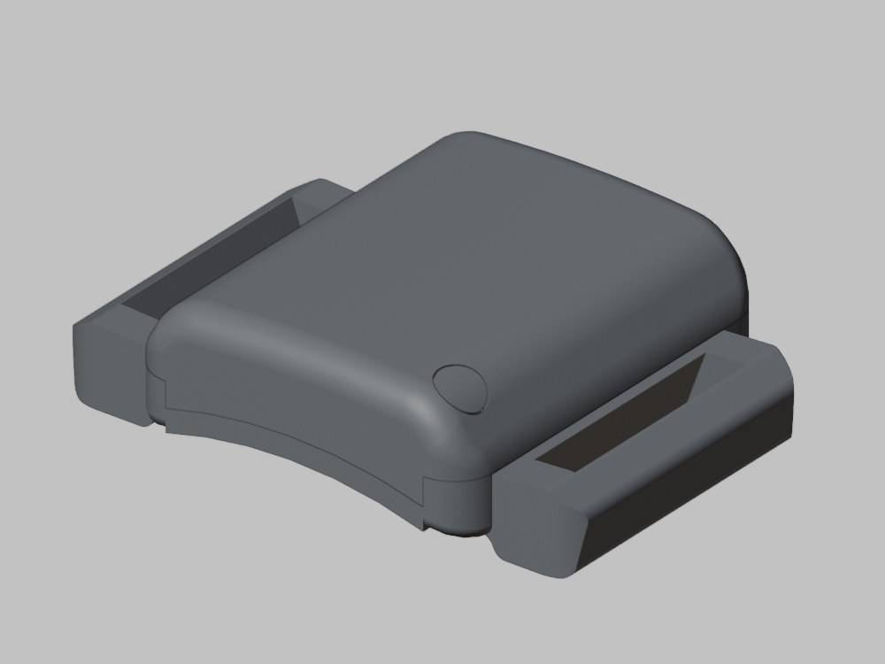

- **The J1 end** of the module points toward the hand. The **button side** goes toward the thumb, and
  the **antenna side** toward the little finger.
- **Bar A** is the strap bar at the antenna-side end (slot A, 4.4 mm). The strap's cut end is
  **locked** round it once.
- **Bar B** is the strap bar at the button-side end (slot B, 3.5 mm). The hook end goes **through it
  and folds back**; that is where you tighten and loosen.
- **Pods 1-8** are numbered as on the flex. Pods 3 and 4 sit under the module. Pods 1 and 2 are on the
  button side (pod 2 next to bar B), and pods 5, 6, 7 and 8 on the antenna side (pod 5 next to bar A).
  **The gap** is between pods 1 and 8, on the palm side near the thumb.
- **The connector bay** is the window in the module's elbow end (away from J1). The device half of the
  magnetic connector sits there.

### 0.3 Exploded overview

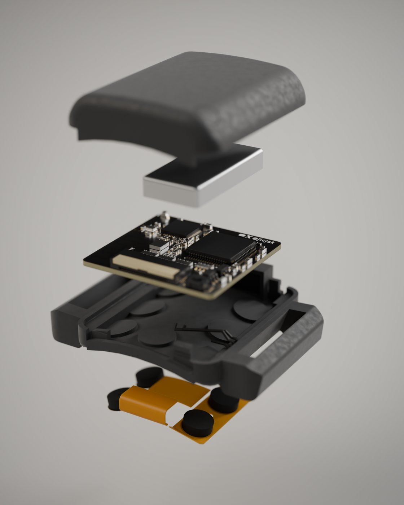

From the skin out:

- the **electrode flex**, with its 24 gold pads;
- a **foam dot** behind each pad;
- the **pods**, and the **module base** for pods 3 and 4.

The **strap** sits in the pods' snap-in channels; its ends go through slot A and slot B. The module
stacks the **base** (the magnetic connector glued into its bay), the **main board** (the flex tail
plugs into J1), the **cell**, the **lid** and the **button cap**.

### 0.4 One pod on the skin

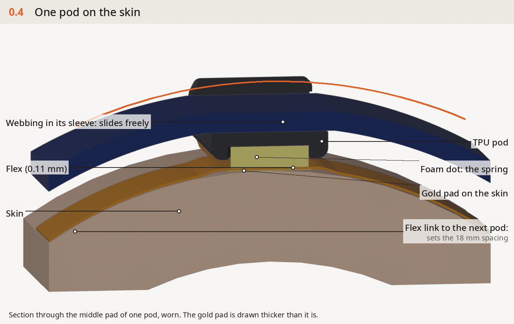

- **Foam dot.** It is the spring that keeps the **gold pad** on the skin, at about 3-15 kPa depending
  on how tight the strap is.
- **Flex.** It sets the 18 mm spacing between pods.
- **Strap.** It lies in the pod's channel, under two small TPU lips, and presses the pod onto the
  skin. It slides in the channel, so tightening never pulls on the flex. r2: the channel is open at
  the top. You press the strap in; you never thread it.

## Shopping list

Everything you buy yourself is in [sourcing.md](sourcing.md) (strap and connector checked 2026-11-01,
the rest 2026-10-29, from Greece; prices move).

| Part | Per band | Buy (pack) | ~EUR |
|---|---|---|---|
| **20 mm one-piece hook-and-loop strap** ("single pass", steel ring at one end, hook tab at the other, loop panel in the middle), size L, 302 mm | 1 | [Amazon.de B0CWH1XS7B](https://www.amazon.de/dp/B0CWH1XS7B); for wrists over 170 mm the longer [Eichmüller B06XRYRDRR](https://www.amazon.de/dp/B06XRYRDRR) | 11.50 |
| **2-pin magnetic pogo connector pair, 2.5 mm pitch** (female 12.5 x 4 mm face, 14.5 mm flange) | 1 pair | [Amazon.de B0FXL1C7N1](https://www.amazon.de/dp/B0FXL1C7N1) (2 pairs: [B0HHMGMGJY](https://www.amazon.de/dp/B0HHMGMGJY)) | 6.20 |
| USB-A lead for the charging cable (or an old USB cable) | 1 | [Amazon.de B0DFCFZD9Y](https://www.amazon.de/dp/B0DFCFZD9Y) (12) | 9.40 |
| Foam dots, **round 6 x 2 mm EVA, adhesive on both faces** | 25 | [Amazon.de B0GTVY9GP9](https://www.amazon.de/dp/B0GTVY9GP9) (1160) | 6.20 |
| LiPo cell with protection board, **401223 (130 mAh)**, at most 12.0 x 25.0 x 4.0 mm | 1 | [AliExpress 1005013473853786](https://www.aliexpress.com/item/1005013473853786.html) | 11.10 |
| Fallback cell **401120** (uses the printed spacer) | (1) | [AliExpress 1005005450826923](https://www.aliexpress.com/item/1005005450826923.html) | 1.80 |
| SWD probe: **Raspberry Pi Pico 2** with [debugprobe](https://github.com/raspberrypi/debugprobe) | 1 | [nettop.gr](https://nettop.gr/index.php/en/raspberry-pi-en/pico/raspberry-pi-pico-kits/raspberry-pi-pico-2.html) | 5.60 |
| BLE receiver for the PC: **nRF52840 Dongle** | 1 | [DigiKey](https://www.digikey.ie/en/products/detail/nordic-semiconductor-asa/NRF52840-DONGLE/9491124) | 12 |
| 30 AWG silicone or PTFE wire; Kapton tape, 10 mm | a little | [Amazon.de B094X62PSM](https://www.amazon.de/dp/B094X62PSM) (Kapton) | 6 + 5 |

That comes to about EUR 75. No pogo pins and no magnets are needed any more.

What you probably already have: a soldering iron with a fine tip and 0.5 mm flux-core solder, flush
cutters, tweezers, calipers, scissors, a lighter, thin CA glue or 5-minute epoxy, a multimeter and a
USB charger.

**What to order through Backplane.** Press **Buy it** in Backplane for:

- the assembled main board ([boards/neurband_c/ORDERING.md](../../boards/neurband_c/ORDERING.md));
- the electrode flex ([boards/neurband_c_flex/ORDERING.md](../../boards/neurband_c_flex/ORDERING.md));
- the printed parts, which are the `mech/rev_c/*.fab.json` files with no `"order": false`.

## Printing

Every printed part is in `mech/rev_c/`. The fab chooses the orientation for MJF parts. The walls of
every printed part are at least 1.0 mm (`mech/rev_c/wall_check.json`). **Tools** are only used to
build the band; they are not part of it.

| Part (`.fab.json`) | Process | Ordered (per band) | Notes |
|---|---|---|---|
| `module_base` | MJF PA12, black | 3 (1) | Two thick strap bars (A: slot 4.4 mm; B: slot 3.5 mm), connector bay, lead and wire channels, tail slot |
| `module_lid` | MJF PA12, black | 3 (1) | Tapered sides, crowned top; four snap catches; the pry notch is above the connector |
| `button_cap` | MJF PA12, black | 4 (1) | |
| `cell_spacer` | MJF PA12, grey | 2 (0 or 1) | Only for the shorter 401120 cell |
| `pod` | FDM TPU 95A, black | 14 (6) | On its side (channel vertical), no supports; 0.4 mm nozzle |
| `bond_jig` (**tool**, stage 1) | FDM PLA or PETG, white | 1 | Flat, plate down. Check that all 16 small pins printed |
| `base_jig` (**tool**, stage 2) | FDM PLA or PETG, white | 1 | Pedestal, foot down, no supports. Check the four pins on the saddle |

Retired in r2 and not ordered (`"order": false`): `strap_slide`, `charge_clip`, `swd_jig`.

## Step 1: Flash and test the bare board (once, with soldered wires)

The board is flashed **once**, before anything else. Later updates go over Bluetooth.

1. Turn the bare board over. The five SWD test pads **TP1-TP5** are in a short diagonal row in the
   corner by the LED, on the antenna side at the far end from J1. Counted from the board edge they are:
   - **TP1** +3V3 (at KiCad 1.1, 5.1);
   - **TP2** SWDIO;
   - **TP3** SWDCLK;
   - **TP4** NRST;
   - **TP5** GND (at 4.7, 1.5).
2. Tin the pads. Solder a 10 cm length of 30 AWG wire to each of TP2, TP3, TP5 and TP1, keeping the
   joints small. TP4 is not needed.
3. Wire them to the Pico 2 running [debugprobe](https://github.com/raspberrypi/debugprobe):
   - **TP2 SWDIO** to **GP3** (pin 5);
   - **TP3 SWDCLK** to **GP2** (pin 4);
   - **TP5 GND** to **GND** (pin 3);
   - **TP1 +3V3** to **3V3(OUT)** (pin 36), only while no cell is fitted.
4. With a meter, check that TP1 and TP5 are not shorted.
5. Flash and test following [docs/firmware_c.md](../firmware_c.md), "Build and flash", then bring-up
   checklist items 2-7:
   - the RTT log shows `neurband c0.1 up`;
   - the LED flashes;
   - a phone sees `neurband`;
   - the ADS ID is 0x92;
   - the test signal shows on all 8 channels.

   Make sure the Bluetooth bootloader / DFU works before you go on: from here on, updates go over the
   air.
6. **Unsolder the wires** and wipe the pads flat with the iron. The base has a 0.5 mm relief under these
   pads, so a small leftover bump is fine. Nothing may stand more than 0.4 mm proud.

## Step 2: Solder the cell leads and the charging wires

### 2.1 Cell leads onto J2

1. Lay the board **bottom side up**. **J2** (two 1.5 x 2 mm pads, 3 mm apart) is on the **button
   side**, about 8 mm from J1's edge:
   - **J2 +** (VBAT) is the pad **nearer the board edge**;
   - **J2 -** (GND) is the inner one.
2. Cut off any plug on the cell, **one lead at a time** so the leads never touch. Strip 1.5 mm and tin.
   Keep the leads long: the route needs about 25 mm.
3. Solder **red to J2 +** and **black to J2 -**. Keep the joints flat (the base has a 1.0 mm relief
   here). Put a strip of **Kapton** over both joints. From here on the board runs from the cell, so
   **never connect TP1**.
4. **Lead route** (when the board goes in, step 5):
   - the leads leave the cell's lead end (toward J1);
   - they cross the board to its button-side edge;
   - they go down past the edge in the 0.6 mm gap next to the base wall, level with J2;
   - they run back under the board to the pads, in the relief there.

### 2.2 Charging wires from J3 to the magnetic connector

1. **J3** is the pair of pads in the board's **button-side corner at the J1 end**, also on the bottom:
   - **J3 pad 1** (5 V in, VCHG) is the inner one;
   - **J3 pad 2** (GND) is the one at the edge.
2. First build the charging cable (step 9.1), so you know which **female** contact meets the cable's
   red wire. Snap the cable's male half onto the female; the magnets only let it go one way. Find with
   the meter which female pin connects to red.
3. Solder a 50 mm length of 30 AWG wire to each J3 pad: red to **pad 1**, black to **pad 2**. Run them
   flat along the button-side edge of the board's underside. Tape them down with Kapton every 10 mm.
4. Solder the other ends to the female connector's two pins: **red to the pin that meets the cable's
   red**. Cover the joints with Kapton.

## Step 3: Bond the six free pods (bonding jig, stage 1)

### 3.1 The bonding jig

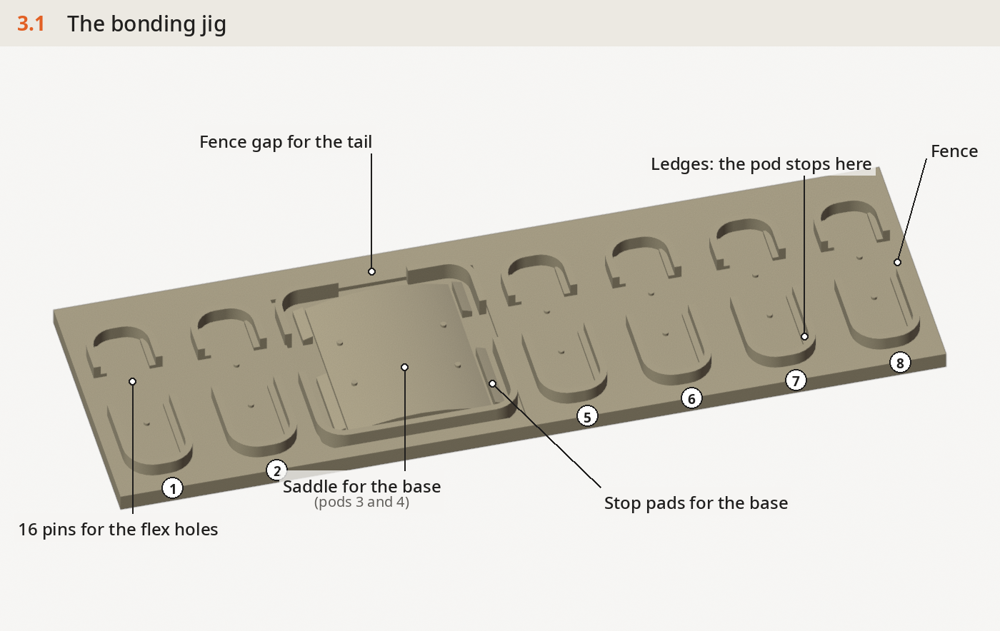

- The jig has a **nest** for each free pod: 1 and 2 on the short side, 5-8 on the long side.
- The **saddle** in the middle carries the pod 3/4 section of the flex; the base is bonded later, in
  stage 2.
- **16 pins** locate the flex by its holes. Each nest has a **fence** and two **ledges** that stop the
  pod at the right height.

### 3.2 Flex onto the jig

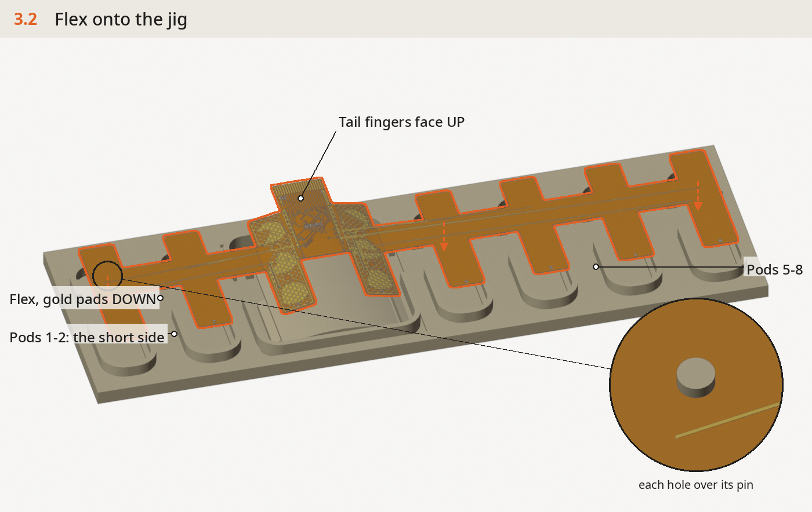

1. Lay the flex with its **gold pads DOWN** (the tail's contact fingers face UP), pods 1-2 on the
   short side.
2. Lower it so **each hole goes over its pin** (inset). It lies flat on the plate, and on the saddle
   in the middle.

### 3.3 Foam dots into a pod

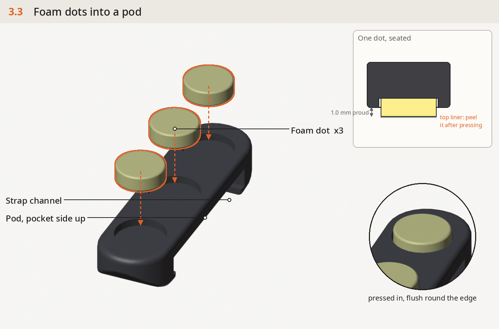

1. Hold a pod **pocket side up** and press a dot into each of its three pockets. Each dot stands
   1.0 mm proud of the pod's face.
2. **Peel each dot's top liner** after pressing it in. Do all six pods.

### 3.5 Pods into their fences

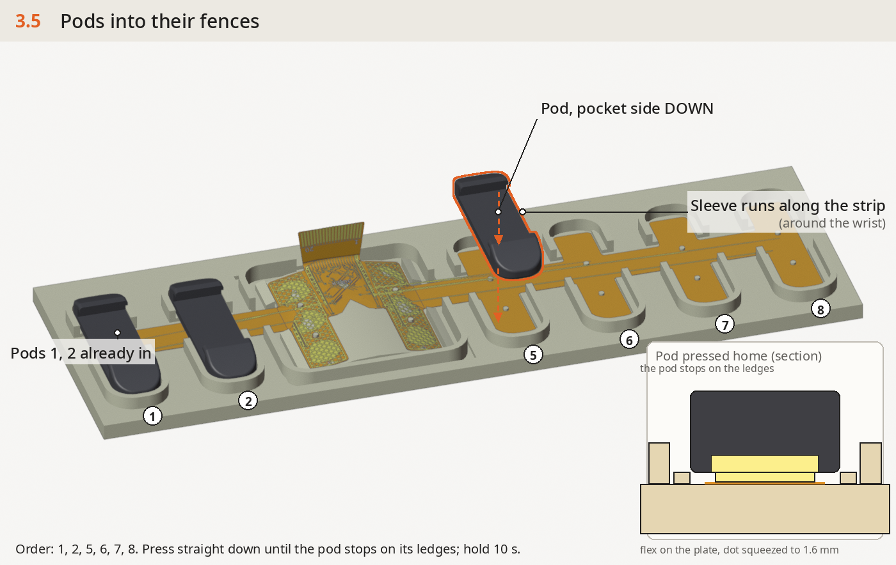

1. Turn a pod **pocket side DOWN** and lower it straight into its fence. Its **sleeve runs along the
   strip** (around the wrist).
2. Press until it **stops on the ledges** (inset), and hold for 10 s.
3. Order: **1, 2, 5, 6, 7, 8**.

### 3.6 The strip after stage 1

1. Wait 10 minutes, then lift the strip off the pins, pulling each pod straight up.
2. Check that every gold pad sits centred on its dot.

## Step 4: Bond the base (pedestal jig, stage 2)

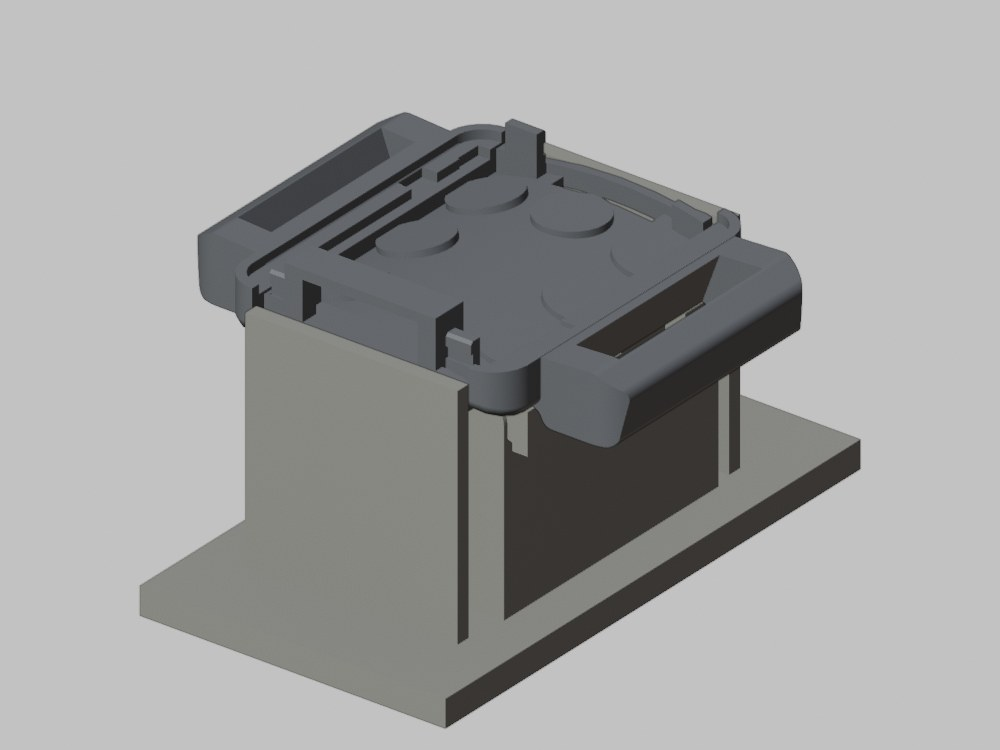

In r2 the module base carries the two strap bars outboard of its ends. On the flat jig they would land
on pods 2 and 5, so the base is pressed on here instead. Pods 2 and 5 hang down the pedestal's sides,
clear of the bars, as they do on a wrist.

1. Stand the **base jig** on the table. Lay the strip on the pedestal **gold pads down**:
   - the pod 3/4 section goes on the curved saddle;
   - its four 1.2 mm holes go over the four pins;
   - the free pods hang down both sides.
2. Turn the base upside down. Press a dot into each of the **six pad pockets** and the **root dot**
   into the small pocket by the tail slot. Peel the liners.
3. Thread the flex **tail up through the base's floor slot** from underneath.
4. Lower the base, **right way up**, onto the saddle between the two fences, with the J1 end on the
   tail's side. Press until it stops on the four pads, and hold for 10 s. The bars overhang the
   pedestal's open ends. Wait 10 minutes.

## Step 5: Board, connector and leads into the base

### 5.1 Tail into J1

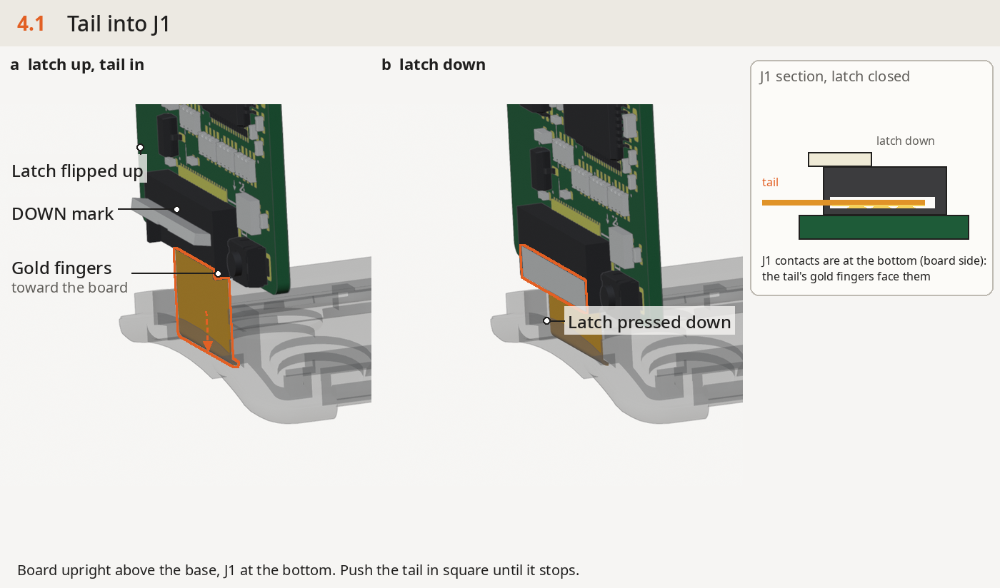

1. Put the strip down, base the right way up. Hold the board **upright above the base's J1 end**,
   with J1 at the bottom and its mouth down. Let the cell hang beside the module on its leads.
2. **Flip J1's latch up** (a). Push the tail in square until it stops, with its **gold fingers
   toward the board**: J1's contacts are on the board side (section). J1's pin 1 end has a dot.
3. **Press the latch down** (b).

### 5.2 Book-fold the board down

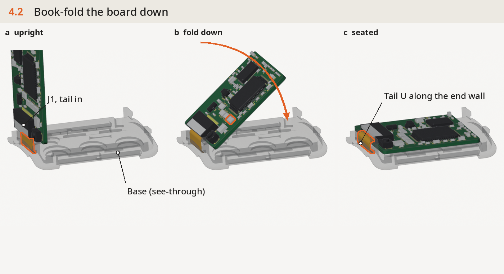

1. Fold the board down onto the base like closing a book (a to c). The tail forms a smooth **U along
   the end wall**. Don't crease it.

### 5.3 Connector into its bay; leads and wires

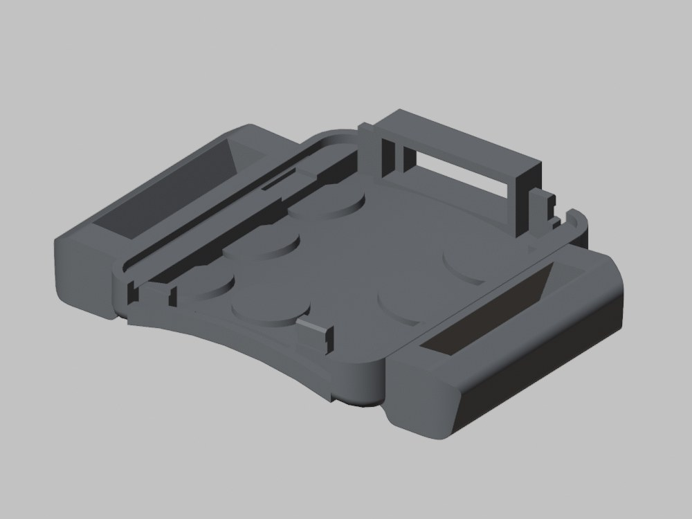

1. Put a little 5-minute epoxy (or thick CA) on the **flange** of the female connector. Push it into
   the **bay** in the elbow-end wall from the inside, so that:
   - its face is flush with the outside;
   - its pins point toward the board;
   - its wires run under the cell's end.

   Hold it for a minute. Keep glue off the face.
2. Lay the **J3 wires** in the channel under the board's button-side edge. Lay the **cell leads** past
   the board edge level with J2 (2.1, step 4).
3. Lay the cell flat on the board, **lead end toward J1**, between the lid's two cage ribs. For a
   401120 cell, put the spacer at its far end.

## Step 6: Close the module

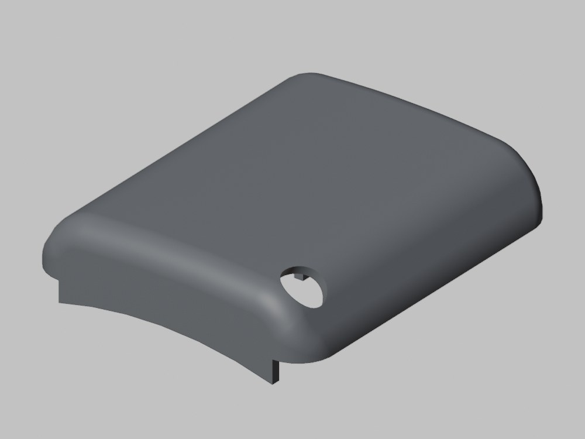

1. Stand the **button cap** stem-down on SW1. In r2 the button sits on the lid's sloped shoulder.
   Its opening is drilled square to the shell, about 28 deg off vertical, so the cap is tilted the same
   way and presses SW1 with a domed stem. Put the cap in the lid's opening first, then lower the lid.
2. Lower the lid with the cap in it so that the **LED hole** sits over D1.
3. Press the lid down at the four corners until the **four snap catches** click. There are two at
   the J1 end and two at the elbow end. At the elbow end the lid's edge sits on top of the connector
   bay. The button should click, and the LED should still flash.

## Step 7: Fit the strap

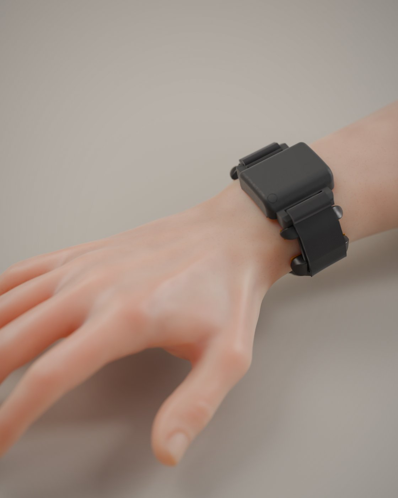

### 7.1 Measure the strap

1. Measure the band's thickness with calipers, at the loop panel and at the hook tab:
   - the band must be **1.3-2.4 mm**;
   - the hook end at most **3.0 mm** (slot B is 3.5).
2. Check the faces. When the hook end goes through bar B and folds back over the outside of the band,
   the hook tab must land face down on the loop panel. On these straps the hook and the panel are on
   the same face. Try it once by hand.

### 7.2 Cut the ring end

Cut the steel ring end off: at least the 10 mm sewn loop. For a smaller wrist, cut more:

| Wrist at the band line | Cut off the ring end | Hook tab on the loop panel |
|---|---|---|
| 145 mm | 18-33 mm (about 25) | all 44 mm |
| 160 mm | 10-21 mm (about 13) | all 44 mm |
| 180 mm | 10 mm (the ring only) | about 30 of 44 mm |

(Numbers from `mech/rev_c/fit_results.json`, size L, 302 mm. For wrists over about 170 mm the longer
fallback strap gives the full overlap.) Better still, **try it on first**:

1. Do 7.3 and 7.4 without cutting, holding the ring end.
2. See where the hook tab lands when the band is snug.
3. Cut so that the tab lands on the panel.

Heat-seal the cut with a quick pass of the lighter flame. Keep the bead small.

### 7.3 Lock the cut end round bar A

This is set once.

1. From under the module, push the cut end **up through slot A**, on the **end-wall side** of the
   slot (away from the bar).
2. Take it **over bar A**, **down its outer face**, and **under it**.
3. Tuck the end **back up into slot A between the bar and the band** (the bar side), about 6 mm.
4. Pull the long part of the band hard. It bends round the tucked end at the bar's lower inner corner
   and **pinches it against the bar**: the harder it pulls, the harder it pinches. It can only slip,
   never break.

### 7.4 Press the band into the pods

1. Starting next to bar A, press the band into the open channel of **pods 5, 6, 7, 8**, across the gap,
   then **1 and 2**.
2. Press one edge of the band under one lip, then push the other edge down past the other lip until
   it clicks in. Keep the band flat, with the **loop panel facing out**.

### 7.5 Through bar B and fold back

1. Push the hook end **up through slot B** from under the module.
2. Take it **over bar B** and fold it back down over the band.
3. Pull it until the band is snug, and press the hook tab onto the loop panel.
4. To loosen or take it off, peel the tab back and pull it out of slot B. The pods stay on the band.

## Step 8: First wear

### 8.1 On the wrist

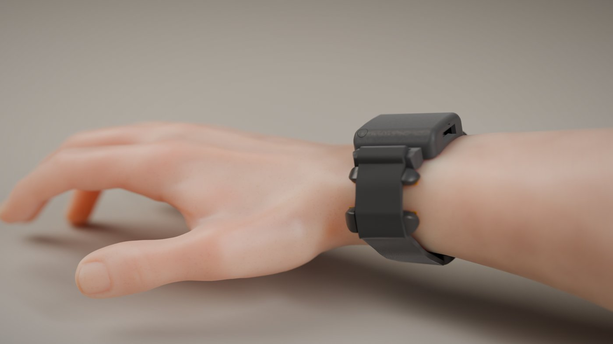

1. **Put it on.** Lay the module on the back of the forearm, wrap the strap round, pull the tail through slot B and press it down (7.5). Wear it with:
   - the module on the back of the forearm, **about 25 mm above the wrist crease**;
   - the J1 end toward the hand and the **button toward the thumb**.

   It should be snug, not tight: every pod touches the skin, and **a finger fits under the
   webbing**.
2. **Battery only.** Never wear it with the magnetic charging cable attached.
3. **Record.** Connect with `python3 host/neurband_ble.py --duration 60 -o first.npz` and follow
   [docs/firmware_c.md](../firmware_c.md), bring-up checklist item 12 ("On skin"). You should see:
   - **relaxed forearm:** a few µVrms per channel, and no mains hum in the live RMS;
   - **fist:** tens to hundreds of µV;
   - `diag_dc` well inside ±400 mV, and `rail=0x00`.

   A channel much noisier than the others usually means its pod is not on the skin: pull the tail a
   few mm tighter (7.5), or move the band 1 cm.
4. **Report.** `python3 -m analysis report first.npz` makes a per-channel report.

## Step 9: Charging

### 9.1 Build the charging cable

1. Take the **male** half of the magnetic pair (the one with the sprung pins) and a USB-A lead.
2. Solder **red (5 V) to one pin** and **black to the other**. Mark the red pin's side on the male
   housing.
3. Cover the joints with heat-shrink or epoxy.

### 9.2 Charge

1. Take the band **off the wrist**.
2. Bring the cable's head to the window in the elbow end of the module. The magnets pull it on, and
   only one way round.
3. Plug into a USB charger. The LED stays **solid** while it charges and goes back to flashing when
   the cell is full.

## Step 10: Opening and updates

1. **Updates** go over Bluetooth ([docs/firmware_c.md](../firmware_c.md)). There is no SWD access with
   the module closed. If a board ever needs SWD again, open it and solder the five wires as in step 1.
2. **Open.** Put a fingernail or a plastic pry tool in the **pry notch** at the elbow end, just above the
   connector, and lever the lid up. The catches let go.
3. **Strap off.** Peel the hook tab, pull the band out of slot B, lift it out of the pods, and untuck
   the end at bar A.

## Troubleshooting

| Symptom | Likely cause | Fix |
|---|---|---|
| Probe found, but no target | Wire on the wrong pad, or a swapped SWDIO/SWDCLK | Check TP2 to GP3 and TP3 to GP2. If APPROTECT blocks access, erase the chip (firmware_c.md bring-up item 2) |
| All 8 channels flat or railed after assembly | Tail in J1 the wrong way round, or not fully in | Re-insert it with the fingers toward the board; press the latch down |
| One channel noisy | That pod is not on the skin, or a dot lost its grip | Pull the strap a few mm tighter; re-press the pod; replace the dot |
| Pod 5 (next to bar A) reads worse than the others | The band leaves bar A above it and presses it least (fit.py: 0.15-0.25 of the mean pod load; pod 2 at bar B gets 0.55-1.35) | Tighten a little more, or add a second foam dot under pod 5 |
| Lid won't click shut | Cell not flat, a lead or wire over the board edge, or the cap off SW1 | Re-seat the cell, leads and wires; stand the cap on SW1 |
| Band loosens | The hook tab only partly on the loop panel, or the end at bar A not tucked between the bar and the band | Re-cut or re-tuck (7.2, 7.3) |
| No charge LED | Cable on the wrong way, or red and black swapped at J3 | The magnets key it; check J3 polarity with the meter |

## Physical tests to do on the first build

These numbers come from CAD and hand calculations (`mech/rev_c/logs/strap_strength.log`,
`mech/rev_c/fit_results.json`). Check them on the first band and write the results into
[docs/mech/mechanical_c.md](../mech/mechanical_c.md), section 10.

1. **Strap pull.** Hang 5 kg (50 N) from the band, module held, for one minute: nothing moves. Then
   pull harder by hand. The hook tab at bar B should be the first thing to slip (estimated 40-100 N).
   The lock at A holds well past that. Neither bar may crack: they are rated for about 190 N of band
   pull, or 105 N with every unfavourable assumption at once.
2. **Lock at A.** After 20 on/off cycles the tucked end has not crept.
3. **Pod 5** (next to bar A) gets the least strap pressure in the fit model. Compare its signal with
   pods 6 and 1. If it is clearly worse, add a second foam dot under it.
4. **Lid catches.** Open and close it 10 times with no whitening or cracks.
5. **Foam dots.** After one day, every pad still stands about 1 mm proud.
6. **Tail fold.** With the band closed, the test signal shows on all 8 channels.
7. **Connector.** 20 connections; it stays on while you move the band on the table. Nothing gets warm
   while it charges.
8. **Comfort.** Wear it for 30 minutes and check for pressure marks under the bars and pods 2 and 5.

## Figures to redraw for r2

These need new figures (render/manual_figs.py, render/guide_figures.py):

- **New r2 parts:** 0.1 kit, 0.2 names, 2.1 cell leads and route, 2.2 J3 wires to the connector, 3.1
  jig (no base fence), 3.4 (now done in step 4), stage-2 pedestal, 5.3 connector bay, 6 lid, 7.3 lock at bar A, 7.4 snap-in
  channel, 7.5 fold at bar B, 9.1-9.2 charging.
- **Removed steps:** the old SWD jig (1.1-1.3), slides (6.1-6.4) and charge clip (8.1-8.2).
- **Still valid:** 3.2-3.5, 5.1 (J1) and 5.2 (book-fold).

0.3 and the hero images are the new renders in `docs/media/*_r2.jpg`.
