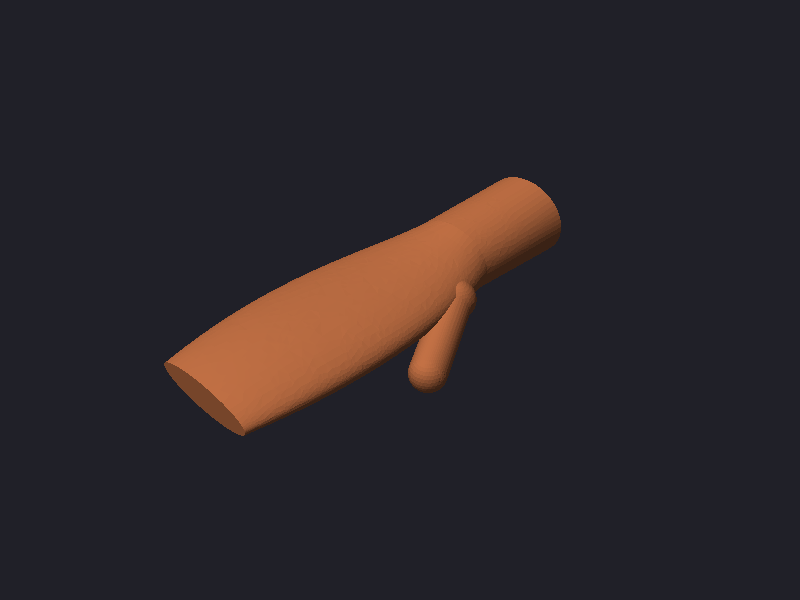

# neurband mechanical design (first iteration)

Mechanical CAD for the 16-channel bipolar sEMG wristband. All parts are FreeCAD Python scripts in
`mech/` (wrist models in `extra/wrists/`). Each script has its dimensions as named parameters at
the top, uses millimetres with Z up and the front facing -Y, checks `shape.isValid()`, and writes
`<part>.FCStd`, a coloured `<part>.step` and a log in `mech/logs/`.

```
QT_QPA_PLATFORM=offscreen timeout 300 /usr/bin/freecad mech/<part>.py      # coloured STEP
```
Build order: `extra/wrists/wrist.py`, `pod_shell.py`, `electrode_flex.py`, `housing.py`, `strap.py`,
`fit_band.py`. The fit numbers below are written to `mech/fit_results.json`.

## 1. Concept

The band copies the architecture of Meta's sEMG-RD (see `docs/research/meta_semg_research.md`):

- **16 rigid pods on one flex.** Each pod carries 3 gold domes along the arm at -10/0/+10 mm. The
  outer two are the bipolar pair (20 mm apart) and the middle one is bias/ground. Each pod is
  bonded into a stiff printed PA12 shell, so the pods are rigid and the short flex links between
  them do all the bending.
- **Module on the back of the wrist (rev 2, matches the laid-out main board).** The 30 mm flex
  tail leaves the distal edge of the strip between pods 4 and 5, which sit at the dorsal centre.
  It bends up through a slot next to the housing's distal wall, then turns proximally into J2.
  J2 is a 40-pin HCTL connector on the top side of the board, on its upper long edge, with the
  opening facing outward. Because the tail is distal and J2 is on a long edge, the board's 54 mm
  side has to run **across the wrist**, and J2 has to face distal; any other orientation would
  need a 90 deg twist in the tail. The board is turned 180 deg from the KiCad top view: the
  antenna end is on the radial side and the battery-connector (J1) end on the ulnar side, with
  J2 centred on the tail. The housing has a 38 mm wide curved seat (R44) on pods 3-6, flat wings
  beyond it, and the strap lugs under the ends of the seat.
- **Gap over the ulna.** Pods 1-4 run from the dorsal centre toward the ulnar side, and pods 5-16
  run over the radial and volar sides. The gap between pod 16 and pod 1 lands 91-103 deg from the
  dorsal centre (90 deg is the ulnar apex). The gap absorbs wrist-size variation and is where the
  strap closes.
- **Open strap.** Elastic webbing is sewn to the housing lugs, runs in the shell channels at one
  constant height, and closes with hook-and-loop through a ring over the gap. The band opens
  fully, so nothing has to pass over the hand.

Frame used in all assemblies: right forearm, palm down. X is radial(+)/ulnar(-), Y runs along the
arm (hand toward -Y, wrist crease at y = 0), Z is dorsal. The band centre line is 25 mm proximal
of the crease (it was 22 mm). The housing spans y = -20.8..+18.2 mm around it, so its distal wall
stays about 4 mm clear of the crease.


## 2. Key design decision: pod width 7.0 mm instead of 9.0 mm, and the pitch per size

Pods are rigid plates that touch the skin along their centre line, so each flex link of free
length `p - w` (pitch minus rigid pod width) has to turn by the local wrist turning angle `p/R`.
That gives a link bend radius of about `r = R(p - w)/p`. The tightest place is the radial side of
the wrist ellipse, where R is about 14-21 mm. (The ulnar apex is under the gap.)

- With the 9 mm pods from the brief, the brief's pitches cannot work. At S 8.0 mm the pods
  overlap. At M 9.0 mm the link has zero length, which is a crease (r = 0). L 10.5 gives r about
  2.5-3 mm, and only XL works.
- 16 pods plus a non-negative gap must fit in the circumference at the small end of each size
  range. This caps the pitch at roughly (C_min + 8 - w)/15.
- A rigid width of **7.0 mm** (6.5 mm dome + 0.25 mm each side) satisfies both constraints. The
  pocket is open at the sides, so the shell is no wider than the flex pod. **For the flex
  designer:** a 6.5 mm pad on a 7.0 mm pod is tight. If the outline must be wider, the extra width
  has to stay flexible and unstiffened.

**Recommended pitches** (flat flex, pod centre to pod centre): **S 8.6 / M 9.5 / L 10.8 /
XL 12.4 mm**. In each size the gap is 2-9 mm at the smallest wrist and 20-35 mm at the largest,
and the bend radius stays at or above 3 mm everywhere except the bottom of the S range. Compared
with the brief (8.0/9.0/10.5/12.0) the pitches are 0.3-0.6 mm larger, which the bend radius
requires. Meta's 10.6/12/13/15 mm pitches cannot be copied with a 16-pod closed chain on these
circumferences. The open gap is what makes our layout work.

## 3. Parts list

| Part | File | Material / process | Qty (fab file) | Notes |
|---|---|---|---|---|
| Module housing base | `mech/housing_base.step` | PA12, MJF, black (SLA tough resin also OK) | 2 | body 63.6 (across the wrist, x -21.4..+42.2) x 39.0 x 10.0 mm, walls 1.6 mm, floor 1.4 mm. 38 mm R44 seat keel with the strap lugs under its ends. Two M2 bosses for H1/H2, 4 support bosses, tail slot at the distal wall. No wall openings (the cell is charged outside the module) |
| Module housing lid | `mech/housing_lid.step` | PA12, MJF, black | 2 | snap-off lid with a lip and beads (removed for charging and for access to the programming pads and J2), 2 posts clamp the J1-end corners, 2.4 mm pin hole over the BOOT button |
| Pod shell | `mech/pod_shell.step` | PA12, MJF, grey | 36 (2 bands + 4 spare) | 7.0 x 34.0 x 4.25 mm, no end walls (the tail leaves at the shell end; the flex is located with a jig), electrode reliefs, snap channel for 20 mm webbing. The same part is used for every size |
| Strap ring | `mech/strap_ring.step` | PA12, MJF, black | 4 | 21.5 x 3.2 mm opening |
| Strap keeper | `mech/strap_keeper.step` | TPU 95A, FDM, black | 4 | holds the folded-back tail |
| Electrode flex | `mech/electrode_flex_<S..XL>.step` | polyimide 0.2 mm, ENIG/gold domes | - | **visual only**; the real flex lives in `boards/` |
| Strap webbing | `mech/strap_<S..XL>.step` (visual) | 20 mm elastic nylon webbing about 1.3 mm thick, bought | 1 short + 1 long per band | cut lengths in the table below |
| Hook-and-loop | - | 20 mm sew-on hook 40 mm + loop 60 mm, bought | per band | hook on the fold-back, loop on the outer face of the long strap |
| Screws | - | 2x M2 x 6 **nylon** (next to the antenna) | 2 per band | H1/H2 into the base bosses |
| Main board | `mech/main_board.step` (kicad-cli export, components included) | from `boards/neurband_main` | - | reference only |
| Adhesive | - | thin VHB or flexible epoxy | - | flex pods into the shells; shells of pods 4 and 5 onto the housing seat |
| Cell | - | LiPo 402030 with PCM, JST-SH lead | 1 | 0.4 mm insulating foam under it, on the AFE half of the board |

Fab files (`mech/*.fab.json`, features measured from the FreeCAD shapes):

| fab file | volume cm3 | area cm2 | size mm |
|---|---|---|---|
| housing_base | 8.76 | 101.1 | 65.8 x 39.1 x 16.3 |
| housing_lid | 3.86 | 60.6 | 63.7 x 39.1 x 7.8 |
| pod_shell | 0.580 | 7.5 | 34.0 x 7.0 x 4.3 |
| strap_ring | 0.327 | 5.1 | 26.3 x 8.0 x 2.4 |
| strap_keeper | 0.380 | 7.6 | 23.4 x 6.0 x 5.4 |

Renders:  
 
  
 


### Housing internal stack (z above the seat apex)
Floor 0-1.4. Bosses 0.6 (the board has no bottom-side parts). PCB 2.0-3.6. The tallest board
parts are J1 at 2.96 mm and the ESP32 module at 2.4 mm. The cell sits on 0.4 mm foam over the
AFE half, where the tallest part under it is a 1.55 mm SOT-23-5: cell 5.6-9.6, plus 0.4 mm
swelling allowance. Lid 10.0-11.4. The module therefore stands **11.4 mm** above the pod rails,
down from 15.4 mm, and the total band height on the dorsal side is about **17 mm** above the
skin. `housing.py` imports the real board STEP and found no clash between board, parts, cell,
base or lid.

**Battery position: above the board, not beside it.** With the board across the wrist, a cell
beside it would sit proximal of the board along the arm. The housing would grow from 39 to about
61 mm long and the cell would be cantilevered 6 mm above the forearm, all to save about 3 mm of
height (it would stand 8.3 instead of 11.4 mm). I kept the cell above the board, inside the area
the board designer reserved. Its corner is at KiCad x 15.6, which is 15.6 mm from the antenna
edge (Espressif asks for at least 15 mm).

### Interface to the main board (from `docs/layout/main_board_layout.md`)
- Board 54 x 34 x 1.6 mm, with the antenna overhanging 5.05 mm at KiCad x < 0. The housing gives
  the antenna 1 mm of clearance to a plastic-only wall. Its envelope has no metal; H1/H2 must use
  nylon screws.
- Mapping KiCad (x, y) to housing (X, Y): `X = 34.6 - x`, `Y = -17.8 + y` (`housing.pcb_to_h`).
  J2's cable opening at KiCad y = 0.5 lands at Y = -17.3, which is 1.2 mm proximal of the tail
  riser at Y = -18.5.
- **Flex tail:** the routed path needs only **13.5-14.0 mm** (bend up R1.5, riser 5.5 mm, bend
  R1.5, then 3.5 mm into J2). The 30 mm tail leaves about 16 mm of slack, and there is no room
  for a relaxed loop between the riser and the distal wall. **I ask the flex designer to shorten
  `TAIL_LENGTH` to 15-16 mm.** The alternative is to grow the housing about 6 mm distally so the
  tail can bow. The tail root is 22 mm wide and leaves a strip that curves around the wrist
  (about 1.5 mm sagitta over 22 mm at the dorsal R about 40). The first 2 mm of the tail stays
  free of stiffener so it can take that curvature.
- With the lid off, the programming pads (lower long edge, now proximal), J2's actuator, the J1
  plug and the BOOT button are all reachable. A 2.4 mm pin hole in the lid also reaches BOOT.

## 4. Strap ideas and choice

1. **Elastic nylon webbing + hook-and-loop (chosen).** Two pieces of 20 mm elastic webbing are
   sewn around the housing lug bars. They snap into the channel on every pod shell, so the strap
   sits at the same height on every pod. The long piece crosses the ulnar gap, passes through a
   printed ring sewn to the end of the short piece, and folds back onto loop tape over the gap and
   pods 14-16. A TPU keeper holds the tail. The materials are off the shelf, the tension adjusts
   continuously, and the elasticity keeps the contact force while the wrist moves. It opens fully.
2. **One-piece printed TPU carrier with pod pockets and a watch buckle.** This needs a per-size
   print and a tang buckle with holes. Pod location is very repeatable, but adjustment comes in
   steps, the pressure depends on TPU creep, and the strap is long to print.
3. **Elastic cord tensioner (Meta sEMG-RD).** Two 2 mm shock cords run through holes at both ends
   of every pod (y = +/-15, clear of the 22 mm tail) and are closed with a cord lock and hook at
   the gap. It is the lightest option and gives the most uniform tension, but it needs knot and
   cord-lock tuning and a hook to open it.
4. **Magnetic clasp (Neural Band style).** The best user experience, but it needs custom magnet and
   latch hardware and more design time. Leave it for a later iteration.

Idea 1 is the simplest for a first prototype. It needs nothing more than sewing.

## 5. Fit-check results

Wrist model: an elliptical forearm segment from the crease to 70 mm proximal. Width:depth is 1.35
at the crease, becoming rounder toward the elbow (1.29 at the band, 1.18 at 70 mm), and the
circumference grows 9 % over that length. The model also has a palm block, a finger block and a
thumb hint. Sizes are given as the circumference at the band. The assemblies are
`mech/fit_<size>.step`, and `mech/band_<S,M,XL>.step` is the same assembly without the wrist.

| | S | M | L | XL |
|---|---|---|---|---|
| Size range (wrist circumference, mm) | 130-148 | 148-169 | 169-193 | 193-220 |
| Pitch / link free length (mm) | 8.6 / 1.6 | 9.5 / 2.5 | 10.8 / 3.8 | 12.4 / 5.4 |
| Model wrist C, semi-axes a x b (mm) | 140, 25.1 x 19.3 | 160, 28.6 x 22.1 | 180, 32.2 x 24.8 | 200, 35.8 x 27.6 |
| Electrode-covered arc on skin, model (mm, % of C) | 128.5 (92 %) | 142.2 (89 %) | 161.7 (90 %) | 185.4 (93 %) |
| Covered arc at range low / high end | 98 % / 87 % | 96 % / 84 % | 95 % / 84 % | 96 % / 85 % |
| Ulnar gap, edge to edge at the flex (low / model / high, mm) | 2.2 / 12.2 / 20.2 | 6.7 / 18.7 / 27.7 | 8.2 / 19.2 / 32.2 | 8.2 / 15.2 / 35.2 |
| Gap centre from the dorsal centre (90 deg = ulnar apex) | 90-101 deg | 92-103 deg | 92-103 deg | 91-102 deg |
| Min flex-link bend radius (low / model / high, mm) | **2.87** / 3.12 / 3.33 | 4.59 / 5.05 / 5.23 | 6.95 / 7.49 / 7.96 | 9.73 / 10.1 / 11.2 |
| Collisions (CAD: shell-shell, shell-housing, housing-strap, housing-skin, tail-housing/PCB, cell/lid-board parts) | none | none | none | none (0.02 mm3 seat-shell touch) |
| Sagitta of the skin under a flat 38 mm base (mm) | 6.8 (6.3-7.7) | 5.6 (5.2-6.3) | 4.8 (4.4-5.2) | 4.3 (3.8-4.4) |
| R44 seat: housing contact / max gap under its pods (model, range) | rocks on pods 4-5; pods 3/6 gap 0.23 (0.15-0.34) | pods 4-5; 0.07 (0.01-0.20) | bridges on pods 3/6; 4-5 gap 0.08 (0.01-0.16) | bridges on 3/6; 4-5 gap 0.31 (0.25-0.45) |
| Module overhang beyond the band-wrapped radial side (mm) | **11.6** | 8.0 | 4.5 | 0.9 |
| Flex tail path needed (mm, the tail is 30) | 13.5 | 13.5 | 13.6 | 14.0 |
| Strap load per pod, max/min over pods 8-15 (model) | 2.1 | 2.1 | 2.1 | 2.1 |
| Webbing cut length short / long (mm, incl. loops + sewing) | 79 / 191 | 81 / 216 | 86 / 235 | 92 / 250 |
| Hand at the knuckles: breadth / girth (mm) | 79 / 178 | 84 / 190 | 89 / 201 | 94 / 212 |

Notes on the table:
- **Pod collisions.** There are none at any size. On a convex wrap, the gaps between hinged pods
  open on the outside. In the flat state the pods are 1.6-5.4 mm apart, so they also clear when
  the band is laid flat or bent slightly backwards.
- **Bend radius.** Bend radius is at least 3 mm everywhere except the bottom of the S range. Below
  about 138 mm the tightest link, on the radial side, drops to 2.86 mm. That is about 14x the flex
  thickness, so it is acceptable for a static bend, but route that link with copper on one layer
  only (or hatched) and keep the vias out of the link. The other sizes have 1.5-3x margin.
- **Board base.** The rigid 54 mm board sits flat on bosses and never touches the pods. Only the
  38 mm seat keel does. A flat 38 mm base would bridge 3.8-7.7 mm over the dorsal curvature,
  which is why the keel is curved. One R44 seat (radius on the pod rails) fits every size to within
  0.5 mm. On S/M it rests on the centre pods and can rock slightly about the arm axis. On L/XL it
  rests on pods 3 and 6, leaving pods 4/5 0.1-0.46 mm proud of the skin. Skin compliance under
  strap pressure (about 1-2 mm) absorbs both. If XL contact turns out poor, print an R50 variant
  (`SEAT_R`).
- **Electrode pressure.** The strap load on a pod is proportional to the local turning angle. On
  the 1.3:1 ellipse, the pods on the radial side see about twice the load of the flat volar pods.
  This is the limit of any tension band. Meta used spring-loaded pogo electrodes to even it out,
  and a later iteration could add a 1 mm compliant pad under each shell or spring domes. The pods
  next to the lugs are unevenly loaded: pods 2 and 7 on S/M carry only 0.1-0.35x the load of a
  typical pod because the lug underside is relieved by 0.5 mm. If they show poor contact, set
  `BAR_RELIEF = 0` or add 1 mm foam under the lugs. The pods next to the gap (1 and 16) are loaded
  by the closure.
- **Forearm taper.** The forearm gets wider proximally, so with pods not tilted the proximal dome
  presses about 0.3 mm into the skin model and the distal dome floats about 0.3 mm. The domes
  touch the rigid model by 34-70 mm3 in total. Real skin takes this up. The middle electrode sits
  exactly on the skin.
- **Module width.** With the board across the wrist, the module is 63.6 mm wide and sits 10 mm
  off-centre toward the radial side, because J2 is not centred on the board. It overhangs the
  radial side of the wrapped band by 11.6 mm on S and 8 mm on M, while the 38 mm seat still
  carries it. That is acceptable for a prototype but bulky. See open issues.
- **Gap and closure.** At the bottom of the S range the gap is only 2.2 mm and the ring rides over
  pod 16. S is therefore snug at 130 mm, and a 130-134 mm wrist is close to the limit.
- **Hand.** The band opens completely, so it never has to pass over the hand. For reference, the
  knuckle girth (178-212 mm) is 12-38 mm more than the band size. A closed, non-stretch loop of the
  band's size would not pass over the hand, and an elastic closed loop would need 6-27 % stretch
  (the most on small wrists).

## 6. Assembly

1. Print the parts (MJF PA12 for the shells, housing and ring; FDM TPU for the keeper). Remove the
   powder and check that the lid snaps onto the base.
2. Bond each flex pod into its shell pocket with thin VHB or flexible epoxy. The electrode tails go
   into the reliefs and the domes face out. Bond with the flex flat, on a jig at the size's pitch,
   so that the links stay straight and unstressed.
3. Thread the tail up through the floor slot at the distal wall. Bond the shells of pods 4 and 5
   to the seat keel; pods 3 and 6 rest under it.
4. Sew the short webbing around the -X lug bar (ulnar side) and the long webbing around the +X lug
   bar. To do this, thread the webbing through the slot, around the bar and back, then box-stitch
   a 15 mm overlap. Sew the ring into a 14 mm loop at the free end of the short piece. Sew the
   hook tape on the inner face of the long piece's last about 60 mm and the loop tape on its outer
   face over pods 14-16.
5. Press the webbing into the channels of pods 1-2 (short side) and 7-16 (long side), and slide on
   the keeper.
6. Put the board on the bosses, components up, with J2 at the distal wall and the antenna end
   radial, and fix it with 2 nylon M2 screws at H1/H2. Bend the tail over (R about 1.5 mm) into
   J2, check pin 1 (`docs/layout/electrode_flex_layout.md` section 7) and close the latch. Put
   the foam on the AFE area, lay the cell on it with its PCM toward J1, plug it in and snap the
   lid on. To charge or program, take the lid off; there is no charging port in the module.
7. To wear it, put the module on the back of the wrist about 2 cm above the crease, with the gap
   over the ulna (pinky side). Pass the long end through the ring, pull it snug and close the
   hook-and-loop.

## 7. Open issues

- **The board runs across the wrist (63.6 mm module, up to 11.6 mm radial overhang on S).** This
  is forced by the distal-edge tail plus J2 on a long edge. For rev 2 of the board, put J2 on a
  34 mm short edge, which would allow the board along the arm and a module about 40 mm wide, or
  cut the board to 46 mm or less. If J2 were centred on the board, the 10 mm offset would also
  go away.
- The flex tail is about 16 mm longer than the routed path. Shorten it to 15-16 mm, or let the
  housing grow about 6 mm distally so the tail can form a bow.
- S at 130-138 mm has a link bend radius of 2.86-3.0 mm, below the 3 mm rule.
- Electrode pressure varies about 2:1 around the ellipse, and the pods next to the lugs are
  underloaded on S/M. Measure the contact impedance per channel on the first prototype before
  adding springs or foam.
- The wrist model is an ellipse. Real distal-forearm sections are closer to rounded rectangles,
  with flatter faces and tighter corners, so the radial-side bend radius may be smaller and the
  flat-face pressure lower. Check on real wrists with a paper strip at 1:1 scale.
- The module is 17 mm above the skin with the cell stacked on the board. Putting the cell beside
  the board would save about 3 mm but add about 22 mm of length (see section 3).
- There is no water sealing (the snap lid is not sealed). The cell is charged outside the module.
  BOOT is reached through a pin hole.
- The pods are not tilted to follow the forearm taper (±0.3 mm). This is fine for dry domes on
  soft tissue, but a 1 deg wedge could be added to the shell.
- The renderer used for the PNGs (`backplane-serve --render`) drops colours from multi-solid
  compound objects in STEP files that contain several objects. The export now writes one object
  per solid, so the colours show; the STEP files were correct either way.
