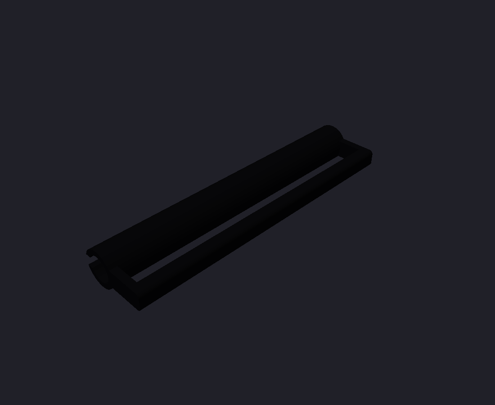

# neurband rev C mechanical design (8 pods, one size M)

Rev C is a small, clean 8-channel bipolar band. The design language is a premium consumer
wearable: one **continuous woven band**, a small pebble module and no visible clips, lugs or pins.
It comes in **one size, worn on 145-180 mm wrists**.

All CAD is in `mech/rev_c/` as FreeCAD scripts, one per part, with the named parameters at the
top. Units are mm, Z is up and the front faces -Y. Every script checks `isValid()` and writes
`.FCStd`, a coloured `.step` and a log in `mech/rev_c/logs/`. Rev A/B (`mech/*.py`,
[mechanical.md](mechanical.md)) are untouched; the shared helpers `mech/cadutil.py`,
`mech/fitgeom.py` and `extra/wrists/wrist.py` are reused, and wrist.py gained a 145 mm size.

```
QT_QPA_PLATFORM=offscreen timeout 300 /usr/bin/freecad mech/rev_c/<part>.py
build order: pod.py, module.py, strap.py, charge_puck.py, fit.py, assembly.py
```


## 1. Summary

| | |
|---|---|
| Module | **31.9 x 34.3 x 9.9 mm** (across x along the arm x thickness at the apex). The crowned lid has R2.5 blends and the underside is a R42 hollow; the body edges hang 3.1 mm lower, 13.0 mm overall. There are no external lugs: the strap enters hidden slots in the two end faces. The button is a flush disc and the light pipe a flush dot. It stands 10.5-10.8 mm above the skin |
| Strap | **One continuous 25 x 1.2 mm elastic woven webbing** (loop-fabric face) around the whole outside. It is sewn round a hidden integral bar on the ulnar side, passes through a slim printed loop that snaps onto the hidden radial bar, and folds back with a 40 mm hook tab. Opens fully |
| Pods | 6 low TPU pods, 9.0 x 32.0 x 3.2 mm. They cover the whole 30 mm flex paddle, so no flex shows, and their ends taper to 2.0 mm under the band edges. The webbing slides through a captive edge sleeve; only the soft tapered pod ends show beyond the band. Pods 3 and 4 sit in the module underside |
| Contact | Each 6.5 mm gold pad sits on a 6.6 x 1.5 mm self-adhesive foam disk in a 0.5 mm pocket, so it stands 1.0 mm proud (about 0.65 mm when worn). P-N spacing is 20 mm |
| Sizes | One size. A wrist of 145 / 160 / 180 mm leaves a 17 / 32 / 52 mm gap between pods 1 and 8 on the volar-ulnar side, which the band bridges. The electrodes cover 89 / 81 / 72 % of the circumference |
| Materials | MJF PA12 (natural grey or dyed black) for the module base, lid, button cap and strap loop. TPU 95A for the pods (own FDM printer, on their side, or MJF TPU). Bought webbing, foam and hook tape |
| Charging | The board's bottom pads VCHG/GND are reached through a 1.7 mm deep window in the module underside, with 2 magnets and a printed pogo puck. Skin cannot reach the pads, so the band cannot charge while worn |
| Mass (estimate) | About 5 g of printed parts, plus the board, the 401225 cell (about 3 g), the webbing and the flex: roughly 15 g |

## 2. Concept and frame

The wrist frame is the same as rev A/B (`mech/fitgeom.py`): right forearm palm down, X radial (+) /
ulnar (-), Y along the arm with the hand toward -Y, Z dorsal. The band centre line is 25 mm
proximal of the crease. The module frame has its origin at the apex of the module underside on
that line.

- **The module is two electrode pods plus the electronics.** The flex tail leaves the strip
  between pods 3 and 4, so the module sits over them, centred on the dorsal side. Its curved
  underside carries flex pods 3 and 4 at an arc of +/-9 mm (foam pockets and locating pins,
  exactly like a pod shell).
- **Flex tail U-turn.** The tail leaves the strip's distal edge (y = -15) heading distal. It
  bends up (R1) through a floor slot next to the distal wall and bends again (R1) into J1. The
  path is 8.2 mm, which is why the tail is 8.5 mm with the stiffener only on the last 3.7 mm (as
  agreed with the flex layout). The tail fingers are on the non-skin side.
- **Continuous band, sliding pods.** The webbing runs through every pod sleeve and slides freely.
  This is essential: the flex links between pods are inextensible (18 mm pitch), while elastic
  webbing stretches 5-15 % when worn. Pods fixed to the webbing would pull the flex apart. The
  flex sets the pod positions and the webbing only presses them on. Because the 25 mm webbing
  covers the whole pad span (y -13.25..+13.25 is under 25 mm of fabric), each pod's load lands on
  all three pads even though the TPU shell is soft.
- **Module-edge spine links** (pods 3 to 2 and 4 to 5) leave the module underside and lie on the
  skin under the strap's sewn wrap and the loop clip. The strap is always outside the flex.
- **The gap** between pod 1 and pod 8 (17-52 mm) lies on the volar-ulnar side, centred
  137-145 deg from the dorsal centre. The band bridges it, so from outside the band is
  continuous.

## 3. Module (`module.py` -> `module_base`, `module_lid`, `button_cap`, `module_assy`)

 
 

(`module_section.step` is a cut at X = +3 mm, distal end on the left. It shows the tail U-turn
into J1, the board on its supports, the cell over the TQFP and the pod 3/4 foam and pads under
the floor.)

**Shape.** The plan is a 31.9 x 34.3 mm rounded rectangle (R5.5), offset +0.35 mm radially
because the board is 28.7 mm wide on its +X side. The underside, pods 3/4 and the tail stay on
the dorsal centre.
- The lid is a single soft crown (R65 across the wrist) with R2.5 blends into the walls. R2.5 is
  the largest blend that keeps the lid clear of the cell's proximal end.
- The underside is a R42 hollow along the arm with R1.4 edge blends.
- The **parting surface runs at a constant 2.0 mm above the underside**, so the seam follows the
  curve as a 0.3 x 0.12 mm hairline.
- Walls are 1.1 mm, the floor 1.1 mm and the top 1.0 mm. A 3 mm pry notch sits at the proximal
  seam.

**Hidden strap attachment.** Each X end face has a slot 27.2 mm wide (along the arm), 3.35 mm deep
and open underneath, through which the webbing enters the body. It looks like a watch band slot.
- Inside each slot an **integral PA12 bar** (1.3 x 1.6 mm stadium section, rated for about 5 N of
  strap tension) spans the slot, 0.7 mm in from the end face, so its outer face is flush and
  hidden behind the strap. There are no pins, no metal, and nothing protrudes.
- The slot is 3.35 mm deep and the bar sits high (z = -1.0). This keeps the 1.2 mm webbing's sewn
  wrap clear of the pod 3/4 paddles and of the spine link passing beneath it.
- The ulnar bar is the fixed end: the webbing is sewn round it once, through the open underside.
- The radial bar carries the slim strap loop, which snaps on with a C-clip.
- The slot roofs double as the board's edge supports (top at the board bottom), together with
  four 2 mm standoffs. A 1 mm relief under the J2 battery pads leaves room for the wire joints.
- The snap beads moved to the +/-Y walls, because the X walls now carry the slots.

**Lid details.**
- **Button:** a flush 4.8 mm PA12 disc (`button_cap`) in a 5.0 mm opening (0.1 mm hairline) over
  SW1. It is retained by a 6.0 mm flange under the lid, and its stem stops 0.15 mm above the
  switch. It is a separate part, put in from inside before the lid closes, and replaces the
  earlier U-slot.
- **Light pipe:** a 1.5 mm PMMA rod (or clear UV resin) in a guide tube over D1, cut flush with
  the crown.

**Stack at the centre (z above the underside apex).**

| z (mm) | item |
|---|---|
| 0-1.1 | floor; pods 3/4 foam pockets 0.5 deep on the outside |
| 1.1-1.7 | 0.6 mm gap for bottom pads and wire joints (SWD, battery, charge pads) |
| 1.7-2.7 | board, 28.7 x 27 x 1.0 mm (`boards/neurband_c/neurband_c.step`) |
| 2.7-4.7 | parts: J1 FPC and SW1 2.0 mm, TQFP 1.2 mm |
| 4.15-8.15 (+0.3 swell) | LiPo 401225 on 0.15 mm tape over KiCad x 10.5-22.5, y -3.3..21.7 (the parts under it are at most 1.2 mm), proximal of J1 and clear of the antenna region (x 0..5.65, y 11.65..27) |
| 8.9-9.9 | lid top |

**Charging, with a safety interlock by geometry (signal-chain review sec. 7).**
- VCHG and GND are board bottom pads at KiCad **(14, 6) and (14, 9)**. They were moved off the
  flex spine, which runs under the module centre strip at y -7..+0.6.
- They sit in a 3.0 x 6.0 mm stadium window, **1.7 mm deep** (at least 1.5 mm), at module
  y 1.7..7.7. When worn the pads are about 2.4 mm from the skin, so skin cannot touch them.
- A 4 x 8 x 0.4 mm counterbore locates the charger. Two N52 3 x 1 mm magnets sit in floor pockets
  at x = +/-3.6, set N/S to key the polarity.
- `charge_puck.step` carries two 2.0 x 6 mm pogo pins at 3 mm pitch and two flush magnets of
  opposite polarity, with a USB lead.


**Clash check** (`logs/module_checks.json`, against the real `boards/neurband_c/neurband_c.step`):
board, parts, cell (including the swell box), tail, button cap, base and lid are all at
0.00-0.006 mm3, which is tessellation level. The tallest part under the cell is the TQFP at
1.19 mm, and SW1 (2.0 mm) sits 0.14 mm under the cap stem.

**Printing.** MJF PA12 is the recommended process: the snaps, clip and integral bars need its
toughness, and it needs no supports. On your own FDM printer, print the lid top-down on the bed
in PETG at 0.12 mm layers. The base needs tree supports under the curved underside. That is fine
for fit tests.

## 4. Electrode pods and compliant contact (`pod.py` -> `pod.step`, `pod_with_flex.step`)

 

- **Shape.** A low TPU 95A pebble, 9.0 x 32.0 x 3.2 mm (4.05 mm above the skin when worn), with
  R1.2 top blends and R0.8 face blends. It covers the whole 30 mm flex paddle; the ends taper on
  an R43 arc from 3.2 mm at the sleeve rims to 2.0 mm at the tips. The face blends are the strain relief where the flex
  spine leaves at +/-X (y -7..+0.6).
- **Captive edge sleeve.** A 25.4 x 1.6 mm slot runs through the pod along the band. Its roof is
  open over the middle 22.4 mm, so the fabric stays visible, and two 1.5 mm rounded rims hold the
  webbing edges. To assemble, thread the webbing through the pods; it cannot pop out and slides
  freely. Nothing protrudes: from outside the pods read as small soft bumps under the band.
- **Compliant contact** (signal-chain review sec. 2). A 7.0 x 0.5 mm pocket behind each pad
  (y = -10/0/+10) holds a 6.6 x 1.5 mm self-adhesive PU or EVA foam disk, so the pad stands
  1.0 mm proud when free and about 0.65 mm when worn. The flex is held only by the adhesive foam
  and floats between the pads (polyimide cannot be forced into a dome).
- **Locating pins.** Two pins, 1.0 mm diameter and 0.55 mm tall, sit at y = +/-5 in the flex's
  1.2 mm holes (0.2 mm clearance, not a press fit). They locate the flex during bonding,
  disengage when worn and act as over-compression stops.
- **Tuning.** If a pod reads poorly, use a thicker or denser foam disk.

**Pressure.** The load on a pod is T x (wrap angle). About 0.4 N of strap tension gives about
3 kPa per pad; a firmly closed band (1-2 N) gives about 7-15 kPa.

## 5. Strap (`strap.py` -> `strap_loop.step`; the webbing is a swept band in the assemblies)



**Chosen: one continuous 25 x 1.2 mm elastic woven webbing** with a loop-fabric face
(off-the-shelf 1 in elastic hook-and-loop band; plain elastic webbing plus 110 mm of sew-on loop
tape also works). Keep it at 1.2 mm or thinner: the sewn wrap round the ulnar bar must clear the
spine link beneath it.
- **Ulnar end:** fixed, sewn round the hidden ulnar bar.
- **Around the wrist:** the webbing runs through the six pod sleeves and across the gap.
- **Radial end:** it passes through the slim printed loop on the radial side. The loop is
  26.8 x 6.4 x 3.3 mm, snaps onto the hidden bar and has a 1.9 mm opening. The webbing turns
  round the loop's far bar and folds back over its own outer face, closing with a 25 x 40 mm hook
  tab.
- The fold-back is 78 / 64 / 45 mm on 145 / 160 / 180 mm wrists. The whole band opens by peeling
  the tab and pulling the end out of the loop.

Why 25 mm: it covers the whole pad span, so it presses all three pads directly, and the 32 mm
pods show only their tapered 3.5 mm ends at each edge. The flex is fully covered. A 28-30 mm band
would hide the pod ends too, but its 30-32 mm slot would cut into the module's R5.5 plan corners
(the end faces are straight for only 23 mm). That needs a squarer module, so it is left as an
option.

Alternatives considered:
1. Two-piece webbing with a printed buckle ring at the gap (the previous version). Rejected: it
   puts a visible buckle on the volar side and breaks the continuous look.
2. An off-the-shelf nylon sport loop with spring bars. It is 2-3 mm thick and would need steel
   spring bars next to the antenna.
3. A printed TPU band with tang buckle. It is not elastic and adjusts in steps.
4. Shock-cord tensioner (Meta sEMG-RD style). The most uniform load, but cord and cord lock look
   technical.

**Cut list (from `fit_results.json`):** webbing **234 mm**, including the 12 mm sewn loop at
the ulnar bar and a 45 mm fold-back at 180 mm. Hook tape 25 x 40 mm.

## 6. Fit check (`fit.py` -> `fit_results.json`, `fit_145.step`, `fit_180.step`; `assembly.py` -> `fit_160.step`, `band_assembly.step`)

  


The wrist model is the rev A/B ellipse forearm (`extra/wrists/wrist.py`), now also built at
145 mm. In each case:
- the module rests centred on the pads of pods 3 and 4, with the foam at its worn compression;
- the free pods sit 18 mm apart along the flex, tangent to the wrist, and are tilted to follow
  the forearm taper (the module tilts 2.7-3.4 deg);
- the webbing is taut, modelled as the convex hull of the hidden ulnar bar, the pod sleeves, the
  skin across the gap and the loop's far bar, then swept as one smooth B-spline band;
- collisions are CAD Boolean volumes.

| | 145 mm | 160 mm | 180 mm |
|---|---|---|---|
| Model wrist semi-axes a x b (mm); dorsal / side radius | 25.9 x 20.1; R 33.4 / 15.6 | 28.6 x 22.2; R 36.8 / 17.2 | 32.1 x 24.9; R 41.4 / 19.3 |
| Gap between pod 1 and pod 8, edge to edge (mm) | 17.2 | 32.2 | 52.2 |
| Gap centre from the dorsal centre (90 = ulnar apex, 180 = volar centre) | 137 deg | 141 deg | 145 deg |
| Electrode coverage (pod 1 to pod 8 arc / circumference) | 88.6 % (128.4 mm) | 80.5 % (128.9 mm) | 71.8 % (129.3 mm) |
| Pod collisions (shell-shell, shell-module, CAD mm3) | 0.0 / 0.0 | 0.0 / 0.0 | 0.0 / 0.0 |
| Spine bend radius, min free link (mm); links 2-3/4-5 at the module | 10.51; 14.41 | 11.81; 17.09 | 13.44; 21.0 |
| Module seat gap underside-skin: centre / edge (mm) | 0.61 / 1.63 | 0.73 / 1.3 | 0.85 / 0.97 |
| Module tilt following the forearm taper | 2.72 deg | 3.0 deg | 3.37 deg |
| Strap loop far bar clearance to skin (mm) | 1.52 | 1.47 | 1.41 |
| Module / pod shells vs. skin (CAD mm3); strap inner face to skin, min (mm) | 0.0 / 0.0; 0.7 | 0.0 / 0.0; -0.41 | 0.0 / 0.0; -0.58 |
| Strap vs. pods / module; loop vs. module / pods (CAD mm3) | 0.0 / 0.0; 0.0 / 0.0 | 0.0 / 0.256; 0.0 / 0.0 | 0.0 / 0.47; 0.0 / 0.0 |
| Strap load per pod, relative (pods 1, 2, 5, 6, 7, 8) | 1.35, 1.00, 0.86, 1.21, 0.75, 0.83 | 1.50, 0.87, 0.72, 1.22, 0.81, 0.89 | 1.53, 0.77, 0.61, 1.22, 0.94, 0.93 |
| Strap load max / min | 1.8 | 2.08 | 2.52 |
| Strap tension for 3 kPa on an average pad (N) | 0.37 | 0.38 | 0.42 |
| Strap path ulnar bar -> loop (mm); fold-back (mm) | 128.9; 78.3 | 143.2; 64.0 | 162.2; 45.0 |
| Pads pressed into the rigid wrist model (taper; foam/skin take it, CAD mm3) | 11.505 | 12.222 | 13.344 |

Notes:
- **Gap and the ulna.** The flex chain is 133 mm long, so the gap absorbs the 35 mm size range.
  Pod 1 lands within about 10 deg of the ulnar apex (108 / 98 / 87 deg).
- **Bend radius.** The free spine links bend at R10.6 mm or more and the module-edge links at
  R14.5 mm or more, at least 3.5x the 3 mm rule.
- **Module seat.** Only the 6 pads touch. The underside clears the skin by 0.6-0.85 mm at the
  centre and 1.0-1.6 mm at the edges.
- **Strap.** The webbing rests on the skin across the gap. Strap-vs-pod volume is measured with
  untilted pods: the 1-3 deg taper tilt of each pod is taken by a slight twist of the webbing.
  The module-edge links drape onto the skin under the strap wrap. That gives a static S-bend of
  R0.6-1.4 mm where they leave the module (the tightest on 145 mm wrists), which is below the
  12x-thickness guideline for 2-layer flex (see open issues). The load spread across pods is 1.8-2.5:1. Pods 1 and 6 carry the most; pods 2 and 5 next to
  the module the least.

## 7. Interface to the board and flex

- **Board** (`boards/neurband_c/neurband_c.step`, 28.7 x 27 x 1.0 mm):
  - J1 centred at x = 14 with its mouth on the y = 27 edge;
  - SW1 at (24.8, 25.1), D1 at (2, 1), and J2 (bottom) at (23.9, 25.6)/(26.9, 25.6);
  - **J3 VCHG/GND must be at (14, 6)/(14, 9).** This was agreed; the 03:12 PCB still had
    (14, 9)/(14, 12), which would put the window over the flex spine;
  - the board is supported by the two slot roofs (x 0..3 and 25.7..28.7, |y - 12.2| <= 14.4) and
    standoffs at (1.6, 1.6), (26.4, 1.6), (1.6, 25.4), (26.6, 22.6). Keep bottom copper off
    those areas except J2;
  - parts under the cell rectangle must be at most 1.3 mm;
  - the mapping is KiCad (x, y) to module (x - 14, -14.8 + 27 - y) (`module.k2m`).
- **Flex** (`flex_c_layout.md`):
  - pods 7.1 x 30 at an 18 mm pitch, 1.2 mm holes at +/-5, spine at native Y -0.6..+7.0;
  - the tail is 8.5 mm long with the stiffener on the last 3.7 mm, fingers on the non-skin side,
    and is mirrored at the fingers;
  - the outline is otherwise as used here.

## 8. Parts, fab files and cost

| Part | File | Process / material | Qty (fab) | Size mm | Volume cm3 |
|---|---|---|---|---|---|
| Module base | `mech/rev_c/module_base.step` | MJF PA12, grey | 3 | 34.5 x 31.6 x 6.2 | 1.20 |
| Module lid | `mech/rev_c/module_lid.step` | MJF PA12, grey | 3 | 34.5 x 32.1 x 11.0 | 1.85 |
| Button cap | `mech/rev_c/button_cap.step` | MJF PA12, grey | 4 | 6.0 x 6.0 x 4.5 | 0.06 |
| Pod shell | `mech/rev_c/pod.step` | TPU 95A (FDM or MJF TPU), black | 16 (2 bands + 4) | 27.7 x 9.1 x 3.8 | 0.23 |
| Strap loop | `mech/rev_c/strap_loop.step` | MJF PA12, black | 4 | 26.8 x 6.4 x 3.3 | 0.16 |
| Charger puck | `mech/rev_c/charge_puck.step` | MJF PA12 or FDM PETG | 2 | 30.1 x 26.1 x 7.4 | 3.50 |

The fab files are `mech/rev_c/<part>.fab.json` (kind 3dp; volume, area and size measured from the
FreeCAD shapes).

Bought parts per band:
- 25 mm elastic woven webbing with a loop face (0.25 m) and a 25 mm sew-on hook tab;
- self-adhesive foam sheet 1.5 mm (18 disks);
- 4 N52 3 x 1 mm magnets, 2 x 2.0 x 6 mm pogo pins and a USB lead;
- 1.5 mm PMMA fibre;
- a protected 401225 LiPo.

Together these are about 6-10 EUR.

**Cost.** MJF PA12 at JLC3DP-class services is roughly 1.5-3 USD per part (the per-part minimum
dominates), so the 4 PA12 parts per band cost about 8-12 USD. The six TPU pods on your own FDM
printer use about 1.5 g of TPU, well under 0.10 EUR. These are estimates; take the live quote
from the fab files.

## 9. Assembly

1. Punch 18 foam disks. Stick one into each pod pocket and 6 into the module underside.
2. Lay the flex skin-side down on a flat plate. Press each pod and the module base on so the pins
   enter the holes and the foam takes the pads. Hold for 1 min.
3. Fit the tail and board:
   1. Thread the tail up through the floor slot and glue the magnets in (N/S).
   2. Solder the cell leads to J2. Set the board on the slot roofs and standoffs.
   3. Fold the tail (R1) into J1, fingers down, and close the actuator.
4. Tape the cell, fit the light-pipe rod and the button cap, and snap the lid on.
5. Fit the strap:
   1. Sew the webbing end round the hidden ulnar bar through the underside opening.
   2. Thread the webbing through the six pod sleeves.
   3. Snap the strap loop onto the radial bar.
6. To wear it, put the module on the back of the wrist about 25 mm above the crease. Pass the end
   through the loop, pull it just snug and press the hook tab down.
7. To charge, take the band off and lay it module-down on the puck.

## 10. Open issues

- **J3 position** must move to (14, 6)/(14, 9) on the board (agreed, not yet in the 03:12 PCB).
- **Antenna.** The plastic-only region (KiCad x 0..5.65, y 11.65..27) is kept free of metal by
  the module (integral bars, magnets at x 10.4/17.6). Pod 3's flex lies below it. Tune with the
  band worn.
- **Module-edge spine links** bend at R0.6-1.4 mm (static) where the strap wrap presses them onto
  the skin. Keep those first 3 mm of the links free of vias and of B-side copper, or accept the
  static bend after a flex-cycling test.
- **Pod load spread** is up to 3.3:1 on 180 mm wrists; pods 2 and 5 next to the module carry the
  least. A 0.5-1 mm shim in their sleeves evens it out.
- **Strap bars are integral PA12** (about 5 N). If a bar ever cracks, drill 1.6 mm and use a
  1.5 mm steel spring bar, on the radial side only.
- **Module size:** 31.9 x 34.3 mm, set by the 28.7 mm board and the 25 mm cell.
- **Foam choice and pressure.** Measure contact impedance per channel against strap tension
  (signal-chain review sec. 2).
- **No sealing** (snap lid). The charge window is open to sweat; wipe it, or conformal-coat the
  board bottom outside the pads.
