# neurband rev C mechanical design (8 pods, one size M)

Rev C is a small, clean 8-channel bipolar band. The design language is a premium consumer
wearable: one **continuous woven band**, a small pebble module and no visible clips, lugs or pins.
It comes in **one size, worn on 145-180 mm wrists**.

**To build one, follow [docs/build/assembly.md](../build/assembly.md)** (ordering, printing, gluing,
bring-up, the assembly sequence with images, strap, charging, troubleshooting).

All CAD is in `mech/rev_c/` as FreeCAD scripts, one per part, with the named parameters at the
top. Units are mm, Z is up and the front faces -Y. Every script checks `isValid()` and writes
`.FCStd`, a coloured `.step` and a log in `mech/rev_c/logs/`. Rev A/B (`mech/*.py`,
[mechanical.md](mechanical.md)) are untouched; the shared helpers `mech/cadutil.py`,
`mech/fitgeom.py` and `extra/wrists/wrist.py` are reused, and wrist.py gained a 145 mm size.

```
QT_QPA_PLATFORM=offscreen timeout 300 /usr/bin/freecad mech/rev_c/<part>.py
build order: pod.py, module.py, strap.py, charge_puck.py, fit.py, assembly.py
```

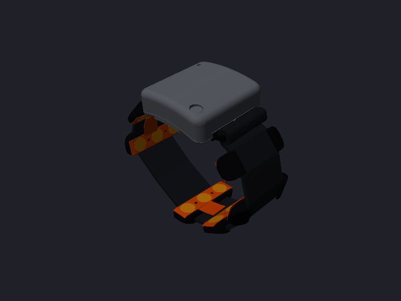
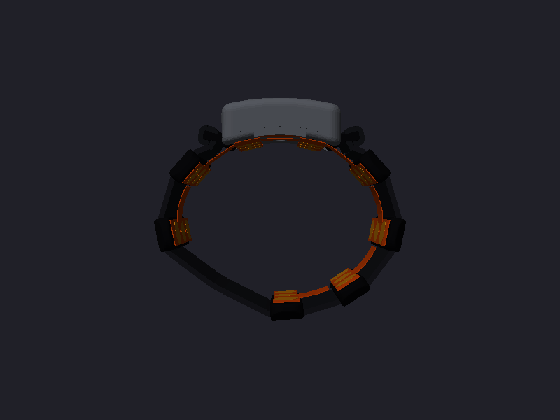
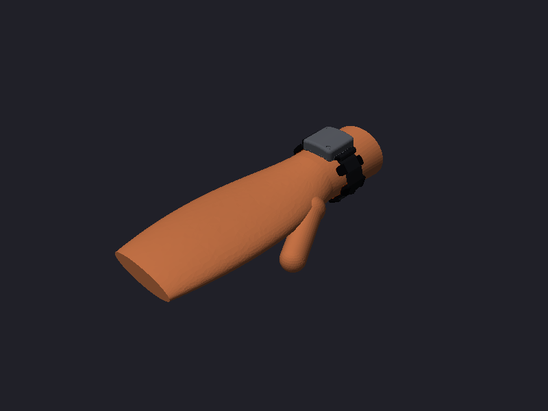

## 0. Easy-assembly redesign (2026-10-29): what changed

The band was redesigned for the fewest bought items and the fewest, most foolproof steps. The board
and flex interface is unchanged. All named dimensions are parameters in `rc.py`; the sourced
values (`docs/build/sourcing.md`) are set there.

| Area | Before | Now |
|---|---|---|
| Strap | 22 mm hook-and-loop elastic, ulnar end sewn round a loop, radial end folded back with a sewn 40 mm hook tab | **Plain 20 x 1.5 mm woven elastic** (`STRAP_W` 20, `STRAP_T` 1.5 nominal, every slot and sleeve clears `STRAP_T_MAX` 1.8). **One closed loop, slipped over the hand**: both ends locked round the same printed **`strap_slide`**, a two-bar slide clipped onto the hidden bar; the tail tip tucks under the friction bar and the loaded strand pinches it (sec. 5). No sewing, hook-and-loop or glue |
| Module strap bars | 1.3 x 1.6 mm integral bar over a 24.8 mm span (about 5 N) | Same bar over a 22.8 mm slot, plus a **1.2 mm centre rib** back to the slot wall: two 10.8 mm spans, rated about 20 N. The slide's C-clip is split round the rib |
| Pods | 3.9 mm tall, 1.0 mm locating pins, 6.2 x 0.5 mm foam pockets | **4.9 mm** tall (sleeve 20.6 x 1.9, 1.0 mm pockets for **6 x 2.0 mm pre-cut EVA dots**: pads 1.0 mm proud). **No pins**: the bonding jig locates the flex |
| Module underside | Pins, 6.2 x 0.5 pockets, 2 magnet through-holes | No pins or magnets. 0.6 mm pockets (the floor plus the 0.6 mm gap to the board leave no more), so the module pads stand 1.4 mm proud. A seventh dot holds the **flex root** (pocket at (0, -10.4)) |
| Flex bonding | Hole punch, needles, transfer tape | **`bond_jig`**: a printed plate with 16 pins through the flex holes, fences that locate the six pods and the base, ledges and stops that set the press depth, and an R42 saddle for the module section |
| Charger | Magnetic puck, 4 magnets, 2.0 x 6 mm pogo pins | **`charge_clip`**: snaps onto the module's proximal end; a key in the pry notch makes it fit one way only. **2 P50 pogo pins** (0.68 mm, glued with a drop of CA) on VCHG/GND, 2 x 0.74 N preload. No magnets anywhere |
| Light pipe | 1.5 mm PMMA rod | **None**: the 1.6 mm hole and its guide tube are open over D1 |
| Cell | Tape on the TQFP, foam pad; 401225 | **401223-class** (at most 12 x 25 x 4 mm incl. board) in a **12.4 x 25.5 mm cage**: two ribs under the lid. The shorter 401120 fallback cell takes the printed `cell_spacer`. Its own leads go straight to J2 (no splice) |
| SWD | Wires or a bought pogo clip | **`swd_jig`**: a board nest with 5 P50 pins on TP1-TP5. At 1.27 mm pitch the pins lean +/-12 deg alternately so the printed webs stay >= 1.0 mm |
| Adhesives | Foam tape, transfer tape, Kapton, CA, textile glue | **The foam dots only**, plus a drop of CA for each pogo pin; Kapton only to insulate |

Why the slides sit at the module and no closure buckle is used: from the hidden bar to the pod 2/5
sleeve there is 8.1-9.3 mm (`fit.py`). A tri-glide or ladder lock for 1.5-1.8 mm webbing needs 9-12 mm,
but the two-bar slide needs 6.0 mm. A buckle in the volar gap would need a second webbing piece and
two more parts. The closed loop stretches over the hand (the gap between pods 1 and 8 opens) and is
set to the wrist once, by pulling a slide's tail.

## 1. Summary

| | |
|---|---|
| Module | **31.9 x 34.3 x 9.9 mm** (across x along the arm x thickness at the apex). R3.4 plan corners; the crowned lid has R2.5 blends and the underside is a R42 hollow. The body edges hang 3.1 mm lower, 13.0 mm overall. There are no external lugs: the strap enters hidden slots in the two end faces. The button is a flush disc and the light pipe a flush dot. It stands 10.5-10.8 mm above the skin |
| Strap | **One closed loop of plain 20 x 1.5 mm woven elastic** round the whole outside, slipped over the hand. Each end is locked round an identical printed two-bar slide clipped onto the hidden integral bar (tail tip tucked under the friction bar, pinched by the loaded strand); the length is set once at the slides |
| Pods | 6 TPU pods, 9.0 x 32.0 x 4.9 mm with 1.0 mm minimum walls (no pins). They cover the whole 30 mm flex paddle, so no flex shows, and their ends taper to 2.0 mm beyond the band edges. The webbing slides through a captive edge sleeve; only the soft tapered pod ends show beyond the band. Pods 3 and 4 sit in the module underside |
| Contact | Each 6.5 mm gold pad sits on a pre-cut 6 x 2.0 mm double-sided EVA dot in a 6.4 x 1.0 mm pocket, so it stands 1.0 mm proud (about 0.65 mm when worn); the module's pads in 0.6 mm pockets stand 1.4 mm proud. P-N spacing is 20 mm |
| Sizes | One size. A wrist of 145 / 160 / 180 mm leaves a 17 / 32 / 52 mm gap between pods 1 and 8 on the volar-ulnar side, which the band bridges. The electrodes cover 89 / 81 / 72 % of the circumference |
| Materials | MJF PA12 for the module base, lid, button cap, strap slides, charge clip, cell spacer and SWD jig. TPU 95A for the pods (own FDM printer, on their side). The bonding jig is FDM PLA/PETG. Bought: webbing, foam dots, cell, 7 P50 pins, a USB cable |
| Charging | The board's bottom pads VCHG/GND are reached through a 1.7 mm deep window in the module underside by a printed clip with 2 P50 pogo pins that snaps onto the module's proximal end (keyed by the pry notch). Skin cannot reach the pads, so the band cannot charge while worn |
| Printability | Every printed part has walls of at least 1.0 mm, measured on the exported STEPs (`wallcheck.py`, sec. 8) |
| Mass (estimate) | About 5 g of printed parts, plus the board, the 401225 cell (about 3 g), the webbing and the flex: roughly 15 g |

## 2. Concept and frame

The wrist frame is the same as rev A/B (`mech/fitgeom.py`): right forearm palm down, X radial (+) /
ulnar (-), Y along the arm with the hand toward -Y, Z dorsal. The band centre line is 25 mm
proximal of the crease. The module frame has its origin at the apex of the module underside on
that line.

- **The module is two electrode pods plus the electronics.** The flex tail leaves the strip
  between pods 3 and 4, so the module sits over them, centred on the dorsal side. Its curved
  underside carries flex pods 3 and 4 at an arc of +/-9 mm (foam pockets and locating pins,
  exactly like a pod shell).
- **Flex tail U-turn.** The tail leaves the strip's distal edge (y = -15) heading distal. It
  bends up (R1) through a floor slot next to the distal wall and bends again (R1) into J1. The
  path is 8.2 mm, which is why the tail is 8.5 mm with the stiffener only on the last 3.7 mm (as
  agreed with the flex layout). The tail fingers are on the non-skin side.
- **Continuous band, sliding pods.** The webbing runs through every pod sleeve and slides freely.
  This is essential: the flex links between pods are inextensible (18 mm pitch), while elastic
  webbing stretches 5-15 % when worn. Pods fixed to the webbing would pull the flex apart. The
  flex sets the pod positions and the webbing only presses them on. The 22 mm webbing presses the
  middle 22 mm of each pod. The pod's 1.0 mm-wall TPU shell, a box 3.9 mm deep, carries that load
  to all three pads.
- **Module-edge spine links** (pods 3 to 2 and 4 to 5) leave the paddle edge along the R42 seat
  and hang free on a smooth tangent curve to pod 2/5. They pass under the loop clips and the
  strap's wraps round the loops' far bars with at least 0.1 mm clearance and bend at R2.3 mm or
  more. The strap is always outside the flex.
- **The gap** between pod 1 and pod 8 (17-52 mm) lies on the volar-ulnar side, centred
  137-145 deg from the dorsal centre. The band bridges it, so from outside the band is
  continuous.

## 3. Module (`module.py` -> `module_base`, `module_lid`, `button_cap`, `module_assy`)

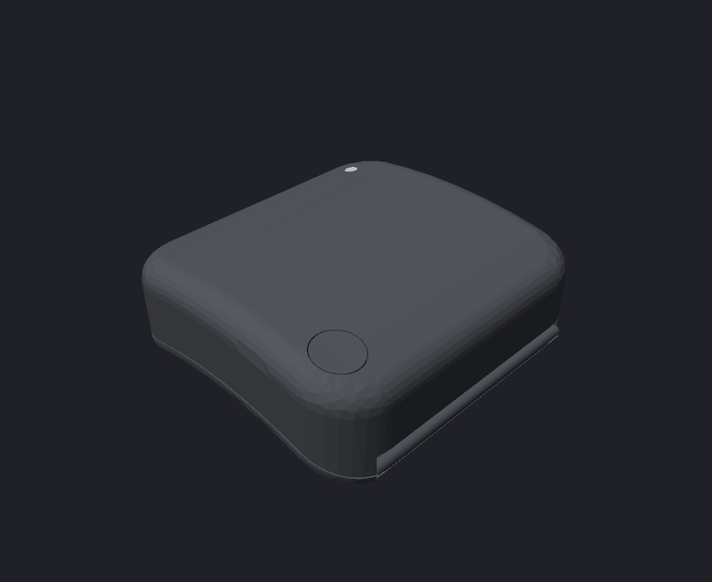 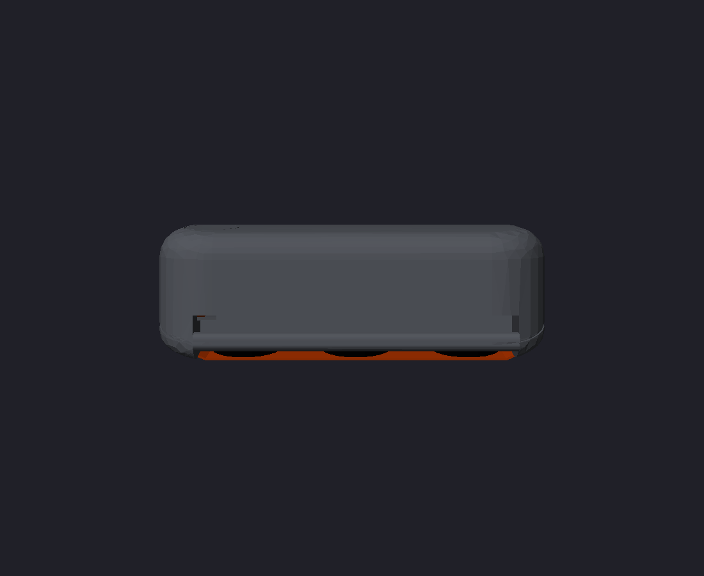
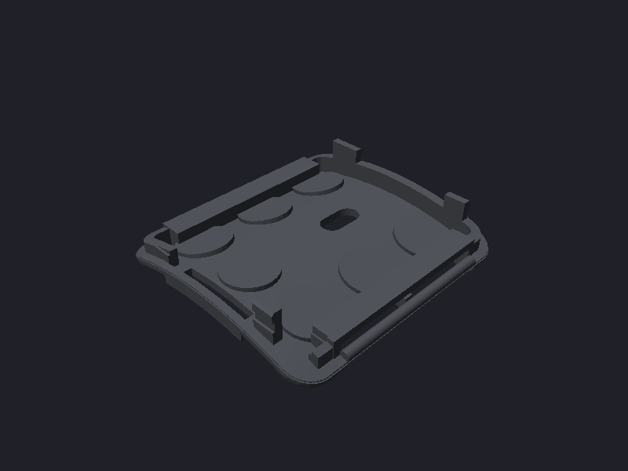 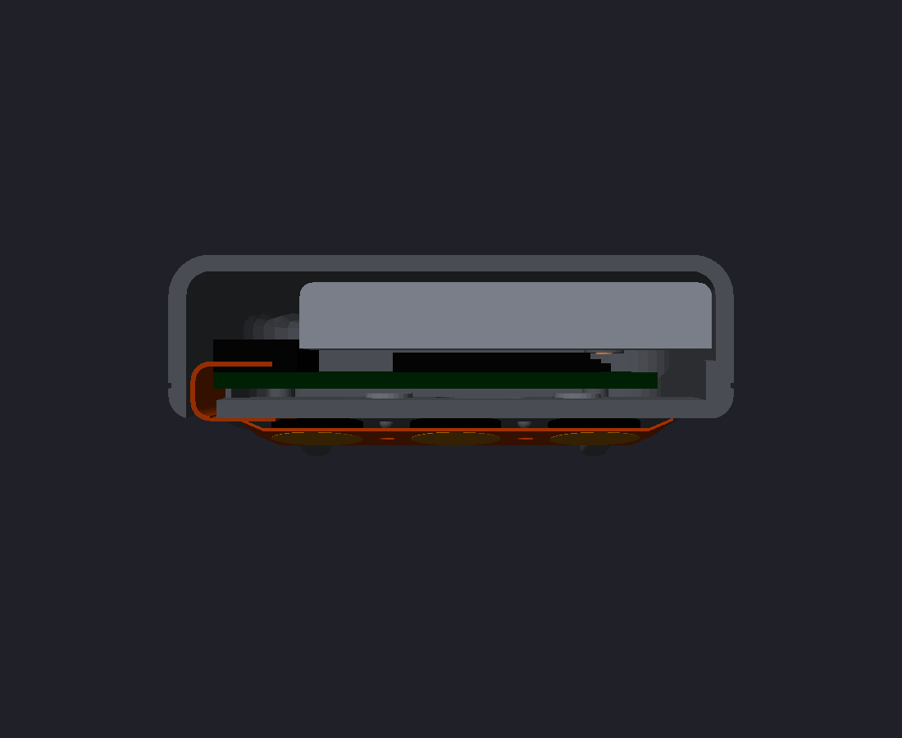

(`module_section.step` is a cut at X = +3 mm, distal end on the left. It shows the tail U-turn
into J1, the board on its supports, the cell over the TQFP and the pod 3/4 foam and pads under
the floor.)

**Shape.** The plan is a 31.9 x 34.3 mm rounded rectangle with R3.4 corners, offset +0.35 mm
radially because the board is 28.7 mm wide on its +X side. The corner radius was reduced from 5.5
so the strap slots keep 1.0 mm side walls; with R5.5 the slots cut into the corner arcs and left
0.2 mm slivers. The underside, pods 3/4 and the tail stay on
the dorsal centre.
- The lid is a single soft crown (R65 across the wrist) with R2.5 blends into the walls. R2.5 is
  the largest blend that keeps the lid clear of the cell's proximal end.
- The underside is a R42 hollow along the arm with R1.4 edge blends.
- The **parting surface runs at a constant 2.0 mm above the underside**, so the seam follows the
  curve as a 0.3 x 0.12 mm hairline.
- Walls are 1.1 mm, the floor 1.1 mm and the top 1.0 mm. A 3 mm pry notch sits at the proximal
  seam.
- Behind the pod 3/4 foam pockets, the floor has 1.0 mm bosses inside. The pockets are cut from
  below the curved underside, so no feathered skin is left at their mouths.
- The distal wall keeps a square bottom edge across the tail slot, where there is no floor behind
  it. That keeps its 1.1 mm all the way down.

**Hidden strap attachment.** Each X end face has a slot 24.8 mm wide (along the arm), 3.35 mm deep
and open underneath, through which the webbing enters the body. It looks like a watch band slot.
The slot has 1.0 mm side walls and a 1.0 mm roof (slot top 0.7 under the board bottom at 1.7).
Below z = -0.25 the slot stops 1.0 mm short of the pod 3/4 foam pockets; only the part that
holds the loop clip is full depth (3.35 mm).
- Inside each slot an **integral PA12 bar** (1.3 x 1.6 mm stadium section, rated for about 5 N of
  strap tension) spans the slot at z = -0.8, 0.6 mm in from the end face, so its outer face is
  flush. There are no pins, no metal, and nothing protrudes.
- An identical slim loop snaps onto each bar. The webbing never wraps the bars themselves, so
  nothing bulky sits under the module edge and the flex links pass beneath on a gentle curve.
- Ulnar side: the webbing end is sewn round its loop's far bar (fixed).
- Radial side: the webbing passes through its loop and folds back (closure).
- The slot roofs are the board's supports: both X edges of the board rest on them (KiCad
  x 0..2.75 and 25.95..28.7). A 1 mm relief under the J2 battery pads leaves room for the wire
  joints. The separate standoffs were removed because they overlapped the roofs.
- **Snap:** four square snap features on the +/-Y walls. The X walls carry the slots, and round
  beads would leave sub-1 mm tips and lips.
  - Each is a local tongue riser, 1.3 mm thick and 3.0-4.5 mm long, with a 0.3 x 1.2 mm groove and at
    least 1.0 mm of material on all sides.
  - A 1.0 mm tall rib on the lid, 0.35 mm deep, clicks into the groove. Its top sits 0.15 mm below the
    groove's top, which absorbs height tolerance, so the catch is 0.25 mm.
  - A 0.3 mm 45 deg lead-in chamfer on the riser's top outer edge cams the lid wall out as the lid goes
    on. The lip above the groove stays 1.0 mm thick under the chamfer.
- **Tongue clearance.** Above the parting surface the tongue (1.3 mm) is 0.1 mm clear of the lid's
  inner wall. Before it was line-to-line, which MJF or FDM tolerance would turn into an interference
  fit. Below the parting surface the tongue is solid with the wall, so no slit is left.
- **Clear of J1 for the fold-in.** The tongue is cut back to x = +/-7.5 over the tail U-turn, and the
  distal snaps start there. J1 is 14.4 mm wide, so the board can be plugged onto its tail standing
  upright and folded into the base without its connector catching on a riser
  ([assembly.md](../build/assembly.md) sec. 6.5). With the board flat, the tail has 0.3 mm of slack:
  it cannot be plugged in that way.
- **Battery-lead gate.** The tongue is also cut away on the distal wall from x = +10.5 to the +X corner,
  in front of SW1. The battery pads J2 are on the board's underside. Elsewhere the board edge is 0.2 mm
  from the tongue and 0.5 mm from the lid wall, and no wire fits there. So the two 30 AWG leads run in the
  1.0 mm J2 relief, wrap the board's distal edge through the gate, and come up past SW1's outer end to the
  cell. This is also the hinge line when the board is folded out for re-flashing.

**Lid details.**
- **Button:** a 4.3 mm PA12 disc (`button_cap`) in a 4.6 mm opening over SW1. The 0.15 mm hairline was
  0.1 mm, too tight for MJF or FDM tolerance.
  Its flat top sits just below the lowest point of the crown around it, so it reads as a subtle
  flush pad with no knife edge. It is retained by a 6.0 x 1.0 mm flange under the lid, and its
  stem stops 0.15 mm above the switch. It is a separate part, put in from inside before the lid
  closes.
- **Light pipe:** a 1.5 mm PMMA rod (or clear UV resin) in a 3.6 mm guide tube (1.0 mm wall) over
  D1, cut flush with the crown.

**Stack at the centre (z above the underside apex).**

| z (mm) | item |
|---|---|
| 0-1.1 | floor; pods 3/4 foam pockets 0.5 deep on the outside, with 1.0 mm bosses behind them |
| 1.1-1.7 | 0.6 mm gap for bottom pads and wire joints (SWD, battery, charge pads) |
| 1.7-2.7 | board, 28.7 x 27 x 1.0 mm (`boards/neurband_c/neurband_c.step`) |
| 2.7-4.7 | parts: J1 FPC and SW1 2.0 mm, TQFP 1.2 mm |
| 4.15-8.15 (+0.3 swell) | LiPo 401225 on 0.15 mm tape over KiCad x 10.5-22.5, y -3.3..21.7 (on the final board the parts under it are at most 1.11 mm: the TQFP; the 0603 caps are 0.92 mm or less), proximal of J1 and clear of the antenna region (x 0..5.65, y 11.65..27) |
| 8.9-9.9 | lid top |

**Charging, with a safety interlock by geometry (signal-chain review sec. 7).**
- VCHG and GND are board bottom pads at KiCad **(14, 6) and (14, 9)**. They were moved off the
  flex spine, which runs under the module centre strip at y -7..+0.6.
- They sit in a 3.0 x 6.0 mm stadium window, **1.7 mm deep** (at least 1.5 mm), at module
  y 1.7..7.7. When worn the pads are about 2.4 mm from the skin, so skin cannot touch them.
- Two N52 3 x 1 mm magnets sit in **through holes**, glued flush with the underside at
  (x = +/-2.1, y = 11.25). They are proximal of the window with 1.0 mm webs, clear of the spine
  and of the antenna region, so no thin skin is left over them. Set them N/S to key the polarity;
  they also locate the charger, so there is no counterbore.
- `charge_puck.step` carries two 2.0 x 6 mm pogo pins, staggered +/-0.5 mm across the 2 mm pads
  (1.1 mm web between the holes), and two magnets of opposite polarity, glued flush under flat
  spot faces. It has a USB lead. It has no nose: the magnets centre it.

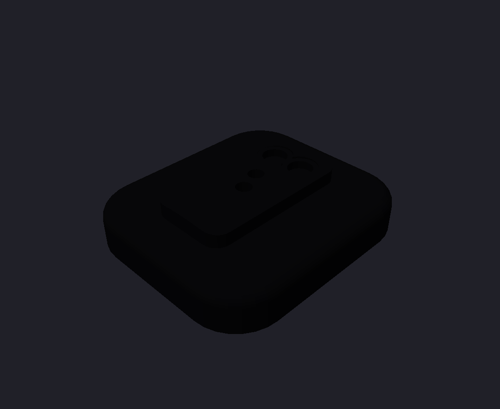

**Clash check** (`logs/module_checks.json`, against the real `boards/neurband_c/neurband_c.step`):
board, parts, cell (including the swell box), tail, button cap, base and lid are all at
0.00-0.006 mm3, which is tessellation level. The tallest part under the cell is the TQFP at 1.11 mm (final board STEP, 0603 caps at most 0.92 mm, all under the 1.3 mm limit), and SW1 (2.0 mm) sits 0.14 mm under the cap stem. Measured clearances: cell to lid 0.09 mm at its proximal +X top corner, cell to parts 0.15 mm, cell to the charger IC U4 (1.56 mm tall, outside the cell zone) 0.45 mm, cap to lid 0.15 mm.

**Printing.** MJF PA12 is the recommended process: the snaps, clip and integral bars need its
toughness, and it needs no supports. On your own FDM printer, stand the base and lid on their proximal
end faces in PETG at 0.12 mm layers. The crown, the R42 underside and the slot roofs then need no
supports; only the lid's light-pipe tube does. The integral bars print vertically and are weaker in
bending, so an FDM base is for fit tests. Per-part settings and the tolerance checks are in
[assembly.md](../build/assembly.md) sec. 3.

## 4. Electrode pods and compliant contact (`pod.py` -> `pod.step`, `pod_with_flex.step`)

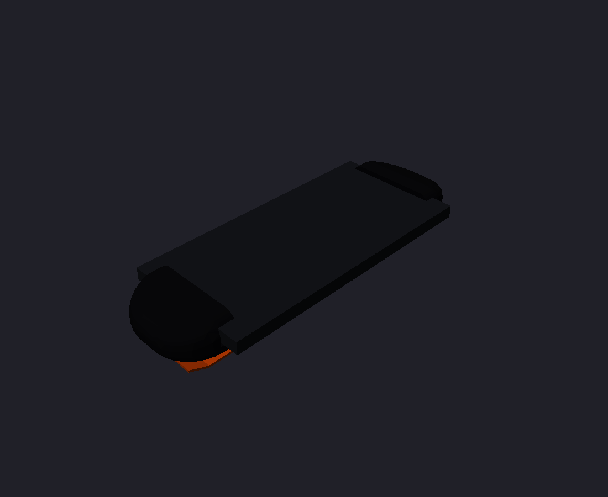 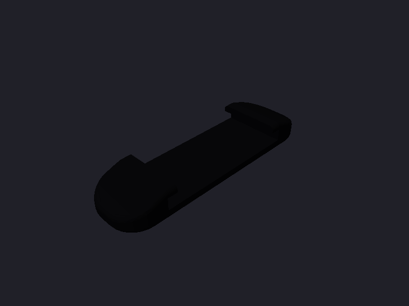

- **Shape.** A TPU 95A pebble, 9.0 x 32.0 x 3.9 mm (4.75 mm above the skin when worn), with R0.8
  top and face blends. It covers the whole 30 mm flex paddle, and the ends taper from 3.9 mm at
  the sleeve rims to 2.0 mm at the tips.
- **Walls:** at least 1.0 mm everywhere (FDM TPU: 2.5 perimeters at 0.4 mm). The floor behind the
  foam pockets is 1.0 mm and the sleeve rims are 1.0 mm thick. That is why the pod is 3.9 mm
  rather than 3.2 mm: with the 1.5 mm foam kept, there is no thinner way. The face blends are the strain relief where the flex
  spine leaves at +/-X (y -7..+0.6).
- **Captive edge sleeve.** A 22.4 x 1.4 mm slot runs through the pod along the band. Its roof is
  open over the middle 19.4 mm, so the fabric stays visible, and two 1.5 x 1.0 mm rims hold the
  webbing edges. To assemble, thread the webbing through the pods; it cannot pop out and slides
  freely. Nothing protrudes: from outside the pods read as small soft bumps under the band.
- **Compliant contact** (signal-chain review sec. 2). A 6.2 x 0.5 mm pocket behind each pad
  (y = -10/0/+10) holds a 6.0 x 1.5 mm **double-sided** adhesive PU or PE foam disc (6 mm punch), so the pad stands
  1.0 mm proud when free and about 0.65 mm when worn. The flex is held only by the adhesive foam
  and floats between the pads (polyimide cannot be forced into a dome).
- **Locating pins.** Two pins, 1.0 mm diameter and 0.55 mm tall, sit at y = +/-5 in the flex's
  1.2 mm holes (0.2 mm clearance, not a press fit).
  - The free foam stands 1.0 mm proud, so the adhesive meets the flex 0.45 mm before the pins reach
    the holes. The pins cannot pull a misplaced flex into line.
  - Sight the holes onto the pins first: rest a needle through each hole on its pin's domed tip, then
    slide the flex down ([assembly.md](../build/assembly.md) sec. 6.4).
  - The pins then hold the flex while you press, disengage when worn and stop over-compression. They
    must stay shorter than the worn foam (0.65 mm), or they would poke the skin through the holes.
- **Tuning.** If a pod reads poorly, use a thicker or denser foam disk.

**Pressure.** The load on a pod is T x (wrap angle). About 0.4 N of strap tension gives about
3 kPa per pad; a firmly closed band (1-2 N) gives about 7-15 kPa.

## 5. Strap (`strap.py` -> `strap_slide.step`; the webbing is a swept band in the assemblies)

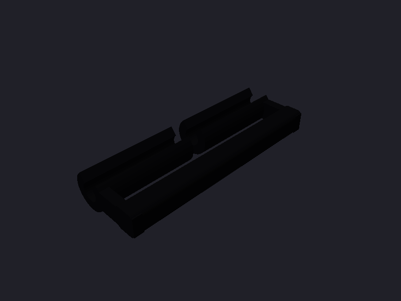

**One closed loop of plain woven elastic**, 20.0 x 1.5 mm (`STRAP_W`, `STRAP_T`; 1.2-1.8 mm allowed,
so every slot and sleeve clears `STRAP_T_MAX` 1.8). No hook-and-loop, no sewing, no glue.
- **Slides.** The ends are anchored by two identical printed `strap_slide`s. Each is a split C-clip on
  the module's hidden bar (as before), a 1.9 x 20.4 mm slot and a 2.2 x 2.4 mm friction bar. The ulnar
  one is the same part turned over. It is 7.9 x 22.4 x 3.4 mm and reaches 6.0 mm from the hinge (8.1-9.3
  mm are free to the pod 2/5 sleeve).
- **Locking path** (`strap.lock_paths`, modelled in `fit.py` since 2026-10-29). Each end:
  - comes from the pods **under** the friction bar;
  - goes **up** through the slot and **over** the bar toward the pods;
  - goes **round the bar's far end and back under it**, between the bar and the loaded strand;
  - stops with its tip at the slot.

  The loaded strand bends up into the slot round the tail tip and pinches the tip against the bar's
  corner. The clamping force grows with the band tension, so it self-locks. That is on top of about
  360 deg of wrap friction (capstan factor e^(-0.3 x 2 pi) = 0.15 with mu about 0.3).
  - The earlier CAD wrapped a plain ring round the bar and laid the tail back along the outside of
    the band. That holds by wrap friction only and slips unless the tail is held.
  - Each lock uses 14.1 mm of webbing.
  - To set the length: untuck the tip, pull or feed webbing, trim so the tucked tip just reaches the
    slot, and tuck it again.
- **Slide pose.** The slide pivots freely on its clip, so under load it swings until the loaded strand
  points at the hinge axis. That is `LOCK_SWING`, 41 deg outward of the hinge-to-pod-sleeve line
  (`fit.py` places it there).
  - This lifts the bar away from the module-edge flex link. Two layers fit under the bar with 1.5-1.9
    mm to the link, where the unswung bar had room for one.
  - The band runs straight from the pod 2/5 sleeve to the slide.
  - The clip's opening is set to `CLIP_OPEN_DEG` = 130 - `LOCK_SWING` = 89 deg in the slide frame. On
    the swung slide it still faces the slot roof, and the bar bears 10 deg from its edge, as before.
  - Clearances on 145-180 mm wrists (`fit_results.json`):
    - locking path vs. slide, module, pods and flex: 0.0 mm3;
    - locking path to the flex 1.48-1.87 mm, to the module 1.23-1.52 mm, to the pods 1.95-2.74 mm;
    - slide vs. module: 0.0 mm3.
- **Wearing.** The loop is set once to the wrist and slipped over the hand. The gap between pods 1 and
  8 opens and the pods slide on the webbing, so the flex is never stretched.
- **Strength at 20 N band tension.** Friction bar: about 1.5 T = 30 N over 20.4 mm, M = wL/10 = 61 N mm,
  S = 1.94 mm3, 32 MPa against about 48 MPa for MJF PA12. The module's hidden bar now has a centre rib:
  two 10.8 mm spans carry 10 N each, 25-39 MPa depending on end fixity. The slide's clip snaps on with
  0.14 mm interference and its bearing point sits 10 deg from the opening edge, as before. **Physical
  pull test required** for the slide's grip (webbing and friction) and the clip retention.
- **Cut list** (`fit_results.json`): **218 mm** of webbing, rounded to 220 in the guide. That is the
  180 mm wrist's 187.5 mm tip to tip plus 30 mm to hold while tucking.
  - Tip to tip after trimming: 155 / 169 / 188 mm on 145 / 160 / 180 mm wrists.
  - Between the slides through the pods: 127 / 141 / 159 mm.

  Heat-seal the cut ends.

Why not a tri-glide at the ulnar end and a ladder lock at the radial end: either needs 9-12 mm of free
webbing beside the hidden bar, and there is only 8.1-9.3 mm. A buckle in the volar gap would need a
second webbing piece and two more parts. Slipping on a pre-set elastic loop is the simplest one-hand
"closure".

## 6. Fit check (`fit.py` -> `fit_results.json`, `fit_145.step`, `fit_180.step`; `assembly.py` -> `fit_160.step`, `band_assembly.step`)

  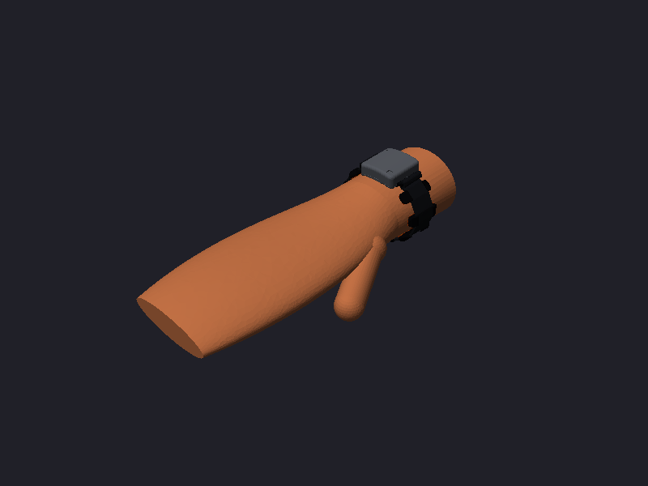
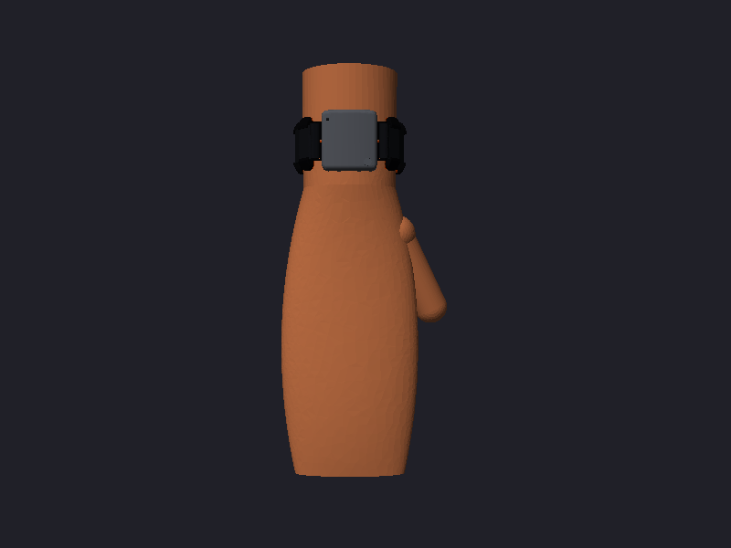

The wrist model is the rev A/B ellipse forearm (`extra/wrists/wrist.py`), now also built at
145 mm. In each case:
- the module rests centred on the pads of pods 3 and 4, with the foam at its worn compression;
- the free pods sit 18 mm apart along the flex, tangent to the wrist, and are tilted to follow
  the forearm taper (the module tilts 2.7-3.4 deg);
- the webbing is taut, modelled as the convex hull of the pod sleeves, the skin across the gap and the
  point where the loaded strand meets each slide's locking path, then swept as one smooth B-spline
  band; at each slide the locking path is swept separately (sec. 5);
- collisions are CAD Boolean volumes.

| | 145 mm | 160 mm | 180 mm |
|---|---|---|---|
| Model wrist semi-axes a x b (mm); dorsal / side radius | 25.9 x 20.1; R 33.4 / 15.6 | 28.6 x 22.2; R 36.8 / 17.2 | 32.1 x 24.9; R 41.4 / 19.3 |
| Gap between pod 1 and pod 8, edge to edge (mm) | 17.2 | 32.2 | 52.2 |
| Gap centre from the dorsal centre (90 = ulnar apex, 180 = volar centre) | 137 deg | 141 deg | 145 deg |
| Electrode coverage (pod 1 to pod 8 arc / circumference) | 88.6 % (128.4 mm) | 80.5 % (128.9 mm) | 71.8 % (129.3 mm) |
| Pod collisions (shell-shell, shell-module, CAD mm3) | 0.0 / 0.0 | 0.0 / 0.0 | 0.0 / 0.0 |
| Spine bend radius, min free link (mm); module-edge links (free, under the slides) | 10.51; 3.03 | 11.82; 2.71 | 13.45; 2.54 |
| Module seat gap underside-skin: centre / edge (mm) | 1.02 / 2.05 | 1.14 / 1.71 | 1.26 / 1.38 |
| Module tilt following the forearm taper | 2.72 deg | 3.0 deg | 3.37 deg |
| Strap slide friction bar clearance to skin (mm) | 5.48 | 5.41 | 5.32 |
| Module / pod shells vs. skin (CAD mm3); strap inner face to skin, min (mm) | 0.0 / 0.0; 1.11 | 0.0 / 0.0; -0.33 | 0.0 / 0.0; -0.48 |
| Strap vs. pods / module; slide vs. module / pods; locking path vs. slide / pods (CAD mm3) | 0.0 / 0.0; 0.0 / 0.0; 0.0 / 0.0 | 0.0 / 0.0; 0.0 / 0.0; 0.0 / 0.0 | 0.0 / 0.0; 0.0 / 0.0; 0.0 / 0.0 |
| Strap load per pod, relative (pods 1, 2, 5, 6, 7, 8) | 1.25, 1.10, 1.06, 1.11, 0.70, 0.78 | 1.41, 0.97, 0.94, 1.09, 0.73, 0.87 | 1.42, 0.91, 0.87, 1.07, 0.84, 0.89 |
| Strap load max / min | 1.79 | 1.93 | 1.70 |
| Strap tension for 3 kPa on an average pad (N) | 0.34 | 0.34 | 0.37 |
| Webbing between the slides (mm); tip to tip incl. both locks (mm) | 127.2; 155.3 | 141.0; 169.1 | 159.4; 187.5 |
| Pads pressed into the rigid wrist model (taper; foam/skin take it, CAD mm3) | 11.505 | 12.222 | 13.344 |
| Strap vs. flex links (CAD mm3) | 0.0 | 0.0 | 0.0 |

Redesign re-run (2026-10-29, with the locking path and the swung slides): all interferences are 0.0, including the untilted-pod webbing check. The pads-into-rigid-wrist volume is by design. Module-edge links bend at R2.54 mm or more and free links at R10.5 mm or more. The module seat rises 0.4 mm (prouder module pads). The band now runs straight from the pod 2/5 sleeves to the swung slides, so pods 2/5 carry 0.87-1.10 of the mean load (before, 0.50-0.88) and the spread falls to 1.7-1.9:1.

Notes:
- **Gap and the ulna.** The flex chain is 133 mm long, so the gap absorbs the 35 mm size range.
  Pod 1 lands within about 10 deg of the ulnar apex (108 / 98 / 87 deg).
- **Bend radius.** The free spine links bend at R10.6 mm or more and the module-edge links at
  R14.5 mm or more, at least 3.5x the 3 mm rule.
- **Module seat.** Only the 6 pads touch. The underside clears the skin by 0.6-0.85 mm at the
  centre and 1.0-1.6 mm at the edges.
- **Strap.** The webbing rests on the skin across the gap. Strap-vs-pod volume is measured with
  untilted pods: the 1-3 deg taper tilt of each pod is taken by a slight twist of the webbing.
  The module-edge links hang free from the R42 seat to pods 2/5 and bend at R2.3-8.8 mm (the
  tightest is the ulnar link), well above the 1.2 mm guideline for 2-layer flex. The load spread across pods is 1.8-3.3:1. Pods 1 and 6 carry the most; pods 2 and 5 next to
  the module the least.

## 7. Interface to the board and flex

- **Board** (`boards/neurband_c/neurband_c.step`, 28.7 x 27 x 1.0 mm):
  - J1 centred at x = 14 with its mouth on the y = 27 edge;
  - SW1 at (24.8, 25.1), D1 at (2, 1), and J2 (bottom) at (23.9, 25.6)/(26.9, 25.6);
  - **J3 VCHG/GND must be at (14, 6)/(14, 9)**, as agreed with the coordinator; the window and the
    magnets (KiCad (11.9, 0.95)/(16.1, 0.95), under the board) follow that position;
  - the board rests on the two lug-slot roofs along its X edges, KiCad x 0..2.75 and 25.95..28.7
    (y -1.2..25.6), with no separate standoffs. Keep bottom copper off those strips; J2 has its
    own relief in the +X roof;
  - parts under the cell rectangle must be at most 1.3 mm;
  - the mapping is KiCad (x, y) to module (x - 14, -14.8 + 27 - y) (`module.k2m`).
- **Flex** (`flex_c_layout.md`):
  - pods 7.1 x 30 at an 18 mm pitch, 1.2 mm holes at +/-5, spine at native Y -0.6..+7.0;
  - the tail is 8.5 mm long with the stiffener on the last 3.7 mm, fingers on the non-skin side,
    and is mirrored at the fingers;
  - the outline is otherwise as used here.

## 8. Parts, fab files and cost

| Part | File | Process / material | Qty (fab) | Notes |
|---|---|---|---|---|
| Module base | `mech/rev_c/module_base.step` | MJF PA12 | 3 | hidden bars with centre ribs, no magnets or pins, root-dot pocket |
| Module lid | `mech/rev_c/module_lid.step` | MJF PA12 | 3 | open 1.6 mm LED hole, cell cage ribs, 3.0 x 1.2 mm pry/key notch |
| Button cap | `mech/rev_c/button_cap.step` | MJF PA12 | 4 | |
| Strap slide | `mech/rev_c/strap_slide.step` | MJF PA12, black | 5 (2 per band) | replaces the strap loop |
| Cell spacer | `mech/rev_c/cell_spacer.step` | MJF PA12 | 2 | only for the 401120-class fallback cell |
| Pod shell | `mech/rev_c/pod.step` | FDM TPU 95A, black | 14 (6 per band + 2) | 4.9 mm tall, no pins |
| Charge clip | `mech/rev_c/charge_clip.step` | MJF PA12, black | 2 | replaces the magnetic puck; 2 P50 pins |
| Bonding jig | `mech/rev_c/bond_jig.step` | FDM PLA/PETG (or MJF) | 1 | 142.6 x 46.5 x 5.6 mm; print once |
| SWD jig | `mech/rev_c/swd_jig.step` | MJF PA12 | 1 | 36.7 x 35.5 x 18 mm; 5 P50 pins at +/-12 deg |

Fit views: `mech/rev_c/charge_clip_fit.step`, `bond_jig_fit.step`, `swd_jig_fit.step`. The magnetic
puck (`charge_puck`) and the sewn strap loop (`strap_loop`) are removed.

The fab files are `mech/rev_c/<part>.fab.json` (kind 3dp; volume, area and size measured from the
FreeCAD shapes, plus `min_wall_mm` from the wall check).

**Minimum wall per part** (`wallcheck.py` on the exported STEPs -> `wall_check.json` and
`min_wall_mm` in each fab.json). Rays are shot along the inward normal from a grid on every face
(0.3 mm in from the edges) and intersected exactly with the solid. A ray counts as a wall only
where it leaves through a roughly opposite face, so acute rims, such as the lid's edge where the
curved parting meets the wall at 21 deg, are not reported as walls.

| Part | Process | Min wall measured (mm) | 1st percentile (mm) | Samples |
|---|---|---|---|---|
| module_base | MJF PA12 | **0.98** | 1.00 | 6452 |
| module_lid | MJF PA12 | **0.98** | 1.00 | 4742 |
| button_cap | MJF PA12 | **1.00** | 1.00 | 339 |
| strap_slide | MJF PA12 | **1.00** | 1.00 | 1291 |
| cell_spacer | MJF PA12 | **3.80** | 3.80 | 480 |
| charge_clip | MJF PA12 | **1.00** | 1.00 | 1208 |
| pod | FDM TPU 95A | **1.00** | 1.00 | 1578 |
| bond_jig | FDM PLA/PETG | **1.00** | 1.00 | 12277 |
| swd_jig | MJF PA12 | **1.43** | 1.43 | 497 |

The 0.98 mm spots on the base and lid are the unchanged distal-wall edges (tessellation level).

Bought parts per band (exact specs from `docs/build/sourcing.md`):
- plain woven polyester elastic, 20.0 +/-0.5 mm wide, 1.5 mm thick (1.2-1.8 OK): 0.21 m;
- pre-cut round double-sided EVA foam dots, 6 mm x 2.0 mm: 25 (18 pods, 6 module, 1 flex root);
- protected 401223-class LiPo, about 130 mAh, at most 12.0 x 25.0 x 4.0 mm including its board and tabs,
  with two wire leads of at least 30 mm (fallback 401120 class, about 4 x 10-11 x 20-21 mm, with the
  printed spacer);
- P50 pogo pins (0.68 mm barrel, 0.48 mm plunger, 16.0-16.35 mm, 2.6 mm travel, about 75 g): 2 for the
  charge clip, 5 for the SWD jig (once per builder);
- a USB cable to cut (5 V and GND);
- Kapton tape (insulation only) and CA glue (one drop per pogo pin, the only glue).

Gone: hook-and-loop webbing and hook tape, 4 magnets, 2.0 x 6 mm pogo pins, PMMA fibre, foam sheet,
transfer and double-sided tape, 30 AWG wire, heat-shrink, foam pad, textile glue, thread, the 6 mm
punch and the alignment needles.

**Cost.** MJF PA12 from the fab is roughly 1.5-3 USD per part (the per-part minimum
dominates), so the 5 PA12 parts per band (base, lid, cap, 2 loops) cost about 8-15 USD. The six TPU pods on your own FDM
printer use about 1.5 g of TPU, well under 0.10 EUR. These are estimates; take the live quote
from the fab files.

## 9. Assembly (summary; the full guide is [docs/build/assembly.md](../build/assembly.md))

1. **Flash** the bare board in the SWD jig (Pico on the five pins).
2. **Cell.** Solder its own leads flat onto J2 (VBAT = BAT +). They run under the board in the 1.0 mm
   relief and round the distal +X corner through the lead gate. Kapton over the joints.
3. **Flex.** Lay it pads-down on the bonding jig, holes over the 16 pins. Peel the dots onto the 18
   pod pockets and the 7 base pockets. Press each pod into its fence until it stops. Feed the tail up
   through the base's floor slot and press the base into its fence.
4. **Book fold.** Base upright, board upright above its distal end, tail into J1, latch closed, fold the
   board down. The cell lies beside the module during the fold, then goes into the lid's cage on the
   board, lead end against J1. The 30 mm leads are enough: the route needs 16-22 mm.
5. **Close.** Button cap in, lid on (four catches).
6. **Strap.** Clip both slides onto the hidden bars. Thread the webbing up through one slide, through
   pods 2, 1, 8, 7, 6, 5 and the other slide. At each slide: under the friction bar, up the slot, over the
   bar, round its end and the tip tucked back under it. Set the length, trim the tips to reach the slots.
7. **Charge** with the clip on the proximal end: it fits one way only.

Old guide (rev C.1) versus now: 12 top-level steps and about 45 hand operations become 7 steps and
about 25 operations. Gone are punching 24 discs, needle alignment, two sewing jobs, gluing 4 magnets
by polarity, pre-wiring 30 AWG leads, two splices and cutting and polishing a light pipe.

## 10. Open issues

- **J3 position** must move to (14, 6)/(14, 9) on the board (agreed, not yet in the 03:12 PCB).
- **Antenna.** The plastic-only region (KiCad x 0..5.65, y 11.65..27) is kept free of metal by
  the module (integral bars; no magnets or pins any more). Pod 3's flex lies below it (pod 4 in the
  flex's own numbering). Tune with the band worn.
- **Pod load spread** is 1.7-1.9:1 with the swung slides (pods 7 and 1 are the extremes). The slide
  swing and the locking grip are both from the model: check them in the first build's pull test
  ([assembly.md](../build/assembly.md), "Physical tests"). If a slide cannot swing (for example, it
  rubs on the slot roof), the bar sits lower and the second webbing layer under it presses on the
  flex edge link.
- **Strap bars are integral PA12** with a centre rib (about 20 N, sec. 5). If a bar ever cracks, drill
  1.6 mm and use a 1.5 mm steel spring bar. Pull-test the slides on the first build
  ([assembly.md](../build/assembly.md), "Physical tests").
- **Module size:** 31.9 x 34.3 mm, set by the 28.7 mm board and the 25 mm cell.
- **Foam choice and pressure.** Measure contact impedance per channel against strap tension
  (signal-chain review sec. 2).
- **No sealing** (snap lid). The charge window is open to sweat; wipe it, or conformal-coat the
  board bottom outside the pads.
- **Board-side wishes for a rev D**, to make assembly easier (the rev C board interface is frozen):
  - top-side or edge-castellated battery pads near the cell's lead end, which would remove the lead gate
    and the 0.6 mm joint-height limit;
  - SWD reachable without taking the board out: top-side pads by the J1 edge, or a BLE DFU bootloader;
  - the final board's top silkscreen has a **CELL** outline at x 10.5-22.5 (the module's cell position),
    a vertical **DOWN** mark between J1 and SW1 and J1's pin-1 mark. x 11-23 would be the +X limit,
    where the cell touches the proximal +X snap riser and has 0.05 mm to the lid. On a rev D, the
    "CELL" label (now under U2) and the outline segments under U1/U2 could move to where they stay
    visible after assembly, and the flex tail could get a matching pin-1 mark.
- **Pod order is mirrored in the fit.** This document and `fit.py` number the pods in the mirrored
  order of the real flex (`docs/layout/flex_c_layout.md`, "Pod under the main-board antenna"). The
  mirror is geometric, not only a matter of names:
  - `fit.py`, and so `band_assembly.step`, puts two free pods on the ulnar (-X) side and four on the
    radial side. The real flex has pods 1-2 radial (the button side) and 5-8 ulnar.
  - So the real band's pod ring is the mirror image of the CAD one, and the volar gap sits on the
    radial side.
  - The fit numbers do not change, because the wrist section is an ellipse. Only the module's 0.35 mm
    `CX_OFF` is asymmetric.
  - The build guide and animation mirror the ring (`render/nb_blender.mirror_ring`).
  - To fix it at the source, mirror `layout()` in `fit.py`: swap the sign of the pod 3/4 positions
    and of the pod walk, and swap the slide-to-pod pairing (2/5) and the edge-link sides.
