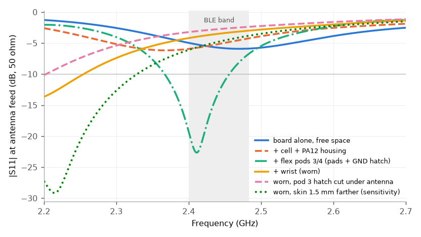
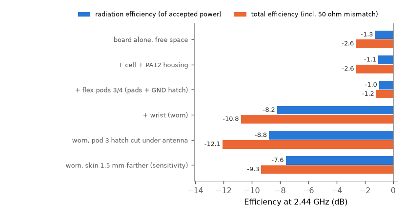

# neurband rev C: 2.4 GHz antenna on the wrist (openEMS FDTD)

> **Re-run on the reworked board (2026-10-29).** The main board's ground was reworked: GND
> vias went from 63 to 103 (including nine in the nRF exposed pad), and pours and routing
> changed. Re-reading the file confirms the antenna copper, keepout, fence and feed track are
> identical. The geometry was re-extracted from the current `boards/neurband_c/neurband_c.kicad_pcb`
> and re-run with the same mesh (0.81 M / 1.36 M cells) and settings:
>
> | Case | Board | Best match | S11 at 2.44 GHz | Z at feed, 2.44 GHz (ohm) | Radiation eff. | Total eff. |
> |---|---|---|---:|---|---:|---:|
> | free space | first | 2.47 GHz, -5.9 dB | -5.7 dB | 24 - j33 | 74 % (-1.3 dB) | -2.6 dB |
> | free space | reworked | 2.48 GHz, -6.1 dB | -5.7 dB | 26 - j36 | 76 % (-1.2 dB) | -2.6 dB |
> | worn | first | <= 2.20 GHz, -13.7 dB | -3.5 dB | 13 + j25 | 15 % (-8.2 dB) | -10.8 dB |
> | worn | reworked | <= 2.20 GHz, -13.1 dB | -3.4 dB | 12 + j25 | 15 % (-8.3 dB) | -11.0 dB |
>
> The differences are at most 0.2 dB and 3 ohm, the same size as the mesh-convergence spread
> (sec. 3.7), so the ground rework does not move the antenna. The best pi retune is unchanged
> (5.6 nH series + 0.5 pF shunt: worst-in-band delivered power -3.1 to -0.8 dB), and every
> link-budget margin in sec. 5 drops by 0.2 dB. **The verdict is unchanged.** Apart from sec. 3.6,
> the rest of this document describes the first board version; its numbers hold within 0.2 dB
> for the reworked board.
>
> The small-monopole chip-antenna stand-in (sec. 3.6) was fixed and run on the reworked board.
> It confirms sec. 6: worn, it radiates 1.5 dB less than the IFA (10.6 % vs 14.8 % radiation
> efficiency). It needs a lossy two-inductor match that cannot reach -10 dB with stock 0402
> parts even on the bench. Its total worn efficiency is -15.8 dB bench-tuned and -12.5 dB
> re-tuned on the wrist, against -11.0 dB for the untuned IFA. Results:
> `sim/antenna/results/*_v2.json`, `compare_v2.json` (`sim/antenna/compare_v2.py`).

Scope: decide whether the printed TI SWRA117D / AN043 inverted-F antenna (AE1) on the rev C
main board works when the band is worn, and settle "keep the printed antenna, or switch to a
chip antenna?". Full-wave FDTD (openEMS), geometry read from the real `.kicad_pcb`, five
loading cases plus a sensitivity case, a mesh check and a chip-antenna stand-in (sec. 3.6).
Design files were not changed.

## 1. Summary

**Verdict: keep the printed IFA and leave the 0 ohm through-path (C22/C23 DNP) as the default.
The worn link works with large margin at 0.5-3 m line of sight and still closes at 2-3 m with
the torso in the way.** The antenna is detuned on the wrist (its best match moves from 2.41 GHz
to below 2.2 GHz), but the body loss dominates, not the mismatch. A chip antenna would not do
better here.

| Case (cumulative) | Best match (GHz, dB) | S11 at 2.44 GHz | Worst S11, 2.40-2.48 | Z at feed, 2.44 GHz (ohm) | Radiation eff. (of accepted) | Total eff. (incl. 50 ohm mismatch) |
|---|---|---:|---:|---|---:|---:|
| board alone, free space | 2.470, -5.9 | -5.7 dB | -5.0 dB | 24 - j33 | 74 % (-1.3 dB) | 55 % (-2.6 dB) |
| + cell + PA12 housing | 2.368, -6.2 | -5.2 dB | -4.3 dB | 15 - j4 | 78 % (-1.1 dB) | 55 % (-2.6 dB) |
| + flex pods 3/4 (pads + GND hatch) | 2.411, -22.7 | -13.3 dB | -7.0 dB | 32 - j3 | 80 % (-1.0 dB) | 76 % (-1.2 dB) |
| + wrist (worn) | <= 2.20 (sweep edge), -13.7 | -3.5 dB | -3.0 dB | 13 + j25 | 15 % (-8.2 dB) | 8 % (-10.8 dB) |
| worn, pod 3 hatch cut under antenna | <= 2.20 (sweep edge), -10.2 | -2.8 dB | -2.4 dB | 11 + j30 | 13 % (-8.8 dB) | 6 % (-12.1 dB) |
| worn, skin 1.5 mm farther (sensitivity) | 2.215, -29.2 | -4.8 dB | -3.9 dB | 16 + j21 | 17 % (-7.6 dB) | 12 % (-9.3 dB) |

Total efficiency is what the radio sees with the pi network at 0 ohm. Its orientation average
is the "average gain" used in the link budget.

| Question | Answer |
|---|---|
| Does it work worn? | Yes. Worn total efficiency is -10.8 dB (8 %) with the flat phantom and -9.3 dB with the skin 1.5 mm farther, typical for a wrist-worn 2.4 GHz device 2-3 mm off the skin. With TX +4 dBm the received level at 3 m line of sight is about -59 dBm, 31-34 dB above what 2M/1M streaming needs (sec. 5) |
| What sets the worn loss? | Absorption in the wrist: radiation efficiency drops from 75-80 % to 15 %. Mismatch adds only 2.6 dB at 2.44 GHz |
| Remove pod 3's GND hatch under the antenna? | **No.** It makes things worse (-1.3 dB). The hatch shields the antenna's near field from the skin and the floating pads |
| Pi-network retune for the worn case | R3 position: 5.6 nH series (Sunlord SDCL1005C5N6STDF, C279520). C23 position: 0.5 pF shunt (FH 0402CG0R5B500NT, C285052). C22 stays DNP. Gains +1.5 to +2.3 dB worst-in-band in all three body-loaded variants. Costs 1.6 dB off the wrist, and 1.2 dB if the model's resonance is ~150 MHz too low (sec. 4). **Close call: I would not pre-populate it without one measurement**; keep the 0 ohm default |
| Single most useful change | None needed for 0.5-3 m. If more margin is ever needed, the matched pi above (+2 dB, only after a VNA check on a worn unit) is the largest available on this board. Moving the antenna is not possible without a re-layout |
| Chip antenna instead? | **No.** All five candidates are 50 ohm only on their vendor evaluation boards and need a matching network tuned on the final product. The body detunes them at least as much (100-200 MHz catalogue bandwidth vs ~250 MHz for AN043). The board ground, not the 3 x 1.6 mm ceramic, does most of the radiating on a 29 x 27 mm board, so they cannot beat the IFA's efficiency here (sec. 6) |


## 2. Method

### 2.1 Tool

openEMS 0.37 (FDTD, `v0.37.0-38`) with CSXCAD 0.7, built from source into a user-space
conda-forge environment (no system packages; openEMS is not on conda-forge or PyPI). Recipe:

```text
micromamba create -n oe -c conda-forge python=3.12 numpy cython setuptools h5py matplotlib scipy \
    cmake make gxx_linux-64 libboost-devel cgal-cpp hdf5 vtk-base tinyxml eigen zlib
git clone --recursive https://github.com/thliebig/openEMS-Project
# cmake + make install fparser, CSXCAD, openEMS into the env prefix, then
# pip install --no-build-isolation CSXCAD/python openEMS/python  (CSXCAD_INSTALL_PATH=<env>)
```

Scripts: `sim/antenna/kicad_geom.py` (board geometry), `sim/antenna/model.py` (model + run),
`sim/antenna/run.sh` (batch), `sim/antenna/analysis.py` (tables, matching, link budget, plots),
`sim/antenna/compare_v2.py` (reworked-board comparison and stand-in matching; runs use `OE_TAG=_v2`).
Reduced results are in `sim/antenna/results/*.json`; raw field data in `sim/antenna/build/`
(gitignored). 12 CPU threads, no GPU.

### 2.2 Geometry (from the real board)

`kicad_geom.py` parses `boards/neurband_c/neurband_c.kicad_pcb` as an s-expression (no pcbnew):

- **Antenna copper:** the F.Cu `fp_poly` of `RF_Antenna:Texas_SWRA117D_2.4GHz_Left`, transformed by
  the footprint's (5.9, 14.7) / 90 deg placement. It spans x 0.75..6.15, y 12.15..26.55. Feed pad
  (5.9, 14.7); the short-to-ground through-hole (5.9, 12.6) is a PEC via to all GND layers.
- **Ground:** the *filled* GND polygons of all four copper layers (F.Cu, In1.Cu, In2.Cu, B.Cu),
  rasterised onto the FDTD mesh cells (cell centre inside the fractured KiCad fill) and covered
  with boxes, so they cannot fall between mesh lines. The all-layer radiator exclusion
  x 0..5.65, y 11.65..27 is therefore exactly as drawn, as are the microstrip top-ground gaps.
  All 63 GND vias (including the seven counterpoise stitches at x = 6.0) are PEC lines.
- **Stack:** FR-4 er 4.3, tan d 0.02, 1.0 mm; zero-thickness copper sheets at z = 0 (B.Cu),
  0.135 (In2), 0.865 (In1) and 1.0 mm (F.Cu). Solder mask (10 um) is neglected.
- **Port:** 50 ohm lumped port, vertical, from In1.Cu to the antenna feed strip at the feed pad
  (5.9, 14.7), i.e. between the feed and the ground-plane edge. The 12.2 mm, 0.16 mm-wide feed
  track from the pi network (R3/C23) to the antenna is not meshed; it is added analytically as a
  50 ohm line (eps_eff 3.05, ~0.3 dB loss) when computing the impedance at the pi pads.
- Board components, signal tracks and the nRF52 package are not modelled (small, mostly over
  the solid L2 ground, away from the radiator).

Mechanics (simple boxes; KiCad frame, z = 0 at the board bottom):

| Item | Model |
|---|---|
| LiPo 401225 | PEC box x 11..23, y -3.3..21.7, z 2.3..6.3 (1.3 mm above the top copper), floating |
| Housing | PA12 er 2.95, tan d 0.02. Outer 31.9 x 34.3 mm (x -1.95..29.95, y -4.95..29.35), walls 1.1, floor z -1.7..-0.6 (1.1 mm, 0.6 mm gap under the board), lid z 7.2..8.2. Lid crown, R3.4 corners, R42 underside hollow and the 3.1 mm hanging edges are flattened |
| Flex pods 3, 4 | GND hatch (0.2/0.8 mm, 45 deg: a 1 mm-pitch mesh is opaque at 2.4 GHz, so a PEC sheet) at z -1.7 over x 1.45..8.55 and 19.45..26.55, y -2.8..27.2; 6.5 mm pads at y 22.2 / 12.2 / 2.2 at z -1.8 (2.8 mm below the top copper). The 25 um polyimide between pads and hatch is a 0.1 mm layer with er scaled to 13.6, which keeps the real pad-to-hatch capacitance (~18 pF per pad, a few ohm at 2.4 GHz) |
| Flex GND return | hatch continues along the spine (x 8.55..19.45, y 11.6..19.2) and the tail (x 11.5..16.5) to y 27.6, then up to the board's top GND at J1 |
| Wrist | flat 70 x 80 mm phantom, 0.65 mm air below the pads: skin 1.5 mm (er 38, 1.46 S/m), fat 3 mm (5.3, 0.10 S/m), muscle 20 mm (52.7, 1.74 S/m). Bone omitted: the 1/e depth in muscle is ~22 mm, so little field reaches it |

Why flat: the module underside is a R42 hollow and the wrist is R30-37, so module floor, pods and
skin are roughly concentric. Flattening all three keeps the local antenna-to-skin spacing that
sets detuning and absorption. A flat slab also keeps tissue under the antenna's outer edge, where
a cylinder would curve away by 1-3 mm, so it is the slightly pessimistic choice. It is also
mesh-friendly.

Using KiCad y without flipping makes the model a mirror image of the board. That does not change
S11 or efficiency.

### 2.3 Mesh, excitation, efficiency

- Graded rectilinear mesh. 0.25 mm in x/y over the antenna (lines on every antenna polygon edge),
  0.5 mm over the rest of the board, 1.0 mm in tissue near the module and 1.6 mm farther out,
  <= 3.8 mm in air. 0.1-0.36 mm in z between the board and the skin. 8-cell PML on all sides,
  >= 46 mm of air outside the phantom. 0.8-1.4 M cells, time step 0.23-0.25 ps, 4-12 min per run
  on 6 threads.
- Gaussian excitation (2.45 GHz centre, 1.2 GHz 20 dB half-width), run until the energy is
  35 dB below its peak.
- Radiated power comes from a near-to-far-field box in air that encloses the module *and* the
  phantom, integrated over 3 x 5 deg. Radiation efficiency is P_rad / P_accepted. Total
  efficiency is P_rad / P_available from a 50 ohm source, so it includes the mismatch. Tissue,
  FR-4 and PA12 losses are inside the box, so they count as loss.

## 3. Results





### 3.1 Board alone in free space: sanity check against AN043

AN043 measured the antenna on the CC2511 USB dongle. It reports about 250 MHz of -10 dB
bandwidth in free space, maximum radiated power at 2.54 GHz, a downward shift from plastic
encapsulation, and 100 MHz bandwidth with the larger ground of a laptop (SWRA117D sec. 5).
On our 28.7 x 27 mm, 1.0 mm four-layer board the model gives:

- The series resonance (X = 0) is near 2.56 GHz, consistent with TI's 2.54 GHz power peak, so
  the meander length and the FR-4 loading are right.
- The resistance there is only ~13 ohm, so S11 never gets below -5.9 dB (best at 2.47 GHz).
  Z at 2.44 GHz is 24 - j33 ohm. This is not the AN043 behaviour. The likely cause is the
  ground layout: here the plane wraps around the short-circuit end of the antenna (the RF
  match area x 0..5.65, y < 11.65 sits 0.5 mm from the short leg). The dongle has ground on
  one side only, and the board is also smaller and 4-layer.
- Radiation efficiency is 74 % (-1.3 dB) and total efficiency 55 % (-2.6 dB).

So the free-space board is mismatched but efficient. As section 3.2 shows, that is irrelevant
because the board is never used bare.

### 3.2 Cell, housing and flex pods (no wrist)

- **+ cell + PA12 housing:** the PA12 shell (its wall is 1.6 mm from the antenna's outer trace)
  and the floating cell lower the series resonance by ~110 MHz, to ~2.45 GHz, as TI reports
  for plastic encapsulation. R stays ~14 ohm: Z(2.44 GHz) = 15 - j4 ohm, S11 -5.2 dB (best
  -6.2 dB at 2.37 GHz). Radiation efficiency 78 %, total 55 % (-2.6 dB).
- **+ flex pods 3/4:** the GND hatch 2.7 mm under the antenna acts as a partial reflector and
  changes the antenna into a narrower, better-matched resonance. Best match -22.7 dB at
  2.41 GHz. Z(2.44 GHz) = 32 - j3 ohm, S11 -13.3 dB at 2.44 GHz, -7.0 dB at 2.48 GHz.
  Radiation efficiency 80 %, total 76 % (-1.2 dB). A weak parasitic resonance of the
  hatch/spine/tail loop shows near 2.3 GHz. This is the "off the wrist, on the desk" condition.

### 3.3 Worn (wrist phantom)

The tissue pulls the resonance below 2.2 GHz: S11 is -13.7 dB at 2.20 GHz and -3.5 dB at
2.44 GHz. Z(2.44 GHz) = 13 + j25 ohm, inductive, i.e. electrically too long. Radiation
efficiency drops to **15 % (-8.2 dB)**, total to **8.4 % (-10.8 dB)** at 2.44 GHz
(-10.6 / -11.0 dB at 2.40 / 2.48 GHz). Maximum directivity rises to 5.4 dBi (pattern pushed away
from the arm), so peak gain away from the wrist is about -5.4 dBi. Of the 10.8 dB, 8.2 dB is
absorption and 2.6 dB is mismatch.

### 3.4 Variant: pod 3 hatch removed under the antenna courtyard

Cutting the hatch at x < 6.25, y > 11.5 (the antenna courtyard) makes the worn case worse:
Z = 11 + j30 ohm, S11 -2.8 dB, radiation 13 % (-8.8 dB), total 6.2 % (-12.1 dB), i.e.
**-1.3 dB**. Without the hatch the antenna's near field reaches the skin directly. The two
6.5 mm pads under the antenna stay RF-coupled to the remaining hatch strip (x 6.25..8.55), so
they are not truly floating either. Keep the hatch.

### 3.5 Sensitivity: skin 1.5 mm farther away

The flat phantom keeps tissue 0.65 mm under the pads across the board's whole width. On a real
wrist the skin curves away by 1-3 mm under the board's outer edge, which is where the
antenna's open end sits. Moving the whole phantom 1.5 mm lower (2.15 mm air under the pads)
brackets this effect. The best match is still at 2.215 GHz, so the detuning hardly moves.
Z(2.44 GHz) = 16 + j21 ohm, S11 -4.8 dB, radiation efficiency 17 % (-7.6 dB), total 12 %
(-9.3 dB). That is **+1.5 dB** against the flat 0.65 mm case. The real wrist is probably
between the two: about -9 to -11 dB total efficiency.

### 3.6 Small-monopole stand-in for a chip antenna (worn)

As a generic electrically small antenna in the same clearance, I modelled an 11 mm L-shaped
0.5 mm strip fed at the ground edge at y = 25.2, corner-mounted like a chip antenna, with the
same housing, flex and wrist. This is **not** a model of any of the five parts: a real chip
antenna's behaviour depends on its internal structure (ceramic, meander or helix) and on the
vendor's matching and clearance.

The first attempt (feed at y = 24.5) was invalid. A fence via at (6.0, 24.2) snapped onto the
feed tab, and the top-layer pour ran under it, so the port was shorted (Z = 0 + j1 ohm). In the
corrected model (run on the reworked board) the feed sits midway between fence vias at y = 25.2,
with a local F.Cu pour cut-out:

| | Free space | Worn |
|---|---|---|
| Z at feed, 2.44 GHz | 5 - j114 ohm (electrically short, capacitive) | 6 - j85 ohm |
| Radiation efficiency | 71 % (-1.5 dB) | 10.6 % (-9.8 dB); IFA: 14.8 % (-8.3 dB) |
| Best stock two-part match at the feed, worst delivered 2.40-2.48 GHz | 2.4 nH shunt + 5.6 nH series: -4.0 dB (never reaches -10 dB return loss) | same parts: -6.0 dB; re-tuned (1.8 nH shunt + 4.3 nH series): -2.7 dB |
| Total efficiency | | -15.8 dB bench-tuned, -12.5 dB wrist-tuned; IFA: -11.0 dB untuned, -9.1 dB with the pi |

How this transfers to real parts:

- **Probably transfers:** the stand-in loses 1.5 dB more to the body than the IFA, and it needs
  tuning on the wrist. A small antenna's near field is concentrated at its open end and at the
  ground edge, both within 3-4 mm of the skin.
- **Overstates the chip penalty:** real chip antennas are built for a higher feed resistance
  than this bare 11 mm strip (5 ohm). The 3-4 dB of 0402 inductor loss in the match therefore
  overstates their penalty.

### 3.7 Mesh convergence and what to trust

The worn case was re-run with a coarser 0.35 mm antenna mesh (1.0 M instead of 1.36 M cells):

| Mesh | Z at 2.44 GHz (ohm) | S11 at 2.44 | Radiation eff. | Total eff. | Best match |
|---|---|---:|---:|---:|---:|
| 0.25 mm | 12.7 + j25.3 | -3.5 dB | -8.2 dB | -10.8 dB | <= 2.20 GHz |
| 0.35 mm | 12.6 + j26.3 | -3.4 dB | -8.3 dB | -10.9 dB | <= 2.20 GHz |

Agreement is within about 1 ohm and 0.2 dB, so the antenna-region mesh is converged for these
purposes. Other numerical settings, not separately converged: all runs stop at -35 dB energy
(-40 dB for the first, discarded, fs attempt), the air margin to the PML is >= 46 mm, and the
NF2FF box sits in air 5 mm outside the phantom. Radiated power integrates over 3 x 5 deg. A
finer z mesh in the board (0.135 mm now) and the "thirds rule" at metal edges were not tried:
both mainly move the resonance by tens of MHz.

Trust levels:

- **Trusted (a few tenths of a dB / tens of MHz):** relative effects between cases from the same
  mesh: the hatch helps, body absorption dominates, mismatch is a 2-3 dB term.
- **Moderately trusted (+-1.5 dB):** the absolute worn efficiency of about -11 dB. It depends on
  the tissue distance (sec. 3.5), the phantom shape and arm position, and the real foam and
  strap. It matches the -8 to -15 dB usually reported for wrist-worn 2.4 GHz devices.
- **Not trusted to better than ~+-100 MHz:** the absolute resonance frequency. Simplifications
  include zero-thickness copper, no solder mask, FR-4 er 4.3 +-0.2, a flattened housing (no lid
  crown, corner radii or hanging edges), the flex modelled as sheets, no components, and the
  feed track added analytically. TI itself reports 5-10 MHz shifts just from the measurement
  cable.

## 4. Pi-network retune (C22 / R3 / C23)

The worn feed impedance was moved through the 12.2 mm, ~50 ohm feed track (62 deg at 2.44 GHz)
to the pi pads, where it is about 190 + j61 / 250 - j12 / 232 - j114 ohm at 2.40 / 2.44 /
2.48 GHz. Then every two-part combination of fab-stock 0402 values (FH 0402CG C0G
0.3-10 pF, Sunlord SDCL1005 1.0-10 nH; C22 shunt, R3 series, C23 shunt) was searched, with
Q = 60 caps and Q = 20 inductors, maximising the worst delivered power over 2.40-2.48 GHz:

| Network | Delivered power, worst in 2.40-2.48 GHz (worn) | At 2.44 GHz |
|---|---:|---:|
| 0 ohm through (current) | -3.0 dB | -2.6 dB |
| **R3 position: 5.6 nH series; C23 position: 0.5 pF shunt; C22 DNP** | **-0.75 dB** | -0.8 dB |
| alternatives within 0.2 dB | 5.1 or 4.7 nH + 0.5 pF; 0.8 pF series + 6.8 nH shunt | |

Expected gain if the model is right: **+2.3 dB worst-in-band**, +1.8 dB at 2.44 GHz, i.e. about
1.6x delivered power. Robustness of the same two parts:

| Condition | Through (0 ohm) | 5.6 nH + 0.5 pF |
|---|---:|---:|
| worn (design case) | -3.0 | -0.75 |
| worn, hatch cut | -3.7 | -1.25 |
| worn, skin 1.5 mm farther | -2.3 | -0.8 |
| off the wrist (housing + flex, no body) | -1.0 | -2.6 |
| worn, antenna curve 75 MHz lower than modelled | -3.8 | -1.7 |
| worn, curve 75 MHz higher | -2.2 | -1.4 |
| worn, curve 150 MHz higher (less body detuning) | -1.2 | -2.4 |
| board bare in free space | -1.7 | -6.2 |

(dB of available power delivered into the antenna, worst over 2.40-2.48 GHz.)

**Decision: leave the 0 ohm through-path as the default and do not pre-populate blind.** It is
a close call. The match helps in every body-loaded variant simulated (+1.5 to +2.5 dB:
flat phantom, hatch cut, skin 1.5 mm farther), because the body detuning is robust: the best
match stays at ~2.2 GHz in all three. Against pre-populating:

- the model's absolute frequency is uncertain by about +-100 MHz, and if the real curve sits
  ~150 MHz higher than modelled the match becomes 1.2 dB *worse* than the through path;
- the 0.5 pF shunt is comparable to the 0402 pad and layout parasitics (~0.1-0.2 pF);
- the link already has 20-30 dB of margin, so +2 dB does not change any use case.

Keep R3 = 0 ohm with C22/C23 DNP. If the owner accepts one measurement, a single VNA sweep at the
pi (coax pigtail at C23, unit on a wrist) confirms or rejects 5.6 nH / 0.5 pF. If it looks like
the simulation, fit both for the expected ~+2 dB.

## 5. BLE link budget and throughput (nRF52840 USB dongle)

Assumptions: band TX +4 dBm. Band antenna average gain = simulated worn total efficiency
(-10.8 dB, through path; -9.0 dB with the retuned pi). Feed track and pi loss 0.3 dB. Dongle
antenna -2 dBi average (small PCB antenna, orientation-averaged; not simulated). Free-space path
loss 20 log10(4 pi d / lambda) at 2.44 GHz. Sensitivities from the nRF52832 PS: -96 dBm (1M),
-93 dBm (2M), defined at BER 1e-3. The dongle's nRF52840 is specified 1 dB worse; this is
within the uncertainty. A sustained stream of 236-byte notifications needs more than that: at
BER 1e-3 a ~2000-bit packet fails 86 % of the time. About 3 dB more brings BER to roughly 1e-5
and packet error to a few %. So the streaming threshold is **sensitivity + 3 dB**: -93 dBm 1M,
-90 dBm 2M.

Body shadowing, typical published 2.45 GHz values:

- forearm/hand between band and dongle: ~10 dB;
- torso blocking the path (dongle behind the wearer): 20-30 dB, sometimes more in open space,
  less indoors where reflections fill the shadow;

(Hall and Hao, *Antennas and Propagation for Body-Centric Wireless Communications*, 2nd ed.,
Artech House 2012; IEEE 802.15.6 channel model document IEEE P802.15-08-0780.) Indoor
multipath adds deep but frequency-selective fades. BLE's channel hopping averages over them, and
a 10 dB fade allowance on top of the mean is customary.

Margin above the streaming threshold (dB), worn, through path (retuned pi: add 1.8 dB):

| Distance | FSPL | P_rx LOS (dBm) | 1M LOS | 2M LOS | 1M arm (-10) | 2M arm (-10) | 1M torso (-25) | 2M torso (-25) |
|---:|---:|---:|---:|---:|---:|---:|---:|---:|
| 0.5 m | 34.2 | -43.2 | 50 | 47 | 40 | 37 | 25 | 22 |
| 1 m | 40.2 | -49.3 | 44 | 41 | 34 | 31 | 19 | 16 |
| 2 m | 46.2 | -55.3 | 38 | 35 | 28 | 25 | 13 | 10 |
| 3 m | 49.7 | -58.8 | 34 | 31 | 24 | 21 | 9 | 6 |

With the hatch cut every entry is 1.3 dB lower. With the retuned pi every entry is 1.8 dB
higher.

Throughput. The firmware (`firmware_c/prj.conf`, `firmware_c/src/acq.c`) uses 2M PHY, DLE 251,
ATT MTU 247 and a 7.5-15 ms connection interval. It sends 236-byte packets of 14 samples x 8 ch,
i.e. ~143 packets/s (~270 kbit/s), with a 20-packet (~140 ms) queue. One 251-byte LL packet plus
its empty ACK takes ~1.4 ms on 2M and ~2.5 ms on 1M. The link can therefore carry ~700 (2M) or
~400 (1M) packets/s, **4.9x / 2.8x the need**. That ceiling still holds the stream at an average
packet error rate of about 60 % (2M) or 40 % (1M). Note that BLE closes a connection event after
two consecutive CRC errors, so the usable PER is somewhat lower. The queue rides through outages
up to ~140 ms (longer ones set `PF_MISSED`).

Reading:

- **Line of sight, 0.5-3 m:** 30-50 dB above the streaming threshold. Even a 10 dB fade on top
  of an arm block leaves 10+ dB. Full-rate streaming should be solid on 2M.
- **Torso in the way:** 2M keeps 6-10 dB at 2-3 m before fading, so expect bursts of lost
  packets and queue overflows at 3 m behind the body. 1M gains 3 dB of sensitivity and still
  has 2.8x throughput headroom, so it is the right fallback. The nRF52832 has no LE Coded PHY.
  Practical advice: dongle within ~2 m and on the band's side of the body.
- An antenna change cannot buy back torso shadowing (20-30 dB). The antenna's ~11 dB on-body loss
  is in the same range as every wrist-worn device's.

## 6. Chip antennas from the fab's stock

| Part (fab code) | Size | Catalogue bandwidth / peak gain |
|---|---|---|
| YAGEO ANT3216LL00R2400A (C293767) | 3.2 x 1.6 x 1.2 mm | 160 MHz / 5.05 dBi |
| Walsin RFANT3216120A5T (C127629) | 3.2 x 1.6 x 1.2 mm | 100 MHz / 2 dBi |
| Kinghelm KH-3216-A27 (C504001) | 3.2 x 1.6 x 0.6 mm | 100 MHz / 5.54 dBi |
| Rainsun AN2051-245 (C99727) | 5.1 x 2.0 x 1.2 mm | 110 MHz / 0.5 dBi |
| Rainsun AN9520-245 (C99665) | 9.5 x 2.1 x 1.0 mm | 200 MHz / 1.5 dBi |

None of them would do better here, for four reasons:

1. **They need tuning, which is the one thing the owner wants to avoid.** The 50 ohm / bandwidth /
   gain figures are measured on each vendor's evaluation board, with its ground size and
   clearance. Every vendor requires a matching network (usually a pi) tuned on the final product.
   Our ground (28.7 x 27 mm) is smaller than typical evaluation boards and is loaded by the
   cell, housing, hatch and wrist. The IFA's on-body S11 curve (sec. 3.3) is the kind of shift a
   chip antenna would see too. With 100-200 MHz of intrinsic bandwidth against ~250 MHz for
   AN043, it would detune *more* in relative terms.
2. **They cannot radiate better on this board.** A 3.2 x 1.6 mm ceramic is electrically tiny
   (lambda/40). On a ground below lambda/4 across, the ground currents do most of the
   radiating whatever feeds them. On-body efficiency is set by tissue absorption near those
   currents (radiation efficiency 80 % to 15 % here), not by the feed element. The quoted 5 dBi
   "peak gains" are evaluation-board figures and are physically implausible as efficiency
   indicators for a 3 mm part. The small-monopole stand-in in the same corner (sec. 3.6)
   radiates 1.5 dB less than the IFA on the wrist.
3. **The near-field environment is the same.** A chip antenna in the same corner sits 2.7 mm
   above the same hatch and ~3.5 mm above the same skin. Its high-er ceramic concentrates part
   of the near field, but the ground-edge currents that couple to the wrist are unchanged.
4. **What they would really buy is area.** A 3216 chip needs roughly a 4-6 x 8-10 mm clearance
   instead of 5.65 x 15.35 mm. That only matters if the board is re-laid out, and the extra
   area is not needed today.

The AN9520 (9.5 mm, 200 MHz) comes closest to the IFA's behaviour. It still needs tuning and
offers no efficiency advantage.

## 7. Recommendation

1. **Keep the printed TI IFA (AE1) as is**, with R3 = 0 ohm and C22/C23 DNP. Worn, it delivers
   about -11 dB total efficiency, enough for a 30+ dB streaming margin at 3 m line of sight and
   6-10 dB at 2-3 m with the torso blocking.
2. **Keep pod 3's GND hatch under the antenna.** Cutting it costs 1.3 dB.
3. **Do not switch to a chip antenna.** It would need product-specific tuning and cannot
   out-radiate the IFA on this ground and this wrist.
4. Leave the pi pads in place. If a worn unit ever shows a weak link, measure S11 at C23 on the
   wrist. If it looks like the simulation (inductive, ~13 + j25 ohm at the feed), fit
   **5.6 nH (SDCL1005C5N6STDF) at R3 and 0.5 pF (0402CG0R5B500NT) at C23** for about +2 dB.
5. Firmware: keep 2M as the default, but allow a PHY update to 1M when RSSI drops (shadowed
   case, +3 dB). Keep the dongle within ~2 m and in view where possible.

