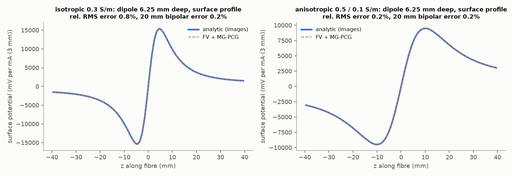
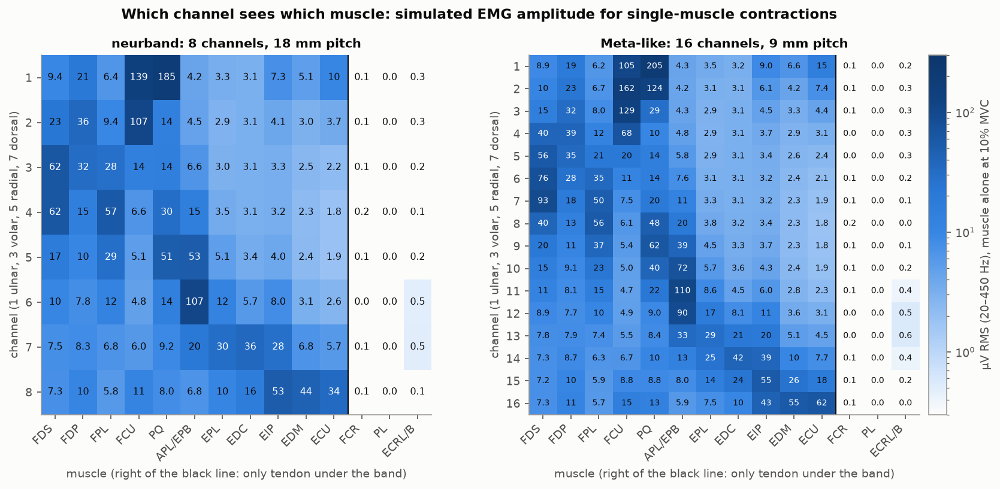
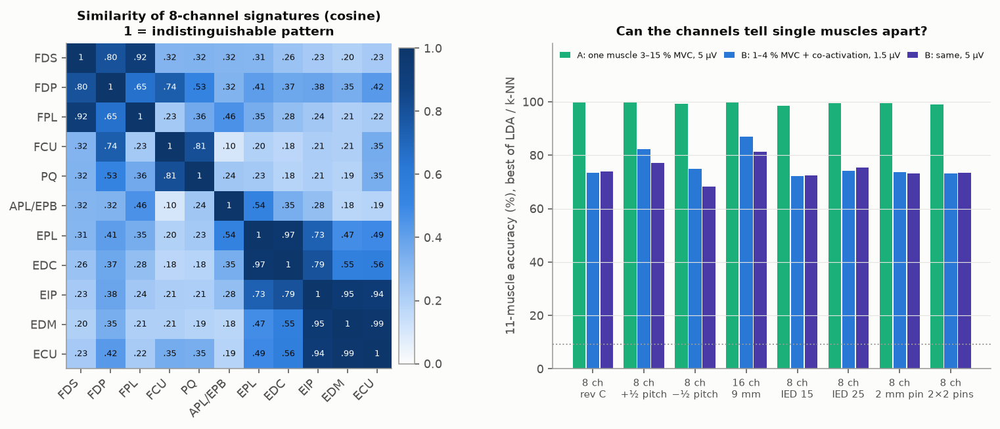
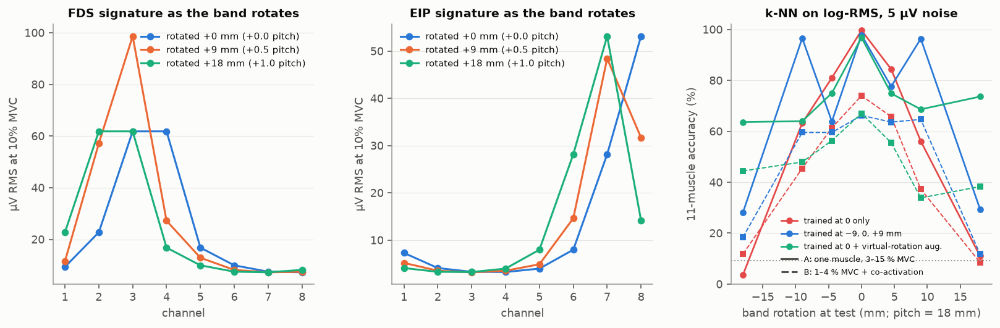
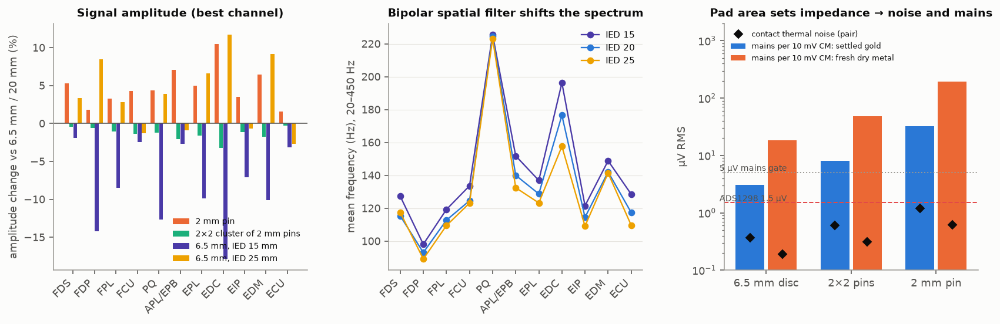
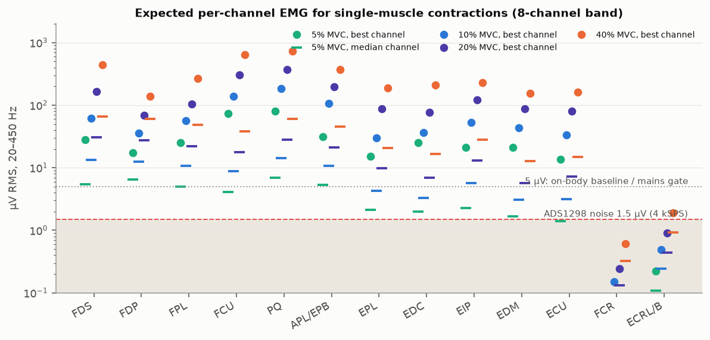

# What the neurband electrodes see: a forward model of distal-forearm sEMG

2026-10-26 · Code: [`sim/emg_forward/`](../../sim/emg_forward/) (numpy + matplotlib only) · Figures: [`figures/`](figures/)

**Evidence labels** (as in [signal_chain.md](signal_chain.md)): **P** published value; **C** calculated by this model; **E** engineering assumption. All numbers below are model outputs (**C**) unless marked otherwise. This model is not a measurement of the band or of a person.

## Summary

The model is a finite-volume volume conductor of a 155 mm distal forearm with anatomically placed muscle bellies and tendons. The sources are Rosenfalck motor units (684 MUs in 14 compartments). Each electrode's lead field comes from one reciprocal solve with my own multigrid-preconditioned CG, validated against analytic dipole solutions to 0.2-0.9 %. Main findings for the rev C band (8 bipolar pods, 18 mm pitch, 6.5 mm dry pads, 20 mm IED, 40 mm above the crease):

- **What is visible.** At 3-5 cm above the crease the visible muscles are PQ, FCU, FDS, FDP, FPL, EIP, APL/EPB and, weakly, EDC, EPL, EDM and ECU. **FCR, PL and ECRL/B are tendon there and give < 1 µV.**
- **Amplitudes vs noise.** On the best channel a single muscle gives **14-81 µV RMS at 5 % MVC** and **3-30 µV (typically 8-9) at 1-2 % MVC**. That is 15-35 dB above the ADS1298 (1.5 µV). For subtle gestures the limit is the 5 µV mains/contact budget, not the ADC.
- **8 vs 16 channels.** Single muscles at ordinary effort are 98-100 % separable with either. For subtle, co-activated contractions, 8 channels give **70-74 %** and 16 channels at 9 mm give **78-87 %**. Five muscle pairs have nearly identical 8-channel signatures (cosine > 0.9; worst EDM/ECU 0.985), against two with 16 channels.
- **Rotation.** ±¼ pitch (4.5 mm) keeps signatures at r = 0.97. **±½ pitch (9 mm) drops them to r = 0.87, and an unrotated classifier from 99 % to about 60 %.** ±1 pitch is a near-exact channel permutation, except at the ulnar gap. Rotation augmentation by channel shifts recovers ±1 pitch (to 64-74 %), but half-pitch offsets need registration or recalibration.
- **Pad size.** A 2 mm pin gains only +4 % amplitude over the 6.5 mm disc, but its impedance is 10.6x higher: 10.6x more mains conversion (32 vs 3 µV per 10 mV of common mode for settled gold) and 1.2 vs 0.37 µV thermal noise per pair. **Keep the 6.5 mm discs.**
- **IED.** 15/20/25 mm change amplitude by −8.5 / 0 / +3 % and mean frequency by +8 / 0 / −4 Hz. **20 mm is fine.**

Figures for a project README: [`emgfwd_cross_section.png`](figures/emgfwd_cross_section.png), [`emgfwd_skin_map.png`](figures/emgfwd_skin_map.png), [`emgfwd_sensitivity_matrix.png`](figures/emgfwd_sensitivity_matrix.png).

**Reproduce** (numpy and matplotlib only; about 25 min on a shared 8-core machine, mostly the 134 lead-field solves):

```sh
cd sim/emg_forward
python3 validate.py      # analytic half-space and reciprocity checks  -> cache/validation.json
python3 leadfield.py     # 134 reciprocal solves (cached in cache/, about 1 GB)
python3 study.py         # MUAPs, sensitivity, coverage, rotation, pads, amplitudes -> cache/results.json
python3 sensitivity.py   # grid and tissue-parameter variants  -> cache/sensitivity.json
python3 figures.py       # docs/science/figures/emgfwd_*.png
```

Code map:

| File | Contents |
|---|---|
| `geometry.py` | Anatomy, conductivities, electrodes |
| `solver.py` | Finite-volume operator, aggregation multigrid, PCG |
| `leadfield.py` | Reciprocal solves and field sampling |
| `sources.py` | Rosenfalck fibres, motor-unit pools, MUAPs |
| `study.py` | Analyses |
| `tables.py` | Markdown tables for this document |


---

## 1. Model

### 1.1 Volume conductor

| Item | Value used | Source / note |
|---|---|---|
| Section | Ellipse, circumference **155 mm**, width:depth **1.35** (56.4 x 41.8 mm). Prismatic (no taper) | **E**. Owner's wrist is 150-155 mm. Wrist depth:width is about 0.7 (carpal-tunnel "wrist ratio") |
| Block | x 64 mm, y 48 mm, z from -20 to +120 mm relative to the distal wrist crease. Band centre at **z = 40 mm** (P at 50 mm, N at 30 mm) | Air outside the skin, so zero normal current (Neumann) everywhere |
| Grid | **0.5 x 0.5 mm in-plane, 1 mm along the arm**; 128 x 96 x 140 = 1.72 M cells | Cell-centred finite volumes, harmonic-mean face conductances |
| Skin | 1 mm, **0.2 S/m** (dermis/epidermis below the stratum corneum) | **E**, within the 0.1-0.4 S/m brief. IT'IS LF skin is 0.148 S/m. The stratum corneum is handled at the electrode interface (§1.4) |
| Fat | **3 mm**, **0.04 S/m** | 0.04 is the value of Farina 2004 [F04]. IT'IS LF is 0.078 S/m. Lean adult distal forearm is about 2-4 mm (**E**) |
| Muscle | **0.5 S/m along the fibres, 0.1 S/m across**. Fibres along the arm, except pronator quadratus (transverse, along x) | Farina & Merletti [F01, F04]. IT'IS: 0.415 / 0.132 S/m |
| Tendon | 0.37 S/m isotropic | IT'IS LF tendon/ligament 0.368 S/m |
| Connective tissue (septa, sheaths, neurovascular bundles, interosseous membrane) | 0.25 S/m | **E** |
| Bone | Cortex 1.5 mm at 0.02 S/m; cancellous core at 0.08 S/m | Gabriel 1996 [G96]; IT'IS cancellous 0.080 S/m |

Bones and compartments are ellipses placed after published axial anatomy at the pronator-quadratus level [GRAY, AJR18, PQ16]. Compartments are grown by 1.3x and split Voronoi-style, so that they fill the space under the fascia as in MRI. Radius: 23 x 13 mm, dorsolateral. Ulna: 11 mm, posteromedial, almost subcutaneous. The 8-pod gap sits over the ulna. This is a schematic of one plausible anatomy, not a segmentation of a scan.

### 1.2 Which muscles are muscle at 3-5 cm above the wrist

Most forearm muscles become tendon in the distal third. Each compartment has a central tendon core, which shrinks proximally. The **muscle area fraction** is `f(z) = f_max·clip((z − z_MTJ)/ramp, 0, 1)`. Fibres terminate on that core, so the distal fibre ends are spread over the ramp. Each fibre runs from its distal end proximally for one fibre length. The end-plate zone sits at the fibre middle, ±4 mm per MU and ±1 mm per fibre.

| Compartment | Role | Area (mm²) | Muscle area at z = 30 / 40 / 50 mm (mm²) | Distal MTJ z (mm) | Fibre length (mm) | MUs / fibres modelled |
|---|---|---|---|---|---|---|
| pronator quadratus (PQ) | forearm pronation | 140 | 140 / 140 / 140 | spans 8-56, transverse fibres | 28 | 204 / 69204 |
| flexor pollicis longus (FPL) | thumb IP flexion | 58 | 22 / 36 / 52 | 15 | 55 | 46 / 15674 |
| flexor digitorum profundus (FDP) | finger DIP flexion | 84 | 28 / 46 / 66 | 15 | 78 | 67 / 22798 |
| flexor digitorum superficialis (FDS) | finger PIP flexion | 122 | 23 / 48 / 72 | 20 | 70 | 97 / 32851 |
| flexor carpi ulnaris (FCU) | wrist flexion/ulnar dev. | 89 | 37 / 56 / 74 | 10 | 50 | 67 / 22651 |
| flexor carpi radialis (tendon) (FCR) | wrist flexion/radial dev. | 24 | 0 / 0 / 0 | 105 | 63 | 19 / 6451 |
| palmaris longus (tendon) (PL) | wrist flexion (absent in ~15%) | 11 | 0 / 0 / 0 | 110 | 64 | 9 / 2999 |
| abductor pollicis longus + EPB (APL_EPB) | thumb abduction/extension | 33 | 4 / 14 / 24 | 25 | 70 | 26 / 8998 |
| ECRL + ECRB (tendons) (ECR) | wrist extension/radial dev. | 33 | 0 / 0 / 0 | 95 | 70 | 26 / 8925 |
| extensor pollicis longus (EPL) | thumb extension | 34 | 0 / 8 / 17 | 30 | 54 | 27 / 9076 |
| extensor digitorum (communis) (EDC) | finger extension | 53 | 0 / 0 / 11 | 40 | 68 | 42 / 14325 |
| extensor indicis (EIP) | index extension | 36 | 26 / 32 / 32 | 5 | 59 | 28 / 9677 |
| extensor digiti minimi (EDM) | little-finger extension | 16 | 0 / 5 / 10 | 30 | 68 | 13 / 4427 |
| extensor carpi ulnaris (ECU) | wrist extension/ulnar dev. | 16 | 4 / 7 / 11 | 20 | 62 | 13 / 4427 |

Active muscle grows from about 280 to 390 to 510 mm² at z = 30 / 40 / 50 mm, out of a 1850 mm² section. Most of it is volar (PQ, FCU, FDS, FDP, FPL). The dorsal side is mostly tendon, apart from EIP and the outcropping APL/EPB.

Sources and assumptions:

- **P:** FCR's distal musculotendinous junction lies 11.7 ± 2.3 cm proximal to the radial styloid [PAN21]. FCR is therefore tendon at the band.
- **P:** PQ occupies the distal 1.2-6.0 cm of the ulna and 0.5-5.2 cm of the radius [PQ16].
- **P:** EIP fibres reach the wrist joint. APL/EPB cross the radial wrist extensors 4-8 cm proximal to Lister's tubercle [AJR18].
- **P:** Fibre lengths are from Holzbaur et al. 2005, Table 1, which compiles Lieber 1990/1992 and Jacobson 1992 [H05, L92].
- **E:** The remaining musculotendinous-junction positions (FDS, FDP, FPL, FCU, EDC, EPL, EDM, ECU, PL, ECRL/B) are my estimates. They follow the qualitative anatomy: deep flexors, FCU, PQ and EIP stay muscular to the distal forearm; FCR, PL, ECRL and ECRB are tendon; EDC is borderline. I found no per-muscle distance table for the wrist crease. These are the least certain inputs of the model.

### 1.3 Sources: motor units

| Item | Value | Source |
|---|---|---|
| Intracellular action potential | Rosenfalck: `Vm(s) = 96 s³ e^(−s) − 90 mV`, s in mm behind the front | [R69] |
| Impressed (axial) current | `I = −σi·πa²·∂Vm/∂z`, with σi = 1.01 S/m and fibre radius a = 25 µm | [R69, F01] |
| Conduction velocity | **4 m/s**. The AP is born at the end-plate, travels both ways and is extinguished at sealed fibre ends | Generation and extinction at the fibre ends create the non-propagating "end-of-fibre" components [F01] |
| Fibre density | 300 fibres/mm² of muscle; 20 fibres/mm² inside one MU territory | 200-400 /mm² [MA22]; MU territory density from [FUG93] |
| MU pool | Innervation numbers exponential over 50:1, mean 340 fibres | FDI has 41k fibres in 119 MUs [FEI55] |
| MU count | Muscle area x density / 340, so 13-204 MUs per compartment | — |
| MU territory | Circular, area = n/20 mm² (radius 0.7-4.7 mm), clipped to the compartment | — |
| Sampling | 24 fibres simulated per MU, scaled to the true fibre count | — |
| Recruitment and rate coding | Thresholds exponential from 1 % to 60 % MVC (Fuglevand-style [FUG93]). Rate is 8 Hz at threshold, +1 Hz per % MVC, capped at 30 Hz | — |
| Interference EMG power per channel | `Σ_i rate_i · ∫ MUAP_i² dt`, band-limited 20-450 Hz | Campbell's theorem, for independent firing |

Reciprocity: a pad pair's voltage is `V_P − V_N = ∫ J_i · ∇ψ dV`, where ψ is the potential when 1 A is injected at P and removed at N. The code samples ψ along each fibre (trilinear interpolation) and forms `Σ_k I(u_k+½)·[ψ(u_k+1) − ψ(u_k)]`. This is exactly the discrete adjoint of injecting the membrane currents into the grid. One finite-volume solve per electrode gives the electrode's field. Any bipolar pair is a difference of two fields, because each solve uses a uniformly spread sink that cancels in the difference. 134 such solves cover all configurations here.

### 1.4 Electrodes and the skin interface

A pad is modelled as a **uniform current density over its footprint**. This holds for dry contacts, whose interface impedance (tens of kΩ to MΩ) is much larger than the tissue spreading resistance (about 0.8 kΩ, computed). By reciprocity the pad then reads the area-averaged skin potential.

Pad types:

- 6.5 mm disc (33.2 mm²), the rev C pad.
- 2 mm disc (3.1 mm²).
- 2x2 cluster of 2 mm pins on a 3.5 mm square, tied together (12.6 mm²).

The stratum corneum enters only the noise and impedance calculation, through an **R‖C contact per unit area** scaled as 1/area. Two fits are used:

- **Settled gold:** fitted to Yamagami 2018. A 5 mm² gold contact measured 252 kΩ at 53 Hz and 139 kΩ at 151 Hz [Y18]. The fit gives R·A = 15.3 kΩ·cm² and C/A = 135 nF/cm².
- **Fresh dry metal:** R·A = 2 MΩ·cm² and C/A = 41 nF/cm² (Goyal 2022 [GOY22]: 2.1-2.7 MΩ·cm² at 10 Hz in vivo; phantom C_sc 41 nF/cm²).

Two quantities follow from the contact model:

- **Thermal noise:** `√(4kT∫Re Z df)` over 20-450 Hz.
- **Mains conversion:** `V_dm ≈ V_cm·ωC_in·|ΔZ|`, the model of [signal_chain.md](signal_chain.md) §3, with 50 Hz, C_in = 50 pF and a 50 % contact mismatch.

Real dry contacts also show excess (non-thermal) noise and motion artefacts that grow as the contact shrinks [HUI02]. Those are not modelled, so the small-pad noise is a lower bound.

### 1.5 Solver

Cell-centred finite-volume 7-point operator with harmonic-mean face conductances. Air cells have zero conductance, which gives a natural Neumann boundary at the skin.

Linear solver: **conjugate gradients preconditioned by one symmetric V-cycle of an aggregation multigrid**. Coarsening is 2x2x2 piecewise-constant, with an exact Galerkin coarse operator: a coarse conductance is the sum of the fine conductances it contains. Smoothing is damped Jacobi (ω = 0.7), and the coarsest grid is solved by a dense pseudo-inverse.

Convergence: 45 iterations to a relative residual of 1e-8 on 1.7 M cells, about 10 s on one core. Jacobi-PCG needs 10x more iterations. The singular Neumann system is made consistent by projecting the right-hand side to zero mean.

## 2. Validation

**Analytic half-space.** A 3 mm current dipole lies 6.25 mm deep, oriented along the fibres, in a homogeneous block of 100 x 50 x 120 mm. All faces are insulating, and the top face plays the skin. The analytic reference is the image solution of a point current in an anisotropic medium (coordinate scaling), with the images of all six walls summed to third order. The comparison region is the top surface within ±30 mm across and ±40 mm along (`validate.py`).

| Medium | Grid (mm) | PCG iterations | Surface map RMS error | 20 mm bipolar error | Error if far walls are ignored (pure half-space) |
|---|---|---|---|---|---|
| Isotropic 0.3 S/m | 1 x 1 x 1 | 19 | 0.90 % | 0.21 % | 10.8 % |
| Isotropic 0.3 S/m | 0.5 x 0.5 x 1 | 53 | 0.79 % | 0.24 % | 10.4 % |
| Muscle 0.5 / 0.1 S/m | 1 x 1 x 1 | 37 | 0.54 % | 0.50 % | 8.0 % |
| Muscle 0.5 / 0.1 S/m | 0.5 x 0.5 x 1 | 22 | **0.24 %** | 0.18 % | 7.8 % |

The last column is a check on the reference itself: the finite block matters at about the 10 % level, so the comparison must include the wall images.

**Reciprocity.** In the full forearm model, a forward solve of a dipole in FDS, read as area-averaged pad potentials, agrees with the lead-field formula to a relative difference of **2 x 10⁻⁹**. The implementation is therefore exactly reciprocal.

**Grid refinement.** Section 3.6 compares the 1 mm grid with the production grid on the 8 baseline channels.



## 3. What the electrodes see


*Left:* model anatomy 40 mm above the crease, with the 8 rev C pods. Pod 1 is ulnar, 3 volar, 5 radial and 7 dorsal; the gap is over the ulna. *Middle:* how strongly the best channel couples to a source pointing along the fibres, in dB. Sensitivity falls by about 20-30 dB from the superficial muscles to the deep side of PQ and the interosseous space. *Right:* lead field of channel 2 in a longitudinal section. Sources directly under each pad couple with opposite signs. Under the 20 mm gap, coupling stays the same sign and reaches deep.


One 546-fibre FDS motor unit with its end-plate at 78 mm above the crease:

- The action potentials form two travelling tripoles of several hundred µV on the skin (monopolar).
- The distal one reaches the P row at about 6 ms and dies on the tendon between the P and N rows at about 9-10 ms.
- The unit sits between pods 3 and 4, so those two channels carry nearly identical large bipolar MUAPs and pods 1 and 5-8 see almost nothing.

This is the "spatial bandwidth" problem in one picture: the field of one unit is about 15-20 mm wide around the forearm, comparable to the 18 mm pitch.

### 3.1 Sensitivity matrix



The table gives µV RMS over 20-450 Hz on the best channel, for each muscle contracting alone (recruitment model, §1.3). "2nd/1st" is the ratio of the second-best channel to the best: lower means a more focal signature.

| Muscle | Best channel (8-ch) | 5 % MVC | 10 % | 20 % | 2nd/1st | Median channel at 10 % | MUAP p-p median / 90th pct (µV) | Mean freq. (Hz) |
|---|---|---|---|---|---|---|---|---|
| FDS | 4 (3 equal) | 28 | 62 | 167 | 1.00 | 13 | 117 / 851 | 115 |
| FDP | 2 | 17 | 36 | 70 | 0.88 | 13 | 91 / 411 | 93 |
| FPL | 4 | 25 | 57 | 104 | 0.50 | 11 | 132 / 853 | 113 |
| FCU | 1 | 74 | 139 | 304 | 0.77 | 9 | 343 / 2140 | 125 |
| PQ (transverse) | 1 | 81 | 185 | 367 | 0.28 | 14 | 192 / 1257 | 224 |
| APL/EPB | 6 | 32 | 107 | 198 | 0.50 | 11 | 366 / 1416 | 140 |
| EPL | 7 | 15 | 30 | 88 | 0.39 | 4 | 92 / 718 | 129 |
| EDC | 7 | 25 | 36 | 77 | 0.44 | 3 | 73 / 511 | 177 |
| EIP | 8 | 21 | 53 | 121 | 0.53 | 6 | 159 / 1125 | 114 |
| EDM | 8 | 21 | 44 | 88 | 0.16 | 3 | 281 / 1016 | 142 |
| ECU | 8 | 14 | 34 | 80 | 0.30 | 3 | 200 / 778 | 117 |
| FCR (tendon at band) | — | 0.07 | 0.15 | 0.25 | — | 0.1 | 0.7 / 4 | — |
| PL (tendon) | — | 0.00 | 0.01 | 0.04 | — | 0.0 | 0.3 / 1 | — |
| ECRL/B (tendon) | — | 0.2 | 0.5 | 0.9 | — | 0.2 | 2 / 9 | — |

What the table shows:

- **Wrist-only muscles whose bellies end proximally are invisible at 3-5 cm.** These are FCR, PL, ECRL and ECRB: below 1 µV even at 20 % MVC. Wrist flexion and extension can only be read from FCU, ECU and the finger and thumb muscles that co-activate.
- **The ulnar-volar pods 1-2 dominate.** FCU and PQ are big and close to the skin there, which gives the strongest signals.
- **The dorsal finger extensors are mostly tendon at the band.** EDC, EPL, EDM and ECU are small but focal, mainly on pods 7-8.
- **Amplitudes drop steeply with distance.** The median pod sees 3-16x less than the best pod (4.6x for FDS, about 3x for the deep FDP, 10-16x for FCU, PQ, EDC, EDM and ECU). The band therefore behaves like 8 fairly local sensors, not 8 views of one mixture.

### 3.2 Coverage: can 8 channels tell the muscles apart, and what do 16 add? (question a)

**Linear separability.** For linear unmixing, 8 channels have rank at most 8, so 11 muscles cannot all be unmixed.

| Measure | 8 ch, 18 mm pitch | 16 ch, 9 mm pitch |
|---|---|---|
| Condition number, 6 main muscles (FDS, FDP, FPL, FCU, EDC, ECU), column-normalised | **12.2** | **7.8** |
| Effective rank, 11 muscles (entropy of singular values) | 4.3 | 4.7 |
| Muscle pairs with signature cosine > 0.90 | FDS-FPL 0.92, EPL-EDC 0.97, EIP-EDM 0.95, EIP-ECU 0.94, EDM-ECU 0.985 | EPL-EDC 0.91, EDM-ECU 0.98 |



**Classification.** Features are log-RMS per channel in 256 ms windows. Firing is synthesised (CV 0.2), with white in-band noise of 1.5 or 5 µV and 5 % per-channel gain jitter. The data are 80 training and 80 test windows per class, classified by LDA or k-NN (k = 7). Two scenarios:

- **A:** one muscle at 3-15 % MVC.
- **B:** subtle, one muscle at 1-4 % MVC plus random co-activation of every other muscle at up to 60 % of that level.

| 11-muscle accuracy | A, 5 µV noise | B, 1.5 µV | B, 5 µV | B: mutual information (bits, maximum 3.46) |
|---|---|---|---|---|
| 8 ch, rev C placement | 98-100 % | 72-74 % | 70-74 % | 2.2-2.3 |
| 8 ch, rotated +9 mm (half pitch, in the pod 1 → 2 direction) | 98-100 % | 78-82 % | 76-77 % | 2.2-2.6 |
| 8 ch, rotated −9 mm | 97-99 % | 72-75 % | 65-68 % | 2.0-2.2 |
| **16 ch, 9 mm** | **100 %** | **78-87 %** | **79-81 %** | 2.5-2.7 |

(Ranges are LDA vs k-NN. With about 880 test windows the binomial standard error is about 1.5 points.)

- **Strong single-muscle contractions are trivially separable with 8 channels.** Signals of tens of µV sit far above any noise.
- **Subtle, co-activated contractions are limited by spatial resolution, not electronics.** Going from 1.5 to 5 µV of noise costs 0-3 points, while 16 channels add 4-14 points. LDA gains the most; with k-NN the gain is 4-5 points.
- **Placement matters about as much as the extra channels.** Shifting the same 8 pods by 9 mm in the pod 1 → 2 direction raised accuracy from 73 to 78-82 %, because it puts a pod directly over FDS/FPL instead of between them (figure in §3.3). The opposite shift lowered it to 65-75 %. Best placement depends on the individual anatomy, which argues for checking it per user.

### 3.3 Band rotation (question b)



| Rotation of the 8-pod band | Median correlation with unrotated signature | Median relative change ‖Δs‖/‖s‖ | Accuracy (A, k-NN), trained at 0 | Accuracy (A, k-NN), trained at 0 + virtual rotation | Accuracy (B), trained at 0 |
|---|---|---|---|---|---|
| 0 | 1.00 | 0 | 99.7 % | 96.8 % | 74 % |
| ±4.5 mm (¼ pitch) | 0.97 | 0.18-0.24 | 81-84 % | 75 % | 61-66 % |
| **±9 mm (½ pitch)** | **0.87** | **0.39-0.46** | **56-63 %** | 64-69 % | 37-46 % |
| **±18 mm (1 pitch)** | 0.36-0.42 | 0.82-0.84 | **4-11 %** | **64-74 %** | 9-12 % |

- **A full-pitch rotation is almost exactly a channel permutation.** Compared with the unrotated signature shifted by one channel, the relative change is at most 0.3 for 8 of the 11 muscles (typically about 0.05). It reaches 0.4-1.3 only for ECU, EIP and FCU, next to the ulnar gap, where the "new" channel lands on skin that no pod covered before. A one-channel circular shift is therefore a near-exact augmentation, except at the gap.
- **Half-pitch rotations are the hard case.** The 18 mm pitch undersamples a 15-20 mm-wide field. Rotating by 9 mm makes FDS appear on one pod at 98 µV instead of on two at 62 µV each. Linear interpolation between neighbouring channels does not reproduce that pattern well: with virtual-rotation augmentation, accuracy at ±½ pitch is only about 65 %.
- **Training on real data at −9, 0 and +9 mm** recovers those positions (96-99 %) but not ¼ or 1 pitch.
- **Rotation augmentation is necessary but not sufficient.** Integer channel shifts are cheap and close to physical. Fractional rotations need real multi-position data or recalibration. Mechanically holding the band to within about ±¼ pitch (±4.5 mm) keeps accuracy above 80 % without any of these.

### 3.4 Pad size, pin clusters and inter-electrode distance (question c)



| Variant (vs 6.5 mm disc, IED 20 mm) | Best-channel amplitude, median (range) | Mean-frequency shift | Scenario B accuracy |
|---|---|---|---|
| 2 mm disc | +4 % (+2 … +10 %) | +3 Hz (0 … +12) | 71-74 % (base: 70-74 %) |
| 2x2 cluster of 2 mm pins | −1 % (−3 … 0 %) | −0.5 Hz | 69-73 % |
| IED 15 mm | **−8.5 % (−18 … −2 %)** | +8 Hz (+1 … +20) | 67-72 % |
| IED 25 mm | +3 % (−3 … +12 %) | −4 Hz (−19 … +2) | 73-75 % |

**Spatial filtering by the pad is negligible.** The sources are at least 4 mm deep under 3 mm of fat and 1 mm of skin, so the skin potential is already smooth over 5-10 mm; a 6.5 mm pad loses only about 4 % against a point contact. A longer IED picks up deeper and farther sources (more amplitude, lower frequencies), and a shorter one is slightly more superficial and higher-frequency. All differences are small next to the effect of rotation or of 8 vs 16 channels.

**Noise and mains** (R‖C per area, §1.4; pair of contacts, 20-450 Hz):

| Contact model | Pad | \|Z\| at 50 Hz | \|Z\| at 1 kHz | Thermal noise of the pair | Total with ADS1298 (1.5) and 2x4.7 kΩ | Mains: differential µV per 10 mV common mode (50 % mismatch, 50 pF) |
|---|---|---|---|---|---|---|
| Settled gold [Y18] | 6.5 mm disc | 39 kΩ | 3.5 kΩ | 0.37 µV | 1.57 µV | **3.0** |
| | 2x2 pins | 102 kΩ | 9.4 kΩ | 0.60 µV | 1.64 µV | 8.0 |
| | 2 mm pin | 408 kΩ | 37 kΩ | 1.20 µV | 1.94 µV | **32** |
| Fresh dry metal [GOY22] | 6.5 mm disc | 234 kΩ | 12 kΩ | 0.19 µV | 1.53 µV | **18** |
| | 2x2 pins | 617 kΩ | 31 kΩ | 0.31 µV | 1.55 µV | 48 |
| | 2 mm pin | 2.5 MΩ | 124 kΩ | 0.62 µV | 1.64 µV | **194** |

- **Thermal noise of the contact never dominates the ADS1298 in band.** The R‖C corner sits low, so most of the contact's thermal noise falls below 20 Hz.
- **Contact impedance sets the mains conversion.** Mains pickup grows in proportion to 1/area: a 2 mm pin is 10.6x worse than the 6.5 mm disc, and the 2x2 cluster 2.6x worse.
- **Smaller pads buy nothing spatially and lose a lot on mains.** They also worsen motion artefacts, which are not modelled.

### 3.5 Expected amplitudes vs. noise (question d)



| Situation (8-ch band) | Best channel, µV RMS (20-450 Hz) | Median channel |
|---|---|---|
| Single muscle, 1.5 % MVC (2-21 MUs firing) | 3-19 (median of muscles **8**) | — |
| Single muscle, 2 % MVC | 4-29 (median 9) | — |
| Single muscle, 5 % MVC | 14-81 (median 25) | 1.4-7 |
| Single muscle, 20 % MVC | 70-370 | 6-31 |
| Grip, all flexors + PQ, 5 % / 20 % | 110 / 480 | 31 / 150 |
| Finger and wrist extension, 5 % / 20 % | 34 / 200 | 20 / 76 |
| Thumb (FPL + APL/EPB + EPL), 5 % / 20 % | 33 / 200 | 15 / 75 |

Noise references from [signal_chain.md](signal_chain.md): ADS1298 1.5 µV RMS (4 kSPS, HR); target on-body baseline and mains residual ≤ 5 µV; one example of 10 mV common mode with 100/200 kΩ contacts converts to 18.9 µV.

- **Light and moderate contractions are easy.** At 5 % MVC or more, every muscle except the tendinous ones gives at least 14 µV on its best channel: 19-35 dB above the ADS1298 and 9-24 dB above a 5 µV residual. Every pod's best muscle gives at least 21 µV at 5 % MVC.
- **Subtle input is marginal.** At 1-2 % MVC (a handful of motor units) the best channel carries 3-30 µV, typically 8-9 µV. That is 15 dB over the ADC but only about 4 dB over a 5 µV mains/contact residual. **For subtle gestures the 5 µV on-body gate in signal_chain.md matters more than the ADC noise.**
- **Absolute scale is uncertain.** These amplitudes are in the upper half of the 10-100 µV planning envelope of signal_chain.md. The model is probably high by up to about 2x (perfectly synchronous fibres within an MU, straight fibres, a thin 3 mm fat layer, 50 µm fibres), so treat them as an upper-middle estimate. The ratios between channels, muscles and design variants are much more robust (§3.6).

### 3.6 How robust are these numbers?

The 16 lead fields of the 8 baseline channels were recomputed for each variant. The table reports the ratio of each muscle's best-channel amplitude to the baseline, and the correlation of its 8-channel signature with the baseline (`sensitivity.py`).

| Variant | Best-channel amplitude ratio, median (range over 11 muscles) | Signature correlation with baseline, min | Condition number (11 muscles) |
|---|---|---|---|
| Baseline | 1 | 1 | 22.4 |
| Grid 1 x 1 x 1 mm (vs 0.5 x 0.5 x 1) | 1.04 (0.95-1.12) | 0.999 (FPL) | 22.3 |
| IT'IS conductivities (muscle 0.415/0.132, fat 0.078, skin 0.148, cortex 0.006 S/m) | 1.22 (1.15-1.30) | 0.999 (FDP) | 21.6 |
| Skin 0.4 S/m (vs 0.2) | 0.76 (0.73-0.82) | 0.998 (EPL) | 24.8 |
| Fat 5 mm (vs 3 mm; anatomy and MU pools rebuilt) | 0.94 (0.35-1.42) | 0.709 (EDC) | 38.2 |
| Isotropic muscle 0.3 S/m (no anisotropy) | 1.04 (0.75-1.51) | 0.986 (FDP) | 23.0 |

- **The grid is converged.** Halving the in-plane cell size changes amplitudes by 4 % and leaves signatures unchanged (r ≥ 0.999).
- **Tissue conductivities mainly change the absolute scale.** IT'IS values give +22 % and a more conductive skin −24 %, which is consistent with the "factor 2" uncertainty quoted above. The channel patterns are unaffected (r ≥ 0.98).
- **Fat thickness changes the pattern.** At 5 mm the compartments shrink and the signatures of some muscles move between pods (r down to 0.71) and the conditioning worsens (38). Part of this spread comes from a different random motor-unit layout, because the pools had to be rebuilt for the new anatomy. This anatomy-driven variability between people is exactly what per-user calibration has to absorb.


## 4. Design implications (plain language)

1. **Eight channels are enough to see which part of the forearm is working, not always which single muscle.** Flexor vs extensor side, thumb vs fingers and ulnar vs radial all separate cleanly at ordinary effort. Some neighbours look alike to an 18 mm-pitch band: the small dorsal extensors (EDM/ECU/EIP, EPL/EDC) and FDS vs FPL. Telling those apart at very light effort will rely on per-user training. A 16-channel band at 9 mm pitch would add 4-14 points of accuracy in the hardest (subtle + co-activation) test. Keep it as the upgrade path if subtle-gesture accuracy disappoints. It is not needed for gross gestures.
2. **Placement: 3-5 cm above the crease sees finger and thumb muscles well, but not the pure wrist movers.** FCR, PL, ECRL and ECRB are only tendon there and contribute nothing. If wrist flexion/extension and radial deviation matter as separate commands, test a position 2-3 cm more proximal, where more bellies are present. Otherwise rely on FCU/ECU and co-contraction patterns.
3. **Rotation is the biggest practical risk.** Half a pitch (9 mm) of rotation scrambles single-muscle signatures. Correlation with the unrotated signature drops to 0.87, and a classifier trained unrotated falls from 99 % to about 60 %; one full pitch drops it to about 10 %. Two mitigations, in order of value:
   - Mechanically register the band: put the gap over the ulnar head and add a visible or tactile mark, aiming for ±4.5 mm.
   - Train with circular one-channel shifts, which are physically almost exact.
   Fractional rotations still need recalibration or data from several positions.
4. **Pad size: keep the 6.5 mm discs (or go larger, 8 mm).** Going smaller gains at most 4 % in amplitude. It costs 2.6x (2x2 pins) to 10.6x (single 2 mm pin) more mains conversion, and probably more motion artefact.
5. **IED: keep 20 mm.** 25 mm buys +3 % amplitude and a slightly lower spectrum; 15 mm loses 8.5 %. Neither changes separability beyond the noise of this simulation. Spectral content sits mostly at 90-180 Hz (PQ at about 220 Hz), so the 20-450 Hz band captures it. Meta's 20 mm choice is reasonable for this anatomy.
6. **Electronics: the ADS1298 is not the bottleneck.** Its 1.5 µV is 15 dB below even the faintest modelled activity (1-2 % MVC). Effort should go to contact quality and the bias/mains loop to keep the on-body residual below 5 µV, and to band registration.

## 5. Limits of the model

What the model can and cannot claim:

- **One idealised anatomy.** The geometry is prismatic and elliptical: no taper, ellipse compartments, no vessels or nerves, uniform 3 mm fat, and one placement of the radius and ulna. Real wrists differ in fat (women typically 4-7 mm), ulna prominence and muscle-tendon proportions. Section 3.6 shows the size of these effects for fat, skin and conductivities. Absolute amplitudes are uncertain by roughly a factor of 2. Channel *patterns* are more robust.
- **Musculotendinous-junction positions are estimates (E)** for most muscles. If EDC or FDS stay muscular further distally than assumed, the dorsal channels see more. Moving the band 1 cm proximally adds muscle under it for every compartment.
- **Fibres are straight and parallel to the arm.** The model ignores pennation (3-12° [H05]), fibre curvature around the bones, and conduction-velocity spread between motor units (all MUs at 4 m/s). Pennation and CV spread broaden spectra and slightly reduce the propagating components.
- **Rosenfalck IAP, 50 µm fibres, independent firing (Campbell power sum).** There is no MU synchronisation, no fatigue and no force-to-EMG calibration. "% MVC" here means the recruitment model's excitation level, not a measured force.
- **Single-muscle activations are a coverage proxy.** Real gestures are synergies of several muscles, which makes classes more distinct than single muscles in some cases and less in others. Classification accuracies here measure how separable the channel patterns are, not gesture accuracy.
- **Contacts are linear and static.** The R‖C contact model is scaled by area from two published fits. Excess contact noise, motion artefacts, sweat bridges, polarisation drift and pressure effects are not modelled; for small pads these effects are probably larger than the thermal noise computed here [HUI02]. The model ignores the driven bias pad between P and N: with a dry contact of more than 40 kΩ it shunts the skin potential negligibly.
- **Quasi-static and purely resistive tissue.** Capacitive tissue currents are negligible below about 1 kHz.
- **Electrodes are flat footprints mapped onto the skin ellipse.** A real band may tilt and lose contact on the flat dorsum; this is not modelled.

## References

- [F01] Farina D, Merletti R. A novel approach for precise simulation of the EMG signal detected by surface electrodes. *IEEE Trans Biomed Eng* 48(6):637-646, 2001. doi:10.1109/10.923782
- [F04] Farina D, Mesin L, Martina S, Merletti R. A surface EMG generation model with multilayer cylindrical description of the volume conductor. *IEEE Trans Biomed Eng* 51(3):415-426, 2004. doi:10.1109/TBME.2003.820998
- [R69] Rosenfalck P. Intra- and extracellular potential fields of active nerve and muscle fibres. *Acta Physiol Scand Suppl* 321, 1969.
- [G96] Gabriel S, Lau RW, Gabriel C. The dielectric properties of biological tissues II/III. *Phys Med Biol* 41:2251-2293, 1996.
- [ITIS] IT'IS Foundation tissue property database, low-frequency conductivity (v4.x). https://itis.swiss/virtual-population/tissue-properties/database/low-frequency-conductivity
- [H05] Holzbaur KRS, Murray WM, Delp SL. A model of the upper extremity for simulating musculoskeletal surgery and analyzing neuromuscular control. *Ann Biomed Eng* 33:829-840, 2005. doi:10.1007/s10439-005-3320-7 (Table 1)
- [L92] Lieber RL, Jacobson MD, Fazeli BM, Abrams RA, Botte MJ. Architecture of selected muscles of the arm and forearm. *J Hand Surg Am* 17:787-798, 1992.
- [PAN21] Panwar et al. FCR musculotendinous junction relative to the radial styloid. *Muscles Ligaments Tendons J* 2021. doi:10.32098/mltj.04.2021.20 (found by literature search; abstract-level check only)
- [PQ16] Choung et al. Pronator quadratus anatomy for needle EMG. *Ann Rehabil Med* 40(3):496, 2016. doi:10.5535/arm.2016.40.3.496
- [AJR18] MRI of the extensor tendons of the wrist. *AJR* 2018. doi:10.2214/AJR.17.17791 (snippet-level check only)
- [GRAY] Standring S (ed.). *Gray's Anatomy*, 42nd ed., forearm chapter and axial sections; any cross-sectional atlas at the pronator-quadratus level
- [FUG93] Fuglevand AJ, Winter DA, Patla AE. Models of recruitment and rate coding organization in motor-unit pools. *J Neurophysiol* 70:2470-2488, 1993.
- [FEI55] Feinstein B, Lindegård B, Nyman E, Wohlfart G. Morphologic studies of motor units in normal human muscles. *Acta Anat* 23:127-142, 1955.
- [MA22] Ma et al., arXiv:2211.01856 (fibre density / CV ranges used in sEMG simulation)
- [MAK21] Maksymenko K et al. A myoelectric digital twin for fast and realistic modelling in deep learning. bioRxiv 2021, doi:10.1101/2021.06.07.447390 (*Nat Commun* 2023). Comparable forearm MU-pool parameters
- [Y18] Yamagami M et al. Assessment of dry epidermal electrodes for long-term electromyography measurements. *Sensors* 18:1269, 2018. https://pmc.ncbi.nlm.nih.gov/articles/PMC5948629/
- [GOY22] Goyal K et al. Dry electrode-skin impedance, *Sensors* 22:8510, 2022. doi:10.3390/s22218510
- [HUI02] Huigen E, Peper A, Grimbergen CA. Investigation into the origin of the noise of surface electrodes. *Med Biol Eng Comput* 40:332-338, 2002.
- [N25] CTRL-labs at Reality Labs (Kaifosh, Reardon et al.). A generic non-invasive neuromotor interface for human-computer interaction. *Nature* 645:702-711, 2025. See [../research/meta_semg_research.md](../research/meta_semg_research.md)
- [ADS] TI ADS1298 datasheet SBAS459K, Table 1 (via [signal_chain.md](signal_chain.md))
