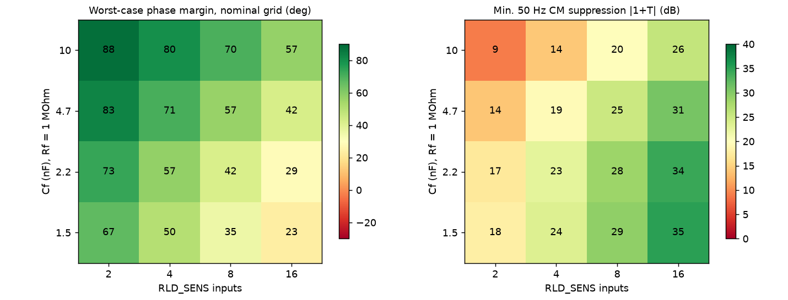
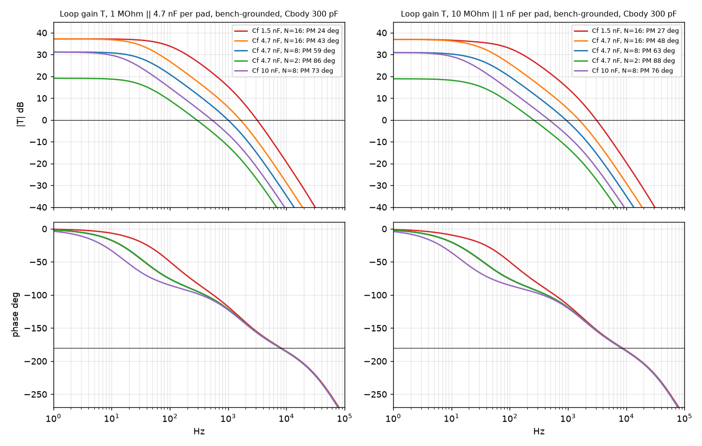
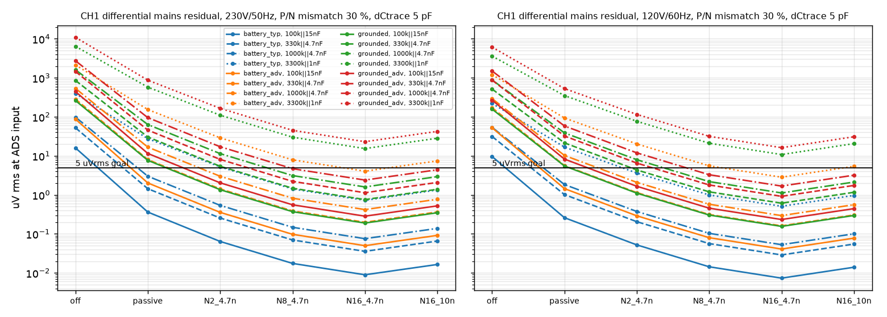
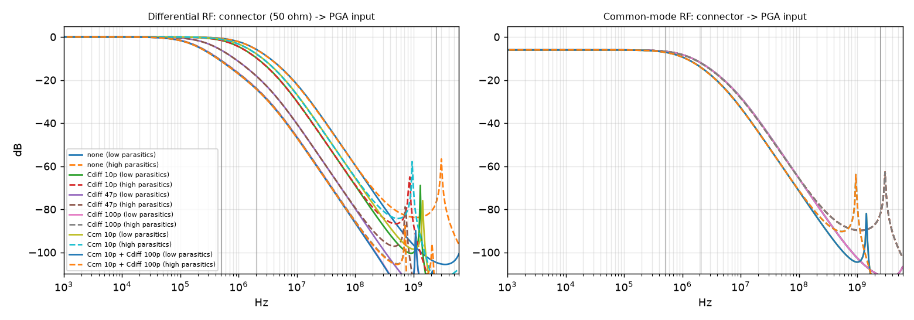
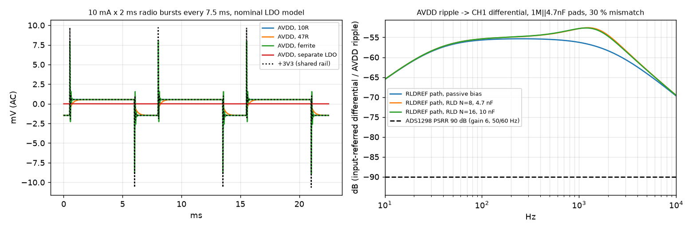

# Rev C analog front end: circuit simulations

2026-10-26. These are **simulations only (ngspice-47 plus numpy). Nothing was measured.** They follow up the questions in `signal_chain.md` §3 and §7. The circuit source is `boards/neurband_c/gen_c_sch.py`, which as fitted has Rf = 1 MΩ, **Cf = 4.7 nF**, 100 kΩ to BIAS_E (8 pads, also to RLDIN), 4.7 kΩ per input, RLDREF pin NC (internal reference), and +3V3 → 10 Ω → 10 µF + 100 nF (+ 1 µF + 3 × 100 nF local) → AVDD. No board, schematic, firmware or mechanical file was changed.

Scripts are in `sim/` and outputs (CSV, PNG, logs) in `sim/out/`. Re-run everything with `sim/run_all.sh` (about 30 s).

| Script | Question |
|---|---|
| `sim/afe.py` | Shared netlist generator: 16 electrode lines, 8 bias pads, body/earth/mains, ADS1298 input and RLD models, ngspice runner, margin extraction |
| `sim/q1_rld_loop.py` | Bias-loop gain, phase margin and 50/60 Hz suppression over 10,240 cases |
| `sim/q2_cm_to_dm.py` | Mains CM → CH1 differential residual with P/N mismatch, RLD off / passive / closed loop |
| `sim/q3_input_filter.py` | 4.7 kΩ + package + internal EMI filter: RF and modulator-band attenuation, in-band droop, optional RF caps |
| `sim/q4_supply.py` | Radio bursts on the shared 3.3 V rail → AVDD ripple → input-referred error (transient + FFT) |

## 1. Model and assumptions

Device GND (AVSS) is the SPICE reference. "Earth" is a separate node reached only through capacitances. Each of the 16 lines runs: body → pad R‖C → flex trace C to GND → 4.7 kΩ → 10 pF pin → 5 kΩ + 10 pF EMI filter → 1 GΩ PGA input. Sensed inputs feed a unity-CM PGA pole (64 kHz) and then a 220 kΩ summing resistor into RLDINV. The RLD amplifier is a single-pole op-amp. The loop gain is the return ratio, taken by breaking the loop between the amplifier output and the 100 kΩ resistor. That break is clean because the amplifier's closed-loop output impedance is much smaller than 100 kΩ.

| Quantity | Value used | Source / label |
|---|---|---|
| RLD amp GBW | **100 kHz** typ (50 kHz derated case) | ADS1298 EC table, "RLD amplifier", 50 kΩ‖10 pF, G = 1 |
| RLD amp slew, drive | 0.25 V/µs; 270/550 µA short-circuit; 50 µA at peak swing (AVSS+0.3 to AVDD−0.3) | EC table |
| RLD amp A0, Rout | 100 dB, 100 Ω | **E**. A0 is not specified; 100 Ω is the spec for the pace amp |
| Summing resistors | 220 kΩ per selected input | Fig. 43. The EC table says "200 kΩ" matching 0.1%. 200 kΩ would give 10% more loop gain |
| CM sense pole | 64 kHz (PGA BW at gain 6) | Table 5 |
| Input | 20 pF total (10 pF pin + 5 kΩ/10 pF EMI), 1 GΩ | EC table; Fig. 24; §9.3.1.1 "≈3 MHz" (5 kΩ·10 pF = 3.2 MHz) |
| PSRR | 90 dB typ at 50/60 Hz, gain 6 (80 dB conservative) | EC table, Fig. 9 |
| AVDD current | 2.75 mA HR (2.8 mA used) | EC table |
| Pad (6.5 mm) | R 100 kΩ–10 MΩ ‖ C 1–50 nF; bias = 8 pads in parallel (1-pad contact-loss case too) | Task brief; `signal_chain.md` §2 |
| Flex trace C | 10–20 pF per line, 20 pF BIAS_E bus, +10 pF RLDIN pin | Task brief; **E** for the bus and pin |
| Body / environment | Cbody–earth 100–300 pF (1 nF stress); mains→body 1–3 pF; device-GND–earth 10 pF (battery) or shorted (bench-grounded); body–device GND 50 pF; mains→device 0–0.2 pF | Task brief; Metting van Rijn-type lumped model. **E** for the device capacitances |
| nRF52832 radio | TX 0 dBm 11.6 mA, RX 2M 12.9 mA in LDO mode (DCC NC on rev C) | `nrf52832_ps_v1.0.pdf`. Bursts modeled as 5/10/15 mA, 1–3.75 ms, every 7.5–30 ms |
| XC6206 | Zout = R0 + (L‖Rol). Nominal: R0 0.2 Ω, Rol 3 Ω, fu 30 kHz, PSRR 50 dB. Slow: 0.3 Ω, 10 Ω, 5 kHz, 40 dB | **E**. The Torex PDF was not retrievable (see `docs/review/sol_rev_c_review.md`). Measure it |
| Ceramic derating at 3.3 V | 10 µF 0402 6.3 V → 40%; 4.7 µF 0603 → 60%; 1 µF → 80% | **E** |

Two environments matter.

- **Battery** is the on-body safety configuration. The device floats, coupled to earth by about 10 pF. The body-to-earth capacitance then barely loads the loop.
- **Bench-grounded** covers USB, scope or a phantom test. Here the body capacitance loads the loop directly. This is the worst case for stability and for mains pickup.

## 2. Q1: bias (RLD) loop stability

The sweep covers Cf ∈ {1.5, 2.2, 4.7, 10} nF × RLD_SENS N ∈ {2, 4, 8, 16} × pad R (5 values) × pad C (4 values) × trace C {10, 20 pF} × environment {bench 100 pF, bench 300 pF, battery, bench 1 nF stress} × GBW {100, 50 kHz} × bias pads in contact {8, 1}.

In the table, "Nominal grid" means bench 100/300 pF plus battery, GBW 100 kHz, 8 bias pads.

| Cf nF | N | 50 Hz CM suppression \|1+T\| dB | Crossover Hz | Worst PM, nominal grid | Worst PM, battery | Worst PM with GBW 50 kHz and/or 1 bias pad | Worst PM, 1 nF body stress | Max \|S\| dB |
|---:|---:|---:|---:|---:|---:|---:|---:|---:|
| 1.5 | 2 | 18.0–19.2 | 745–900 | 67° | 73° | 63° | 58° | 2.3 |
| 1.5 | 4 | 23.5–24.7 | 1.3–1.6 k | 50° | 57° | 50° | 42° | 3.7 |
| 1.5 | 8 | 29.3–30.5 | 2.1–2.7 k | **35°** | 40° | 35° | 29° | 5.8 |
| 1.5 | 16 | 35.1–36.3 | 3.1–4.0 k | **23°** | 27° | 23° | 19° | 8.7 |
| 2.2 | 2 | 17.2–18.4 | 530–630 | 73° | 78° | 67° | 64° | 1.8 |
| 2.2 | 4 | 22.7–23.9 | 970–1190 | 57° | 64° | 55° | 48° | 3.0 |
| 2.2 | 8 | 28.4–29.7 | 1.6–2.1 k | 42° | 48° | 42° | 34° | 4.7 |
| 2.2 | 16 | 34.3–35.5 | 2.5–3.2 k | 29° | 34° | 29° | 23° | 7.2 |
| 4.7 | 2 | 13.9–15.1 | 260–300 | 83° | 86° | 73° | 76° | 1.0 |
| 4.7 | 4 | 19.4–20.6 | 500–600 | 71° | 76° | 64° | 62° | 1.8 |
| **4.7** | **8** | **25.1–26.3** | 920–1120 | **57°** | 63° | 53° | **47°** | 3.0 |
| 4.7 | 16 | 30.9–32.2 | 1.5–2.0 k | 42° | 48° | 42° | 34° | 4.7 |
| 10 | 2 | 8.9–10.0 | 120–140 | 88° | 90° | 77° | 84° | 0.6 |
| 10 | 4 | 14.1–15.3 | 240–290 | 80° | 83° | 69° | 73° | 1.0 |
| 10 | 8 | 19.8–21.0 | 475–560 | 70° | 75° | 63° | 61° | 1.7 |
| **10** | **16** | **25.6–26.9** | 875–1070 | **57°** | 63° | 53° | **47°** | 2.9 |

At 60 Hz, suppression is about 1.6 dB lower; it scales roughly as 1/f.

**Findings:**

- **The ratio N/Cf sets both CM suppression and margin.** Suppression is |T(50 Hz)| ≈ N·Rf/Rsum / |1 + j·50·2πRfCf|, so it rises with N/Cf while margin falls.
- **Worst-case margin.** Keeping N/Cf at or below about 1.7 per nF (8 inputs on 4.7 nF, or 16 on 10 nF) holds PM ≥ 57° on the nominal grid and ≥ 47° at the 1 nF stress. The cost is a cap of about 26 dB of 50 Hz suppression.
- **Worst cases in the grid are low-R contacts, not high-R ones.** The worst cases are 100 kΩ pads in the bench-grounded 300 pF case. Here the 16 line capacitances (about 35–40 pF each through the pad) plus the body capacitance load the body node behind 100 kΩ + Zbias, giving a pole near 1–2 kHz.
- **The review's "sensing pole" is small once pad capacitance is included.** With pad C ≥ 1 nF, the pad dominates the 30–40 pF input capacitance, so the sense divider stays near unity. The review's purely resistive stress case (1 MΩ, 50 pF, 1 nF body, Cf 1.5 nF, 16 inputs) reproduces in this model at **−1° PM**, versus the review's −11°.
- **The datasheet's 1.5 nF default should not be used with ≥ 8 inputs.** It gives PM 23–35°, peak sensitivity up to 8.7 dB and ringing.
- **The fitted 4.7 nF with all 16 inputs is marginal.** It gives 31–32 dB suppression but only 42° nominal and 34° at the stress case.
- **Output limits are not reached.** The largest simulated RLD output at 50/60 Hz is 78 mVrms (bench-grounded adverse, 3.3 MΩ‖1 nF pads, from `q2`). That is far inside the ±1.35 V swing. The 100 kΩ limits current to ≤ 13.5 µA, well within the amplifier's 50 µA at peak swing. Slew rate is irrelevant at mains frequency.
- **Not modeled:** a sensed input going open. In practice the open input rails and drives the loop to a rail. That is a DC and large-signal failure, so firmware must drop failed contacts from RLD_SENS, as the review recommends.

## 3. Q2: common-mode to differential conversion (mains residual)

**Setup.** CH1 has P = R‖C and N = R(1+δ)‖C/(1+δ), with δ = 10/30/50%. CH1 trace C is 15 pF on P and 15 or 20 pF on N. All other lines are nominal. The differential is read at the PGA inputs. Mains is 230 V/50 Hz or 120 V/60 Hz.

**RLD modes:**

- **off**: amplifier powered down, so the bias pads float.
- **passive**: RLD on with RLD_SENS = 0. The amplifier then acts as a follower holding the bias pads at AVDD/2 through 100 kΩ.
- **closed loop**: N2 / N8 / N16 with Cf = 4.7 nF, plus N16 with Cf = 10 nF.

The review's formula is reproduced exactly: conversion 0.00189 (−54.5 dB), i.e. **18.9 µV per 10 mVrms CM**. With pad capacitance and a 30%/5 pF mismatch, 1 MΩ‖4.7 nF pads give −50.6 dB. A 5 pF trace mismatch alone (with 10% pad mismatch) degrades conversion from −64 to −56 dB.

The real difference from the review is the **CM level**. The review assumed 10 mV. The circuit model gives the following CM at the inputs (1 MΩ‖4.7 nF pads, 230 V/50 Hz):

| Environment | RLD off | Passive bias | N = 2 | N = 8 (4.7 nF) | N = 16 (4.7 nF) | N = 16 (10 nF) |
|---|---:|---:|---:|---:|---:|---:|
| Battery, typical | 33 mV | 1.0 mV | 0.18 mV | 0.050 mV | 0.025 mV | 0.047 mV |
| Battery, adverse | 181 mV | 5.6 mV | 1.0 mV | 0.28 mV | 0.14 mV | 0.26 mV |
| Bench-grounded | 544 mV | 21 mV | 3.8 mV | 1.05 mV | 0.54 mV | 0.99 mV |
| Bench-grounded, adverse | 925 mV | 32 mV | 5.8 mV | 1.6 mV | 0.81 mV | 1.5 mV |

Differential mains residual on CH1 (µVrms) at 230 V/50 Hz, with **30% P/N mismatch and 5 pF trace mismatch**. The worst row at 50% mismatch follows.

| Environment, pad | RLD off | Passive | N2 | N8 / 4.7 nF | N16 / 4.7 nF | N16 / 10 nF |
|---|---:|---:|---:|---:|---:|---:|
| Battery typ, 330 kΩ‖4.7 nF | 52 | 1.4 | 0.26 | 0.07 | 0.04 | 0.07 |
| Battery typ, 1 MΩ‖4.7 nF | 98 | 3.0 | 0.54 | 0.15 | 0.08 | 0.14 |
| Battery typ, 3.3 MΩ‖1 nF | 393 | 28 | 5.2 | 1.4 | 0.73 | 1.3 |
| Battery adverse, 1 MΩ‖4.7 nF | 536 | 17 | 3.0 | 0.82 | 0.42 | 0.77 |
| Battery adverse, 3.3 MΩ‖1 nF | 2140 | 154 | 29 | **7.9** | 4.0 | **7.4** |
| Grounded, 330 kΩ‖4.7 nF | 858 | 31 | 5.4 | 1.5 | 0.76 | 1.4 |
| Grounded, 1 MΩ‖4.7 nF | 1610 | 63 | 11 | 3.1 | 1.6 | 2.9 |
| Grounded, 3.3 MΩ‖1 nF | 6420 | 578 | 110 | **30** | **15** | **28** |
| Grounded adverse, 1 MΩ‖4.7 nF, **50%** | 4020 | 140 | 25 | **6.9** | 3.5 | **6.5** |

At 120 V/60 Hz the values are 15–45% lower (median 30%). For example, grounded at 1 MΩ‖4.7 nF and 30% mismatch with N8 gives 2.2 µV. The full grid is in `sim/out/q2_cm_dm.csv`.

**Findings:**

- **Battery-only on the body.** With the closed loop (N ≥ 8), the residual is ≤ 1.4 µV for pads up to 3.3 MΩ‖1 nF in the typical environment and ≤ 0.8 µV up to 1 MΩ in the adverse one. That is 13–130× better than the review's 19 µV example.
- **The 100 kΩ bias pads alone already pull the CM down from about 33 mV (floating) to about 1 mV.** The loop adds about 20–26 dB on top. "RLD off" (floating bias) fails badly: 50–2000 µV.
- **Bench-grounded tests are the hard case.** The 5 µV goal needs pads ≲ 1 MΩ‖4.7 nF (|Z(50 Hz)| ≲ 0.6 MΩ) at ≤ 30% mismatch with N ≥ 8. Pads of 3.3 MΩ‖1 nF fail (15–30 µV) for every loop setting. More loop gain cannot recover this within the stability limit; lower contact impedance or buffers can.
- **The 5 µV goal is met** with N ≥ 8 for pads ≤ 1 MΩ‖4.7 nF in every environment except bench-grounded adverse at 50% mismatch (3.5–6.9 µV).
- **Not modeled: direct mains-field coupling onto individual traces.** For scale, 1 fF of P/N imbalance from 230 V into a 100 kΩ contact injects about 7 µV. That is why the outer GND hatch matters.

## 4. Q3: input filtering

The RF source is 50 Ω at the flex connector (the trace is the antenna; lumped beyond ~500 MHz). Parasitics are bracketed:

- 4.7 kΩ array element: 0.03–0.1 pF across it, 0.4–0.8 nH
- PCB pad: 0.2–0.5 pF
- Package lead plus bond wire: 2–5 nH
- Internal 5 kΩ: 0.01–0.05 pF across it
- Optional caps: 0402 C0G (0.4 nH, 0.1 Ω), placed at the ADS side of the 4.7 kΩ

| Attenuation, dB (low / high parasitics) | No caps | Cdiff 10 pF | Cdiff 47 pF | Cdiff 100 pF | Ccm 10 pF (each to GND) |
|---|---|---|---|---|---|
| DM 512 kHz (fMOD) at PGA | −0.7 | −1.6 | −6.2 | −11.0 | −1.1 |
| DM 2.048 MHz (fCLK = 4·fMOD) at PGA | −5.9 | −9.9 | −18.3 | −24.0 | −8.0 |
| CM 512 kHz / 2.048 MHz at PGA | −6.7 / −11.9 | same | same | same | −7.1 / −14.0 |
| DM 2.44 GHz at **PCB pad** | −38 / **−10** | −80 / −70 | −59 / −49 | −58 / −48 | −74 / −64 |
| DM 2.44 GHz at **die pin** (ESD) | −49 / −31 | −91 / −91 | −71 / −70 | −70 / −68 | −85 / −85 |
| CM 2.44 GHz at die pin | −55 / −37 | −55 / −37 | −55 / −37 | −55 / −37 | **−91 / −91** |
| DM 2.44 GHz at PGA (after internal 5 k/10 p) | −105 / −77 | −147 / −137 | −126 / −115 | −125 / −114 | −140 / −131 |

In-band DM droop from the analog path at 850 Hz (450 Hz is nearly identical):

| Pad | No caps | Cdiff 10 pF | Cdiff 47 pF | Cdiff 100 pF |
|---|---:|---:|---:|---:|
| 100 kΩ‖15 nF | −0.02 dB | −0.03 | −0.07 | −0.13 |
| 1 MΩ‖4.7 nF | −0.05 | −0.08 | −0.17 | −0.31 |
| 1 MΩ‖1 nF | −0.32 | −0.47 | −1.03 | **−1.77** |
| 10 MΩ‖1 nF | −0.10 | −0.16 | −0.36 | −0.61 |

The ADS sinc³ filter adds −0.54/−1.97 dB at 450/850 Hz at 4 kSPS, and −2.21/−8.26 dB at 2 kSPS. That reproduces `signal_chain.md` §4.

Matched 10 pF CM caps at ±5% tolerance worsen 50 Hz CM→DM conversion from −54.7 to −53.4 dB; 22 pF gives −52.0 dB.

**Findings:**

- **At 2.4 GHz the 4.7 kΩ alone is not a filter.** Its 0.03–0.1 pF self-capacitance bypasses it, leaving only 10–38 dB at the board pad. The internal 5 kΩ/10 pF is what protects the PGA on paper (77–105 dB). The die pin and ESD structure see only 31–55 dB.
- **The input path does essentially nothing at the modulator images.** It gives 1–12 dB at 512 kHz and 2.048 MHz. The sinc³ passband repeats at every multiple of fMOD (datasheet §9.3.2.4.1), so any narrowband interference within ±850 Hz of n × 512 kHz aliases straight in-band.
- **A 10 pF C0G is a better 2.4 GHz shunt than 100 pF**, because the 100 pF 0402's self-resonance is about 0.8 GHz. A differential cap fixes only DM; RF picked up by the flex is mostly CM, which needs the matched CM pair.

## 5. Q4: supply ripple from radio bursts

The transient runs 300 ms; the last 240 ms (an integer number of burst periods) are analyzed. Input-referred error is integrated after the sinc³ response at 4 kSPS, folded, in 20–450 and 20–850 Hz.

Two coupling paths are evaluated:

- **(a) PSRR.**
- **(b) RLDREF.** The internal RLDREF is (AVDD+AVSS)/2 (datasheet §9.3.1.7.6), assumed unfiltered on-chip. The RLD loop or passive bias moves the body by ΔAVDD/2, and the CH1 mismatch (1 MΩ‖4.7 nF, 30%, 5 pF) converts that to differential. The simulated transfer is **−56.5 dB at 50 Hz and −54 dB at 500 Hz**, about **35 dB above the 90 dB PSRR path**.

Results for a 10 mA × 2 ms burst every 7.5 ms. The "15 mA" column is 15 mA × 3.75 ms every 7.5 ms (4 kSPS streaming, LDO-mode TX current).

| LDO model, AVDD branch | AVDD DC | +3V3 p-p | AVDD p-p | AVDD rms 20–850 Hz | PSRR path (90 dB), 20–850 Hz | RLDREF path, N8, 20–450 / 20–850 Hz | RLDREF path, 15 mA burst, 20–850 Hz |
|---|---:|---:|---:|---:|---:|---:|---:|
| Nominal, 10 Ω (fitted) | 3.270 V | 20 mV | 5.1 mV | 0.87 mV | 0.03 µV | **1.5 / 1.5 µV** | 2.6 µV |
| Nominal, 47 Ω | 3.167 V | 22 mV | 2.0 mV | 0.82 mV | 0.03 µV | 1.4 / 1.4 µV | 2.5 µV |
| Nominal, ferrite (0.3 Ω, 1.5 µH) | 3.297 V | 16 mV | **16.9 mV** | 0.87 mV | 0.03 µV | 1.5 / 1.5 µV | 2.6 µV |
| Nominal, separate analog LDO | 3.300 V | 23 mV | 0.008 mV | 0.002 mV | <0.001 µV | 0.004 µV | 0.006 µV |
| Slow, 10 Ω | 3.269 V | 76 mV | 54 mV | 2.7 mV | 0.08 µV | **3.7 / 4.8 µV** | 7.0 µV |
| Slow, 47 Ω | 3.166 V | 90 mV | 23 mV | 2.3 mV | 0.07 µV | 3.5 / 4.1 µV | 6.2 µV |
| Slow, ferrite | 3.296 V | 77 mV | 77 mV | 2.8 mV | 0.08 µV | 3.8 / 4.9 µV | 7.0 µV |
| Slow, separate analog LDO | 3.300 V | 98 mV | 0.008 mV | 0.002 mV | <0.001 µV | 0.004 µV | 0.006 µV |

With 5 mA × 1 ms bursts, the nominal 10 Ω case gives 0.58 µV. Complete rows, including the passive-bias and N16/10 nF variants, are in `sim/out/q4_supply.csv`.

**Findings:**

- **The radio rides through to the signal via the LDO's load regulation.** The burst envelope (33–133 Hz fundamental plus harmonics) appears on AVDD essentially unfiltered, because the 10 Ω/≈5 µF effective corner is about 3 kHz.
- **Neither 47 Ω nor a ferrite helps in-band.** 47 Ω cuts in-band ripple by only about 5–15% and costs 0.1 V of AVDD (PGA CM window). A ferrite gives no in-band attenuation and resonates (3× larger edge spikes).
- **PSRR is not the problem** (≤ 0.12 µV).
- **The RLDREF path is the problem.** It gives 0.6–2.6 µVrms with the nominal LDO model and 2–7 µVrms with the slow one. That exceeds the review's ≤ 0.5 µVrms radio-on excess gate (`signal_chain.md` §6), and its harmonics are coherent with the connection interval.
- **A separate analog LDO from VBAT removes it** (VBAT ripple ≈ 0.5 Ω × ΔI, then 60 dB LDO PSRR). **A filtered external RLDREF** would cut the dominant path by about 50 dB at 133 Hz, assuming 0.3 Hz RC (not simulated).
- **Not modeled:** shared ground-return impedance between nRF and ADS, LDO noise, and RLD-amp PSRR.

## 6. Q5: antenna

Skipped. openEMS or an equivalent EM solver is not installed, and installing one was out of scope.

## 7. Recommendations (hardware lead decides)

| # | Recommendation | Confidence |
|---|---|---|
| 1 | **Keep Cf = 4.7 nF.** Make the firmware default **RLD_SENS = 8 healthy inputs** (P and N of 4 good channels): 25–26 dB at 50 Hz, worst PM ≥ 57° nominal and ≥ 47° at the 1 nF body stress. Allow 16 inputs on 4.7 nF (31–32 dB, PM ≥ 42°/34° stress) only after a measured phantom margin. To sense all 16, fit **10 nF** instead (same 26 dB and margins). Never use 1.5 nF with ≥ 8 inputs (PM 23–35°). Rule of thumb: N/Cf ≤ 1.7 per nF. | Medium. Lumped body/skin model; the ranking and the ratio rule are robust |
| 2 | Keep the closed loop on. Battery-only wear with N ≥ 8 predicts ≤ 1.5 µV mains residual for pads ≤ 3.3 MΩ‖1 nF at 30% mismatch (≤ 2.1 µV at 50%). Run bench phantom tests both grounded and battery-floating, because grounded is about 20× harsher. Pads ≥ 3 MΩ at 50 Hz fail the 5 µV gate in grounded or adverse conditions regardless of Cf/N; treat those as contact failures, not loop tuning problems. | Medium (device–earth and body–device capacitances are estimates) |
| 3 | Match P/N trace capacitance within about 2 pF and route pairs together. A 5 pF mismatch costs 8 dB of CM→DM conversion, about as much as 30% electrode mismatch. | High (directional) |
| 4 | Reserve DNP 0402 footprints per channel at the ADS side of the 4.7 kΩ: one **differential P–N** cap and a **matched CM pair** to AGND. Candidate fit is **10 pF C0G** for both (better at 2.4 GHz than 100 pF; ≤ 0.5 dB droop at 850 Hz; +1.3 dB CM→DM). Do not fit 47–100 pF differential by default: it gives up to 1.8 dB droop at 850 Hz with 1 MΩ‖1 nF pads and channel-dependent gain. Populate only if radio-on tests show burst-correlated artifacts. | Medium-low at RF (parasitic-dominated); high in-band |
| 5 | Address the **AVDD → internal RLDREF → body** path. Either (a) reserve a 2 × 1 MΩ divider from +3V3A with 1 µF to AGND on the RLDREF pin (pin 60, NC today) and set RLDREF_INT = 0, or (b) add a separate analog LDO from VBAT for AVDD. Option (a) is three passives and the cheaper first step. Keep the 10 Ω; 47 Ω and a ferrite do not help in-band, and the ferrite resonates. Verify on the bench with radio on/off and with 1 mVpp injected on AVDD at 100 Hz. | Medium. Depends on undocumented on-chip RLDREF filtering and on actual XC6206 load regulation |
| 6 | Run the ADS internal oscillator test and keep known interferers (SPI clock and harmonics, nRF clocks) off n × 512 kHz ± 1 kHz. The input path gives ≤ 12 dB there. | Medium |
| 7 | Firmware must remove failed contacts from RLD_SENS (open input → loop rails). This was not simulated as small-signal. | High |

**Limits of these simulations.** These are lumped, linear small-signal and behavioral models: no measured body, electrode polarization or motion, nonlinear RF rectification, layout ground impedance, or EM field coupling onto traces. The XC6206 and device-capacitance parameters are engineering estimates. All results are **C** (calculation) or **E** (estimate) in the sense of `signal_chain.md`, not **P** or measured.
