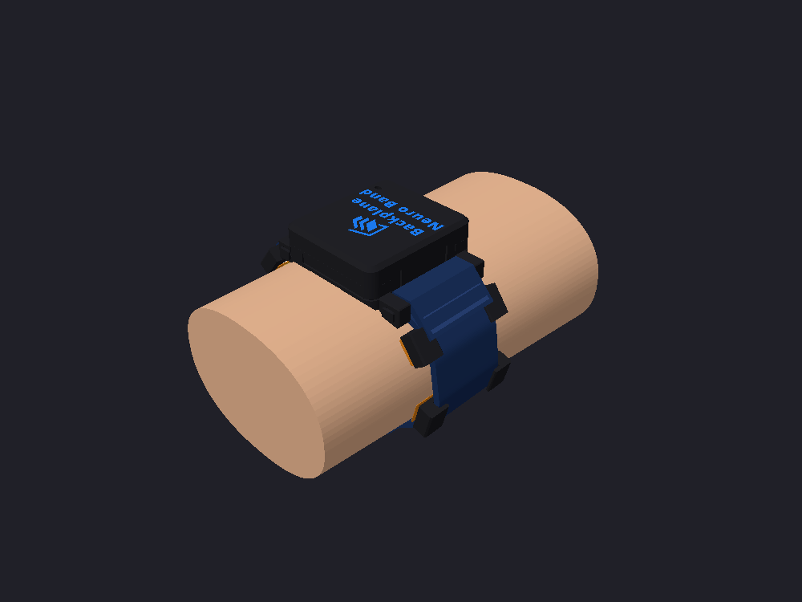
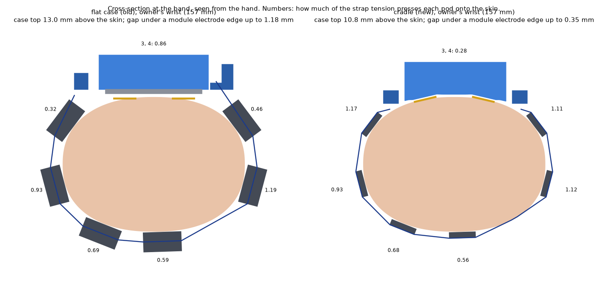
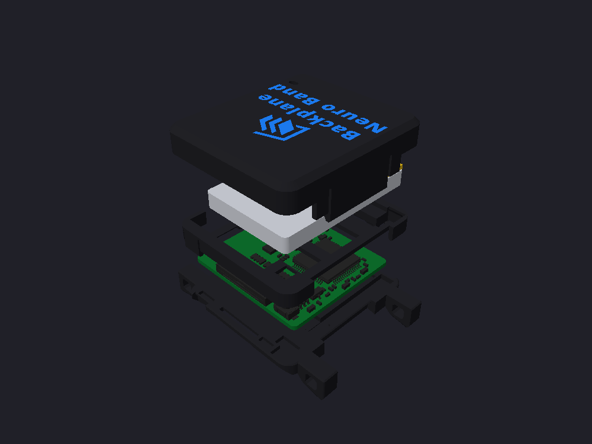
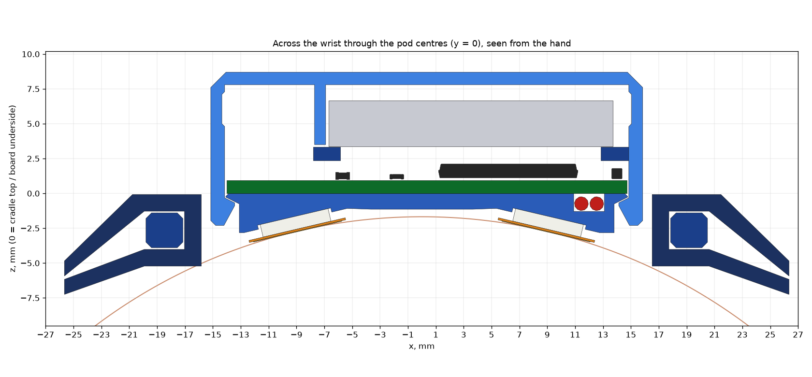
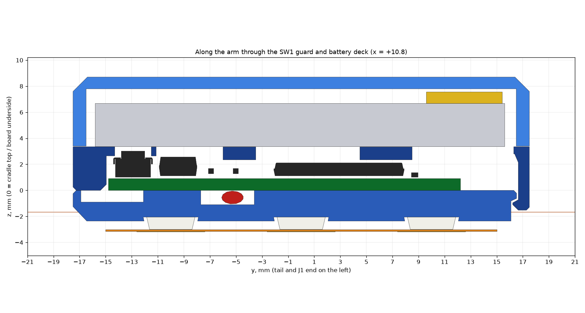
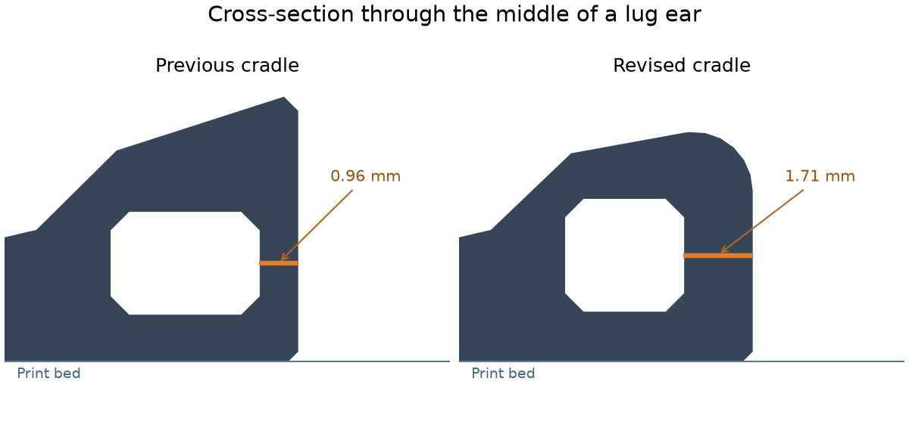

# neurband rev C housing: compact 35 mm module + 100% 3D-printed lug bars + zero-glue side-ear clip pods (2026-11-26)

Five printed wearable parts (`cradle` x1, `holder` x1, `lid` x1, `lug_bar` x2, `pod` x6) and one flat bonding jig (`bond_jig` x1), built around your fabricated boards, `302030` LiPo cell, **22 mm Tech-Protect Nylon Classic** two-piece buckle strap (the fenix 5/6/7/8 47 mm, QuickFit 22 version; measured 22 mm wide; QuickFit clips popped off to use its sewn nylon loops directly; piece lengths taken as `92 + 125 mm` from the shop page, not yet measured), and 5 mm punched `1.27 mm` foam dots. **Zero glue, zero metal pins/screws, zero TPU.**

| | |
|---|---|
| **Module footprint** | **31.0 mm** across the wrist × **35.0 mm** along the arm (**-6.4 mm shorter** and **-0.7 mm narrower** than the 31.7 × 41.4 mm buttoned case); **44.0 mm** over the lug ears |
| **Thickness** | **9.84 mm** at the centre; **10.2 to 10.8 mm** above skin on your **157 mm** wrist (vs 12.7 to 13.0 mm on the old flat case) |
| **Zero-metal lug bars** | Two **100 % 3D-printed slide-in cross-bars** (`lug_bar_x2.step`, `2.65 × 2.50 mm` octagonal shaft printed flat on bed along continuous grain, `-Y` external T-head + `+Y` pinch-release split snap-barb) pass straight through `cradle`'s stout lug ears (1.71 mm outboard wall at mid-ear and a 1.45 mm wrist-side tip radius) and the strap's sewn nylon loops. The lug ears are 22.50 mm apart. A centred 22 mm strap has 0.25 mm clearance per side. Use the matching 31.95 mm bars |
| **Strap & Side-Ear Clip Pods** | **Zero glue:** each `pod_x6.step` (`8.0 × 30.2 mm`) is only **`1.26 mm` thick** across its `17.4 mm` open centre and uses two low-profile `±Y` C-ear clips (`2.3 mm` hook over each strap edge, `0.30 mm` sliding clearance) so the `22 mm` strap **slides freely (~5.2 mm)** relative to the inelastic flex as the band curves from flat onto your **157 mm** wrist (`Pods 5–8` on the `92 mm` buckle half, `Pods 2 & 1` on the `125 mm` half, with the buckle hole selected on the physical strap) |
| **Board centering** | Flush snap-in **`holder`** collar keys into `cradle` (`4` asymmetric poka-yoke slots + `45°` lead-in funnel) to self-center and lock all 4 corners of the PCB (`±0.15 mm`) before battery & lid go on |
| **Buttonless & SW1-safe** | Flat black top with LED slit and flush blue inlay; `holder` forms a flat `Z = 3.35 mm` battery deck keeping the cell **`0.37 mm` clear above `SW1`'s cap** |
| **Printed parts** | `cradle` x1, `holder` x1, `lid` x1, `lug_bar` x2, `pod` x6, and tool `bond_jig` x1 |
| **Sources** | `params.py`, `module.py`, `band.py`, `fit.py`, `sections.py`, `export_to_print.py` |



## Why this rev works better

1. **35.0 mm compact length (-6.4 mm shorter along the arm) & 1.0 mm walls.** Removing external button access lets the `31.4 mm` `302030` LiPo slide forward directly over `J1` and `SW1` on a dedicated flat `Z = 3.35 mm` deck, shrinking the case from `31.7 × 41.4 mm` right down to **`31.0 × 35.0 mm`** while keeping `1.65 mm` antenna clearance.
2. **Board centering and holder retention.** The four keys locate the holder around the PCB. Press down at the two diagonally opposite end tabs until both catch under the cradle ledges. The holder stays seated while the battery is installed.
3. **Lid retention.** Two 15 mm spring wings carry 0.72 mm inward-facing hooks. The relief slots have rounded ends 4.60 mm above the cradle seam.
4. **Raised electrode seats.** The two 13.2° cradle facets project another 0.28 mm toward the wrist, with a blend back to the lug roots. Each loose pod has a 1.26 mm base. All 24 foam pockets are 5.4 mm in diameter and 0.30 mm deep. The unloaded flex-tail path is 8.40 mm of the available 8.50 mm. The fit model estimates the case load on the electrodes. Electrical contact still requires an on-wrist test.



## The parts



- **Cradle (`cradle.step`).** Flat top (`Z = 0`) prints on the bed; curved 13.2° wrist facets with 6 foam dimples, 1.14 mm reinforced centre web, wire trough, solder reliefs, 4 asymmetric holder key-slots, and 22.5 mm strap openings (3.70 mm bearing width per ear) print facing up with zero supports.
- **Board Holder & Battery Deck (`holder.step`).** Prints with the battery deck on the bed and removable black supports under its overhangs. Four asymmetric keys locate the holder, and two diagonal end tabs latch under the cradle ledges. The deck has two crossbars and wider side rails. Centres all 4 corners of the `28.7 × 27.0 mm` PCB (`±0.15 mm`), shields `SW1` inside an open window flanked by pillars down to bare FR4, encloses the flex-tail bend behind a solid front wall, and guides the battery leads up the `+X/+Y` corner.
- **Lid (`lid.step`).** Black buttonless tub printed flat top down. A separate blue logo and two-line label fill the first 0.32 mm. The lid is fitted with status-LED slit + light baffle over `D1`, antenna-side battery fence (`1.65 mm` gap), Y end-stops, `+Y` pry notch, and `±X` snap hooks inside the strap slots.
- **Slide-In Lug Bars (`lug_bar_x2.step`, ×2).** `2.65 × 2.50 mm` octagonal cross-bars printed flat on `Z = 0` so continuous filament strands run end-to-end. External `-Y` T-head stop + `+Y` pinch-release split snap-barb lock the strap's sewn nylon loops with zero metal hardware.
- **Open-Back Side-Ear Clip Pods (`pod_x6.step`, ×6).** Sleek `8.0 × 30.2 mm` clips (`1.26 mm` centre skin plate + two `±Y` C-ear hooks leaving a `17.4 mm` open back, sized for the 22 mm strap) with 3 foam-dot dimples and 2 jig alignment holes. Printed on their flat `X = -4.0 mm` side edge so continuous filament loops wrap around both C-ears (`≤ 45°` overhang, `0 mm` bridge).




## Print

The complete black-and-blue X2D plate is [neurband_22mm_complete_x2d.3mf](to_print/neurband_22mm_complete_x2d.3mf). The case-only plate is [reinforced_case_22mm_pla.3mf](to_print/reinforced_case_22mm_pla.3mf). It contains one cradle, holder and lid and two matched bars. All printable STEP files are supplied in bed orientation.

| File | Qty | Material | Settings |
|---|---|---|---|
| `cradle.step` | 1 | PETG / ABS / ASA / PC (PLA ok for fit test) | **0.12 mm layers**, 5 walls, 100 % infill |
| `holder.step` | 1 | PLA / PETG / ABS / ASA / PC | 0.12–0.16 mm layers, 3 walls |
| `lid.step` | 1 | PETG / ABS / ASA / PC (PLA ok for fit test) | 0.12–0.20 mm layers, 3 walls |
| `lug_bar_x2.step` | 2 | PETG / ABS / ASA / PC (PLA ok for fit test) | **0.12–0.16 mm layers**, 4 walls / 100 % infill |
| `pod_x6.step` | 6 | PETG / ABS / ASA / PC (PLA ok for fit test) | 0.12–0.16 mm layers, 3 walls (optional 3 mm brim) |
| `bond_jig.step` | 1 | PLA | 0.20 mm layers |

## Assemble

Follow the [illustrated assembly guide](../../docs/build/assembly.md) for the dry fit, one-jig bonding sequence, J1 connection, holder latches, battery, lid and strap.



## Rebuild

```bash
python3 mech/rev_c/fit.py
unset DISPLAY WAYLAND_DISPLAY
for f in module band sections jig_adapters export_to_print; do QT_QPA_PLATFORMTHEME="" QT_QPA_PLATFORM=offscreen timeout 300 /usr/bin/freecad mech/rev_c/$f.py; done
python3 mech/rev_c/sections.py
python3 render/rev_c_views.py
```
