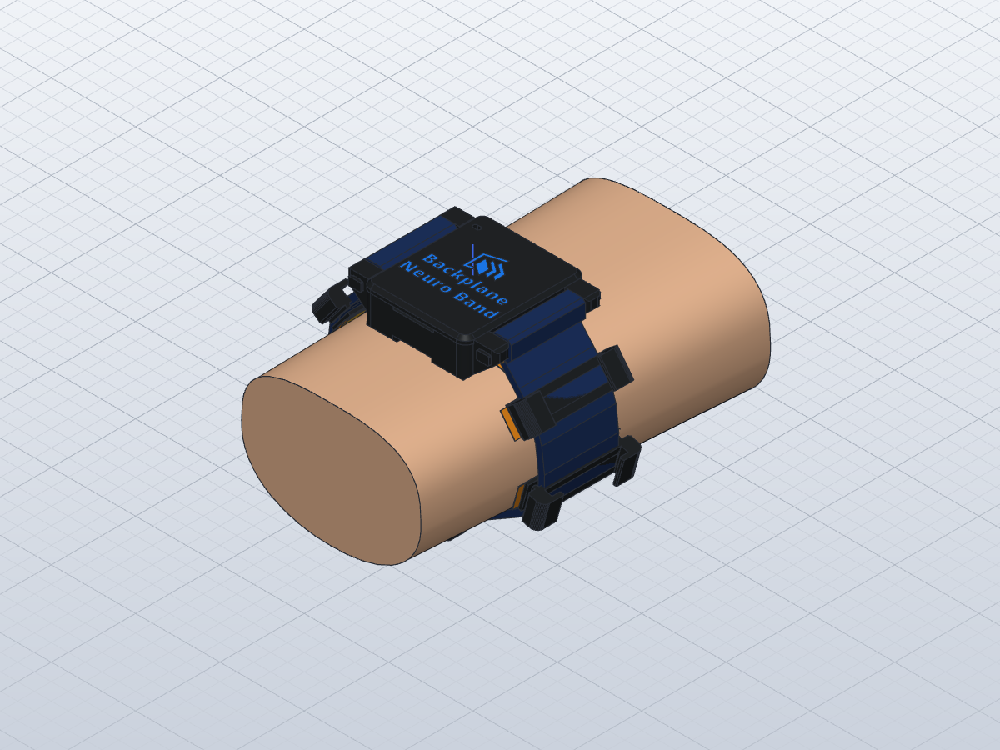
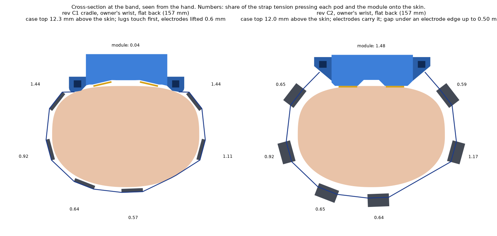
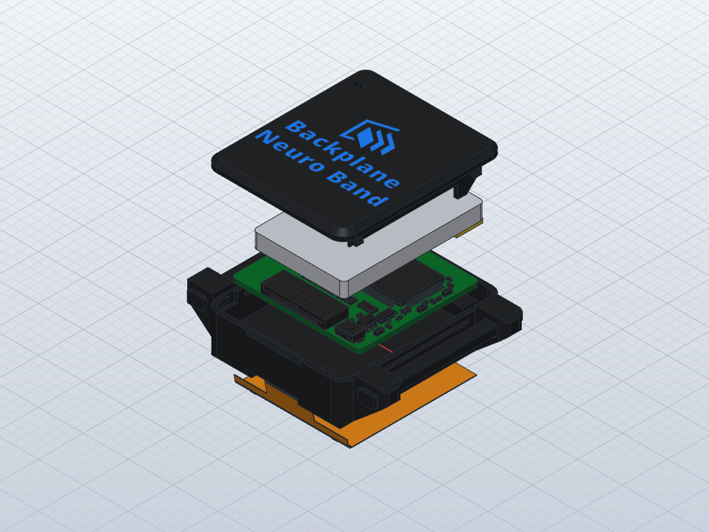
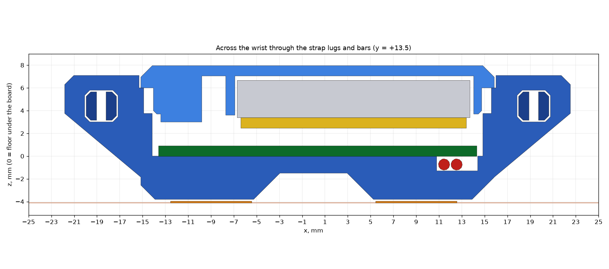
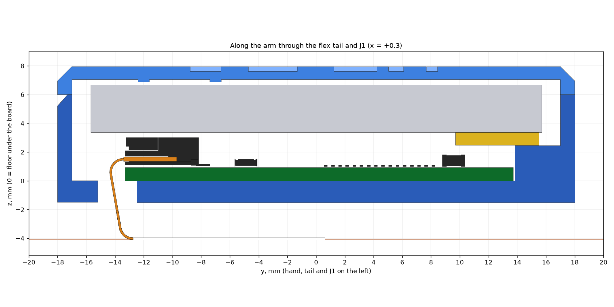
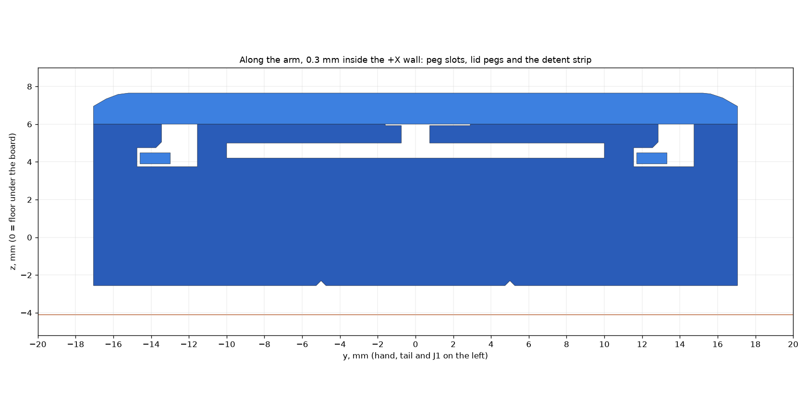
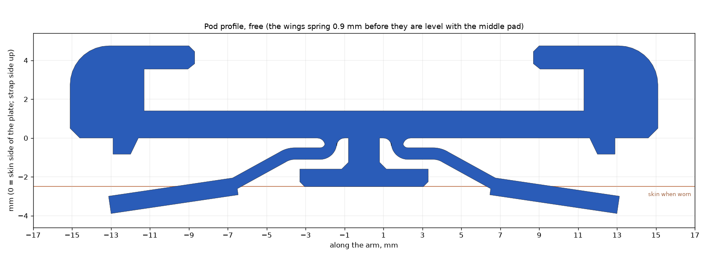
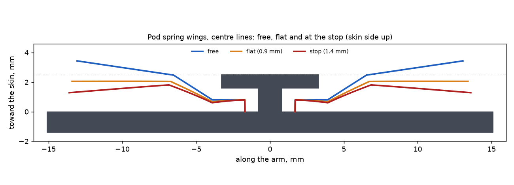

# neurband rev C housing, mechanical revision 2 (2026-11-28)

Two printed case parts (`tub`, `lid`), two printed strap bars and six pods, for the fabricated rev C board,
the eight-paddle flex, the 302030 cell and the 22 mm two-piece nylon strap. No foam, no glue, no screws:
thin double-sided tape holds the flex (the built band uses Kafuty 8 mm double-sided thermal tape). The strap
is the Tech-Protect Nylon Classic, QuickFit 22, with its clips removed; it fits wrists up to about 160 mm round, and a bigger wrist needs a longer 22 mm two-piece strap. The first set was printed on
2026-11-28 and is worn with the case on the underside of the wrist; what is still only checked in CAD is
listed under [Not verified](#not-verified).



## What changed from rev C1, and why

| Rev C1, as worn | Rev C2 |
|---|---|
| Foam dots under every electrode: fiddly to cut and place, and too little travel | **Pods with two spring wings and a rigid middle pad.** The two signal electrodes (P, N) sit on 0.6 mm blades that stand 0.9 mm proud and give about 2 N each when level; the middle pad carries the shared bias electrode and stops the wings at level. One strip of tape per pod |
| Wrist side of the case curved, lugs drooping below it: on a flat wrist the lugs landed first | **Flat wrist side.** Six flat pads on two runners, 2.3 mm below the floor; the lugs are 3 mm or more above the skin on every wrist in `fit.py` |
| Strap bars 2.65 mm *below* the board, far out: the strap left level, pushed the case down with 4 % of its tension and gave its stiff sewn end 4.5 mm before the first pod | **Bars at mid height of the case**, 8.2 mm above the pad plane: the strap leaves at about 50°, pushes the case down with about 1.5 x its tension (both sides together) and has about 10 mm before the first pod |
| Three parts (cradle, holder, lid) held by spring wings: flexed and came apart | **Two parts.** The tub is the whole structure: floor, walls, lugs, board stops and battery shelves in one piece, so the strap never loads a joint. The lid is only a cover: it goes on 1.3 mm off, slides toward the hand and clicks, held by four pegs under ledges behind the lugs |
| Floor 0.86 to 1.14 mm | Floor 1.5 mm, 3.8 mm over the runners |

The numbers come from `fit.py` (wrist sections) and `springs.py` (the wing as a beam model); both write
their results into `logs/`.



## The parts

| File | Qty | What it is |
|---|---|---|
| `tub.step` | 1 | 31.0 x 36.0 mm body, 44.4 mm over the lugs. Prints upright, standing on its six pads, without supports |
| `lid.step` | 1 | Flat cap, 1.95 mm tall outside, with the blue logo and text as a second body in the first 0.32 mm (a plain lid is in the one-filament plate). Prints top down |
| `lug_bar.step` | 2 | 2.65 x 2.5 mm bar, 33.5 mm long, head at one end and a split snap barb at the other. Prints flat. The rev C1 bars are 1.6 mm too short for these lugs |
| `pod.step` | 6 | 8.0 x 30.2 mm, 8.6 mm tall free and 7.25 mm when worn. Prints on its side |
| `bond_tray.step` | 1 | Tool: flat tray with pins for the flex and posts for the tub and pods |

The module is 11.75 mm from the pad plane to the top (rev C1: 9.84 mm plus its foam). The 2.3 mm of pads and
the thicker floor add 2.7 mm; a lower roof takes 0.75 mm back, because the cell now lies with its protection
board over the low shelf whichever way up it is. The body is 1 mm longer, for a 32 mm cell.



### Tub



- **Wrist side.** Two runners, 8.65 mm wide, with three pads each, separated by V grooves. A tunnel between
  them, so only the runners touch. A 45° bevel from the runners up to the walls. All of it prints from the
  bed up; the tunnel roof is a 5.9 mm bridge.
- **Lugs.** Four, 4.5 mm wide (rev C1: 3.7), with 1.75 mm of closed end beyond the bar and 1.15 mm below it.
  Their undersides rise at 50° from the wall, so the load from the bar goes into a solid wedge printed as
  one piece with the wall.
- **Inside.** The board drops between the long walls and four stop faces (0.15 mm play), and its J1 edge
  tucks under two wedge lips. Shelf A at the hand end holds the cell 0.34 mm above the SW1 cap; shelf B at
  the elbow end is 0.9 mm lower, under the protection board. Both shelves have an end stop: the cell bay is
  32.1 mm long. The battery leads run in a trough under the board to a bay behind it; pockets clear the
  solder on J2, J3 and the SWD pads. Charge leads from J3 can come up through a slot in shelf A.
- **Flex tail.** The fabricated tail is the limit on how far the pads can stand off: its free length has
  to reach from the pad plane up into J1. The board therefore sits 1.5 mm further toward the elbow than in
  rev C1, the flex leaves the pad plane 0.5 mm inside the edge of the last electrodes, and the paddle ends
  beyond that line lift with the tail into a pocket. The tail then needs 6.6 mm of the 7.05 mm it has
  (6.7 mm with 0.25 mm tape). 2.3 mm of standoff is what that allows with a 1.5 mm floor.



### Lid



A lip runs inside each long wall and carries two pegs. The pegs drop into slots behind the lugs and
slide 1.3 mm under a ledge of wall. Peg tops and ledge undersides are 45° faces, so neither part has an
unsupported overhang where they meet, and the entry edge of each ledge has a lead-in. The closed lid can
lift 0.25 mm before the pegs meet the ledges; that is the play to tune after the first print.

A bump on each lip sits in a dimple of a wall strip; a slit under the strip makes it a spring, bending in
the plane of its layers, and the lip covers the slit from inside. The strip is relaxed when the lid is
closed, so it does not creep. To open, put a thumbnail in the notch at the hand end and push the lid
toward the elbow, then lift. The lid also carries a fence that keeps the cell 1.65 mm off the antenna, two
ribs over the cell, two gusseted feet that hold the board down and the LED slit with its baffle.

### Pod




| | Free | Level with the middle pad | At the stop |
|---|---|---|---|
| Travel at the pad centre | 0 | 0.9 mm | 1.4 mm |
| Force per electrode | 0 | 1.8 N | 2.9 N |
| Surface strain in the blade | 0 | 0.95 % | 1.5 % |

A 5 N strap tension on a 157 mm wrist gives 3.6 N per pod, which brings both wings just about level. A bump
under each tip is the hard stop, so a wing cannot be bent further than 1.5 % strain. The blade is one 0.6 mm
bead per layer, running its whole length, because the pod prints on its side. A wing leans 8° toward the
skin when free and is flat when level, and its pad moves 0.27 mm outward on the way: the flex is therefore
taped on with the wings pressed level, which leaves it slack in every other state. The middle pad is taped
to the flex first and the wings afterwards; the [assembly guide](../../docs/build/assembly.md#tape-the-flex-on)
explains why.

The two outer corners of the strap clip are rounded to 2 mm.

## Print

Two Bambu Studio projects for the X2D with a 0.4 mm nozzle, PLA Matte, 0.12 mm layers, no supports, every
part already oriented. The single STEP files in `to_print/` lie the same way.

| Project | What is on the plate | Slices to |
|---|---|---|
| [to_print/neurband_c2_x2d.3mf](to_print/neurband_c2_x2d.3mf) | Tub, lid with the blue logo and text as filament 2, two bars, six pods | 1 h 44 min, 15.2 g black, 0.2 g blue |
| [to_print/neurband_c2_x2d_plain.3mf](to_print/neurband_c2_x2d_plain.3mf) | The same with a plain lid, everything on filament 1 and the main nozzle, plus the bonding tray | 2 h 41 min, 34.8 g |

| Part | Settings in the plate |
|---|---|
| Tub | 5 walls, 100 % infill in straight lines |
| Lid | defaults; in the two-colour project the inlay body is filament 2 |
| Bars | 4 walls, 100 % infill in straight lines |
| Pods | 3 walls, **no brim**: a brim fills the 0.5 mm gaps under the wings. Keep the Arachne wall generator: it prints each 0.6 mm blade as one bead |
| Tray | defaults. On its own, `bond_tray.step` can print at 0.2 mm layers |

The slicer reports "floating cantilever" on the tub. That is the strip of wall over each detent slit, a
20 mm bridge printed slowly with full cooling; it needs no support.

## Assemble

Follow the [assembly guide](../../docs/build/assembly.md).

## Not verified

- Clearances are 0.10 to 0.25 mm; if the lid is tight or loose,
  change `LEDGE_CLR` in `case.py` (pegs under the ledges) or `DETENT_BUMP` in `params.py` (click force).
- Each wing starts on the bed as a single line of plastic, without a brim. If one lifts on the first
  layer, that pod is the one to reprint.
- The wing numbers are from a linear beam model with E = 3.3 GPa. Printed PLA varies by about ±15 %.
  PLA also creeps: after long wear the wings will stand a little less proud. PETG is softer by a third and
  creeps more at room temperature; PLA is the better choice here unless the band is left in a hot car.
- The stiff sewn end of the strap is taken as 9 mm long. It has 9.6 to 10.0 mm on the flat-backed wrist
  model. If yours is longer, pods 2 and 5 will still ride on it.
- The wrist models are a superellipse fitted to a 157 mm circumference, not a scan, and they put the case
  on the back of the wrist. The owner now wears it on the underside (palm side); that case is not modelled.
- The cell is modelled 20.4 x 31.4 x 3.3 mm with a 0.9 mm bump over its last 6 mm. The bay takes up to 32.1 mm.
- The tail budget assumes tape of 0.15 to 0.25 mm under the flex. Foam tape will not fit. The tub sits
  between its tray posts with ±0.2 mm of play along the arm and the tail has 0.44 mm to spare, which is
  why the guide says to slide the tub toward the elbow before pressing it on.

## Sources and rebuild

`params.py` every dimension, `springs.py` wing model, `fit.py` wrist fit, `pod.py`, `case.py` (tub, lid,
bar, with the board model, the cell and the tail for clash checks), `tray.py`, `band.py` (band on the wrist),
`sections.py`, `export_to_print.py`, `make_plate.py`.

```bash
python3 mech/rev_c2/springs.py
python3 mech/rev_c2/fit.py
unset DISPLAY WAYLAND_DISPLAY
for f in pod case tray band sections export_to_print make_plate; do QT_QPA_PLATFORMTHEME="" QT_QPA_PLATFORM=offscreen timeout 600 /usr/bin/freecad mech/rev_c2/$f.py; done
python3 mech/rev_c2/sections.py
```
